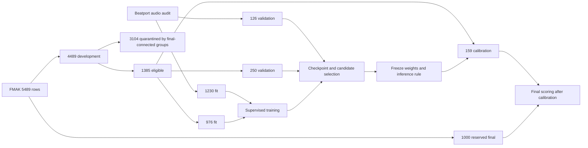

# Drone training: pipeline, experiments, results and lessons

## What this document covers

This is the technical record of the small-model research completed on 11 November
2026: how data became training examples, how candidates were selected, what the
experiments established, and how to reproduce the workflow. It is intended for
someone maintaining Drone or integrating a future validated model into Euphoria.
The [results report](../experiments/RESULTS-2026-11-11.md) contains the detailed
measurements; the protocols linked below record decisions made before each stage.

The completed research snapshot is [PR #3](https://github.com/lvndry/drone/pull/3),
targeting `main` after the K10 merge. The subsequent DSP-guided pilot completed
and failed its development gate; the later update below records it. The separate [K10 architecture PR #2](https://github.com/lvndry/drone/pull/2)
has not been measured under this protocol. Its architecture and published-paper
results must not be substituted for the measurements here.

Subsequent evidence from that separate K10 run is now available: seed 13 scored
**74.83% symmetric-fifth MIREX / 68.54% exact** on the 604 GiantSteps recordings,
versus native Euphoria's 69.35% / 60.60%. The subsequent three-seed K10 mean is
**73.58% MIREX**; its weights shipped through [PR #4](https://github.com/lvndry/drone/pull/4).
This is a stronger observed point estimate
than this document's octave candidate. It is a Beatport-only recipe, not a
controlled comparison on the fixed joint Beatport/FMAK training split below;
confirmation, split auditing and broader-domain evidence remain necessary.
GiantSteps was already exposed at the program level, so this is not a fresh final
test. The artifact is `~/drone-experiments/k10-arch-giantsteps.json` on lysk-server;
its checkpoint SHA-256 is
`ea74ec9604738e1e63fd10e334fda8be2d3a3b8e71422fb473ffde0f6bab2b33`.
The matching run, `~/key-cnn/data/runs/w1.0-seed13-20261111-185528-lr7fvv4k/run.json`,
records 298.47 seconds, best epoch 39, AdamW LR 0.001, decay 0.0001, batch 32,
no label smoothing and a 120-epoch horizon. These are measured run facts, not
evidence that the published paper's full protocol or result has been reproduced.

## Product goal and current decision

Drone estimates a recording's musical key: one of 12 tonics in major or minor mode.
Euphoria needs accurate harmonic-mixing information while remaining a responsive
desktop application. The intended default runs on CPU, does bounded background
work, and reuses results for unchanged audio. Accuracy comes first; optimizing a
validated candidate for Rust and measuring actual application cost comes afterward.

The small model is the product target. Medium and large model profiles are research
controls, not a commitment to ship three tiers. A larger candidate must earn its
cost through measured accuracy gains. Additional song attributes are deferred;
they are not auxiliary training targets in these experiments.

This research tranche selected a candidate with **47,284 parameters** and observed final MIREX
scores of **68.99% on FMAK** and **70.40% on GiantSteps**, versus native Euphoria's
67.82% and 69.35%. Both paired confidence intervals include zero. These results
justify more research, **not a state-of-the-art claim or replacement of the default
detector**. The model is not yet integrated into Euphoria, and the ordinary Drone
predictor intentionally rejects this experimental checkpoint format.

Production now uses K10. The earlier 33-band baseline, checkpoints, preparation and
training helpers live in `experiments/reference/` to reproduce this research
without reverting the production CQT contract. Use
`uv run python -m experiments.reference.train` for that baseline, not the
production `train.py`. Historical source hashes and original server artifacts
remain unchanged; rerunning relocated code records new hashes. The package is
research-only and is excluded from the production wheel.

## Data, labels and provenance

Training uses annotated audio, not labels inferred by another DJ application.
Audio identity is a SHA-256 of file contents. A dataset's numeric track ID is not
sufficient to identify audio across corpora or caches.

| Source | Role and size | Provenance and checks |
|---|---|---|
| Beatport | Original supervised source; 1,230 unique fitting recordings and 126 validation recordings after repair | Original cache had 1,363 rows and seven identical-audio pairs; two pairs crossed the original split. No conflicting labels were found. |
| FMAKv2 | 5,489 annotated recordings, 5,442 unique audio hashes | Official [annotations, Zenodo 12759100](https://zenodo.org/records/12759100), `fmakv2.csv` MD5 `3b2d16784ffbda850c8ddf0519478bfd`; audio from [Zenodo 10719860](https://zenodo.org/records/10719860). |
| FMA metadata | Primary artist and album identifiers for all FMAK rows | Official metadata archive linked by [mdeff/fma](https://github.com/mdeff/fma); archive SHA-1 `f0df49ffe5f2a6008d7dc83c6915b31835dfe733`. |
| GiantSteps | 604 external evaluation recordings | Used for the first frozen legacy-model comparison; consequently exposed to the research program before the final octave comparison. |
| Private listening library | Future runtime testing and manual review only | No trusted reference labels; excluded from fitting, selection, calibration and reported accuracy. |

FMAK preparation verifies upstream archive checksums, ZIP extraction CRCs, and each
extracted audio hash. The ten audio archives total approximately 39.3 GB. Verified
archives can be removed after extraction; audio and identity manifests remain.
There was no exact-audio overlap with Beatport. Checksums establish what was used,
not permission to redistribute it: obtain source datasets under their own terms.
Raw audio, feature arrays and checkpoints are not repository source artifacts.

FMAK download/preparation took 54.73 minutes, including 10.74 minutes of legacy
feature extraction using four workers. These are separate from model-training
times. Preparation preserved at least 50 GiB of disk headroom, with 60 GiB checked
before feature extraction.

## Preventing leakage

The original random split was unsafe because identical recordings could occur in
both fitting and validation. The repaired Beatport split preserves the 126
validation identities, removes their duplicate fitting copies, and deduplicates
the remaining fitting audio. This yields 1,230/126 rows. The earlier baseline's
42.9% validation MIREX is historical evidence from the old split, not the clean
control for the experiments below.

FMAK partitioning happened before any model was scored on it:

1. Remove any exact-audio overlap with Beatport, then group equal audio hashes.
2. Sort groups by the hash of `drone-fmak-holdout-v1:<audio-sha256>`, independently
   of labels and model predictions.
3. Assign whole groups until the final partition contains exactly 1,000 rows,
   skipping groups that would exceed the quota. Freeze the identities and hashes.
4. Keep the other 4,489 rows as development data.

The first frozen Beatport-trained models were diagnosed on all 4,489 development
rows. Before fitting a joint-data model, a stricter split joined recordings into
connected components whenever they shared an exact audio hash, primary artist ID,
or positive album ID. Development components connected to the final partition
were quarantined. That removed 3,104 development rows and left 1,385 eligible rows.
No row lacked the required primary-artist metadata.

The eligible components were hashed with
`fmak-artist-album-audio-purged-70-20-10-hash-v1:<component>` and assigned by hash
range: 70% fitting, 20% validation, 10% calibration. Whole-component assignment
produced these actual counts:

| Role | Beatport | FMAK | Combined |
|---|---:|---:|---:|
| Fitting | 1,230 | 976 | 2,206 |
| Validation | 126 | 250 | 376 |
| Calibration | — | 159 | 159 |
| Final evaluation | — | 1,000 | 1,000 |

Fitting rows are also deduplicated by exact audio, and conflicting labels for the
same audio are rejected. Namespaced identities prevent a Beatport ID from being
confused with a numerically identical FMAK ID.



Each role answers a different question: fitting changes weights; validation chooses
checkpoints and candidates; calibration adjusts confidence after those choices;
final evaluation estimates performance after freezing the system.

There are two exposure caveats. The 159 calibration rows had already appeared in
the initial whole-development diagnosis before roles were assigned. They were not
used to fit or select the adapted or octave networks, but are not historically
pristine. The final 1,000 were reserved before that diagnosis and held out through
selection; **they have now been scored and are exposed**. Future research must not
reuse them as an untouched final test.

Exact hashes and primary artist/album metadata do not detect all remasters,
near-duplicates, covers, collaborations or remixes. Beatport lacks the matching
artist/album metadata used for FMAK purging. These are limits on independence, not
proof that every surviving recording is unrelated.

## Key encoding and pitch augmentation

[drone/keys.py](../drone/keys.py) defines the shared label contract:

```text
tonic: C=0, C#=1, D=2, ... B=11
mode: major=0, minor=1
class_id = tonic * 2 + mode

C major -> 0       C minor -> 1
A major -> 18      A minor -> 19
```

Enharmonic flats are normalized into this tonic indexing. A transposition of `s`
semitones changes the tonic and preserves mode:

```python
transposed = ((class_id // 2 + s) % 12) * 2 + class_id % 2
```

For example, shifting C minor upward by two semitones must produce D minor. The
feature operation and target operation must use the **same sampled shift**.

The repaired legacy augmentation samples the twelve integer shifts in `[-6, 6)`.
Absolute-frequency features shift within their finite frequency range; bins that
leave the range are discarded and newly exposed bins are floor-padded. They do
not wrap the top frequency into the bottom as if the axis were a chroma circle.

Octave-model augmentation instead crops a wider CQT. Moving the crop start up by
one bin changes the pitch relative to the model's coordinate system downward by
one semitone, so its target is transposed by **minus the crop offset**. This sign
differs from shifting an existing feature image upward; tests protect the contract.

## From the repaired baseline to controlled experiments

Before comparing architectures, the reference implementation needed corrections:

| Problem | Correction and consequence |
|---|---|
| Frequency mapping omitted the semitone factor | Use `round(12 * log2(frequency / 55))`; an octave spans twelve bins. |
| Time resizing flattened frequency and time together | Interpolate each frequency band independently, preserving pitch structure. |
| Augmentation targets used a dataset-row index | Derive the target from the actual randomly sampled feature transposition. |
| Training, decoding and scoring disagreed on class order | Use the interleaved tonic/mode encoding everywhere. |
| Cache keys could alias files sharing a track ID | Include full audio SHA-256 and a versioned feature specification. |
| Missing or incompatible weights could produce misleading inference | Validate checkpoint format, feature contract and labels; fail with a useful error. Reuse a loaded predictor instance. |
| Dependency and verification setup was difficult to reproduce | Move to `pyproject.toml`, `uv.lock`, Python 3.12, CI and explicit export/parity checks. |

The legacy feature contract is version 2 in
[experiments/reference/features.py](../experiments/reference/features.py): mono 22,050 Hz, 4,096-sample Hann FFT,
512-sample hop, 33 semitone bands starting at 55 Hz (A1 through F4), then 300 time
positions. It groups STFT energy into logarithmic frequency bands; despite the
historical `build_cqt` function name, this is **not a true constant-Q transform**.
Compression uses `log1p(10 * bands / max(percentile99, 1e-9))`, followed by
per-track standardization. Silent or nearly constant inputs produce zeros.

The original convolutional control globally pools frequency and time before its
classifier: 331,704 parameters. A frequency-preserving head retains six frequency
positions while pooling time: 347,064 parameters. Keeping some absolute pitch
location is a plausible key-classification bias; whether it helps is established
by the controlled comparison, not by parameter count alone.

The [small-model protocol](../experiments/README.md) fixed eight recipes before
screening: control, control without augmentation, frequency head, frequency head
without augmentation, without smoothing, with dropout 0.1, with learning rate
`3e-4`, and a mode-balanced control. All used the repaired split. The default recipe
was AdamW, learning rate `1e-3`, weight decay `1e-4`, smoothing 0.1, dropout 0.3,
cosine scheduling, batch 64, 120 epochs and 16 CPU threads. A 48-example fitting-only
overfit check reached 100% for both architectures; this checks learnability and
label plumbing, not generalization.

Screening used seed 13. The control and at most two challengers beating its
validation MIREX by two percentage points advanced to seeds 13, 37 and 73. The
canonical artifact was fixed as seed 13, rather than choosing whichever seed scored
best. Across 17 runs, training/evaluation took 20.79 minutes of wall time, with
typical 120-epoch runs taking 63–79 seconds. The per-run cap was 300 seconds.

| Confirmed recipe | Beatport validation MIREX, mean ± sample SD |
|---|---:|
| Global-pooling control | 40.45 ± 1.40% |
| Frequency head, dropout 0.1 | 59.68 ± 2.83% |
| Frequency head, learning rate `3e-4` | **61.75 ± 1.73%** |

The frequency-head/lower-learning-rate recipe won. Its frozen GiantSteps MIREX
was 61.13%, far above the repaired control's 38.81%, but below native Euphoria's
69.35%. On the 4,489 FMAK development rows it scored 52.68%, versus native 66.87%.
The paired FMAK difference was −14.19 points, with a 95% interval of
[−15.56, −12.65]. This was a clear generalization failure despite a large local
validation improvement. The candidate also overpredicted minor mode: 3,012 minor
predictions versus 2,176 minor references. That motivated data adaptation before
inventing larger model tiers.

## Joint-data adaptation

The [adaptation protocol](../experiments/ADAPTATION_PROTOCOL.md) kept the winning
347,064-parameter architecture and recipe fixed, trained from scratch on the
2,206 fitting rows, and selected checkpoints on the 376 validation rows. Combined
MIREX weights recordings equally, so the 250 FMAK rows contribute more than the
126 Beatport rows; it is not a 50/50 domain average.

The seed-13 pilot completed 120 epochs in 146.44 seconds. On the same 250 FMAK
validation rows, MIREX rose from 56.00% for the frozen Beatport-only candidate to
63.96%. Beatport validation rose from 60.56% to 61.43%. This passed the predeclared
gate: at least two points gained on FMAK and no more than two points lost on
Beatport. Only then did the fixed recipe advance to three-seed confirmation.

Confirmation took 8.45 minutes. Beatport MIREX averaged 61.64 ± 0.97%; FMAK averaged
62.64 ± 1.15%. Repeated seed 13 reproduced its CPU history and predictions exactly.
The comparison reference was one previously frozen seed-13 artifact, not a new
three-seed paired control. Native references on these exact validation rows were
65.16% and 66.76%, respectively. Adaptation helped, but still trailed native.
No adapted-model GiantSteps score was used to guide the next architecture.

## The octave-aware CQT candidate

The next [predeclared pilot](../experiments/OCTAVE_PROTOCOL.md) changed the pitch
representation and architectural bias together. It is an independently trained,
**supervised**, S-KEY/ChromaNet-inspired candidate. It does not reproduce S-KEY's
self-supervised objectives, use its large unlabeled corpus, or load pretrained
weights. The [S-KEY implementation](https://github.com/deezer/skey) and
[paper](https://arxiv.org/abs/2501.12907) informed the design. Its source and its
published weights have distinct licensing terms; no published weights were used.

**Frontend.** Decode two 32-second mono segments per recording, centered at 25%
and 75% of duration and clamped to valid bounds. Pad short audio. Each segment is
705,600 samples at 22,050 Hz. nnAudio 0.3.4 VQT with `gamma=0` supplies a true CQT:
minimum frequency 27.5 Hz, 99 bins, twelve bins per octave, hop 512. The stored
shape is `2 × 99 × 1379` per recording. Convert amplitude relative to each segment's
peak into decibels, clip to [−80, 0] dB and map to [0, 1]. A peak at or below
`1e-8` produces zeros.

**Sampling.** During fitting, choose one of the two segments and a uniform crop
start from 0 through 15, retaining 84 frequency bins. Transpose the target by minus
the crop offset. During validation/inference, fix crop start 12 and average the
two segment probability distributions. This inference rule is frozen with the
model; switching to full-track aggregation would be another experiment.

**Backbone.** [OctaveNet](../experiments/octave_model.py) retains the frequency
axis while downsampling time. Seven stages have channels `2/3/40/40/30/10/3`,
temporal convolutions of shape `(1, 2)` and stride `(1, 2)`, layer normalization
and GELU. Depthwise ConvNeXt-style blocks use kernels `7/7/7/7/7/5/5`, replicate
padding, pointwise expansion by four and contraction, layer scale 0.1 and training
drop-path 0.1. The final 84 positions become seven octaves × twelve pitch classes.
Mean pooling across octaves and time preserves the twelve pitch classes; a 1×1
head produces two modes. Non-affine batch normalization and the explicit A-based
to C-based pitch roll produce the canonical 24-class logits.

This gives 47,284 learned parameters, or 189,136 FP32 parameter bytes. The selected
checkpoint occupies 436,217 bytes including buffers and metadata. Neither number
includes frontend work, intermediate activations, runtime libraries or decoding.

The entire pilot is one candidate: frontend, segments, architecture and batch size
changed together. Its gains cannot be attributed separately to octave pooling,
CQT bandwidth or any individual block without ablations.

## Optimization, regularization and checkpoint selection

Octave fitting uses FP32 on GPU 0, AdamW learning rate `3e-4`, weight decay `1e-4`,
label smoothing 0.1, batch 16 and cosine scheduling for at most 120 epochs. Stop
after 25 epochs without a new best combined-validation symmetric MIREX score.
Strict improvement selects `best.pt`; ties keep the earlier epoch. Weight decay,
smoothed labels, crop transposition and drop-path discourage overfitting in
different ways, but their individual contributions were not measured here.

The supervised objective is 24-class cross-entropy. With smoothing 0.1, the target
distribution is 90% one-hot plus 10% uniform over the 24 classes. This reduces the
pressure to become arbitrarily confident in a single annotation. AdamW updates
weights from that loss; the cosine schedule reduces the learning rate over the
planned training horizon. MIREX is a validation selection criterion, not the
differentiable loss being optimized. No pseudo-labels, self-supervised pretraining,
teacher distillation or foundation-model embedding targets are used in this run.

The pilot stopped at epoch 66, retaining epoch 41, in 432.39 seconds. Beatport
validation MIREX was 72.94%; FMAK was 68.76%: +11.51 and +4.80 points against the
fixed adapted seed-13 reference. It passed the same two-point FMAK/no-large-Beatport-loss
gate. Feature preparation took another 136.6 seconds and produced about 2.82 GB
for the 2,582 fitting/validation rows.

Confirmation repeated the identical recipe at seeds 13, 37 and 73 in 19.46 minutes:

| Domain | Validation MIREX mean ± sample SD | Exact accuracy mean |
|---|---:|---:|
| Beatport, 126 rows | 72.57 ± 0.64% | 65.08% |
| FMAK, 250 rows | 68.36 ± 0.47% | 59.73% |

One optional ensemble was declared before inspecting the additional seeds: equal
probability averaging of all three models. It could replace canonical seed 13 only
with at least one point gained on combined validation and no domain loss greater
than half a point. It achieved 70.37% versus 70.16%, a 0.21-point gain, and did not
meet the predeclared improvement threshold. The selected artifact remained seed 13.

Eligibility for final evaluation required both the confirmation mean and selected
candidate to meet the matched native validation references in both domains. This
gate passed. It authorizes a frozen evaluation; it is not a product-release gate.

## Reproducibility and recovery

Each run records source/configuration identities, dependency lock identity, feature
and label specifications, data and split fingerprints, seed, device/thread counts,
epoch history, elapsed time, checkpoint identities and completion status.
[snapshot_sources](../experiments/small.py) captures the training entry point,
`pyproject.toml`, `uv.lock`, and relevant Drone/experiment modules. Reusing an
output directory with different captured source is rejected. Completed results
with incompatible source/configuration/data identities require a new experiment
directory rather than overwriting a reference.

`last.pt` supports epoch-boundary recovery: model, optimizer, scheduler, RNG state,
current epoch, best score and experiment identity travel together. CPU runs save
Torch and NumPy RNG state; CUDA runs also save CUDA RNG state. Work interrupted
inside an epoch is replayed from the previous boundary. JSON progress and recovery
checkpoints use pending-file replacement; this is not a claim that every artifact
write, including every best-checkpoint save, is transactional.

The legacy CPU repeat was bitwise reproducible for history and predictions. The
repeated octave CUDA seed 13 retained the same best epoch and final predictions,
but its history was not bitwise identical: maximum loss difference was
`9.66e-8`, with 21 per-epoch score differences. Matching seeds is not a promise of
bitwise equality across GPUs, kernels or library versions. Preserve versions and
compare selected predictions and metrics as well as raw numeric histories.

The server environment recorded Python 3.12.3, Torch `2.15.0+cu132`, NumPy 2.5.4,
nnAudio 0.3.4 and SciPy 1.18.1. Optional research packages lived in an isolated
task-local directory, outside serving environments. A small real CUDA
forward/backward smoke test preceded the expensive stage. Do not assume that a
fresh default installation has the same CUDA build or GPU support.

Checkpoint feature contracts matter as much as tensor shapes. Legacy format 1
expects version-2 legacy features. The octave format is
`octave-supervised-pilot-v1` with its own exact frontend and labels. The existing
production loader must reject it instead of silently interpreting CQT arrays as
the old representation.

## Calibration and frozen evaluation

The [final protocol](../experiments/FINAL_EVALUATION_PROTOCOL.md) fixed selected
weights, inference rule, data identities and evaluation rules before calibration.
A positive temperature was then fitted on the 159 calibration rows by
minimizing NLL over 401 logarithmically spaced values from 0.25 to 4. The selected
temperature was `0.7371346086455506`. If `p` is the already averaged segment
probability, calibration computes:

```text
calibrated_probability = softmax(log(max(p, 1e-12)) / temperature)
```

Positive temperature preserves the predicted class, checked explicitly. It
changes confidence, not exact accuracy or MIREX. On the calibration fitting rows,
NLL changed 1.615→1.531, Brier 0.610→0.575 and ECE 0.1668→0.1019. These are fitting
metrics, not independent evidence of calibration quality.

The complete freeze packet, including the fitted temperature, was written at
`2026-11-11T18:30:57Z`, before final scoring. Its SHA-256 is
`38a51f91c3cb3c6584490fb2fb293764e77bfba61accfff26655d9d7ae6f1058`.

The first calibration attempt uncovered malformed MP3 duration/seek metadata:
reported duration was about 192 seconds while decoded audio was about 79 seconds.
It failed before calibration/final metrics were emitted. The decoder now falls
back to full FFmpeg decoding and actual sample duration when the fast segment
route fails, preserving valid fast-path behavior. Two calibration and two final
FMAK files needed recovery. Regression tests cover both routes. No model, split or
selection rule changed in response to final labels.

Native reference predictions use Euphoria commit `cde6db9`, libkeyfinder 2.2.8 and
FFTW 3.3.10 on matching audio hashes, through an isolated research driver. The
reference uses the existing tuned detector: whole-track aggregation and tuning
correction when the estimated offset is at least 20 cents. Its output is converted
to the same C-based interleaved labels. It is not an untuned library default.

## Results and uncertainty

Exact accuracy requires both tonic and mode to match. Symmetric MIREX awards 1 for
exact key, 0.5 for a same-mode fifth relation in either direction, 0.3 for the
relative major/minor relation, 0.2 for parallel mode, and zero otherwise.
Asymmetric MIREX counts only the specified +7-semitone fifth direction; both are
reported because the convention changes the number. NLL, Brier score and 15-bin
equal-width ECE describe confidence quality, not harmonic-mixing accuracy.

| Final corpus | System | Exact | Symmetric MIREX | Asymmetric MIREX | Mode |
|---|---|---:|---:|---:|---:|
| FMAK, 1,000 rows | Selected octave model | **60.30%** | **68.99%** | 66.49% | 78.00% |
| FMAK, 1,000 rows | Native Euphoria | 58.40% | 67.82% | 66.22% | 75.00% |
| GiantSteps, 604 rows | Selected octave model | **62.75%** | **70.40%** | 68.58% | 80.63% |
| GiantSteps, 604 rows | Native Euphoria | 60.60% | 69.35% | 67.70% | **81.79%** |

Neural NLL/Brier/ECE were 1.419/0.553/3.64% on FMAK and 1.393/0.517/7.51% on
GiantSteps. Native had one missing FMAK prediction, counted as zero rather than
removed from its denominator; none were missing on GiantSteps. A secondary
common-decoded-row analysis retained approximately the same FMAK MIREX gain.

Paired bootstrap intervals resample the same recording groups for both systems:
5,000 draws, seed 13. FMAK uses connected artist/album/audio components; GiantSteps
uses exact-audio groups because equivalent artist metadata was unavailable.

| Neural minus native | MIREX difference, 95% CI | Exact difference, 95% CI |
|---|---:|---:|
| FMAK final | +1.17 points [−1.19, +3.44] | +1.90 points [−1.03, +4.77] |
| GiantSteps | +1.04 points [−1.75, +3.76] | +2.15 points [−1.32, +5.63] |

Every interval includes zero. The point estimates are encouraging; the evidence
does not establish a reliable advantage over native. The three-seed validation
SDs answer a different question: sensitivity to training randomness on one fixed
validation set. They are not confidence intervals for deployment accuracy.
GiantSteps was already exposed earlier in the program, and both final corpora are
now exposed. Repeated improvements on them would no longer constitute fresh
external confirmation.

## Performance and resource policy

Small parameter count and fast cached-feature training do not establish low app
CPU cost. Audio decoding, frontend computation, temporal input length, activations,
runtime initialization and scheduling can dominate the network forward pass.
The octave model's CPU end-to-end cost and Rust implementation are **unmeasured**.

The following measurements belong to the earlier **347,064-parameter legacy
candidate**, not the selected 47,284-parameter octave model:

| Measurement | Observed cost and limits |
|---|---|
| Server CPU, one model thread, cached synthetic input | Forward p50 0.448 ms / p95 0.525 ms, 100 iterations. |
| Mac cached input | Torch p95 0.776 ms; ONNX Runtime p95 0.750 ms. |
| One 120-second Beatport preview | Cold feature path about 228 ms; warm cache p95 2.39 ms. One file, not a corpus benchmark. |
| 100 longer FMAK recordings | Original Torch end-to-end p50 0.523 s / p95 1.026 s, peak RSS about 796 MiB. |
| Same feature contract after streamed FFT aggregation | Bitwise-identical features; p95 0.623 s, peak RSS about 671 MiB. |
| Isolated NumPy/ONNX Runtime path | p50 0.403 s / p95 0.824 s; runtime RSS about 65 MiB, peak about 197 MiB. |

The last comparisons were not randomized backend trials; filesystem cache state
was uncontrolled. Parent-process RSS excludes the decoder process, while reported
CPU time includes child work. ONNX parity was checked for batches 1, 2 and 3.
Streaming the FFT in 256-frame blocks avoided materializing a whole-track
time-by-2,049 magnitude array without changing features; this optimization did not
require retraining. Performance work then paused in favor of improving accuracy.

The training server has a Threadripper PRO 9955WX (16 cores / 32 logical threads),
about 188 GiB RAM, GPU 0 RTX PRO 6000 with about 96 GB VRAM and GPU 1 RTX 5090 with
about 32 GB. The CPU experiments used 16 threads. All stated training minutes are
elapsed wall time, not aggregate CPU-core minutes; downloads, feature preparation,
reference scoring and export are additional costs.

The octave stage used GPU 0's existing headroom. It required at least 8 GiB free
before starting and limited the PyTorch allocator to 0.04 of device memory
(approximately 3.8 GiB, excluding CUDA context and external allocations). The
batch-two smoke test peaked at 184.7 MiB allocated. All vLLM instances were
preserved; no service needed to be stopped. Always inspect current processes and
headroom before a new stage. Existing measurements are not a reservation of GPU
memory or permission to kill serving processes.

Experiment caps were 300 seconds per small-screen run, 600 seconds per adapted
run, 20 minutes for octave preparation and 15 minutes per octave fit. Early stopping
bounded the successful octave runs. Budget exhaustion must be recorded as an
incomplete run, not scored as a completed experiment.

Before product integration, measure decoding + frontend + model + cache behavior
on representative long recordings and the reserved private listening library.
Desired application behavior includes bounded workers, cached unchanged files,
no repeated classification at startup, and no busy idle loop. These are acceptance
requirements still to verify, not observed behavior of an integrated neural model.

## Reproducing the work

Commit and push research work on a branch and submit a PR targeting `main`. Keep each experiment's output
separate. The commands below explain the workflow; they do not make exposed data
fresh again. Use a new protocol and new independent final data for future tuning.

Install the locked core environment and run repository checks:

```bash
uv sync --python 3.12 --locked --all-extras
uv run ruff check .
uv run ruff format --check .
uv run --extra export pytest -q
uv build
```

`ffmpeg` is an external prerequisite. Confirm the intended Torch/CUDA backend
before GPU work. Optional CQT dependencies were installed for Python 3.12 in a
task-local directory rather than modifying vLLM environments:

```bash
uv pip install --python .venv/bin/python --target "$RUNS/research-deps-py312" \
  --no-deps nnAudio==0.3.4 scipy==1.18.1
export PYTHONPATH="$PWD:$RUNS/research-deps-py312"
```

Here `$DATA` is the prepared Beatport root, `$FMAK` the FMAK root, `$RUNS` a new
experiment root, and `$BASELINE` the frozen legacy checkpoint. Set these to actual
artifact locations; these names are shell variables, not built-in dataset paths.
Use the repository's original dataset preparation instructions for Beatport.

For the controlled legacy stage:

```bash
uv run python -m experiments.small diagnose --data "$DATA" \
  --output "$RUNS/diagnostics" --baseline "$BASELINE"
uv run python -m experiments.small screen --data "$DATA" --output "$RUNS/screen"
uv run python -m experiments.small confirm --data "$DATA" \
  --screen "$RUNS/screen" --output "$RUNS/confirm"
```

For FMAK, first save the official audio-record API metadata for record `10719860`
as `$AUDIO_RECORD_JSON`; the preparation tool verifies the pinned record and its
file checksums. Then prepare and freeze partitions:

```bash
uv run python -m tools.prepare_fmak --output "$FMAK" \
  --audio-metadata "$AUDIO_RECORD_JSON" --workers 4
uv run python -m tools.fmak_protocol --data "$FMAK" --beatport-data "$DATA" \
  --output "$RUNS/fmak-partition.json"
uv run python -m tools.fma_metadata --output "$RUNS/fma-metadata"
uv run python -m tools.audit_fmak_groups --data "$FMAK" \
  --partition "$RUNS/fmak-partition.json" \
  --metadata "$RUNS/fma-metadata/tracks.json" --output "$RUNS/fmak-groups.json"
```

For the joint-data reference, run the same command at the fixed seeds in separate
output roots. `$BASELINE` here must be the selected Beatport-only frequency-head
seed-13 checkpoint used by the adaptation protocol:

```bash
uv run python -m experiments.adapt --beatport "$DATA" --fmak "$FMAK" \
  --partition "$RUNS/fmak-partition.json" --groups "$RUNS/fmak-groups.json" \
  --baseline "$BASELINE" --output "$RUNS/adapt" --seed 13
```

Prepare immutable octave inputs once, then train separate fixed-seed artifacts.
`$ADAPTED_REFERENCE` is the adapted seed-13 `result.json` used by the pilot gate:

```bash
uv run python -m experiments.octave prepare --device cuda:0 \
  --beatport "$DATA" --fmak "$FMAK" --partition "$RUNS/fmak-partition.json" \
  --groups "$RUNS/fmak-groups.json" --output "$RUNS/octave-data"
uv run python -m experiments.octave train --device cuda:0 \
  --data "$RUNS/octave-data" --reference "$ADAPTED_REFERENCE" \
  --output "$RUNS/octave-confirm/seed13" --seed 13
```

Repeat the fixed training command with seeds 37 and 73 only after the pilot gate
passes. Keep the pilot separately so confirmation can audit the repeated seed 13.
Summarize confirmation using matched native validation artifacts:

```bash
uv run python tools/summarize_octave.py --root "$RUNS/octave-confirm" \
  --pilot "$RUNS/octave-pilot" --data "$RUNS/octave-data" \
  --native-beatport "$NATIVE_BEATPORT_VALIDATION" \
  --native-fmak "$NATIVE_FMAK_VALIDATION" --device cuda:0
```

`tools/evaluate_octave.py` implements the final guarded sequence: `--mode calibrate`,
then `--mode fmak-final`, then `--mode giantsteps`, using the same selection,
partition, groups and output identity. It rejects ineligible candidates and
inconsistent freezes. The historical final artifacts already exist; inspect them
instead of repeatedly using those corpora as a selection loop. Native driver and
comparison tooling are documented in the [experiment README](../experiments/README.md)
and [final protocol](../experiments/FINAL_EVALUATION_PROTOCOL.md).

## Artifact layout

Repository source contains protocols, code, tests and this explanation. Large
outputs live outside tracked source. On the server the completed record is:

```text
/home/lysk-admin/
  key-cnn/data/                         # Beatport and legacy features
  drone-data/fmakv2/                    # verified FMAK audio/labels/features
  drone-experiments/
    small-tranche-20261111-v2/          # diagnostics, screen, confirmation
    small-adaptation-20261111-v1/       # initial joint-data pilot
    small-adaptation-20261111-confirm/  # fixed three-seed confirmation
    octave-pilot-20261111-v1/
      data/                            # features.npy + identity manifest
      train/                           # pilot run and checkpoints
    octave-confirm-20261111-v1/
      seed13/ seed37/ seed73/           # run.json, best.pt, last.pt, sources
      selection.json                   # canonical/ensemble decision
    octave-final-20261111-v1/
      freeze.json
      calibrate.json
      fmak-final.json
      giantsteps.json
      native-final.csv
      comparison.json
```

Final directories also retain probability arrays, identity lists and feature-cache
metadata needed to audit comparisons. Some artifacts have ignored local copies.
Do not copy private planning notes, private library filenames, raw audio or model
checkpoints into a public documentation change.

Important source milestones are `01bbc88` (reference repair), `6660334` (controlled
screen), `65b42e7` (bitwise FFT streaming), `313092e`/`53638a1` (adaptation and
confirmation), `fe727b2`/`cd68770` (octave pilot and confirmation), `f8e55ab`
(guarded final evaluator), `06b9821` (decoder recovery), and `b523789` (final report).
Use artifact source snapshots to reproduce historical runs: the newest checkout
may contain additional experiments.

## What we learned

* Correctness comes before architecture. Label-order, transposition, frequency
  mapping and split errors can invalidate apparently convincing scores.
* Local validation gains do not guarantee transfer. The first frequency-head
  model gained dramatically on Beatport yet substantially trailed native on FMAK.
* Broader supervised data helped with architecture held fixed. Adaptation improved
  FMAK while retaining Beatport, but was insufficient by itself.
* A stronger pitch representation and octave-aware bias improved both domains
  while reducing parameter count. The combined candidate worked; component-level
  causality remains untested.
* Controlled gates kept research bounded: no architecture sweep after a failed
  pilot, no best-seed shopping, and no ensemble without a meaningful gain.
* Cached-feature training is cheap enough for disciplined iteration. Data
  collection, auditing, extraction and honest final evaluation are substantial
  parts of the budget nonetheless.
* Confidence calibration and uncertainty are separate from point-score accuracy.
  A one-point observed lead is not evidence of a dependable one-point product gain.
* Frontend and cache design can matter more for runtime than parameter count.
  Measure the entire intended CPU path before promising application performance.

## Remaining limitations and next research

The sample size is small, labels express one global key even for ambiguous or
modulating recordings, and corpus/artist grouping cannot remove every musical
relationship. Two segments may miss informative sections. The current program
does not establish broad genre coverage, robust tuning behavior for the neural
frontend, streaming prediction quality, or Rust runtime performance. It also lacks
fresh final data for another unconstrained tuning cycle.

The next hypothesis was **DSP-guided residual prediction**. Native Euphoria has
useful whole-track harmonic evidence that the two-segment neural candidate may
miss. The proposed experiment will export the existing tuned detector's 24-key
scores from an isolated adapter at Euphoria `cde6db9`, first verify exact prediction
parity with the unmodified native detector, then fit one small transposition-aware
residual prior alongside OctaveNet using only the existing 2,206/376 fitting and
validation rows. A residual should learn corrections to a strong prior rather
than relearn the full decision from scratch.

That pilot subsequently completed in 312.02 seconds (47,332 parameters, best
epoch 18, stop at epoch 43). Beatport validation MIREX was 73.49% (+0.56 points)
and FMAK 67.32% (-1.44 points), relative to the frozen octave seed-13 reference.
It failed the predeclared FMAK gain requirement; no confirmation or final scoring
was earned. The run and original source snapshot are retained at
`~/drone-experiments/dsp-guided-20261111-v1/` on lysk-server. Complementary errors
did not translate into an improvement from this one fusion recipe.

The current bounded accuracy experiment is the
[controlled K10 multi-domain comparison](../experiments/K10_MULTIDOMAIN_PROTOCOL.md).
It preserves the same development identities, fixes duplicate-audio leakage and
padding-dependent evaluation, then compares Beatport-only against joint fitting.
That comparison is now complete: across the three paired seeds, BP MIREX gained
2.38 points and FMAK 1.60 points. It missed the predeclared 2-point mean FMAK gain,
so no replacement weights or external freeze were earned. See
[the full K10 comparison results](../experiments/K10_MULTIDOMAIN_RESULTS.md).
Existing exposed final sets must not become its optimization target. Broader
classifiers, liquid-language models, decision-model
ideas, additional model tiers and extra song attributes remain possibilities to
evaluate against concrete needs, not methods demonstrated by this training record.

## Evidence and references

* [Full dated measurements](../experiments/RESULTS-2026-11-11.md),
  [controlled-screen workflow](../experiments/README.md),
  [FMAK partition protocol](../experiments/FMAK_PROTOCOL.md),
  [adaptation protocol](../experiments/ADAPTATION_PROTOCOL.md),
  [octave protocol](../experiments/OCTAVE_PROTOCOL.md), and
  [final evaluation protocol](../experiments/FINAL_EVALUATION_PROTOCOL.md).
* [Shared feature contract](../experiments/reference/features.py), [label/scoring contract](../drone/keys.py),
  [checkpoint validation](../experiments/reference/checkpoints.py), [controlled runner](../experiments/small.py),
  [adaptation runner](../experiments/adapt.py), [octave runner](../experiments/octave.py),
  and [octave architecture](../experiments/octave_model.py).
* [FMAK preparation](../tools/prepare_fmak.py),
  [group audit](../tools/audit_fmak_groups.py),
  [candidate selection](../tools/summarize_octave.py), and
  [guarded calibration/evaluation](../tools/evaluate_octave.py).
* Primary method inspiration: [S-KEY paper](https://arxiv.org/abs/2501.12907) and
  [implementation](https://github.com/deezer/skey). These inform the architecture;
  they are not evidence that this independent supervised model reproduces the
  paper's training regime or results.
