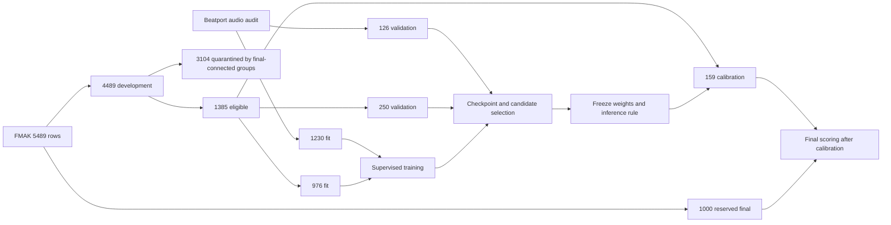

# Compact-model research pipeline (historical)

**Historical record.** This document explains the pipeline behind the compact-model
research completed on 11 November 2026, before Drone adopted K10: how the data
were split, how labels and augmentation work, how the 47,284-parameter octave
model is built and trained, and how its final evaluation was frozen. The
measurements are in the
[compact-model report](../experiments/studies/compact-models/REPORT.md). This
pipeline is not used by the released model; for the current training recipe see
[training.md](training.md), and for later experiments see
[experiments/README.md](../experiments/README.md).

The code for this research lives in `experiments/reference/` (the original
33-band baseline) and `experiments/` (screen, adaptation and octave runners). Use
`uv run python -m experiments.reference.train` for the baseline, not the
production `train.py`. The package is research-only and excluded from the wheel.
Rerunning relocated code records new source hashes; the original run records are
unchanged.

## Outcome in brief

The octave model scored **68.99% MIREX on 1,000 FMAK final tracks and 70.40% on
GiantSteps**, versus libkeyfinder's 67.82% and 69.35% (libkeyfinder 2.2.8 as run
inside Euphoria). Both paired 95% intervals include zero, so the result justified
more research, not replacing the detector. The separately trained K10 recipe
later scored higher on GiantSteps and became the release (see
[training.md](training.md)); the two were never compared on the same training
split.

## Data, labels and provenance

Training uses human-annotated audio, not labels inferred by another DJ
application. Audio identity is a SHA-256 of file contents; a numeric track ID is
not sufficient to identify audio across corpora or caches.

| Source | Role and size | Provenance and checks |
|---|---|---|
| Beatport | 1,230 unique fitting and 126 validation recordings after deduplication | The original cache had 1,363 rows and seven identical-audio pairs; two pairs crossed the original split. No conflicting labels. |
| FMAKv2 | 5,489 annotated recordings, 5,442 unique audio hashes | [Annotations, Zenodo 12759100](https://zenodo.org/records/12759100); audio from [Zenodo 10719860](https://zenodo.org/records/10719860). Checksums are pinned in `tools/prepare_fmak.py`. |
| FMA metadata | Primary artist and album IDs for all FMAK rows | Official metadata archive linked by [mdeff/fma](https://github.com/mdeff/fma); checksum pinned in `tools/fma_metadata.py`. |
| GiantSteps | 604 evaluation recordings | Used for an earlier model comparison, so already exposed before the final octave comparison. |
| Private listening library | Runtime testing and manual review only | No trusted labels; excluded from fitting, selection, calibration and reported accuracy. |

FMAK preparation verifies upstream archive checksums, ZIP extraction CRCs and
each extracted audio hash. The ten audio archives total about 39.3 GB. There was
no exact-audio overlap with Beatport. Checksums establish what was used, not
permission to redistribute it. Download and preparation took 54.73 minutes,
including 10.74 minutes of feature extraction with four workers.

## Preventing leakage

The original random Beatport split was unsafe because identical recordings could
appear in both fitting and validation. The repaired split keeps the 126
validation identities, removes their duplicate fitting copies and deduplicates
the remaining fitting audio: 1,230/126 rows. The earlier baseline's 42.9%
validation MIREX came from the old split and is not a valid control.

FMAK was partitioned before any model was scored on it
([protocol](../experiments/studies/data-split/PROTOCOL.md)):

1. Remove exact-audio overlap with Beatport, then group equal audio hashes.
2. Sort groups by the hash of `drone-fmak-holdout-v1:<audio-sha256>`, independent
   of labels and predictions.
3. Assign whole groups until the final set has exactly 1,000 rows, skipping groups
   that would exceed the quota.
4. Keep the other 4,489 rows as development data.

Before fitting on FMAK, a stricter rule joined recordings into connected
components whenever they shared an audio hash, primary artist ID or positive
album ID. Development components connected to the final set were quarantined,
removing 3,104 rows and leaving 1,385. Components were then assigned by hash
range to 70% fitting, 20% validation and 10% calibration:

| Role | Beatport | FMAK | Combined |
|---|---:|---:|---:|
| Fitting | 1,230 | 976 | 2,206 |
| Validation | 126 | 250 | 376 |
| Calibration | 0 | 159 | 159 |
| Final evaluation | 0 | 1,000 | 1,000 |

Fitting rows are deduplicated by exact audio, and conflicting labels for the same
audio are rejected. Namespaced identities prevent a Beatport ID from being
confused with a numerically identical FMAK ID.



*The diagram shows which rows each stage may touch: fitting changes weights,
validation chooses checkpoints and candidates, calibration adjusts confidence
after those choices, and the final set is scored once after everything is frozen.*

Two exposure caveats. The 159 calibration rows appeared in an earlier diagnosis
of all 4,489 development rows before roles were assigned; they were not used to
fit or select the adapted or octave networks. The final 1,000 have now been
scored and must not be reused as an untouched test. Exact hashes and artist/album
metadata do not detect all remasters, near-duplicates, covers or remixes, and
Beatport lacks matching artist/album metadata.

## Key encoding and pitch augmentation

[drone/keys.py](../drone/keys.py) defines the label contract:

```text
tonic: C=0, C#=1, D=2, ... B=11
mode: major=0, minor=1
class_id = tonic * 2 + mode

C major -> 0       C minor -> 1
A major -> 18      A minor -> 19
```

Enharmonic flats are normalized into this indexing. Transposing by `s` semitones
changes the tonic and keeps the mode:

```python
transposed = ((class_id // 2 + s) % 12) * 2 + class_id % 2
```

Feature and target must use the **same sampled shift**. The repaired baseline
samples the twelve integer shifts in `[-6, 6)`; features shift within their
finite frequency range (bins leaving the range are dropped, new bins are
floor-padded, nothing wraps). The octave model instead crops a wider CQT: moving
the crop start up by one bin lowers the pitch relative to the model by one
semitone, so the target is transposed by **minus the crop offset**. Tests
protect both contracts.

## The repaired baseline and the controlled screen

The original implementation needed these corrections before any comparison
(the [training document](training.md#why-k10) describes the chance-level run
they caused):

| Problem | Correction |
|---|---|
| Frequency mapping omitted the semitone factor | `round(12 * log2(frequency / 55))` |
| Time resizing mixed frequency and time | Interpolate each frequency band independently |
| Augmentation targets used a dataset-row index | Derive the target from the sampled shift |
| Training, decoding and scoring disagreed on class order | One interleaved tonic/mode encoding everywhere |
| Cache keys could alias files sharing a track ID | Key on audio SHA-256 and a versioned feature spec |
| Missing or incompatible weights gave misleading inference | Validate checkpoint format, feature contract and labels |
| Environment hard to reproduce | `pyproject.toml`, `uv.lock`, Python 3.12, CI, export parity checks |

The baseline feature ([experiments/reference/features.py](../experiments/reference/features.py),
version 2): mono 22,050 Hz, 4,096-sample Hann FFT, 512-sample hop, 33 semitone
bands from 55 Hz (A1 to F4), resized to 300 time positions. Despite the
historical function name `build_cqt`, this is **not a true constant-Q transform**.
Compression is `log1p(10 * bands / max(percentile99, 1e-9))` followed by
per-track standardization.

The global-pooling control has 331,704 parameters; a frequency-preserving head
that keeps six frequency positions while pooling time has 347,064. The
[screen protocol](../experiments/studies/compact-models/PROTOCOL.md) fixed eight
recipes in advance (control, control without augmentation, frequency head,
frequency head without augmentation, without smoothing, dropout 0.1, learning
rate 3e-4, mode-balanced control). Defaults: AdamW lr 1e-3, weight decay 1e-4,
label smoothing 0.1, dropout 0.3, cosine schedule, batch 64, 120 epochs, 16 CPU
threads. A 48-example overfit check reached 100% for both architectures (a
plumbing check, not generalization). Seed 13 screened; the control and up to two
challengers beating it by at least 2 validation MIREX points advanced to seeds
13, 37 and 73, with seed 13 fixed in advance as the canonical artifact.

The winning recipe (frequency head, lr 3e-4) reached 61.75 ± 1.73% validation
MIREX and 61.13% on GiantSteps, but only 52.68% on the 4,489 FMAK development
rows versus libkeyfinder's 66.87%, and it overpredicted minor mode. That
generalization failure motivated adding FMAK fitting data.

## Joint-data adaptation

The [adaptation protocol](../experiments/studies/compact-models/ADAPTATION_PROTOCOL.md)
kept the 347,064-parameter recipe fixed, trained from scratch on the 2,206
fitting rows and selected checkpoints on the 376 validation rows. Combined MIREX
weights recordings equally, so the 250 FMAK rows count more than the 126 Beatport
rows. The pre-set threshold was at least +2 FMAK points with no more than 2
Beatport points lost. The seed-13 pilot passed (FMAK 56.00% to 63.96%; Beatport
60.56% to 61.43%), and three-seed confirmation averaged 61.64 ± 0.97% Beatport
and 62.64 ± 1.15% FMAK, still below libkeyfinder's 65.16% and 66.76% on the same
rows.

## The octave-aware CQT model

The [octave protocol](../experiments/studies/compact-models/OCTAVE_PROTOCOL.md)
changed representation and architecture together. The model is a supervised
candidate inspired by S-KEY and ChromaNet
([paper](https://arxiv.org/abs/2501.12907),
[implementation](https://github.com/deezer/skey)); it does not use S-KEY's
self-supervised objectives, unlabeled corpus or published weights.

**Frontend.** Decode two 32-second mono segments centered at 25% and 75% of the
duration (clamped, short audio padded), 705,600 samples each at 22,050 Hz.
nnAudio 0.3.4 VQT with `gamma=0` gives a true CQT: minimum 27.5 Hz, 99 bins, 12
bins per octave, hop 512, stored as `2 x 99 x 1379`. Amplitude is converted to dB
relative to each segment's peak, clipped to [-80, 0] and mapped to [0, 1]; a peak
at or below `1e-8` gives zeros.

**Sampling.** During fitting, pick one segment and a uniform crop start from 0
to 15, keeping 84 bins, and transpose the target by minus the crop offset. At
validation and inference, use crop start 12 and average the two segments'
probabilities. This inference rule is frozen with the model.

**Backbone.** [OctaveNet](../experiments/octave_model.py) keeps the frequency axis
while downsampling time. Seven stages with channels `2/3/40/40/30/10/3` use
temporal convolutions of shape `(1, 2)` and stride `(1, 2)`, layer normalization
and GELU. Depthwise ConvNeXt-style blocks use kernels `7/7/7/7/7/5/5`, replicate
padding, four-times pointwise expansion, layer scale 0.1 and drop-path 0.1. The
final 84 positions become 7 octaves x 12 pitch classes; mean pooling over octaves
and time keeps the 12 pitch classes, and a 1x1 head gives two modes. Non-affine
batch normalization and an A-based to C-based pitch roll produce the 24 logits.

The model has 47,284 parameters (189,136 FP32 bytes); the checkpoint is 436,217
bytes. Neither number includes frontend work, activations, runtime libraries or
decoding. Because frontend, segments, architecture and batch size changed
together, the gain cannot be attributed to any one component without ablations.

**Training.** FP32 on GPU, AdamW lr 3e-4, weight decay 1e-4, label smoothing 0.1
(90% one-hot plus 10% uniform), batch 16, cosine schedule up to 120 epochs, stop
after 25 epochs without a new best combined validation MIREX. Ties keep the
earlier epoch. MIREX selects checkpoints; the training loss is 24-class
cross-entropy. No pseudo-labels, self-supervised pretraining or distillation.

The pilot stopped at epoch 66, keeping epoch 41 (432.39 seconds; features took
136.6 seconds and about 2.82 GB for 2,582 rows). It reached 72.94% Beatport and
68.76% FMAK validation MIREX and passed the same threshold. Three seeds averaged
72.57 ± 0.64% Beatport and 68.36 ± 0.47% FMAK. A three-seed probability ensemble,
declared in advance, gained only 0.21 combined points against a required 1, so
canonical seed 13 was kept. Final evaluation was allowed only because both the
mean and the selected model beat libkeyfinder's validation scores in both
domains.

## Calibration and frozen evaluation

The [final protocol](../experiments/studies/compact-models/FINAL_PROTOCOL.md)
fixed weights, inference rule, data identities and evaluation rules before
calibration. A temperature was fitted on the 159 calibration rows by minimizing
NLL over 401 log-spaced values from 0.25 to 4; the selected temperature is
0.7371346086455506. With `p` the averaged segment probability:

```text
calibrated_probability = softmax(log(max(p, 1e-12)) / temperature)
```

A positive temperature keeps the predicted class, so it changes confidence, not
accuracy. On the calibration rows NLL went from 1.615 to 1.531, Brier from 0.610
to 0.575 and ECE from 0.1668 to 0.1019; these are fitting metrics, not
independent evidence. The complete frozen configuration, including the
temperature, was recorded before final scoring.

The first calibration attempt hit MP3 files whose reported duration (about 192 s)
did not match decoded audio (about 79 s). Evaluation now falls back to full
decoding when fast seeking fails. Two calibration and two final FMAK files needed
this. No model, split or selection rule changed in response to final labels.

libkeyfinder predictions came from Euphoria's unmodified detector (libkeyfinder
2.2.8, FFTW 3.3.10, whole-track aggregation, tuning correction at offsets of 20
cents or more) on matching audio, converted to the same labels.

Final results, paired bootstrap intervals and confidence metrics are in the
[compact-model report](../experiments/studies/compact-models/REPORT.md#results).

## Reproducibility

Each run records source and configuration identities, lockfile identity, feature
and label specifications, data and split fingerprints, seed, device and thread
counts, epoch history, elapsed time and checkpoint identities.
[`snapshot_sources`](../experiments/small.py) captures the training entry point,
`pyproject.toml`, `uv.lock` and relevant modules; reusing an output directory
with different source is rejected. `last.pt` allows resuming at epoch boundaries
with model, optimizer, scheduler and RNG state.

The CPU baseline repeat was bitwise reproducible. The repeated octave seed 13 on
GPU kept the same best epoch and final predictions, but its history was not
bitwise identical (maximum loss difference 9.66e-8, 21 per-epoch score
differences). Matching seeds do not promise bitwise equality across GPUs, kernels
or library versions.

Recorded environment: Python 3.12.3, Torch 2.15.0+cu132, NumPy 2.5.4, nnAudio
0.3.4, SciPy 1.18.1. Legacy checkpoint format 1 expects version-2 legacy
features; the octave format is `octave-supervised-pilot-v1`. The production
loader rejects both.

```bash
uv sync --python 3.12 --locked --all-extras
uv run ruff check .
uv run ruff format --check .
uv run --extra export pytest -q
uv build
```

Optional CQT dependencies for the octave stage:

```bash
uv pip install --python .venv/bin/python --target "$RUNS/research-deps-py312" \
  --no-deps nnAudio==0.3.4 scipy==1.18.1
export PYTHONPATH="$PWD:$RUNS/research-deps-py312"
```

`$DATA` is the prepared Beatport root, `$FMAK` the FMAK root, `$RUNS` a new
experiment root and `$BASELINE` the frozen baseline checkpoint.

Controlled baseline screen:

```bash
uv run python -m experiments.small diagnose --data "$DATA" \
  --output "$RUNS/diagnostics" --baseline "$BASELINE"
uv run python -m experiments.small screen --data "$DATA" --output "$RUNS/screen"
uv run python -m experiments.small confirm --data "$DATA" \
  --screen "$RUNS/screen" --output "$RUNS/confirm"
```

FMAK preparation and partitions (save the Zenodo record `10719860` API metadata
as `$AUDIO_RECORD_JSON` first):

```bash
uv run python -m tools.prepare_fmak --output "$FMAK" \
  --audio-metadata "$AUDIO_RECORD_JSON" --workers 4
uv run python -m tools.fmak_protocol --data "$FMAK" --beatport-data "$DATA" \
  --output "$RUNS/fmak-partition.json"
uv run python -m tools.fma_metadata --output "$RUNS/fma-metadata"
uv run python -m tools.audit_fmak_groups --data "$FMAK" \
  --partition "$RUNS/fmak-partition.json" \
  --metadata "$RUNS/fma-metadata/tracks.json" --output "$RUNS/fmak-groups.json"
```

Joint-data adaptation (`$BASELINE` is the Beatport-only frequency-head seed-13
checkpoint; repeat at seeds 37 and 73 in separate output roots):

```bash
uv run python -m experiments.adapt --beatport "$DATA" --fmak "$FMAK" \
  --partition "$RUNS/fmak-partition.json" --groups "$RUNS/fmak-groups.json" \
  --baseline "$BASELINE" --output "$RUNS/adapt" --seed 13
```

Octave features and training (`$ADAPTED_REFERENCE` is the adapted seed-13
`result.json`; repeat at seeds 37 and 73 only after the pilot passes):

```bash
uv run python -m experiments.octave prepare --device cuda:0 \
  --beatport "$DATA" --fmak "$FMAK" --partition "$RUNS/fmak-partition.json" \
  --groups "$RUNS/fmak-groups.json" --output "$RUNS/octave-data"
uv run python -m experiments.octave train --device cuda:0 \
  --data "$RUNS/octave-data" --reference "$ADAPTED_REFERENCE" \
  --output "$RUNS/octave-confirm/seed13" --seed 13
```

Confirmation summary against libkeyfinder validation predictions:

```bash
uv run python tools/summarize_octave.py --root "$RUNS/octave-confirm" \
  --pilot "$RUNS/octave-pilot" --data "$RUNS/octave-data" \
  --native-beatport "$NATIVE_BEATPORT_VALIDATION" \
  --native-fmak "$NATIVE_FMAK_VALIDATION" --device cuda:0
```

`tools/evaluate_octave.py` runs the final sequence: `--mode calibrate`, then
`--mode fmak-final`, then `--mode giantsteps`. It rejects ineligible candidates
and inconsistent frozen configurations. The final corpora are already exposed;
these commands reproduce the workflow, they do not make the data fresh again.

## What we learned

- Correctness comes before architecture. Label-order, transposition, frequency
  mapping and split errors can invalidate convincing-looking scores.
- Local validation gains do not guarantee transfer: the first frequency-head
  model gained greatly on Beatport but trailed libkeyfinder on FMAK.
- More varied supervised data helped with the architecture fixed, but not enough
  on its own.
- A stronger pitch representation with an octave-aware design improved both
  domains with fewer parameters; which component helped remains untested.
- Pre-set thresholds kept the research bounded: no architecture sweep after a
  failed pilot, no best-seed choice, no ensemble without a meaningful gain.
- A one-point observed lead is not a dependable one-point gain; calibration and
  uncertainty are separate from point accuracy.
- Frontend and cache design can matter more for runtime than parameter count.

## What came next

A follow-up fused libkeyfinder's 24-key scores with OctaveNet as a residual prior
(47,332 parameters). It reached 73.49% Beatport (+0.56) and 67.32% FMAK (-1.44)
validation MIREX against the octave seed-13 reference, missed its pre-set FMAK
gain, and was stopped. Later work moved to K10; see
[experiments/README.md](../experiments/README.md).
