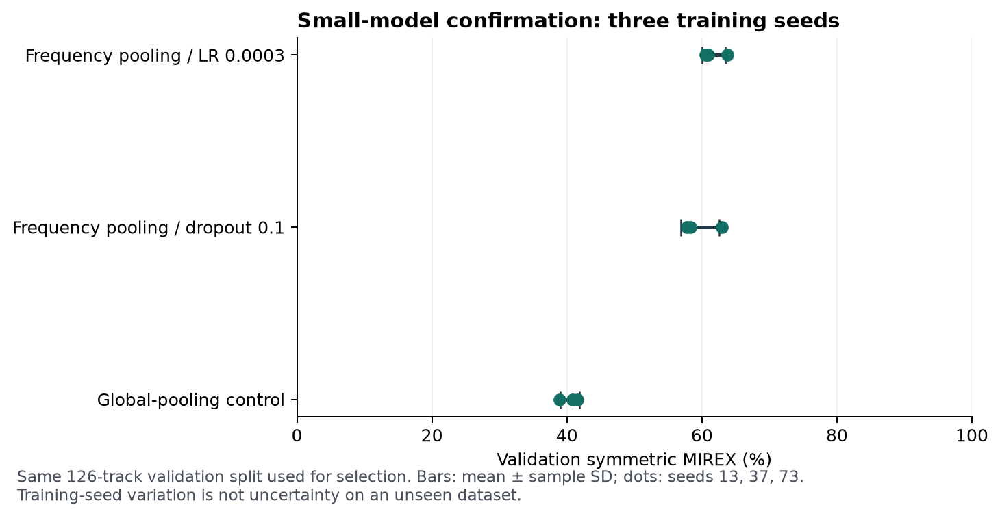

# First small-model tranche — 2026-11-11

**Decision: keep the existing Euphoria detector.** The selected compact model improves
on the repaired CNN control but does not clear the published 69.4% GiantSteps
MIREX reference. CPU latency is comfortably within the proposed forward-pass
budget; accuracy remains the main constraint. No larger model is promoted.

## Protocol and provenance

- Experiment source commit: `6660334` on `experiment/small-baseline`.
- Fixed source hashes in all run records match that branch snapshot exactly.
- Seven identical-audio pairs were found in the 1,363-row Beatport cache; two
  crossed the old split. Preserve the 126 validation IDs, quarantine matching
  training copies and deduplicate remaining training recordings: 1,230 training.
- Both architectures overfit a training-only 48-recording subset to 100% in 20
  optimization steps. This checks learnability, not generalization.
- Eight preregistered screening recipes, followed by the control and two
  qualifying candidates at seeds 13, 37 and 73. All 17 runs completed on CPU,
  16 threads, 120 epochs, batch 64. Repeated seed-13 histories and validation
  predictions reproduced exactly. No held-out data entered recipe selection.
- Primary development criterion: symmetric MIREX; exact accuracy as tie-breaker.
  Recipe selection uses three-seed mean. The canonical artifact uses seed 13,
  rather than choosing the best-performing confirmation seed.
- Original 42.9% validation from the earlier leaked split is historical and is
  not the control for this comparison.

## Three-seed confirmation

| Recipe | Parameters | Validation MIREX, mean ± sample SD | Validation exact, mean |
|---|---:|---:|---:|
| frequency-lr-3e4 | 347,064 | 61.75% ± 1.73 points | 53.44% |
| frequency-dropout-01 | 347,064 | 59.68% ± 2.83 points | 50.79% |
| control | 331,704 | 40.45% ± 1.40 points | 33.07% |

The same 126-track validation set selected recipes/checkpoints. These are development
results, and sample SD describes training-seed variation, not uncertainty on a new
dataset. A three-seed result is not evidence of generalization across artists/genres.

## External GiantSteps comparison after selection

| Canonical seed-13 artifact | Exact | Symmetric MIREX | Asymmetric MIREX |
|---|---:|---:|---:|
| Clean global-pooling control | 29.30% | 38.81% | 34.83% |
| Frozen frequency/LR 0.0003 candidate | 53.31% | 61.13% | 58.39% |

All 604 tracks were scored once for each frozen artifact. The selected model gains
22.32 symmetric MIREX points over the control but remains 8.27 points below the
published 69.4% Euphoria reference. That reference was not rerun in this tranche.
Future development must disclose this GiantSteps exposure; it is no longer an
untouched development-independent comparison for subsequent recipe changes.

## CPU and artifact measurements

- Model: 347,064 parameters; 1,388,256 bytes of FP32 parameters (1.32 MiB).
- Saved checkpoint: 1,512,199 bytes, including buffers and training provenance.
- ONNX artifact: 1,402,048 bytes. Export parity verified for batches 1, 2 and 3.
- Server: Threadripper PRO 9955WX, PyTorch CPU, one thread, batch 1:
  forward p50 0.448 ms / p95 0.525 ms over 100 synthetic-tensor iterations.
- On one two-minute Beatport preview, cold feature-cache decode/features/forward
  took 228 ms; warm feature-cache plus forward p95 was 2.39 ms. This is one file,
  not a corpus-level p95. Filesystem cache was uncontrolled.
- Local Apple Silicon Mac, one thread: PyTorch forward p95 0.776 ms; ONNX CPU
  forward p95 0.750 ms over 100 synthetic-tensor iterations. These measurements
  are not CPU-only x86 laptop results and do not establish UI/startup behavior.
- On 100 FMAK pilot files (median duration 232 s; p95 360 s; maximum 453 s),
  original Python/PyTorch full-path p50/p95 was 0.523/1.026 s; peak parent RSS
  796 MiB. This sample comes from one archive and is not genre representative.
- Bitwise-equivalent streaming aggregation (source commit `65b42e7`) removed the
  full track-length FFT magnitude allocation. On the same sample, measured
  PyTorch p95 was 0.623 s and peak parent RSS 671 MiB. Regression tests verify
  exact feature equality and bounded FFT working memory; a real 7.5-minute file
  also matched bit for bit. No retraining or feature-contract change was needed.
- In a fresh NumPy/ONNX Runtime environment without PyTorch installed/imported,
  the same 100-file path measured p50/p95 0.403/0.824 s, runtime RSS before audio
  65 MiB and peak parent RSS 197 MiB. Sessions used one intra-op thread, sequential
  execution and disabled spinning. Native Rust integration is still unmeasured.
- These are individual benchmark runs with uncontrolled filesystem caches, not a
  randomized backend speed comparison. Parent RSS excludes the decoder child;
  per-file CPU-seconds in the audio reports include it. Raw timings retain file
  durations and checkpoint/feature-source fingerprints.

## Budget and next gate

All screening/confirmation training and per-run evaluation totaled 20.79 minutes, within the 34 CPU-minute reservation.
Typical 120-epoch runs took approximately 63–79 seconds. No GPU or vLLM service
was interrupted. Diagnostics, code/tests, data preparation and export are separate
from that training total.

FMAKv2 preparation uses pinned official annotations and audio checksums. A 100-file
pilot took 134.54 seconds for the 1.73 GB archive download, 2.05 seconds for sample
extraction and 18.84 seconds for feature preparation with four workers. The full
audio download/preparation is a separate two-hour-capped job. Model fitting does
not use FMAK. See [the predeclared FMAK protocol](FMAK_PROTOCOL.md): 1,000 rows
are reserved by exact-audio grouping before any FMAK model scores, with the rest
used only for development diagnostics at this stage. Larger-model research remains
conditional on observed need, not an automatic next step.

## Records

Server root: `/home/lysk-admin/drone-experiments/small-tranche-20261111-v2/`.
Raw histories, confusion matrices, source/data/split fingerprints, resumable state
and artifacts are under `screen/` and `confirm/`. `tranche.exit` is zero.
External results: `control-giantsteps.json` and `selected-giantsteps.json`.
Local ignored copies: `data/small-tranche-20261111-v2/` in the experiment worktree.
No raw audio, checkpoints, or the untracked local `PLAN.md` are in the source commit.
