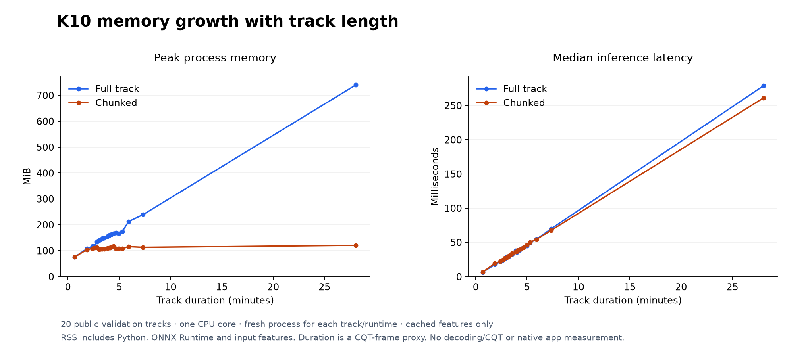
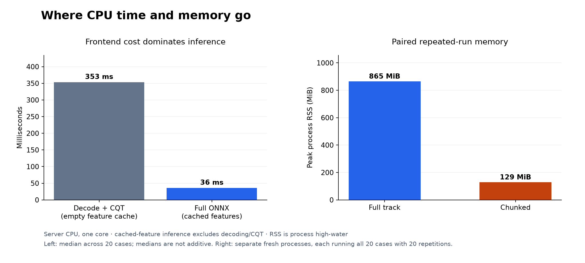
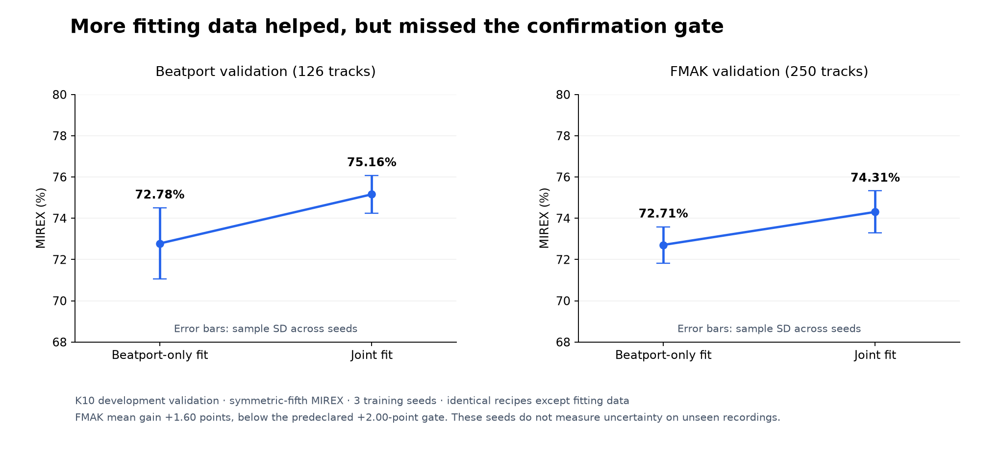
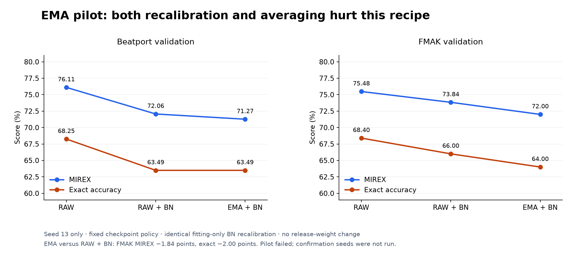

# Research results in graphs

These figures come from checked-in measurements, not illustrative curves.
Each chart includes its sample, metric and limits. The PNGs render on GitHub;
matching SVGs are available in [figures/](figures/) for zooming and reuse.

## Memory grows with track length



The new probe starts a **fresh process for every track and runtime**: 40 isolated
processes for the same 20 public validation tracks, one CPU core, one warmup and
20 timed repetitions. The shortest recording (40 seconds) peaked at 75.8 MiB
full / 76.0 MiB chunked. The longest (28 minutes) peaked at **739.6 MiB full /
120.7 MiB chunked**. Paired logits and key decisions agreed within the fixed gate.
This directly shows the long-track memory growth that a parameter count misses.

Full inference retains large intermediate activation tensors. Chunking bounds
those tensors while retaining every model output position. Total RSS still
includes Python, ONNX Runtime and the full input feature array, so it need not be
constant with track length. Connecting lines guide the eye; there are no measured
cases between roughly 7 and 28 minutes and no fitted scaling law is claimed.
These are server cached-feature measurements, excluding audio decoding/CQT and
native Euphoria. Durations are derived from CQT frame count.

Raw data: [fresh-process measurements](plot-data/k10-memory-curve.json).
The probe completed in 44.53 seconds without GPU work or private DJ audio.

## Frontend time and repeated-run memory



The cold feature path's median was 353 ms versus 36 ms for full ONNX inference.
Those are medians across cases, not an additive decomposition of one track.
The original [paired chunk benchmark](K10_CHUNKED_RESULTS.md) measured
**865.3 → 129.3 MiB**, a 6.69-times peak-memory reduction with a 1.91% median
paired latency increase. Each process handled all 20 tracks with repeated
inference, so its allocator high-water differs from the per-track graph above.
Neither figure is an Euphoria idle-memory or whole-application CPU measurement.

## More fitting data: helpful, insufficient



Joint fitting raised mean Beatport MIREX by 2.38 points and FMAK by 1.60 points.
The latter missed the predeclared 2-point gate, so no weights were promoted.
Error bars show sample standard deviation over **three training seeds**. They
are not confidence intervals over unseen recordings or proof of generalization.
See the [full experiment](K10_MULTIDOMAIN_RESULTS.md) and
[source summary](plot-data/k10-multidomain-summary.json).

## EMA: a negative result worth keeping



The ordinary training run reproduced exactly. Recalibration hurt this recipe,
and EMA hurt further against the matched recalibrated control: FMAK MIREX
fell 1.84 points and exact accuracy fell 2.00 points. This was one fixed pilot,
not a conclusion about every averaging method. The failed gate prevented further
seed runs. [Protocol and result](K10_EMA_RESULTS.md).

## Reproduce and extend

```bash
uv sync --locked --extra plots
uv run --extra plots python -m tools.plot_research
```

All four charts are generated from repository JSON without server/audio access.
[research-inputs.json](figures/research-inputs.json) records data, generator and
lockfile hashes plus the plotting-library version. Keep raw measurements,
units, sample size, selection policy and uncertainty with future figures;
record failed gates alongside successful results. Use paired comparisons when
data or execution protocols differ, and retain negative experiments.

The memory probe can be replayed against the existing server fixtures using
`python -m tools.benchmark_k10_memory_curve --help`. It requires the same passing
376-track validation report, exact model/bundle/source hashes and the existing
20-track selection. Run under `taskset -c 0`, set OMP/MKL/OPENBLAS/NUMEXPR thread
counts to one, and use a fresh output path. It enforces a 600-second wall budget;
each child is independently bounded. [Measurement provenance](plot-data/provenance.json).
