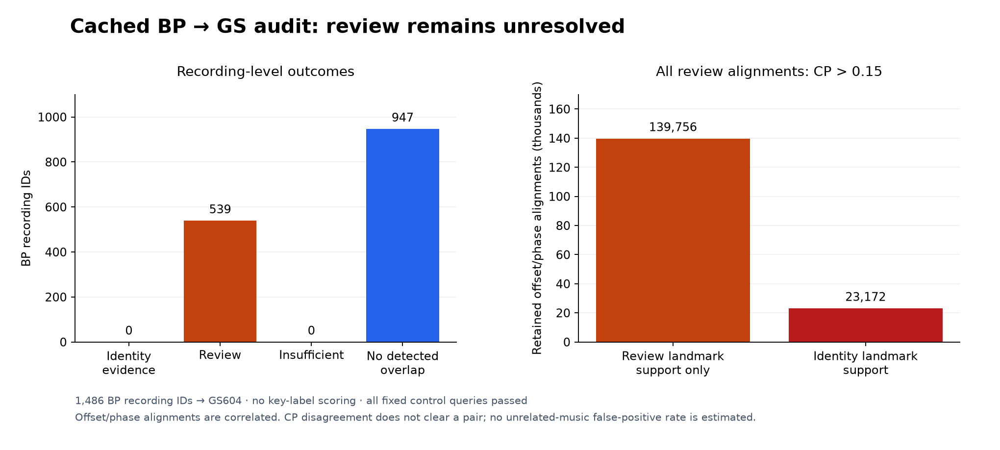

# Beatport and GiantSteps overlap audit leaves 539 recordings unresolved

An audio-fingerprint audit of all 1,486 Beatport (BP) recording IDs against the
604 GiantSteps (GS) previews found **no identity matches, 539 recordings needing
review (36.3%) and 947 with no detected overlap**. The 539 reviews are
landmark coincidences that the second fingerprint did not confirm, so they are
unresolved, not cleared. The audit therefore cannot claim that BP, or any model
trained on it, is free of GS overlap. Study date: 12 November 2026.

## Question

Do the original BP recordings overlap the GS 604 evaluation set, and which
released or candidate models were trained on flagged recordings? This matters
because GS is the headline benchmark for Drone: undetected overlap would inflate
its score.

## Method

The [protocol](PROTOCOL.md) fixed the source data, population, thresholds,
controls and scopes before any query ran.

**Population.** All 1,486 original BP IDs are queried; no exclusion is applied.
The [metadata report](METADATA_REPORT.md) explains the count lineage: 1,486
original IDs, 1,363 parser-eligible labels, 1,356 corrected prepared IDs (1,230
fitting, 126 selection). The 123 label exclusions are 104 wrong-token-count, 17
unsupported-mode and 2 unsupported-tonic annotations; the remaining 7 removals
are exact-file aliases.

**Models.** The released checkpoint declares 1,237 fitting and 126 selection IDs;
its fitting set has 1,232 distinct file hashes, two of which are also in
selection. Six later BP-only and joint (BP plus FMA) checkpoints were checked
separately, so release exposure and later candidate exposure are kept apart.
The release's recorded audio-hash list covers the prepared corpus; it is not a
log of which examples produced gradients.

**Index and matching.** The reference index holds 7,579 recording IDs (5,489 FMA,
1,486 BP, 604 GS). The GS targets represent 602 distinct normalized PCM hashes.
Scientific queries target GS only. All fingerprints and the index were verified
before matching, and the extraction and voting code is a byte-identical copy of
the archived matcher.

**Decision rule.** Every qualifying alignment (3 anchors over 2 seconds, per
offset, bin and phase) is kept; there is no best-offset or top-k pruning.

- *Identity evidence*: at least 20 distinct landmark anchors spanning at least
  8 seconds, **and** Chromaprint (CP) distance of at most 0.15 at that offset.
- *Review*: at least 10 anchors spanning 5 seconds, or identity-level landmark
  support without CP agreement.
- *No detected overlap*: neither.

Anchor span is the first-to-last anchor extent, not the length of continuous
shared audio.

**Controls.** 848 controls: 784 expected positives (transformed and self
matches) and 64 synthetic negatives.

**Known gap in the method.** BP queries reuse the cached BP *reference*
fingerprints with one extraction shift, instead of newly extracted four-shift
query fingerprints. The transformed controls exercise the four-shift path and the
self controls exercise GS indexing; neither proves recall for transformed GS
matches through the cached BP path. A "no detected overlap" result holds only for
this representation, scope and rule.

## Results

All 2,334 planned queries completed. All 784 expected positive controls were
recovered, and the 64 synthetic negatives produced no identity or review flags.
Synthetic negatives do not estimate a false-positive rate on unrelated music.

| Outcome | BP IDs | Share |
|---|---:|---:|
| Identity evidence | 0 | 0.0% |
| Unresolved review | 539 | 36.3% |
| Insufficient information | 0 | 0.0% |
| No detected overlap | 947 | 63.7% |

*Figure 1. Left: outcome for each of the 1,486 BP recording IDs. Right: the
retained review alignments by offset and phase; look at how all of them sit
above the CP distance cutoff of 0.15. These alignments are correlated, not
independent, and CP disagreement is not a clearance rule.*

The run kept 2,657,001 alignment records for scientific queries (4,315,263
including controls, all checked independently). Review support involves 3,173
distinct BP/GS recording pairs. These counts do not measure independent matches,
precision, score inflation or model accuracy.

### Model exposure to flagged recordings

The table counts BP IDs with a review flag in each model's training data. FMA
fitting sources of the joint models were outside the query population.

| Model | Fitting IDs with review | Selection IDs with review | Additional indirect fitting alias |
|---|---:|---:|---:|
| Released `drone-v1` | 459 | 43 | 0 |
| BP-only, seed 13 | 458 | 43 | 1 |
| BP-only, seed 37 | 458 | 43 | 1 |
| BP-only, seed 73 | 458 | 43 | 1 |
| Joint, seed 13 | 458 | 43 | 1 |
| Joint, seed 37 | 458 | 43 | 1 |
| Joint, seed 73 | 458 | 43 | 1 |

No model has identity-evidence or insufficient-information exposure. The
additional candidate alias is `beatport:299977`, whose exact file and normalized
PCM both match a declared fitting source: two records of the same recording, not
two extra exposures. These counts describe metadata exposure, not a causal
estimate of training influence. Full ID lists are in
[the diagnostic](data/diagnostic.json.gz); per-query outcomes are in
[the original result](data/execution/result.json.gz).

### Why the audit abstains so often

All 162,928 review alignments disagree with CP at the 0.15 cutoff. 139,756 fail at
least one landmark identity requirement; 23,172 meet both the 20-anchor and
8-second requirements but lack CP agreement. All 539 review queries have the
first kind and 195 also have the second (categories overlap). No review alignment
has missing or agreeing CP.

This pattern fits many landmark coincidences that the second fingerprint does
not confirm. It does not show that the pairs are unrelated, and it does not
justify turning reviews into negatives. Shared musical material, sparse
landmarks, extraction alignment and fingerprint sensitivity are all possible
explanations. No listening review or labelled unrelated-music panel was used.

The examples below are the first three query IDs in lexical order per category,
using their first retained alignment. They illustrate the evidence; they are not
a representative sample.

| Category | BP source to GS target | Anchors | Span, seconds | CP distance |
|---|---|---:|---:|---:|
| Review-level landmarks only | 1017875 to 3443052 | 10 | 99.219 | 0.448 |
| Review-level landmarks only | 1019315 to 1026478 | 10 | 8.638 | 0.401 |
| Review-level landmarks only | 1051007 to 1092676 | 11 | 22.500 | 0.453 |
| Identity-level landmarks, CP disagrees | 1019315 to 1678455 | 21 | 71.517 | 0.351 |
| Identity-level landmarks, CP disagrees | 1056047 to 4824580 | 21 | 49.203 | 0.464 |
| Identity-level landmarks, CP disagrees | 1115626 to 1353830 | 20 | 39.335 | 0.417 |

[The diagnostic](data/diagnostic.json.gz) gives exact reference IDs, offset bins
and phases; the original query files for these examples are in
[execution/examples](data/execution/examples/). Nothing was reclassified after
inspection.

### Cost

The audit ran once on CPU with one thread per process and no GPU: 1,137.377
seconds wall time, 1,156.810 seconds CPU time, peak RSS 270.3 MiB. These are
fingerprint-audit costs, not model inference or audio-frontend costs.

## Decision

The audit is complete and validated. It finds no identity evidence, leaves 539
queries unresolved and does not establish that BP and GS recordings are
independent. All flags and weaker offsets are preserved. Any listening review,
better negative calibration, new query extraction or re-evaluation of benchmark
scores needs its own protocol. Later data and teacher work uses the exposure
record with these limits stated. Release weights and data roles are unchanged;
no audio was decoded, no key labels were scored and no thresholds were adjusted.

## Limitations

- "No detected overlap" is conditional on cached one-shift BP fingerprints,
  GS-only scope and the fixed rule; recall for transformed matches through this
  path is not proven.
- Synthetic negatives do not estimate the false-positive rate on real unrelated
  music.
- Review flags are neither confirmed overlaps nor cleared; their effect on
  GS scores is unknown.
- Exposure counts describe training metadata, not training influence.
- An earlier audit with a broader scope failed its own acceptance check; that
  result is unchanged.

## Reproduce

An independent checker validated all 2,334 evidence files, all 4,315,263
alignment decisions, control and population scopes, and the index hash after the
run. Its source is preserved as [the original checker](data/execution/original-root-checker.py.txt),
and [its recorded output](data/execution/original-root-check-receipt.json) keeps
the command, exit status and exact stdout. The
[execution index](data/execution/artifact-index.json) lists logs, result, checker
and example files with their checksums. The original diagnostic generator is
[original-report-helper.py.txt](data/execution/original-report-helper.py.txt);
the current typed report helper reads the same gzip inputs. Compressing the
result and diagnostic did not rerun matching or validation.

The repository contains the compact result, diagnostic, metadata collector
outputs and example query files. The complete 64,615,187-byte raw query archive
is kept outside Git; reproducing the full diagnostic requires it, and the
execution index records its checksum. No audio, checkpoints or landmark arrays
are committed.

The published download provenance for the official source archive removes only
transient HTTP `Set-Cookie` fields from the original metadata. The
[sanitization record](data/official-provenance-sanitization.json) gives original
and derived checksums and confirms all other content is equal.
