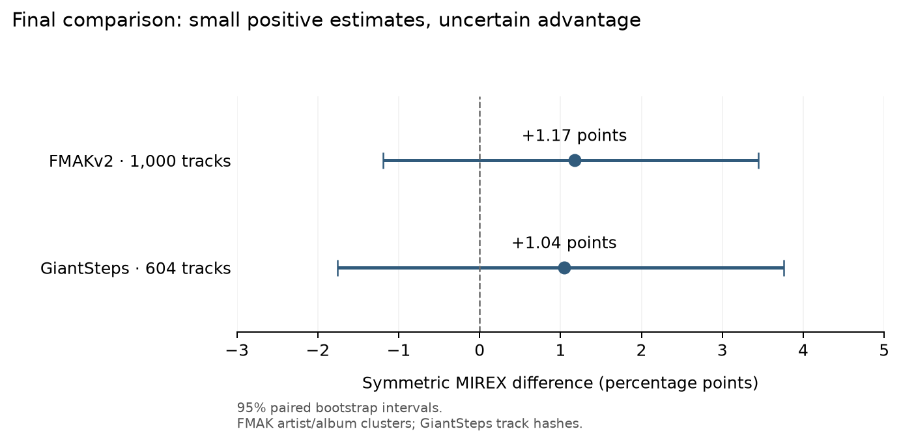
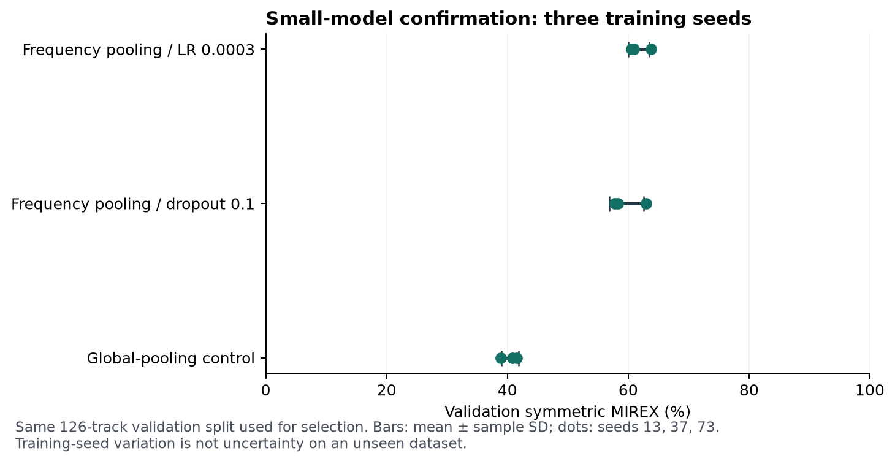

# First small-model tranche — 2026-11-11

**Decision: keep the existing Euphoria detector while accuracy research continues.**
The new 47,284-parameter CQT/octave candidate has higher final point estimates on
both datasets, but the paired 95% intervals include zero. This does not establish
reliable superiority or global state of the art. Rust optimization/default-detector
integration is deferred until stronger accuracy evidence, matching the user's priority.

| Frozen final dataset | Existing Euphoria MIREX / exact | Octave candidate MIREX / exact | MIREX gain, 95% paired bootstrap CI |
|---|---:|---:|---:|
| Artist-purged FMAKv2, 1,000 | 67.82% / 58.40% | **68.99% / 60.30%** | +1.17 points [-1.19, +3.44] |
| GiantSteps, 604 | 69.35% / 60.60% | **70.40% / 62.75%** | +1.04 points [-1.75, +3.76] |

FMAK intervals resample 460 artist/album/exact-audio components; GiantSteps
resamples track hashes, with artist/remix independence unestablished. Both use
5,000 draws, seed 13. GiantSteps had earlier program-level exposure. This FMAK
partition is not directly comparable to papers' all-FMAK/different-holdout scores.

These final rows were evaluated only after the input contract, weights, inference
choice and confidence temperature were frozen. Do not use these results to choose
new recipes or repeatedly score the original holdout. The detailed stages below
include the earlier 347k-parameter controls; their performance measurements do
not describe the new octave model.

## Protocol and provenance

- [Archived small-baseline implementation](https://github.com/lvndry/drone/tree/6660334).
- Fixed source hashes in all run records match that branch snapshot exactly.
- Seven identical-audio pairs were found in the 1,363-row Beatport cache; two
  crossed the old split. Preserve the 126 validation IDs, quarantine matching
  training copies and deduplicate remaining training recordings: 1,230 training.
- Both architectures overfit a training-only 48-recording subset to 100% in 20
  optimization steps. This checks learnability, not generalization.
- Eight preregistered screening recipes, followed by the control and two
  qualifying candidates at seeds 13, 37 and 73. All 17 runs completed on CPU,
  16 threads, 120 epochs, batch 64. Repeated seed-13 histories and validation
  predictions reproduced exactly. No held-out data entered recipe selection.
- Primary development criterion: symmetric MIREX; exact accuracy as tie-breaker.
  Recipe selection uses three-seed mean. The canonical artifact uses seed 13,
  rather than choosing the best-performing confirmation seed.
- Original 42.9% validation from the earlier leaked split is historical and is
  not the control for this comparison.

## Three-seed confirmation

| Recipe | Parameters | Validation MIREX, mean ± sample SD | Validation exact, mean |
|---|---:|---:|---:|
| frequency-lr-3e4 | 347,064 | 61.75% ± 1.73 points | 53.44% |
| frequency-dropout-01 | 347,064 | 59.68% ± 2.83 points | 50.79% |
| control | 331,704 | 40.45% ± 1.40 points | 33.07% |

The same 126-track validation set selected recipes/checkpoints. These are development
results, and sample SD describes training-seed variation, not uncertainty on a new
dataset. A three-seed result is not evidence of generalization across artists/genres.

## External GiantSteps comparison after selection

| Canonical seed-13 artifact | Exact | Symmetric MIREX | Asymmetric MIREX |
|---|---:|---:|---:|
| Clean global-pooling control | 29.30% | 38.81% | 34.83% |
| Frozen frequency/LR 0.0003 candidate | 53.31% | 61.13% | 58.39% |
| Existing Euphoria KeyFinderDetector | 60.60% | 69.35% | 67.70% |

All 604 tracks were scored once for each frozen artifact. The selected model gains
22.32 symmetric MIREX points over the control but remains below the
freshly rerun 69.35% Euphoria reference (8.23 points using unrounded scores).
The native run uses the [unmodified Euphoria implementation](https://github.com/lvndry/euphoria/tree/cde6db9), libkeyfinder 2.2.8 and
FFTW 3.3.10; all audio hashes match the neural test bundle, with zero missing
predictions. It reproduces the historical 69.4% figure. The earlier 8.27-point
gap used that rounded historical number.
Future development must disclose this GiantSteps exposure; it is no longer an
untouched development-independent comparison for subsequent recipe changes.

## CPU and artifact measurements

- Model: 347,064 parameters; 1,388,256 bytes of FP32 parameters (1.32 MiB).
- Saved checkpoint: 1,512,199 bytes, including buffers and training provenance.
- ONNX artifact: 1,402,048 bytes. Export parity verified for batches 1, 2 and 3.
- Server: Threadripper PRO 9955WX, PyTorch CPU, one thread, batch 1:
  forward p50 0.448 ms / p95 0.525 ms over 100 synthetic-tensor iterations.
- On one two-minute Beatport preview, cold feature-cache decode/features/forward
  took 228 ms; warm feature-cache plus forward p95 was 2.39 ms. This is one file,
  not a corpus-level p95. Filesystem cache was uncontrolled.
- Local Apple Silicon Mac, one thread: PyTorch forward p95 0.776 ms; ONNX CPU
  forward p95 0.750 ms over 100 synthetic-tensor iterations. These measurements
  are not CPU-only x86 laptop results and do not establish UI/startup behavior.
- On 100 FMAK pilot files (median duration 232 s; p95 360 s; maximum 453 s),
  original Python/PyTorch full-path p50/p95 was 0.523/1.026 s; peak parent RSS
  796 MiB. This sample comes from one archive and is not genre representative.
- [Bitwise-equivalent streaming aggregation](https://github.com/lvndry/drone/tree/65b42e7) removed the
  full track-length FFT magnitude allocation. On the same sample, measured
  PyTorch p95 was 0.623 s and peak parent RSS 671 MiB. Regression tests verify
  exact feature equality and bounded FFT working memory; a real 7.5-minute file
  also matched bit for bit. No retraining or feature-contract change was needed.
- In a fresh NumPy/ONNX Runtime environment without PyTorch installed/imported,
  the same 100-file path measured p50/p95 0.403/0.824 s, runtime RSS before audio
  65 MiB and peak parent RSS 197 MiB. Sessions used one intra-op thread, sequential
  execution and disabled spinning. Native Rust integration is still unmeasured.
- These are individual benchmark runs with uncontrolled filesystem caches, not a
  randomized backend speed comparison. Parent RSS excludes the decoder child;
  per-file CPU-seconds in the audio reports include it. Raw timings retain file
  durations and checkpoint/feature-source fingerprints.

## Budget and next gate

All screening/confirmation training and per-run evaluation totaled 20.79 minutes, within the 34 CPU-minute reservation.
Typical 120-epoch runs took approximately 63–79 seconds. No GPU or vLLM service
was interrupted. Diagnostics, code/tests, data preparation and export are separate
from that training total.

FMAKv2 acquisition/preparation completed in 54.73 minutes, including 10.74 minutes
for four-worker feature preparation. Every official archive and annotation checksum
was verified. There are 5,489 recordings, 5,442 unique audio hashes and zero exact
Beatport audio overlaps. The predeclared partition reserves 1,000 rows by audio
group; 4,489 development rows were scored. Final holdout remains unscored.

| Frozen artifact, FMAKv2 development | Exact | Symmetric MIREX | Mode accuracy |
|---|---:|---:|---:|
| Original global-pooling control | 22.61% | 33.27% | 54.44% |
| Frequency/LR 0.0003 candidate | 41.30% | 52.68% | 64.13% |
| Existing Euphoria detector | 56.76% | 66.87% | 74.98% |

These are development results on our declared partition, not published all-FMAK
or differently partitioned benchmark results. The candidate still predicts minor
for 3,012/4,489 tracks although references are 2,313 major / 2,176 minor. Do not
infer that enlarging the network is the answer from this alone.

Official FMA metadata (106,574 rows, upstream archive SHA-1 verified) provides
primary artist/album IDs for every FMAK recording. Artist/album/exact-audio connected
components quarantine 3,104 development rows related to final-holdout groups;
1,385 remain eligible for future fitting/validation/calibration. This is a stricter
training restriction added before fitting on any FMAK data; the original final
holdout is unchanged. Near-duplicate/remix/cover independence remains unaudited.

The fixed-recipe data pilot uses 976 FMAK fit / 250 validation / 159 calibration
rows, plus clean Beatport fit/validation. It scores no calibration/final rows and
never reruns the adapted model on GiantSteps. Seed 13 completed in approximately
146 seconds and passes its development gate: FMAK validation MIREX 56.00% ->
63.96%, Beatport validation 60.56% -> 61.43%. The 250-row FMAK validation result is
not directly comparable to the 4,489-row diagnosis above. Three-seed confirmation completed; all three seeds pass the development gate.
The native FMAK development reference completed: 66.87% MIREX, 56.76% exact,
three missing predictions counted as zero across all 4,489 rows. The frozen
Beatport-trained CNN trails by 14.19 MIREX points; paired artist/album-cluster
bootstrap 95% CI for CNN minus native is [-15.56, -12.65] points (5,000 draws,
seed 13, 1,076 development components). This is development uncertainty, not a
final-holdout result. The common-decoded comparison has the same conclusion. See
[the adaptation protocol](ADAPTATION_PROTOCOL.md). No larger model is promoted.

| Same fixed validation rows | Frozen seed-13 reference MIREX | Adapted mean ± sample SD | Adapted exact, mean |
|---|---:|---:|---:|
| Beatport, 126 rows | 60.56% | 61.64% ±0.97 points | 52.65% |
| Artist-purged FMAK, 250 rows | 56.00% | 62.64% ±1.15 points | 51.87% |

[Frozen confirmation implementation](https://github.com/lvndry/drone/tree/53638a1); seeds 13/37/73; canonical seed 13. Source, recipe,
data and split identities match across runs. Repeated seed-13 histories and
validation predictions match the pilot exactly. Confirmation took 8.45 minutes;
pilot 2.44 minutes. Alongside the initial 20.79 minutes, total fitting/per-run
evaluation wall time on CPU is 31.68 minutes. This is wall time using 16 training
threads, not aggregate core-minutes. Acquisition, preparation, native reference
runs, diagnostics and export are separate costs.

The reference column is one frozen seed-13 artifact, not a paired three-seed
control. These same validation rows select checkpoints, so this is a development
gain, not independent final quality. The 159 calibration rows have not entered fitting, checkpoint selection or
calibration for the adapted models. They were included in the earlier frozen-
model diagnosis over all 4,489 development rows before these roles were assigned.
The final 1,000 rows remain unscored. The adapted canonical artifact exports to ONNX with parity
verified for batches 1/2/3; no adapted-model GiantSteps score has been computed.

On the same 126 Beatport validation rows, unmodified native Euphoria scores
65.16% MIREX / 53.97% exact, with no missing predictions. The adapted mean still
trails that MIREX reference. On the same 250 artist-purged FMAK validation rows,
native Euphoria scores 66.76% MIREX / 55.20% exact, zero missing predictions,
versus adapted mean 62.64% / canonical seed-13 63.96% MIREX. Retain the existing
detector pending stronger quality.

The next research priority is accuracy: broader pitch evidence, octave-aware
representations and structured tonic/mode outputs. Native Rust performance tuning
follows a validated quality candidate. A single supervised CQT/octave candidate
([frozen pilot implementation](https://github.com/lvndry/drone/tree/fe727b2)) has passed a real Blackwell forward/backward smoke test; its
fitting/validation identity lists match the adapted artifact exactly. See
[the preregistered octave pilot](OCTAVE_PROTOCOL.md). Preparation/fitting are
currently in flight on GPU 0 with bounded memory; no serving workloads stopped. The user's private DJ library is reserved
for final runtime/manual review and does not enter fitting or recipe selection.

## Records

Server root: `/home/lysk-admin/drone-experiments/small-tranche-20261111-v2/`.
Raw histories, confusion matrices, source/data/split fingerprints, resumable state
and artifacts are under `screen/` and `confirm/`. `tranche.exit` is zero.
External results: `control-giantsteps.json` and `selected-giantsteps.json`.
Local ignored copies: `data/small-tranche-20261111-v2/` in the experiment worktree.
No raw audio, checkpoints, or the untracked local `PLAN.md` are in the source commit.

## Completed supervised octave/CQT stage

The [pilot](https://github.com/lvndry/drone/tree/fe727b2) and
[confirmation](https://github.com/lvndry/drone/tree/cd68770) implementations are archived. Same 2,206 fit / 376 validation
identities as the data-adaptation stage, exactly audited against its artifact.
Own supervised training from scratch; no pretrained weights or unlabeled pretraining.
See [the fixed octave protocol](OCTAVE_PROTOCOL.md).

The complete candidate changes frontend, temporal sampling, architecture and
augmentation: gamma-zero CQT 99 bins, two 32-second segments, 84-bin transposition
crops with matching target shifts, temporal-only downsampling, octave pooling and
structured tonic/mode logits. A gain cannot be attributed to one component without
ablations. Parameter count is 47,284 (189,136 FP32 parameter bytes); the canonical
checkpoint is 436,217 bytes. Smaller parameter count does not establish CPU latency.

CQT preparation: 136.6 seconds, 2,582 tracks, approximately 2.82 GB float32 cache.
Pilot: 432.39 seconds, early stopped at epoch 66, best checkpoint epoch 41.
Three confirmation runs: 19.46 minutes total, seeds 13/37/73, within per-run
15-minute and stage 50-minute caps. GPU 0 allocator capped at 0.04 of total VRAM;
no services stopped and both vLLM instances stayed running.

| Fixed validation subset | Three-seed octave MIREX mean ± sample SD | Native reference |
|---|---:|---:|
| Beatport, 126 | 72.57% ±0.64 points | 65.16% |
| Artist-purged FMAK, 250 | 68.36% ±0.47 points | 66.76% |

Repeated seed-13 best epoch and predictions match the pilot. Training histories
are not bitwise identical on CUDA: maximum per-epoch loss difference 9.66e-8,
21 per-epoch validation-score differences. Do not claim exact training replay.
The other seeds still provide the declared independent initialization checks.

The predeclared all-three equal-probability ensemble scored 70.37% combined
validation versus canonical seed-13 70.16%: its 0.21-point gain fails the >=1-point
rule. Canonical seed 13 was fixed in advance, not selected as the strongest seed.

## Freeze, calibration and final evaluation

The frozen decision is identified in the [training record](../../../docs/RESEARCH_TRAINING.md).
Recorded at 2026-11-11 18:30:57 UTC, before final predictions. Positive temperature
0.7371346086 fitted on the assigned 159 calibration rows by NLL only; class argmax
is unchanged. Their earlier inclusion in the original whole-development baseline
diagnosis is disclosed above; they did not fit/select the adapted/octave networks.
Calibration fitting NLL 1.615 -> 1.531 is a fitting result, not held-out evidence.

The first calibration attempt stopped on malformed MP3 seek/duration metadata
before fitting/calibration metrics or final scores. Full decoding recovered ~79 s
of actual samples where the file reported ~192 s. Evaluation now falls back to
full decoding/actual duration only after fast-path failure, preserving valid
inputs. Regression tests cover both routes. Two calibration and two final-FMAK
files used recovery; no model weights, splits or selection rule changed.

Final FMAK: asymmetric MIREX 66.49%, mode accuracy 78.00%, NLL 1.419, Brier 0.553,
ECE (15 equal-width bins) 3.64%. GiantSteps: asymmetric MIREX 68.58%, mode 80.63%,
NLL 1.393, Brier 0.517, ECE 7.51%. Native final FMAK has one missing prediction,
counted as zero; the common-decoded 999-row MIREX gain is still 1.17 points.
Native GiantSteps has zero missing predictions. The mode metric on GiantSteps is
slightly lower for neural (80.63% versus 81.79%), despite higher joint-key exact.

All final jobs exited zero. Full comparison, confusion matrices, calibrated/raw
probabilities, coverage, source/model/data identities and freeze packet are under
`/home/lysk-admin/drone-experiments/octave-final-20261111-v1/`; ignored local copies
are `data/octave-final-20261111-v1/`. Confirmation checkpoints and selection are
under the corresponding `octave-confirm-20261111-v1/` roots. The experimental
feature/checkpoint contract is separate from legacy Drone's public predictor;
this is not an installed Euphoria model or a release.

## Next accuracy decision

Development diagnostics show substantial complementary errors: an unattainable
oracle choosing between native and neural per track would score 82.14% Beatport
and 77.24% FMAK, versus canonical 72.94%/68.76%. This is a diagnostic upper bound,
not a trained fusion model or a final result. It supports one bounded DSP-guided
residual candidate before automatic size scaling. Define its fixed data/evidence,
configuration, cap and promotion rule first; use development for selection and a
fresh external evaluation protocol. The original final sets are now exposed.
No SOTA claim, larger-model product tier or default-detector switch is justified
by this stage. Private DJ audio stays reserved for final performance/manual review.
