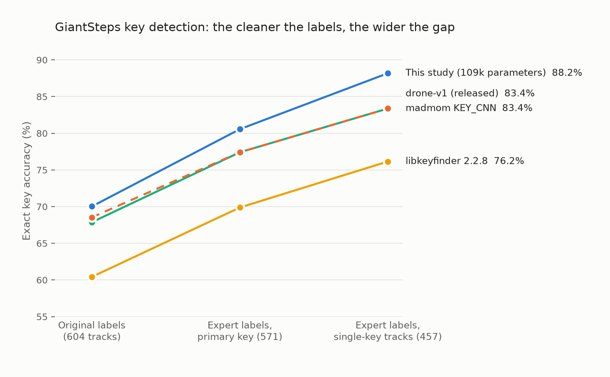

# Pushing a 109k-parameter key model: expert labels, distillation and the ceiling

Study dates: 13 to 14 November 2026. This report records every experiment in
the program, including the ones that failed, in the order they ran.

**Question.** How accurate can Drone's compact key detector become without
changing what ships? The deployed network stays the 109,128-parameter K10 CNN on
the existing constant-Q feature contract and runs on an ordinary CPU. All added
cost lives in training. The priority is DJ music (electronic, hip-hop, R&B,
reggae and related genres).

## Summary

- **The benchmark labels hide a large part of the progress.** The original
  GiantSteps key labels agree with the GiantSteps+ expert re-annotation on only
  81.96% of the 571 tracks both cover. Scored against the expert labels of
  single-key tracks instead of the original labels, every detector gains 15 to
  18 points, and the gaps between detectors widen.
- **A training recipe, not a bigger model, gave the gain.** Distillation from a
  pitch-shift-averaged ensemble plus pitch-shift augmentation of up to 12
  semitones raised a single K10 model from 84.8% to 87.5% exact on single-key
  GiantSteps+ tracks (3-seed means). A paired comparison over 794 development
  tracks puts the gain over the supervised control at +2.14 points (95%
  interval +1.05 to +3.27). The architecture, features and inference are
  unchanged.
- **Against published detectors on identical audio and labels** (exact
  accuracy, single-key GiantSteps+ tracks): libkeyfinder 76.2%, madmom's
  KEY_CNN 83.4%, the released drone-v1 83.4%, and the new recipe 88.2% (three
  seeds, nine pitch shifts averaged). Over madmom the gain is +4.8 points
  (paired 95% interval +2.2 to +7.4), and +4.9 on the half of GiantSteps+ that
  no decision in this study used.
- **The original labels tell a different story.** On them the best published
  exact accuracy is 72.0% (KeyMyna, a 22M-parameter encoder); this study's best
  is 70.0%. No state-of-the-art claim is made on the original labels.
- **The recipe has hit a ceiling near 88%.** Three times more unlabeled audio
  (2,100 hours), a teacher of nine students, a network four times larger, a
  harmonic-only feature view, and ensembles of up to 18 models all landed within
  about one point of the best recipe. Out-of-fold predictions flag 12.6% of
  the training labels as suspect, but training without them, or on the
  teacher's labels for them, did not help either.
- **For the product**, one shift12 model scored at nine pitch shifts reaches
  88.0%, nearly the three-model ensemble's 88.2%, with drone-v1's architecture
  and size.
- **Failed approaches, kept on record:** label-free equivariance pretraining,
  shift-consistency on unlabeled clips, a twice-wider network, two-minute
  crops, a second-stage decision model, and DJ-genre weighting of the
  unlabeled pool (which hurt, including on electronic music).

## Data

**Training.** The v2a corpus: 6,263 labelled tracks, 4,988 from FMAKv2 and 1,275
single-key tracks from GiantSteps-MTG-Key, after removing one byte-identical
duplicate with a conflicting label. An internal stratified 10% split selects the
checkpoint. Two 250-track FMAKv2 panels, `valid` and `holdout`, are scored once
after training.

**Unlabeled audio** (Experiments 4, 9 to 13), all from the Free Music Archive.
Every pool excludes the tracks of the evaluation panels.

| Pool | Tracks | Hours | DJ-genre tracks |
|---|---:|---:|---:|
| FMA medium clips (30 s) | 24,827 | 207 | not used |
| Round 8: 20,000 full-length tracks plus medium clips | 38,204 | 1,553 | 22,247 |
| Round 9: round 8 plus FMA large clips | 104,563 | 2,107 | 39,998 |

The full-length tracks were selected from FMA full: at most 15 per artist, 30
seconds to 15 minutes long, and streamed from the remote archive with HTTP
range requests rather than downloading its 900 GB. DJ genres are the
Electronic, Hip-Hop and Soul-RnB trees plus Reggae-Dub, Afrobeat and Dancehall.
Tracks present in several sources are counted once.

**Inherited exposure caveat.** DATA.md reserves 998 FMAKv2 recordings for
development confirmation and 159 for calibration. The v2a corpus predates that
plan: its training set contains 955 of the confirmation and 150 of the
calibration recordings, and its holdout panel 43 and 9. Any model in this study
has therefore seen most of that reserved set, and it can no longer confirm
these models.

## Evaluation

**GiantSteps Key** (604 two-minute previews of electronic music) is never used
for fitting or checkpoint selection. It is scored against three label sets:

| Panel | Tracks | Reference |
|---|---:|---|
| `gs_original` | 604 | First key of the published annotation |
| `gsplus_primary` | 571 | GiantSteps+ key covering the longest segment |
| `gsplus_clean` | 457 | GiantSteps+ tracks with a single segment and a single key |

GiantSteps+ ([Zenodo 4153506](https://zenodo.org/records/4153506), CC BY-SA 4.0)
re-annotates the collection with segment-level keys and modes. Of its 600 files,
28 have no major or minor key (for example "other" or atonal) and one has no
matching audio, leaving 571. An earlier parser dropped five valid annotations
written with `^` and `_` markers or the misspelling "aeonian"; it was fixed on
14 November and all numbers here use the fixed parse. GiantSteps was used during
development of earlier Drone releases, so it is not a fresh test for drone-v1.

**Metrics.** Exact accuracy is primary. The weighted MIREX score (fifth 0.5,
relative 0.3, parallel 0.2) is reported alongside it.

**Decision rule.** Each arm trains three seeds (13, 15, 42). For every track,
correctness is averaged over the three seeds, and arms are compared track by
track with a paired bootstrap (10,000 resamples) giving a 95% interval for the
difference. The development pool combines FMA `valid`, FMA `holdout` and a fixed
half of GiantSteps+ (794 tracks); the split assigns a track to the test half when
the first byte of `sha256("gsplus-split-v1:" + id)` is odd. An arm is
**adopted** when the pooled development interval lies above zero, **rejected**
when it lies below, and **inconclusive** otherwise. The GiantSteps+ test half is
reported but never used for a decision. Experiments 1 to 6 predate this rule.
Experiment 5's adoption was re-checked under it. Experiments 3, 4 and 6 were
rejected by margins large enough that they were not rerun; their numbers use
the earlier label parse (566 and 453 GiantSteps+ tracks) and are comparable only
with the control scored the same way (84.77 on `gsplus_clean`).

**Test-time pitch-shift averaging.** The feature grid carries a 4-semitone pad,
so each track can be scored at nine transpositions for the cost of nine slices.
Each prediction is rotated back by its shift and the probabilities are averaged.

## Where every detector stands

All six detectors scored on the same 604 decoded previews, against the same
label sets ([data/baselines-giantsteps.json](data/baselines-giantsteps.json)).

drone-v1 (dashed) and madmom coincide on both expert label sets. Exact accuracy:

| Detector | `gs_original` | `gsplus_primary` | `gsplus_clean` | `gsplus_clean`, test half |
|---|---:|---:|---:|---:|
| libkeyfinder 2.2.8 (corrected wrapper, defaults) | 60.43 | 69.88 | 76.15 | 74.78 |
| madmom KEY_CNN (pretrained) | 67.88 | 77.41 | 83.37 | 83.19 |
| drone-v1 (released) | 68.54 | 77.41 | 83.37 | 80.97 |
| Supervised control, 3-seed ensemble | 69.04 | 79.86 | 86.87 | 87.17 |
| Shift12 recipe, 3-seed ensemble | 69.70 | 79.51 | 87.09 | 86.28 |
| Shift12 recipe, ensemble and shift-averaged | 70.03 | 80.56 | 88.18 | 88.05 |

madmom's KEY_CNN reproduces its published 74.6 weighted score on `gs_original`
(74.62 here), which confirms the run. It and Drone were both trained on
GiantSteps-MTG-Key, which shares no track with the 604 test previews. The paired
comparison against madmom ([data/madmom-vs-shift12.json](data/madmom-vs-shift12.json)):

| Panel | madmom | Shift12, ensemble and shift-averaged | Difference | 95% interval |
|---|---:|---:|---:|---:|
| `gs_original` | 67.88 | 70.03 | +2.15 | 0.00 to +4.47 |
| `gsplus_primary` | 77.41 | 80.56 | +3.15 | +0.70 to +5.78 |
| `gsplus_clean` | 83.37 | 88.18 | +4.81 | +2.19 to +7.44 |
| `gsplus_clean`, test half | 83.19 | 88.05 | +4.87 | +1.77 to +8.41 |

The cleaner the labels, the wider the gap. Part of what looks like model error
on the original labels is label error shared by both detectors.

## Experiment 1: rescoring against expert labels

The original GiantSteps labels and the GiantSteps+ primary key agree on 81.96%
of the 571 shared tracks, and on 83.81% of the 457 single-key tracks
([data/label-agreement.json](data/label-agreement.json)). A detector that
matched the expert labels perfectly would therefore score about 82% against the
original ones. Every later experiment reports all three label sets.

## Experiment 2: supervised control

The v2a recipe, reimplemented with an in-memory feature store: AdamW (learning
rate 1e-3, weight decay 1e-4), cosine schedule over 120 epochs, batch 32,
320-frame crops (about 60 seconds), uniform pitch shifts of up to 4 semitones.
The checkpoint is chosen on internal validation MIREX only.

| Scoring | `valid` | `holdout` | `gs_original` | `gsplus_primary` | `gsplus_clean` |
|---|---:|---:|---:|---:|---:|
| Single model, 3-seed mean | 69.60 | 73.73 | 68.05 | 78.11 | 84.83 |
| Shift-averaged, 3-seed mean | 70.00 | 75.20 | 69.15 | 79.39 | 86.43 |
| 3-seed ensemble, shift-averaged | 70.80 | 76.00 | 69.54 | 80.74 | 87.96 |

For the ensemble on `gsplus_clean`, the correct key is among the top two
predictions for about 94% of tracks. The commonest errors are same-tonic mode flips,
then fifths, then relative keys.

## Experiment 3: label-free equivariance pretraining (rejected)

Hypothesis, after STONE and S-KEY: pretraining K10 without labels to be
transposition-equivariant would give a better starting point. Two crops of a
track at known shifts must produce tonic distributions offset by exactly that
shift, enforced with a loss on the 12-point DFT cross-correlation, plus a
cross-view consistency term and a balanced-mode entropy term.

The network found a shortcut. After 100 epochs it agreed on the shift between
views 90.7% of the time but reached only 7.4% exact key accuracy (chance is
about 4%). It learned to read the shift itself, probably from the spectral
envelope, rather than the tonality. A second attempt added a batch-level tonic
spread term and random silencing of up to 12 semitones at each edge: 43.5% shift
agreement, 7.3% exact. Fine-tuning from the first network with the control
recipe gave `gsplus_clean` 84.03 (mean of three seeds) against the control's
84.77. Rejected. This covers only K10 with a 4-semitone pad, not STONE's
octave-pooled architecture.

## Experiment 4: shift-consistency on unlabeled clips (rejected)

Each step also drew 64 unlabeled FMA medium clips at two random shifts. When the
first view's top probability, rotated by the shift difference, exceeded 0.9, it
became a hard target for the second view. Mean `gsplus_clean` 83.88 against
84.77, holdout 71.5 against 73.7. Rejected. One seed selected epoch 15,
suggesting the self-generated targets destabilised later training.

## Experiment 5: ensemble distillation (adopted)

The three control models scored every fitting track and every unlabeled clip at
nine shifts. The averaged probabilities form a soft key distribution per track:
the **teacher**. It agrees with the human label on 73.9% of fitting tracks,
which reflects label noise as well as teacher error.

The **student** keeps the control recipe and adds two terms: on labelled crops,
the loss is half cross-entropy with the human label and half cross-entropy with
the teacher, rotated by the crop's shift; each step also adds the teacher
cross-entropy on 64 unlabeled 160-frame crops. Three variants changed one thing
each: teacher-only labels (`softonly`, human weight 0), a heavier unlabeled term
(`softheavy`), and a second-generation teacher of six models (`gen2`).

| Arm | Single, 3-seed mean `gsplus_clean` | Pooled development vs control | 95% interval | Decision |
|---|---:|---:|---:|---|
| distill | 86.80 | +1.22 | +0.29 to +2.18 | adopt |
| softonly | 87.02 | +1.34 | +0.42 to +2.35 | adopt |
| softheavy | 86.80 | +1.47 | +0.46 to +2.52 | adopt |
| gen2 | 86.51 | +1.43 | +0.55 to +2.39 | adopt |

All four beat the control; none clearly beats the others. Distillation is
adopted as the base for later rounds.

## Experiment 6: wider network and longer crops (rejected)

A network of twice the width (about four times the parameters) and 640-frame
crops (about two minutes), each without distillation. Two of three seeds
finished per arm; the third ran out of GPU memory and was not rerun, because both
finished seeds were already below the control (`gsplus_clean` 81.90 and 83.44
for width 2, 82.56 and 83.00 for long crops). Rejected.

## Experiment 7: wider pitch-shift augmentation (adopted)

A large augmentation search for key detection found shifts of 12 semitones each
way best ([ISMIR 2021](https://archives.ismir.net/ismir2021/paper/000004.pdf)).
The cached features only cover ±4, so shifts beyond that zero-fill the bins that
fall outside the computed range. Distillation recipe, shifts of up to 7 or 12.

| Arm | `holdout` | `gsplus_primary` | `gsplus_clean` | Pooled development vs control | Decision |
|---|---:|---:|---:|---:|---|
| shift7 | 75.20 | 79.92 | 86.72 | +1.76 (+0.67 to +2.90) | adopt |
| shift12 | 76.80 | 80.09 | 87.53 | +2.14 (+1.05 to +3.27) | adopt |

Single-model 3-seed means. Against plain distillation, shift12 is +0.92 (0.00 to
+1.85): inconclusive, but positive on every panel. **Shift12 is the best recipe
of the study**, and the reference for every later experiment.

## Experiment 8: second-stage decision model (rejected)

The correct key is in the network's top two for 94% of clean GiantSteps+ tracks,
so a small model was trained to choose between the top two. It used 27 features:
the two probabilities and their stability across shifts, the musical relation
between the candidates, and chroma, bass and key-profile evidence. It was fitted
on out-of-fold predictions for all 6,263 training tracks from five-fold training.
Cross-validated, logistic regression raised exact accuracy from 69.12% to 69.23%
(26 changed answers: 14 corrected, 7 broken, 5 still wrong); gradient boosting
changed none ([data/reranker.json](data/reranker.json)). Rejected: the network
already uses what these features carry.

## Experiment 9: a large unlabeled pool, uniform or DJ-weighted (no gain)

The round 8 pool (38,204 tracks, 1,553 hours) was labelled by the control
teacher, with shift12 training. One arm drew unlabeled crops uniformly, the
other drew 80% of each unlabeled batch from DJ-genre tracks.

| Arm vs shift12 | Pooled development | FMA development | GiantSteps+ development | Decision |
|---|---:|---:|---:|---|
| uniform | -0.08 (-0.92 to +0.80) | +0.67 | -1.36 | inconclusive |
| DJ-weighted | -1.01 (-1.93 to -0.17) | -0.47 | -1.93 | reject |

DJ weighting hurt even on GiantSteps, which is all electronic music. A likely
reason: concentrating the batch on one slice of the pool amplifies the teacher's
mistakes on that slice. One DJ-weighted seed also peaked at epoch 22.

## Experiment 10: three times more audio and a stronger teacher (no gain)

The round 9 pool (104,563 tracks, 2,107 hours) was labelled by an ensemble of
nine students (shift12, shift7 and the uniform pool arm) averaged over shifts.
Three new students trained on it with shift12.

Against shift12, both shift-averaged: pooled development +0.13 (-0.50 to
+0.80), `gsplus_clean` test half -0.59. Inconclusive. The students now reach
their teacher's level (about 88% on `gsplus_clean`) and stop there.

## Experiment 11: a four-times-larger student (no gain)

If the 109k network lacked capacity to absorb 2,100 hours of teacher labels, a
wider one should gain. Width 2 on the round 9 recipe: pooled development -0.59
(-1.26 to +0.08) against shift12, GiantSteps+ development -1.36 (-2.61 to
-0.23). Inconclusive overall, and worse on GiantSteps+. Capacity is not the
limit.

## Experiment 12: a harmonic-only feature view (no gain)

A teacher whose members make different mistakes improves an ensemble more than
extra copies of the same model. The same CQT was computed after
harmonic/percussive separation (librosa HPSS, margin 2), for every labelled
track, all 604 GiantSteps previews and 104,529 of the round 9 pool tracks. The
round 9 teacher's labels were carried over. Single harmonic models score 85.41 on
`gsplus_clean` (3-seed mean), 1 to 2 points below the plain view.

**Ensemble ceiling.** Shift-averaged ensembles of every trained recipe
([data/ensemble-ceiling.txt](data/ensemble-ceiling.txt)):

| Ensemble | `valid` | `holdout` | `gsplus_clean` development | `gsplus_clean` test |
|---|---:|---:|---:|---:|
| shift12 (3 models) | 72.00 | 76.00 | 88.31 | 88.05 |
| shift12 + shift7 | 72.00 | 76.40 | 88.74 | 87.61 |
| shift12 + harmonic | 72.80 | 76.40 | 88.31 | 86.73 |
| all six recipes (18 models) | 72.80 | 76.40 | 88.31 | 87.17 |

No combination clearly beats shift12 alone. With the models this varied and
still agreeing, the limit is unlikely to be any one model.

## Experiment 13: suspect training labels (no gain)

If the ceiling comes from the labels, models trained on them inherit the same
mistakes. Confident learning
([Northcutt et al., 2021](https://arxiv.org/abs/1911.00068)) flags a label as
suspect when a model that never trained on the track confidently predicts
another key. Five-fold out-of-fold predictions, averaged over nine shifts, gave
the following ([data/confident-learning.txt](data/confident-learning.txt)):

| Source | Tracks | Out-of-fold exact | Suspect labels | Commonest disagreement |
|---|---:|---:|---:|---|
| FMAKv2 | 4,988 | 70.05% | 615 (12.3%) | unrelated key 202, fifth 186, relative 166 |
| GiantSteps-MTG-Key | 1,275 | 65.73% | 174 (13.6%) | same-tonic mode flip 79 |

The FMA `valid` and `holdout` labels come from the same annotation process, so
FMA scores are capped by the same noise; GiantSteps+ is the more trustworthy
reference.

Two arms rerun the round 9 recipe exactly, so round 9 is the like-for-like
baseline. In `clteacher`, suspect tracks learn from the teacher's soft label
only (human weight 0). In `cldrop`, they are removed from training. Both
shift-averaged:

| Arm | vs round 9, pooled development | vs shift12, pooled development | vs shift12, `gsplus_clean` test half | Decision |
|---|---:|---:|---:|---|
| clteacher | -0.59 (-1.30 to +0.13) | -0.46 (-1.18 to +0.25) | -0.44 | inconclusive |
| cldrop | +0.17 (-0.42 to +0.76) | +0.29 (-0.34 to +0.97) | -0.15 | inconclusive |

Neither helps. The test has a blind spot: the flags come from models that
already sit at the ceiling, so they catch labels those models disagree with,
not labels whose errors they share.

## What the ceiling means

Every route tried after experiment 7 landed within about one point of shift12:
more unlabeled audio, a stronger teacher, a larger student, a different
feature view, larger ensembles and cleaned labels. Distillation lets a student
reach its teacher, and pitch-shift augmentation makes it robust to
transposition; beyond that, this training set and this representation give
about 88% exact on single-key GiantSteps+ tracks and 72 to 77% on the FMA panels.

For the product, a single shift12 model scored at nine shifts reaches 88.04% on
`gsplus_clean` (3-seed mean), against 88.18% for the three-model ensemble, at
the same 109,128 parameters as drone-v1 and nine forward passes per track.

Routes not tried here, roughly in order of expected value:

- **A teacher that is not a K10.** KeyMyna's 72.0% on the original labels
  exceeds every model here (70.0%), so a large pretrained encoder fine-tuned on
  this training set may be the first teacher above the ceiling. The existing
  Myna head was weaker on FMA `valid`, but it was never scored on GiantSteps+.
- **More expert labels.** The FMA panels share the training set's annotation
  process, so FMA progress is hard to measure. Expert-labelled DJ tracks would
  sharpen both training and evaluation.
- **Key over time.** GiantSteps+ marks segments with different keys. A model
  that reports key changes would turn some current errors into correct answers
  for DJ use.

## Comparison with published systems

A survey of primary sources (14 November) found no published result on
GiantSteps+. On the original GiantSteps labels, the best reported exact accuracy
is 72.02% (KeyMyna, a frozen 22M-parameter Myna encoder with a small classifier,
[arXiv 2604.10021](https://arxiv.org/html/2604.10021)). madmom's
all-convolutional CNN reports 67.9% exact
([arXiv 1808.05340](https://ar5iv.arxiv.org/html/1808.05340)), which this study
reproduces. S-KEY reports 72.1 weighted on GiantSteps after self-supervised
training on one million songs ([arXiv 2501.12907](https://arxiv.org/html/2501.12907)).
For chords, a student pseudo-labelled on about 1,000 hours of audio has
exceeded its teacher ([arXiv 2602.19778](https://arxiv.org/html/2602.19778v3));
for keys in this study, it matched its teacher but did not exceed it.

The Myna classifier from an earlier Drone study scores 66.4% exact on `valid`
against 69.6% for the K10 control, so it was not used as a teacher. LFM-class
audio language models publish no key accuracy competitive with these numbers and
were not tested.

Published commercial comparisons put Mixed In Key at 89% exact on a 200-track
test labelled by one musician
([Dubspot](https://blog.dubspot.com/dubspot-lab-report-mixed-in-key-vs-beatport))
and 85.2% on a community chart hosted by the vendor
([Mixed In Key](https://mixedinkey.com/best-key-detection-software/)). Neither
publishes its track list, labels or scoring, so no comparison with this study
follows.

## Reproduction

The scripts are in [scripts/](scripts/). They need the v2a corpus, GiantSteps
and the FMA archives, located through environment variables (`DRONE_SOURCE`,
`DRONE_PREP`, `DRONE_GIANTSTEPS`, `DRONE_WORK`, and `DRONE_PYTHON` for the shell
scripts). The order in which they ran is `round1.sh` to `round12.sh`.

| Script | Role |
|---|---|
| `frontier_train.py` | Training, pretraining, distillation, folds, pools, feature views, suspect labels |
| `analyze.py` | Per-track probabilities at nine shifts, singly and as ensembles |
| `compare.py` | Paired decision rule |
| `teacher.py`, `teacher_pool.py` | Teacher labels for fitting tracks and pools |
| `fetch_fma_full.py`, `pack_pool.py`, `harmonic_pool.py` | Unlabeled pools |
| `extract_views.py`, `make_jobs.py`, `prepare_large.sh` | Plain and harmonic features |
| `reranker_features.py`, `reranker.py` | Experiment 8 |
| `confident_learning.py` | Experiment 13 |
| `madmom_predict.py`, `score_madmom.py` | madmom comparison |
| `keyfinder_predict.py`, `score_baselines.py`, `figure_detectors.py` | All-detector table and figure |
| `rescore_gsplus.py`, `ensemble_ceiling.py`, `table.py` | GiantSteps+ loading and summaries |
| `environment.py` | Reads the path environment variables |

The training script grew across rounds; the rounds ran successive versions.
Each version only added options whose defaults keep the earlier behaviour, so
the published final version can rerun every round. It is not bit-identical for
earlier rounds: the labelled loss is now computed per track and then averaged,
which changes floating-point order. The published scripts were also renamed for
readability after they ran, without changing what they compute.

Data: per-run results with per-epoch histories in [data/runs/](data/runs/),
per-arm scoring in [data/analysis/](data/analysis/), every paired decision in
[data/comparisons/](data/comparisons/), and pool summaries in `data/`.
