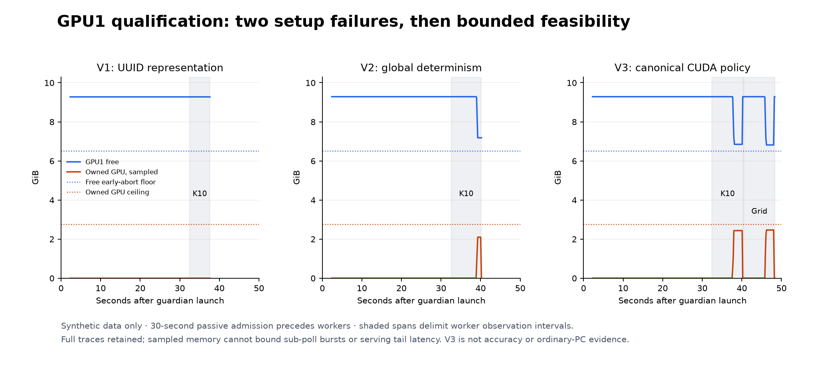
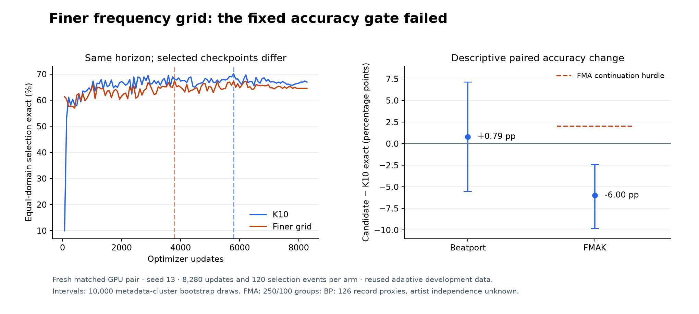

# K10 capacity and frequency resolution

Neither change improved key accuracy. Doubling the width of the K10 key model
(109,128 to 361,080 parameters) lowered symmetric MIREX by 2.14 points on Beatport
and 1.08 points on FMAK. A follow-up that kept the parameter count fixed but kept
a finer frequency grid lost 15 FMA exact cases (70.40% to 64.40%) while gaining one
Beatport case. The released architecture and weights stay unchanged.

The study has three parts, run in November 2026: the width-2 pilot, a compute and
memory check of a finer-grid candidate, and a matched accuracy comparison of that
finer-grid candidate.

## Part 1: a wider model

### Question

Does more capacity give a stronger supervised key model, worth using as a teacher
for distillation? The small release model has 109,128 parameters. This part tests
one wider model with 361,080 parameters (channel widths 32/64/128 instead of
16/32/64). It does not assume parameter count is the current accuracy bottleneck.

### Method

The [protocol](PROTOCOL.md) compares width 2.0 against width 1.0 with everything
else fixed: the same 2,206 fitting and 376 validation recordings, CQT inputs,
augmentation, hard cross-entropy loss, batch size, AdamW, cosine schedule and
early-stopping rule. There was no width, learning-rate or regularization sweep.
Models of different shape consume different random draws at initialization and
in dropout, so the two arms do not share initial weights. The data and crop
schedule is identical.

The width-1 control (seed 13) is the control from the
[structured-target study](../k10-structured-targets/REPORT.md). It was reused only
after its checkpoint, training history and predictions were checked to match the
archived run exactly.

Pre-set success threshold: the candidate had to gain at least 1.0 symmetric MIREX
point on FMAK, with no Beatport MIREX loss and no exact-accuracy loss in either
domain. Only a passing candidate would earn two confirmation seeds (37 and 73).
The candidate had a 45-minute time limit, enough for the full 120-epoch schedule.
It neither ran out of memory nor out of time.

### Results

| Arm | BP symmetric / asymmetric MIREX | BP exact | FMAK symmetric / asymmetric MIREX | FMAK exact |
|---|---:|---:|---:|---:|
| Width-1 control | 76.11 / 73.33% | 68.25% | 75.48 / 74.48% | 68.40% |
| Width-2 candidate | 73.97 / 71.98% | 67.46% | 74.40 / 72.80% | 66.80% |

*Figure 1. The wider model scores lower on every metric in both domains, so it
misses the threshold. Symmetric-fifth MIREX was the metric fixed for selection.*

Symmetric MIREX changed by -2.14 points on Beatport and -1.08 points on FMAK.
Exact accuracy fell by 0.79 and 1.60 points. On FMAK, 12 tracks became correct and
16 became wrong; on Beatport, 8 became correct and 9 became wrong. Full error-category
movement under both MIREX conventions is in the [candidate result](data/candidate-result.json).

*Figure 2. Training loss and validation score per epoch for both arms; markers show
the selected epochs. The candidate selected epoch 20 and stopped at 45; the control
selected epoch 37 and stopped at 62.*

At epoch 20, fitting loss was 1.331 for the control and 1.367 for width 2, so the
data do not support a simple "the larger model fits better but overfits" story.
Candidate training took 274.26 seconds; different stopping epochs and machine load
rule out a throughput comparison. Peak PyTorch memory was 3.16 GB allocated and
4.57 GB reserved (training only, not inference or application memory).

### Decision

The wider model did not produce a stronger teacher, so no confirmation seeds, larger
product tier or distillation followed. This tests one unchanged recipe; it does not
show that every larger model is worse, since model size and optimizer settings
interact. It is not a reason to start a hyperparameter sweep. A targeted
architecture or data hypothesis is a better next step than more capacity alone.

## Part 2: a finer frequency grid at the same size

### Question

Can keeping finer frequency positions inside the network improve key recognition
without making the model larger? The [protocol](RESOLUTION_PROTOCOL.md) fixes one
candidate: six convolutions with 16/32/32 channels and pooling (2,2), (1,2), (1,2),
followed by averaging over time and a frequency-aware dense head. It uses the same
192-bin CQT input, with no octave folding, circular weight sharing, teacher
features or optimizer change.

The final feature grid has one-semitone spacing. Ordinary K10's coarser grid does
not force pitch to be quantized, because channels can still carry within-cell
information, so this tests a joint change in how capacity is spent and how much
frequency detail is kept. The [InceptionKeyNet paper](https://archives.ismir.net/ismir2021/paper/000004.pdf)
motivates keeping frequency localization; it does not predict this compact model's
accuracy.

### Compute and memory cost

*Figure 3. Parameter counts and multiply-accumulates (MACs) for convolution and
linear layers. The candidate moves parameters from the backbone to the head and
needs fewer MACs. These counts exclude normalization, activations and pooling.*

| Quantity | Ordinary K10 | Finer-grid candidate |
|---|---:|---:|
| Trainable parameters | 109,128 | 108,936 |
| Backbone / head parameters | 72,240 / 36,888 | 35,184 / 73,752 |
| Last hidden shape before time mean | 64×24×floor(T/8) | 32×96×floor(T/8) |
| Conv+linear MACs at T=320 | 575,115,264 | 504,373,248 |
| Local frequency receptive field | 36 input bins | 22 input bins |
| Local temporal receptive field | 36 frames | 36 frames |

The candidate needs about 12.3% fewer counted MACs. At T=320 its largest single
FP32 activation is unchanged at 3,932,160 bytes, though some intermediate tensors
double in size.

A small CPU timing check (PyTorch 2.15 on an arm64 Mac, two threads, inference
mode, one warmup and three samples per model and length) gave median times for
K10 versus the candidate of 4.466 vs 3.865 ms at T=65, 21.812 vs 17.899 ms at T=320
and 74.945 vs 74.537 ms at T=1615. Three samples are too few to claim a reliable
speedup, and the long case is a tie.

A GPU check then confirmed that both models could train and evaluate at full
length within the memory available on the shared training GPU (see the
[resource protocol](GPU1_RESOURCE_PROTOCOL.md)). It used random inputs with the
real frame counts of the 376 validation recordings, plus four extra lengths
(T=8, 65, 320, 321), and ran three AdamW updates on 32×192×320 batches followed by
full-length evaluation in batches of 4. No task data, labels or scores were used.

The first two attempts stopped before any weight update because of setup bugs,
not resource limits. The first compared GPU identifiers written in two different
text formats ([details](data/resolution-gpu1-identity-failure.json)). The second
turned on PyTorch's global deterministic-algorithms mode, which does not support
the backward pass of AdaptiveAvgPool2d on CUDA
([PyTorch documentation](https://docs.pytorch.org/docs/2.15/generated/torch.use_deterministic_algorithms.html),
[details](data/resolution-gpu1-determinism-failure.json)). The third attempt used
the project's usual settings (global deterministic mode off, cuDNN deterministic
on, cuDNN benchmark off, TF32 off, FP32 without mixed precision) and completed.

| Attempt | Reached | Outcome | Peak GPU memory | Wall time |
|---|---|---|---:|---:|
| 1 | Device check, before model creation | Identifier format mismatch; no updates | 0 MiB | 37.57 s |
| 2 | First backward pass | Deterministic-mode restriction; no updates | 2,148 MiB | 40.17 s |
| 3 | Both models: three updates and all 376+4 lengths | Complete | 2,524 MiB | 48.29 s |

*Figure 4. GPU memory over time for the three attempts, with every recorded sample
shown. Only the third attempt reaches training and evaluation for both models, and
its memory stays well below the free memory available.*

| Attempt 3 quantity | Ordinary K10 | Finer-grid candidate |
|---|---:|---:|
| First update (includes train/eval switch) | 0.345 s | 0.366 s |
| Next two updates | 0.0279 / 0.0263 s | 0.0276 / 0.0267 s |
| Evaluation of 376 synthetic inputs | 1.123 s | 1.045 s |
| Evaluation of 4 extra inputs | 0.0169 s | 0.0119 s |
| PyTorch allocated / reserved peak | 1,459 / 1,828 MiB | 1,555 / 1,860 MiB |
| Peak GPU memory of the process | 2,492 MiB | 2,524 MiB |

Both models processed 372,532 validation frames in 284 full-length forward groups,
plus 714 frames in the four extra groups. Seed-13 initialization matched the
expected weights. Times include generating the random inputs and checks; they
omit real CQT loading and augmentation, so they are not a training-speed estimate.
Peak host memory was 1.94 GB and total CPU time 27.55 seconds. Free GPU memory
never fell below 6,979 MiB.

## Part 3: matched accuracy comparison of the finer grid

### Method

Following the [pair protocol](RESOLUTION_GPU_PAIR_PROTOCOL.md), a fresh ordinary
K10 control and the finer-grid candidate were trained on the same GPU with the same
1,229 Beatport and 4,033 FMA fitting recordings, identical crop positions, pitch
shifts and sampling order, batch size 32, 320-frame crops, hard cross-entropy and
AdamW with a cosine schedule. Both completed all 8,280 updates and all 120
full-song validation evaluations with no early stopping; every one of the 5,262
fitting recordings was sampled. Both used seed 13. Seeded GPU training is not
bitwise reproducible.

Checkpoints were selected by mean exact accuracy over the two domains, then
symmetric MIREX, then earliest update. The control selected update 5,796 and the
candidate update 3,795. Each selected checkpoint was reloaded and re-evaluated on
all 376 full-length validation inputs, giving identical scores and predictions.

Pre-set success threshold: the candidate needed at least 5 more FMA exact cases out
of 250, with no decline in Beatport exact or either MIREX score. In addition, the
fresh control had to match or beat the earlier GPU control from the
[v2 pilot](../k10-v2-pilot/REPORT.md) on exact and both MIREX scores in both domains,
to confirm the setup was comparable.

### Results

| Selected model | BP exact | BP symmetric / asymmetric MIREX | FMA exact | FMA symmetric / asymmetric MIREX |
|---|---:|---:|---:|---:|
| Fresh ordinary K10 | 88/126 = 69.84% | 75.79 / 74.21% | 176/250 = 70.40% | 75.56 / 74.76% |
| Finer-grid candidate | 89/126 = 70.63% | 75.48 / 74.68% | 161/250 = 64.40% | 72.44 / 70.24% |

*Figure 5. Left: validation curves over the full schedule, with dashed lines at the
selected updates. Right: candidate minus control exact accuracy with 95% bootstrap
intervals. The FMA interval lies entirely below zero, far from the +2-point
threshold marker.*

Exact accuracy changed by +0.79 points on Beatport (95% interval -5.56 to +7.14)
and -6.00 points on FMA (95% interval -9.81 to -2.42). The intervals come from
10,000 bootstrap replicates (seed 20261112) resampling 100 FMA metadata clusters and
126 Beatport recordings (Beatport artist overlap is unknown). They resample the
selected predictions only, not training or checkpoint selection. FMA had 2 tracks
become correct and 17 become wrong; Beatport had 9 and 8. FMA symmetric and
asymmetric MIREX fell by 3.12 and 4.52 points, and Beatport symmetric MIREX also
fell despite the one extra exact case.

The comparability check also failed. The fresh control had one fewer correct
Beatport track than the earlier GPU control, and its symmetric / asymmetric MIREX
was lower by 1.35 / 0.95 points on Beatport and 0.28 / 0.28 points on FMA. Its FMA
exact count matched. The cause of this difference is not known. The pair itself is
internally matched, and the candidate's primary comparison fails on its own.

By duration, on the 37 FMA validation tracks of 5 to 10 minutes the exact count went
from 27 to 28, and the 2 tracks over 10 minutes were correct for both models. Below
5 minutes, FMA had 17 new errors and 1 repair. These slices are small and mixed in
genre, so they say nothing reliable about long DJ tracks. Beatport inputs are about
two-minute previews.

The whole comparison took 767.72 seconds (12.80 minutes), including setup, both
arms, reloads and checks; the training loops took 359.46 and 358.70 seconds,
including their repeated validation and checkpoint writes. Total CPU time was
879.78 seconds, peak host memory 2.28 GB, and peak GPU memory 2,526 MiB, with free
GPU memory never below 6,977 MiB.

## Decision

Keep the released K10 architecture and weights. The width-2 model and the finer-grid
model both failed their pre-set thresholds, so neither received confirmation seeds
or release consideration. These results reject one wider recipe and one
resolution/channel allocation; they do not justify a new width, optimizer or
duration-weighting search.

## Limitations

- Each comparison uses one seed, and the validation set had already been used for
  earlier model selection, so the intervals do not cover seed variation or fresh
  test data.
- Part 1 tests one unchanged training recipe at one larger width.
- The finer-grid model's local frequency receptive field is 22 input bins (11
  semitones). The dense head can combine distant features only linearly, so the
  model has less nonlinear octave context. The negative result applies to this
  architecture, not to high-resolution designs in general.
- The fresh control in Part 3 did not reproduce the earlier GPU control exactly.
- No calibration, final-test or private DJ data was used.

## Reproduce

- Part 1: the training code is preserved at the git tag `research/k10-capacity-v1`.
  [Candidate result](data/candidate-result.json) holds the control check, metrics
  and threshold evaluation; [history extracts](data/histories.json) hold the
  per-epoch curves. Full runs and checkpoints are kept outside the repository.
  Figures 1 and 2: `uv run --extra plots python -m tools.plot_research`.
- Part 2: the [synthetic screen](data/resolution-shape-audit.json) and its
  [provenance](data/resolution-shape-audit-provenance.json) keep the prototype source
  that produced the timings. Figure 3: `uv run --extra plots python -m tools.plot_k10_resolution`.
  The GPU check's [raw bundle](data/resolution-gpu1-raw.json.gz) and
  [index](data/resolution-gpu1-index.json) contain metadata and synthetic-shape
  records only. Verify with `uv run python -m tools.report_k10_gpu1`; add
  `--extra plots` before `python` and `--plot` after the module name to redraw Figure 4.
- Part 3: the [raw archive](data/resolution-pair-raw.tar.gz) holds the 24 metadata
  files (histories, selected predictions, configuration) and the
  [index](data/resolution-pair-terminal-index.json) checks their bytes. No audio,
  CQT arrays or weights are included. Verify scores, selection and intervals with
  `uv run python -m tools.report_k10_resolution_pair`; add `--plot` with the plots
  extra to redraw Figure 5.
