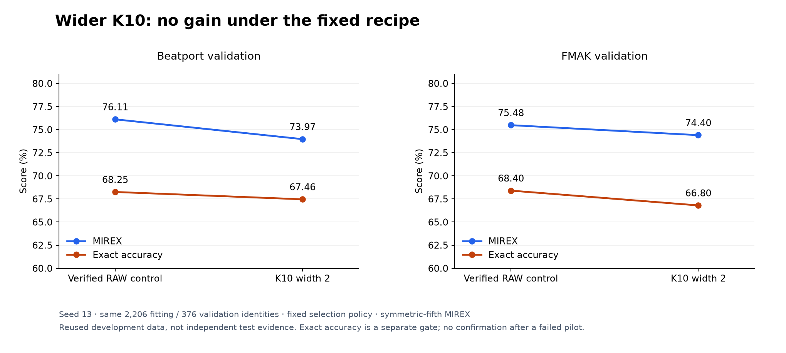
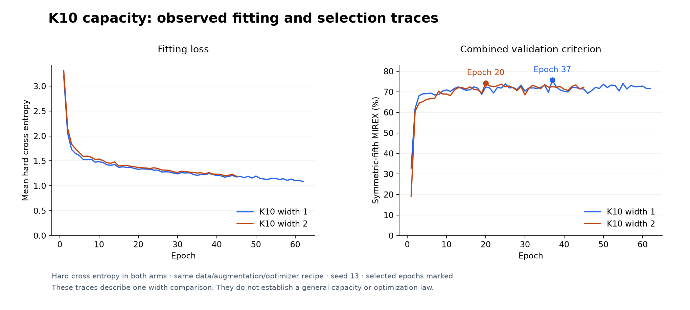

# Wider K10: no stronger teacher under the fixed recipe

## Problem

Does more supervised capacity produce a stronger own-key teacher before investing
in distillation? The small release candidate has 109,128 parameters; this study
tests exactly one wider model with 361,080. It does not commit to product tiers
or assume parameter count is the current accuracy bottleneck.

## Method

The [protocol](PROTOCOL.md) fixes width 2.0 versus width 1.0, with the same clean
2,206 fitting / 376 validation identities, CQT caches, augmentation, hard CE,
batch size, AdamW, cosine horizon and selection/early-stopping rule. No width,
learning-rate or regularization sweep. Different parameter shapes necessarily
consume different initialization/Dropout RNG draws; shared channel initialization
is not claimed. The NumPy data/crop schedule remains unchanged.

The already reproduced seed-13 control from the [structured-target study](../k10-structured-targets/REPORT.md)
was reused only after rechecking actual checkpoint tensors, history, predictions
and artifact hashes against the archived joint run. Explicit source/math audits
complement that proof. The candidate needed at least one FMAK MIREX point, no
Beatport MIREX loss and no exact loss in either domain to earn confirmation.

An upfront 45-minute candidate budget allowed the full 120-epoch horizon; controls
retain 20 minutes. Only this candidate could raise the allocator cap to 8% after
requiring 12 GiB free. OOM/timeout would be resource/budget-inconclusive rather
than an accuracy-negative result. Neither occurred; vLLM stayed running.

## Results

| Arm | BP symmetric / asymmetric MIREX | BP exact | FMAK symmetric / asymmetric MIREX | FMAK exact |
|---|---:|---:|---:|---:|
| Verified width-1 control | 76.11 / 73.33% | 68.25% | 75.48 / 74.48% | 68.40% |
| Width-2 candidate | 73.97 / 71.98% | 67.46% | 74.40 / 72.80% | 66.80% |

*Figure 1. The wider candidate misses the method gate. Symmetric-fifth MIREX
is the fixed selection convention; asymmetric MIREX and exact accuracy expose
different error consequences.*

Symmetric-MIREX changes were **−2.14 Beatport / −1.08 FMAK points**. Exact accuracy
fell 0.79 / 1.60 points. FMAK had 12 exact promotions and 16 exact demotions;
Beatport had eight promotions and nine demotions. Full category movement matrices
under both conventions are retained in the raw result.

*Figure 2. Both arms use hard CE. Markers identify selected epochs. The candidate
selected epoch 20 and stopped at 45; the control selected 37 and stopped at 62.
These descriptive traces do not isolate a general capacity/optimization effect.*

At matched epoch 20, fitting loss was 1.331 for control and 1.367 for width 2.
The data do not establish a simple “larger model fits better but overfits” story.
Candidate wall time was 274.26 seconds; differing stop epochs and system load
prevent a direct training-throughput claim. Peak Torch allocations were 3.16 GB,
with 4.57 GB reserved. These exclude some CUDA/runtime memory; they are not an
inference or application RSS measurement.

## Discussion and decision

The fixed wider recipe did not earn a stronger teacher, confirmation seeds or a
larger product tier. It does not prove that every larger model is worse: model
scale and optimizer compatibility interact, and only one unchanged recipe was
tested. Do not start an opportunistic hyperparameter sweep from this result.

Keep release weights unchanged. A more targeted inductive-bias or data hypothesis
is justified before assuming capacity alone will close the accuracy gap. One seed
on reused validation cannot establish generalization or a route to 90% exact.
No calibration/final/SWD/private predictions or distillation followed.

## Reproduction and evidence

The actual fitting source is preserved by the [`research/k10-capacity-v1`](https://github.com/lvndry/drone/tree/research/k10-capacity-v1) tag.

Actual fit source: `679b7fdb021af64cb2816c8b61d571a5d3ac773c`, based on
`a1abac9ddad927830b0409f80d6908502eeab2cd`. Replay fitting from the frozen source,
not an evolving combined runner. [Candidate result](data/candidate-result.json)
contains the independently reverified control proof, source/math audits, logits
artifact hashes, memory policy and gate. [History extracts](data/histories.json)
retain original run hashes; full runs/checkpoints remain under
`/home/lysk-admin/drone-experiments/k10-capacity-20261111-v1` and the referenced
structured-control directory. No archived source/protocol bytes were changed.
Regenerate figures with `uv run --extra plots python -m tools.plot_research`.
