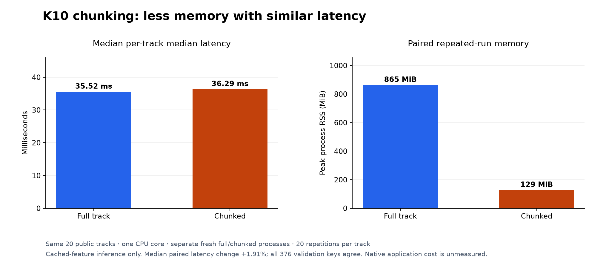
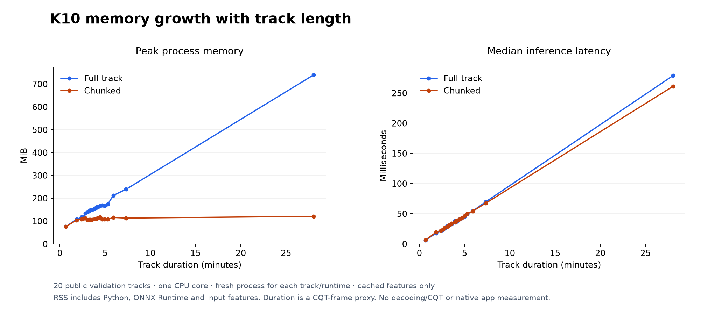

# K10 chunked CPU inference

Running K10 in aligned, overlapping chunks keeps every key decision on all 376 public validation inputs (maximum logit difference 1.90735e-6) while cutting peak process memory 6.69x, from 865.34 MiB to 129.32 MiB; median paired latency rises 1.91%, within the pre-set 10% limit. The saving grows with track length: at about 28 minutes, peak RSS is 739.6 MiB for full-track inference and 120.7 MiB chunked, while a 40-second track sees no saving. Measured on November 11, 2026, from cached features with Python and ONNX Runtime.

## Question

The [CPU baseline](../k10-cpu/REPORT.md) showed that small weights can still need substantial memory for long-track activations. Can we bound those activations while keeping all of the track's evidence and every key decision, with at most a 10% median paired latency increase?

## Method

The [protocol](PROTOCOL.md), fixed before the run, uses aligned overlapping chunks: 64 output positions per core, 16-frame halos and at most 544 input frames per prefix call. Every global output is counted once. Hidden values are accumulated in FP64, averaged and cast to FP32, then pass once through the unchanged ONNX head. Weights, track evidence and the full ONNX reference stay unchanged.

The numerical threshold, fixed before the run, requires finite logits, absolute and relative tolerance 1e-5, and zero key disagreements on all 376 public validation inputs. Reference keys are not used for scoring or selection. Resource measurement runs only if this passes. Boundary, remainder, impulse and extreme synthetic tests supplement the check; no general bitwise floating-point equivalence is claimed.

Resource measurements use the same 20 selected FMAK validation recordings as the baseline, one CPU core of an AMD Ryzen Threadripper PRO 9955WX, all library and model threads set to 1, sequential ONNX Runtime and spinning disabled. Fresh full and chunked processes each run one warmup and 20 repetitions per track. The memory target is at least 2x lower peak RSS than both the paired full run and the earlier 535 MiB single-pass measurement. No training ran on the machine during measurement.

## Results

All 376 key decisions matched. Maximum logit difference was 1.90735e-6.

| Cached-feature inference | Full ONNX | Chunked ONNX |
|---|---:|---:|
| Median of 20 per-track median latencies | 35.52 ms | 36.29 ms |
| Peak process RSS | 865.34 MiB | 129.32 MiB |
| Loaded-runtime peak RSS before tracks | 62.59 MiB | 61.34 MiB |



Figure 1: each mode runs all 20 tracks in one fresh process. Median paired latency rises 1.91% and peak RSS falls 6.69x, so both thresholds pass. The bar medians and the median of paired ratios are different summaries.

Peak RSS is also 4.14x below the earlier single-pass measurement; different allocator history rules out a direct speed comparison across the two protocols. Both processes were Torch-free and used 20.02 and 19.55 CPU seconds. Separate Torch checks found zero key differences, maximum logit error 5.72205e-6, and identical stitched and full ORT hidden tensors. Rounding discrepancies on extreme synthetic inputs are documented in the data.

### Memory versus track length

A follow-up started a fresh process for each track and mode (40 processes, the same 20 inputs and repetition count), so allocator history does not carry across tracks. It took 44.53 seconds and passed the same numerical and key check.



Figure 2: per-track peak RSS and latency against duration. Full-track RSS grows strongly with duration while chunked RSS levels off. RSS still includes Python, ORT and the full input feature array. Lines connect points and are not a fitted scaling law.

| Approximate duration | Full peak RSS | Chunked peak RSS |
|---|---:|---:|
| 40 seconds | 75.8 MiB | 76.0 MiB |
| 4 minutes | 158.3 MiB | 110.7 MiB |
| 28 minutes | 739.6 MiB | 120.7 MiB |

Typical song lengths save less than the longest case. Durations are estimated from CQT frame counts, and no tracks between roughly 7 and 28 minutes were measured. These per-track peaks and the all-tracks peaks in Figure 1 come from different protocols.

## Decision

Chunking passes both pre-set thresholds and moves on to native integration testing (see the [native cached-feature study](../../../research/drone-native-cached/REPORT.md)). Next steps are native parity and end-to-end profiling, stored result caching and bounded concurrency. No release artifact was promoted.

## Limitations

- Observed parity on 376 inputs is not a general accuracy guarantee.
- This bounds CNN activation memory only, not decoding, CQT or input storage.
- Neither measurement covers the Rust application, target laptops or idle application memory.
- The first resource attempt failed before measuring because its reader expected the key `sha` instead of `sha256`. A regression test covers that bug, validation was rerun before the successful measurements, and the failed report is kept.

## Reproduce

[Paired reports and provenance](data/provenance.json) record source archives, contracts and environment for both measured versions; the unchanged model bundle is kept with the server artifacts. [Per-track data](data/memory-curve.json) and its [provenance](data/memory-curve-provenance.json) identify the follow-up implementation and its validation report.

Replay the follow-up with `python -m tools.benchmark_k10_memory_curve --help`, using Linux CPU affinity 0, thread counts of 1 and a new output path. The tool requires the exact passing artifacts and source evidence and enforces a 600-second wall limit.

Regenerate the figures without audio or server access:

```bash
uv run --extra plots python -m tools.plot_research
```

Checked-in JSON supplies all figures. [Figure inputs](../figure-inputs.json) record data, generator and lockfile hashes and the plotting-library version.

After a refactor of the typed input and evidence helpers, all 376 inputs were validated again before native input export. [The new report](data/v3/validation.json) records zero numerical or key failures and the same maximum logit error, 1.90735e-6, and records every support module and the environment, so an unchanged command-line entry point cannot reuse old parity evidence after its implementation changes. [Export provenance](data/v3/native-fixture-export.json) records 376 completed FP32 inputs, exactly 20 performance selections and a 13.16-second export. This checks implementation integrity, not accuracy or native performance. The earlier v1 and v2 reports are unchanged.
