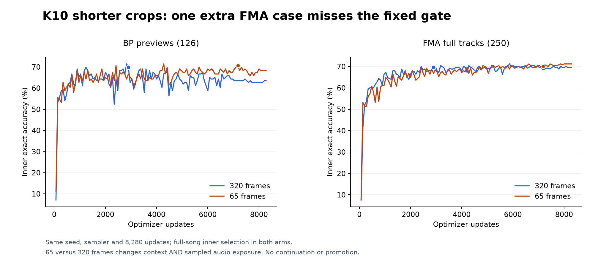
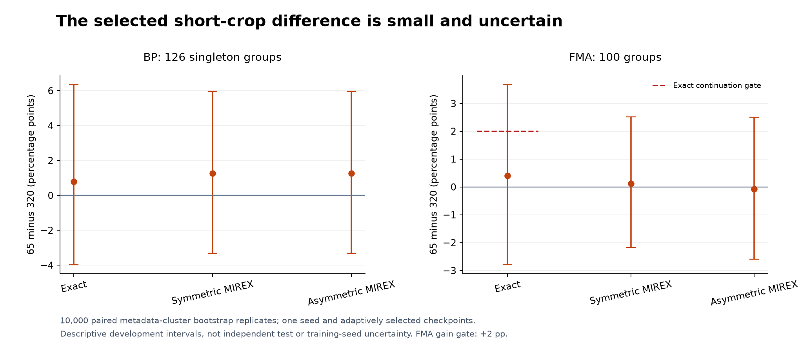
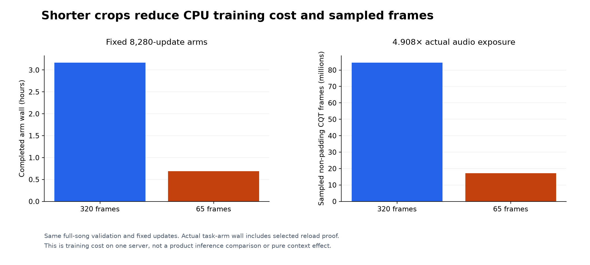

# K10 crop context and audio exposure: completed matched CPU pair

**The 65-frame candidate misses the fixed accuracy gate. No continuation or
promotion is earned.** On the common selected FMA panel it gains one correct case
(+0.40 percentage points), below the required five. BP exact and both BP weighted
scores improve, but the fresh 320-frame CPU control also fails the separately
frozen historical-score guard. Both complete fixed horizons and checkpoint reload
proofs. Release weights, confirmation and calibration remain untouched.

## Question and fixed method

The experiment asks whether a shorter training crop is a useful lever for this
compact classifier under a matched update budget. It compares **65 versus 320
cached CQT frames**, nominally **12.07 versus 59.44 seconds**. This changes sampled
audio exposure, length-dependent crop starts, pooling, BN statistics and gradient
noise along with context. It is not a pure context effect, a teacher architecture
comparison, or a CPU deployment tier. It does not match the MusicFM waveform/mel
frontend or establish why the teacher differs.

The [frozen protocol](PROTOCOL.md) was prospective when written. Execution later
received its own exact approval; its original preparation-only wording remains
historical. Both fresh seed-13 KeyCNN instances use the same 109,128-parameter
architecture and tensor initialization, 1,229 BP + 4,033 FMA fitting identities,
nominal BP sampling mass 1230/2206, keyed IDs/seeds/pitch-bin-reslice augmentation,
batch 32 and uniform legal crop-start rule. Starts depend on crop length; the
common stream is not an identical temporal view. Both use FP32 CPU AdamW
(lr 1e-3, weight decay 1e-4), the same cosine schedule, **8,280 updates / 120
selection events**, and no independent early stopping. CPU affinity is 14–15,
Torch two threads / inter-op one, numeric-library threads one, nice 19 and CUDA
masked. The 320 arm runs first; the 65 arm is independently initialized afterward.

Every 69 updates, the original batch-four evaluator processes the same **376
full true-length feature arrays / 372,532 frames**: BP126 and FMA250. Equal-domain
exact is the primary selector, equal-domain symmetric MIREX the tie-break, and the
earliest tied event wins. Both MIREX conventions are reported. These panels are
repeatedly exposed development data. FMA has audited artist/album grouping; BP
has ID/exact-audio guards and incomplete artist identity, not artist-disjoint
validation. No calibration, reserved confirmation, old final or private DJ input
is used. Full-duration evaluation here means the available recording: BP inputs
are approximately two-minute previews.

## Completed accuracy and fixed decisions

| Selected arm | Update | BP exact | BP symmetric / asymmetric MIREX | FMA exact | FMA symmetric / asymmetric MIREX |
|---|---:|---:|---:|---:|---:|
| 320 frames | 2,898 | 88/126 (69.84%) | 76.11% / 74.52% | 174/250 (69.60%) | 75.20% / 74.60% |
| 65 frames | 7,176 | 89/126 (70.63%) | 77.38% / 75.79% | 175/250 (70.00%) | 75.32% / 74.52% |



The canonical candidate was fixed as 65 frames before outcomes. Its continuation
rule requires at least **+5 FMA exact cases** with BP exact and both BP MIREX
conventions nondeclining versus fresh CPU320. The measured FMA gain is **+1**;
this gate fails. FMA weighted scores were reporting metrics, not an added gate.
The separate historical control guard requires CPU320 to avoid any decline in
both domains' exact and both weighted metrics versus the earlier expanded CUDA
control. It also fails: CPU320 loses **1 BP exact case and 2 FMA cases**, with
symmetric/asymmetric integer weighted-score gaps of −13/−8 BP and −16/−11 FMA
(each unit is 0.1 track credit). These are disclosed CPU/CUDA and thread-count
comparisons, not a claim of historical numerical trajectory reproduction. The
failed guard is retained; no threshold or denominator is relaxed.

Selected exact error movements are **6 repairs / 5 new errors** on BP (83 both
correct, 32 both wrong) and **9 repairs / 8 new errors** on FMA (166 both correct,
67 both wrong). No winning arm, additional seed or longer horizon was chosen
from these outcomes.



| 65 minus 320 | Exact delta [95% interval], pp | Symmetric delta [interval], pp | Asymmetric delta [interval], pp |
|---|---:|---:|---:|
| BP | +0.79 [−3.97, +6.35] | +1.27 [−3.33, +5.95] | +1.27 [−3.33, +5.95] |
| FMA | +0.40 [−2.79, +3.67] | +0.12 [−2.17, +2.51] | −0.08 [−2.59, +2.50] |

Intervals use 10,000 paired metadata-cluster bootstrap replicates, seed 20261112:
126 singleton BP groups and 100 FMA groups (largest five). They are **descriptive
adaptive-development intervals from one seed**, not independent test evidence,
training-seed variability or proof of BP artist independence. Current metadata
cannot guarantee all work/near-duplicate relationships are known.

## Duration and primary-use limitations

| Domain / actual duration | Tracks / groups | 320 correct → 65 correct |
|---|---:|---:|
| BP <2 minutes | 5 / 5 | 4 → 4 |
| BP 2–<5 minutes | 121 / 121 | 84 → 85 |
| BP 5–10 or >10 minutes | 0 / 0 | — |
| FMA <2 minutes | 32 / 18 | 21 → 21 |
| FMA 2–<5 minutes | 179 / 80 | 124 → 123 |
| FMA 5–10 minutes | 37 / 27 | 27 → 29 |
| FMA >10 minutes | 2 / 2 | 2 → 2 |

Actual canonical sample counts define the bins (600 seconds is included in
5–10 minutes); groups may span bins and must not be summed as independent groups.
The five slightly sub-120-second BP inputs do not establish a shorter-song cohort.
The FMA 5–10-minute stratum is not a verified house panel. Available metadata
supports only **five 5–10-minute House inner examples in three groups**, no
8–10-minute House examples and no verified deep-house/melodic-house tags. This
study cannot establish reliable accuracy for the user's primary long-house use.
Broad Electronic and unknown genre identities remain distinct. No private library
or new external panel was consulted to improve these results.

## Resource qualification and completed execution

The earlier [disposable CPU qualification](RESOURCE_PROTOCOL.md), source
`804b21c`, used three actual batch-32 fitting draws per crop size with **synthetic
targets only**, then one full 376-song pass per size with no retained predictions,
task scores or weights. Whole-controller cost was 34.826 wall seconds, 56.44
aggregate CPU-seconds and 2,464,256,000 bytes peak whole-tree RSS. The 320 update
compute times were 1.2105/1.1403/1.0679 seconds; the 65 times were
0.1397/0.1410/0.1296 seconds. Full validation took 12.196 and 10.394 seconds.
Per-arm Linux lifetime high-water values are not independent peak measurements.
The qualification established finite resource feasibility, not accuracy.

The actual task pair completed in **13,902.322 seconds (3.862 hours)**, using
**26,496.92 aggregate CPU-seconds** and **3,014,115,328 bytes (2.807 GiB)** sampled
whole-tree peak RSS, within the shared six-hour / 40,000-CPU-second / eight-GiB /
512-MiB limits. Individual arm wall times were 11,407.757 seconds and 2,485.871
seconds, including their selected-artifact replay. Warmup, order, shared host
load and metadata verification make these training-run timings, not general
product performance estimates. No serving affinity was changed.



Both arms sample all 5,262 fitting IDs across 264,960 draws, with identical per-ID
coverage. Non-padding frame exposure is **84,532,873** for 320 and **17,222,313**
for 65, a **4.908×** difference. Reduced training CPU cost therefore accompanies
less observed audio; this does not isolate context or show that accuracy is
preserved under every use condition. Product inference and weights are unchanged.

## Artifact and provenance verification

Executed task source is `90a318e069ed63a3bc1f3af639dcdf7c3255b93f`; configuration
SHA-256 is `da13456c0bb8d992b81a73e422ce4cf74bc8c1b8afb126adb4cbcdfc55f72925`.
The executed source archive SHA-256 is
`6295ad8d1b2aee97d05d8441241be2cbc00d678fe5b99682e4f5f055f1610cff`.
The retained [archive index](data/archive-index.json) binds original bytes and
deterministic compressed supplements for both complete histories/results,
configuration, approval, cost evidence, controller and read-only postflight.
The numerical source is retained as a small compressed witness; no weights,
CQT arrays or audio are committed. The 17 executed runtime-source hashes are
preserved in both results and independently matched against server bytes.
Publication code may add analysis helpers without relabeling executed source.

| Server artifact | Actual SHA-256 |
|---|---|
| 320 best | `39f4616bc1f6aafe4115e089b6e5c0691ae653e058a059d781057127b093792f` |
| 320 final | `8336d0df2d885cf41403db43e2b49aa85bba1b9c04d32f6d348d9eb62b70d455` |
| 65 best | `fe8bb8736f327e6f733594d901cf05751c39573adfe404c8e9d42540fbdff6ae` |
| 65 final | `96bdf5b760e6cb60aed697157a7df67f53e2c8724c97859ac88714edbdfea6f3` |

All four checkpoint byte hashes match their arm records. Each selected file was
strictly loaded into a fresh KeyCNN and replayed all 376 true-length inputs:
**zero argmax disagreements and identical scores**. The tensors' initial digest,
common ID/seed/pitch trace, per-ID coverage, runtime and data/source provenance
match between arms. Temporal traces differ by design; the 320 BP augmentation
trace matches the historical replay exactly. These are explicitly experimental
checkpoint payloads, not production-compatible release artifacts.

Controller exit is zero, `complete=true`, `error=null`, with both completed arm
hashes. Postflight confirms both CPU processes and the original teacher processes
are absent; the controller verified the teacher's legitimate full terminal
receipts rather than treating unexplained disappearance as success. All four
vLLM PID/start identities remain unchanged. No failure-named run artifact was
found; the authoritative completion/exit/finite/reload checks supply the positive
success evidence. No retry, resume, new inference, horizon extension, BN rescue,
confirmation or promotion was performed during report preparation.

Reproduce metadata checks and plots without fitting or inference:

```sh
python -m tools.check_k10_context_report
python -m tools.plot_research
python -m pytest -q tests/test_k10_context_report.py
```

The checker verifies raw/decoded hashes, selected metrics and earliest selector,
source-bound analysis equivalence, checkpoint receipts, complete horizons,
common streams, fixed failed gates, clustered intervals and per-ID/duration
movements. The small result is a **negative one-seed continuation decision**;
it does not demonstrate a reliable accuracy gain or equivalence of crop lengths.
