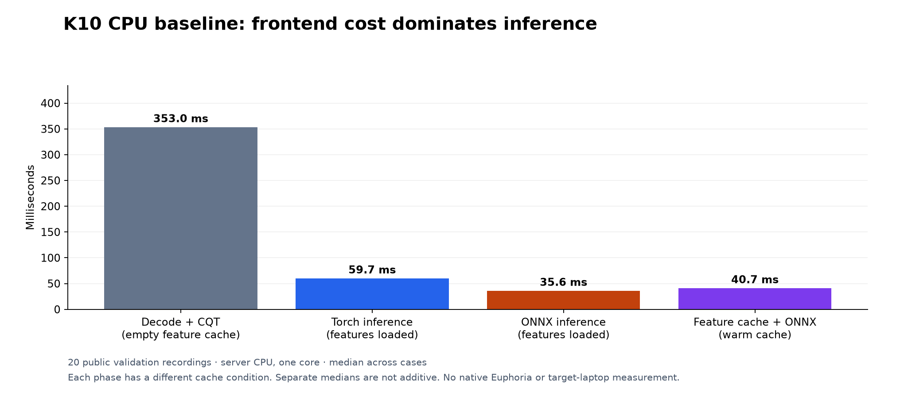

# Full-track K10 CPU baseline

On one CPU core, decoding plus CQT feature extraction dominates the cost of analyzing a track with the unchanged K10 model: a median of 353 ms per track, against 35.6 ms for full-track ONNX inference. Memory, not weight size, is the other concern: an isolated ONNX Runtime process reached 534.9 MiB peak RSS on the longest inputs, although the model has only 109k parameters. This baseline, measured on November 11, 2026 after the K10 layout and variable-length export fixes, is a reference for CPU optimization, not an application performance guarantee or a key-accuracy evaluation.

## Question

A 109k-parameter model is small on disk, but that does not tell us how much CPU time or memory the application needs to analyze a song. Which of decoding, feature extraction, inference or long-track activations dominates, before choosing an optimization?

## Method

Twenty public FMAK validation recordings were chosen at evenly spaced duration ranks among the existing 250 validation rows; their CQT lengths correspond to roughly 40 seconds to 28 minutes. Reference keys were not used. The private DJ library, calibration set, historical final evaluations and SWD were not evaluated.

The process and its decoder child processes were pinned to one logical CPU of an AMD Ryzen Threadripper PRO 9955WX. Torch and ONNX Runtime (ORT) each used one intra-op thread; ORT ran sequentially with spinning disabled. Numerical-library thread environment variables were set to 1. Models used the unchanged shipped K10 parameters.

Each track started with an empty temporary feature cache. Feature preparation (decode, CQT and cache creation) was measured once per track; then ten repeated timings were taken for full-track Torch, full-track ONNX, and the warm feature cache plus ONNX. The tables summarize the twenty per-track medians. The p95 is a quantile over these duration-ranked examples, not a library-wide latency estimate.

## Results

### Timing



Figure: median cost of each phase across the 20 tracks; the decode and CQT frontend is the tallest bar. Phase medians are not additive.

| Phase | Median | p95 across tracks | Longest observed |
|---|---:|---:|---:|
| Decode + CQT + feature-cache creation | 353 ms | 1,002 ms | 2,376 ms |
| Full-track Torch forward | 59.7 ms | 155 ms | 646 ms |
| Full-track ONNX forward | 35.6 ms | 79.4 ms | 278 ms |
| Warm feature cache + ONNX forward | 40.7 ms | 91.2 ms | 316 ms |

Torch checkpoint loading took 7.95 ms and ONNX session creation 50.06 ms. Python imports are outside those times. The first frontend call includes library initialization and may reuse existing compiled or JIT caches; "cold" here does not mean cold OS page caches. Separate phase quantiles must not be added to make an end-to-end p95.

All twenty Torch and ONNX key decisions agreed, with maximum absolute logit difference 3.82e-6, within the existing export parity tolerance. This is agreement between backends on these inputs, not agreement with ground-truth keys. The whole benchmark took 50.70 seconds.

### Memory

The combined Python, Torch, ORT and CQT benchmark process reached 1,614 MiB peak RSS. A second, isolated process imported no Torch and ran only NumPy and ORT on the same twenty cached inputs:

| Isolated process phase | Peak RSS |
|---|---:|
| Before session creation | 53.2 MiB |
| After session creation | 61.8 MiB |
| After full-track inference on all tracks | 534.9 MiB |

These are process high-water marks, not per-track increments or idle memory. The isolated probe excludes decoding and CQT. The longest input had 9,057 frames, and the model's weight size is a poor predictor of the memory its full-track activations need.

## Decision

The feature frontend dominates the cold path. Reusing one initialized session and caching final analysis results matter for startup; a feature cache alone still reruns the network. A result cache key must include the audio identity, the frontend and decoder contract, the model hash and the inference version.

The follow-up [chunking study](../k10-chunked/REPORT.md) tested aligned, overlapping inference that keeps every temporal output and then averages the original hidden features before the unchanged head. Equal-weight crop voting, input truncation, quantization and early exit were ruled out. The first goal was lower activation memory without changing key decisions; streaming the decoder and CQT needs a separate frontend parity check.

## Limitations

- No deployment speedup or memory reduction is measured here. Neither memory figure is a Rust application measurement, and real application behavior on target laptops remains to be measured.
- Twenty tracks on one CPU; p95 is over these examples only.
- Backend agreement is not a floating-point equivalence guarantee or an accuracy result.

## Reproduce

- Data: [raw phase timings](data/pipeline.json), [isolated memory probe](data/ort-memory.json) and [source and environment provenance](data/provenance.json). The provenance file maps the run label recorded in the raw `source_commit` field to the actual source revision, source archive hash and raw result hash. The track selection file (input IDs and content hashes) stays with the server artifacts because it contains machine paths; no audio is committed.
- Tools: [pipeline benchmark](../../../tools/benchmark_k10_pipeline.py) and [Torch-free ORT probe](../../../tools/benchmark_k10_ort_memory.py).

```bash
OMP_NUM_THREADS=1 MKL_NUM_THREADS=1 OPENBLAS_NUM_THREADS=1 taskset -c 0 \
  uv run --extra export python -m tools.benchmark_k10_pipeline \
  --selection <selection.json> --checkpoint weights/drone-v1.pt \
  --onnx weights/drone-v1.onnx --source-commit <revision> --output <pipeline.json>

OMP_NUM_THREADS=1 MKL_NUM_THREADS=1 OPENBLAS_NUM_THREADS=1 taskset -c 0 \
  uv run --extra export python -m tools.benchmark_k10_ort_memory \
  --selection <selection.json> --features <prepared-k10-data> \
  --onnx weights/drone-v1.onnx --output <ort-memory.json>
```

The commands use Linux CPU affinity; on another platform use its equivalent or report that only library thread counts were constrained. Library versions are in the provenance file. No GPU was used.
