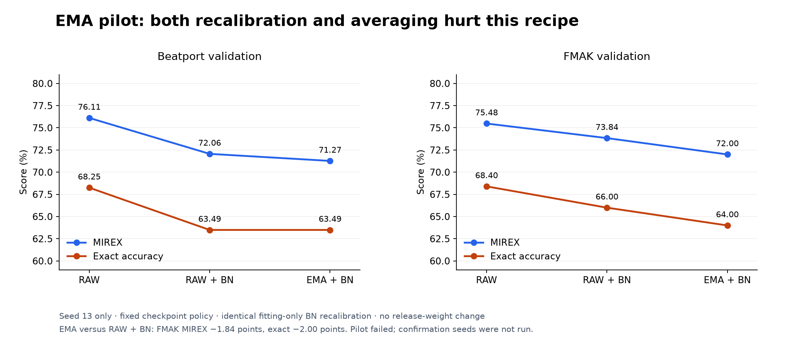

# K10 weight averaging (EMA): rejected

An exponential moving average (EMA) of K10's weights lowered accuracy. Against a
control that received the same batch-normalization recalibration, EMA lost 0.79
MIREX points on Beatport and 1.84 on FMAK, and FMAK exact accuracy fell 2.00 points.
The recipe failed its pre-set threshold, so no further seeds were run. The pilot
used seed 13 and ran on 11 November 2026.

## Question

Can averaging weights during training improve the existing small classifier at no
extra deployment cost? EMA often helps, but whether it transfers to this AdamW
recipe is untested. Batch-normalization (BN) statistics must be recomputed for an
averaged model, and that recalibration can change accuracy on its own, so the
effect of averaging has to be separated from the effect of recalibration.

## Method

The [protocol](PROTOCOL.md) was fixed before the run. EMA averages parameters only,
with decay 0.99, starting from the initial weights. The EMA copy is taken at the
epoch selected for the ordinary (RAW) model; there is no separate checkpoint search
for EMA. Each copy then gets one BN recalibration pass over the fitting data. Three
models are compared: RAW, RAW with recalibration, and EMA with the same
recalibration. RAW alone controls checkpoint selection and early stopping.

The study used the unchanged 2,206 fitting and 376 validation recordings. No
calibration, final-test or private recordings were scored. Before EMA was
interpreted, a fresh RAW run had to reproduce the archived control's history and
selected checkpoint weights exactly.

Pre-set success threshold: EMA had to gain at least 1 FMAK MIREX point over the
recalibrated RAW control (about 2.5 tracks out of 250), with no Beatport MIREX
decline and no exact-accuracy decline in either domain. EMA was also compared
against plain RAW as a safeguard.

## Results

The fresh RAW run reproduced the archived control exactly, including checkpoint
tensor types and values.

| Selected model | Beatport MIREX | Beatport exact | FMAK MIREX | FMAK exact |
|---|---:|---:|---:|---:|
| Ordinary RAW | 76.11% | 68.25% | 75.48% | 68.40% |
| RAW + BN recalibration | 72.06% | 63.49% | 73.84% | 66.00% |
| EMA + same BN recalibration | 71.27% | 63.49% | 72.00% | 64.00% |

*Figure 1. Accuracy of the three models. Recalibration alone lowers accuracy, and
EMA lowers it further. Comparing EMA with recalibrated RAW isolates the effect of
averaging.*

EMA minus the recalibrated control was -0.79 MIREX points on Beatport and -1.84 on
FMAK; FMAK exact fell 2.00 points. EMA also fell short of plain RAW. Epoch 37 was
selected and early stopping ended training at epoch 62, after 4,278 updates. The run
took 228.61 seconds, including 3.43 seconds for both recalibration passes. Another
job ran on the machine at the same time, so these times are not a clean throughput
measurement.

## Decision

The recipe failed, so seeds 37 and 73 were not run. BN recalibration itself hurt
accuracy, and averaging hurt further. Release weights are unchanged and no decay or
optimizer sweep followed.

## Limitations

- One seed, on validation data already used during development.
- This rejects one EMA recipe (decay 0.99, parameter-only, one recalibration pass),
  not every averaging method.

## Reproduce

Checksums of the executed source files, the protocol and the archived control run
are in the [identity file](data/ema-identity.json); source maps, schedules and
evidence checksums are in the [raw results](data/ema-result.json). Checkpoint file
checksums differ from the archived control because file metadata differs; the
weights themselves are identical. Logits, schedules and model states are kept
outside the repository. Regenerate the figure with
`uv run --extra plots python -m tools.plot_research`.
