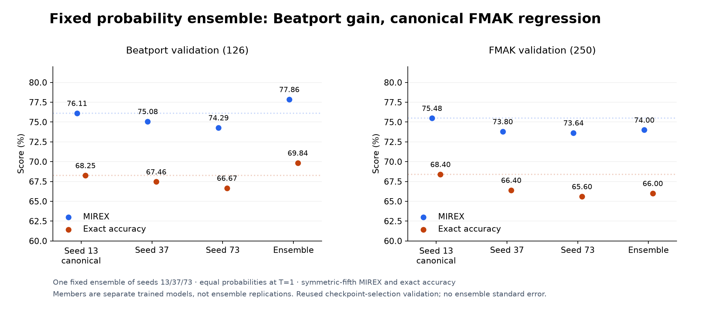
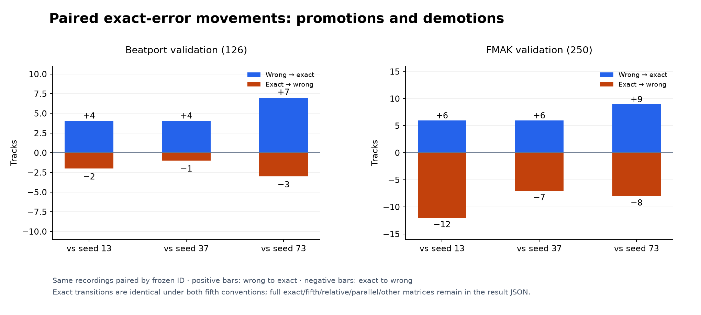

# Fixed probability ensemble: no stronger canonical teacher

## Problem and method

Could independently fitted K10 checkpoints provide a stronger own-data teacher before considering distillation? One fixed ensemble improved Beatport but regressed against the canonical FMAK member, so teacher qualification and the separate BP-reference hurdle both failed. No student, rescue combination or release-weight change followed.

The [frozen pre-extraction protocol](https://github.com/lvndry/drone/blob/research/k10-ensemble-v1/experiments/studies/k10-ensemble/PROTOCOL.md) fixes exactly joint seeds **13/37/73**, equal weights 1/3 and temperature 1. Stable float64 softmax is applied to each member's logits, then probabilities are averaged in that order. This is neither softmax of mean logits nor majority vote. Exact ties choose the lowest canonical class index. No weight/temperature calibration, member replacement or best-seed reselection is allowed.

Each frozen member is a 109,128-parameter K10 selected by its original ordinary joint protocol. The verified archived source-673 model constructor was used with strict checkpoint/schema/feature identities; a newer optimized graph was not substituted. Every member's predictions and complete metrics exactly reproduced its recorded run before ensemble scoring. Extraction was sequential, one GPU model resident at a time, true-length full-track batches up to four, frozen BN, no augmentation, padding to other track lengths or neural chunking.

Only the same immutable CQT cache and 376 development-validation identities (126 Beatport + 250 FMAK) were extracted. Fitting identities were checked against the 2,206-track joint manifest, but no training occurred. BP retains its label-stratified exact-audio-hash split with ID/SHA guards; FMAK retains audited artist/album development groups and audio quarantine. BP is not claimed artist-disjoint. All calibration/final/SWD/private exclusions remained fixed. Launch required SAM's authoritative terminal result and zero exit receipt; those receipts are hashed in the ensemble identity.

## Fixed gates and results

The teacher gate required **at least +1.00 FMAK symmetric-MIREX point over canonical seed 13**, no BP symmetric-MIREX loss and no exact loss in either domain. Separately, the ensemble needed +2.00 FMAK points against the mean of the frozen three BP-only controls, with no BP MIREX loss. Neither gate authorizes automatic promotion or distillation.

| Arm | BP symmetric / asymmetric MIREX | BP exact | FMAK symmetric / asymmetric MIREX | FMAK exact |
|---|---:|---:|---:|---:|
| Joint seed 13, canonical | 76.11 / 73.33% | 68.25% | 75.48 / 74.48% | 68.40% |
| Joint seed 37 | 75.08 / 72.30% | 67.46% | 73.80 / 72.40% | 66.40% |
| Joint seed 73 | 74.29 / 72.30% | 66.67% | 73.64 / 72.44% | 65.60% |
| One equal-probability ensemble | 77.86 / 74.68% | 69.84% | 74.00 / 73.00% | 66.00% |

*Figure 1. Members are separate fitted models, not ensemble replications. Dotted levels mark canonical seed 13; there is no ensemble standard-error bar. Symmetric-fifth MIREX is primary; the table retains the asymmetric convention.*

Against canonical 13, symmetric MIREX changes **+1.75 BP / −1.48 FMAK points** and exact changes +1.59 / −2.40 points. The teacher gate fails. The descriptive member mean is 75.16 / 74.31% symmetric MIREX and 67.46 / 66.80% exact for BP/FMAK; member mean/range is not uncertainty for the ensemble.

| Ensemble versus member | BP Δ symmetric / exact, pp | BP exact ↑ / ↓ | FMAK Δ symmetric / exact, pp | FMAK exact ↑ / ↓ |
|---|---:|---:|---:|---:|
| 13, fixed canonical | +1.75 / +1.59 | 4 / 2 | −1.48 / −2.40 | 6 / 12 |
| 37 | +2.78 / +2.38 | 4 / 1 | +0.20 / −0.40 | 6 / 7 |
| 73 | +3.57 / +3.17 | 7 / 3 | +0.36 / +0.40 | 9 / 8 |

*Figure 2. BP gains coexist with FMAK exact losses against seeds 13 and 37. The raw result retains all paired category matrices and asymmetric deltas against every member. Uniform nonregression against all members is false; comparing only to seed 73 would hide the canonical failure.*

Against the three BP-only controls' mean, symmetric gains are +5.08 BP / **+1.29 FMAK points**, below the separate +2.00 FMAK hurdle. This is **one ensemble versus a mean of BP runs**, not three independent ensemble replications and not the earlier three-candidate-mean experiment.

## Cost, interpretation and decision

The recorded runner elapsed **3.75 seconds**, from study preflight through extraction/combination/artifact construction, within its fixed 20-minute budget and outer 1,250-second backstop. Torch GPU peak allocated/reserved memory was 229,993,984 / 788,529,152 bytes. The recorded stack is Torch 2.15.0+cu132 and NumPy 2.5.4, GPU 0, four Torch/native CPU threads, allocator fraction 0.04 and at least 8GiB free-memory guard; deterministic/TF32 settings were preserved and vLLM remained running. Memory is GPU allocator use, not host RSS. This is not per-track CPU or end-to-end application latency: three sequential backbones add network work, and frontend cost was not benchmarked.

This tests one fixed cohort/combiner. There is no ensemble-seed standard error; member spread and 376 reused checkpoint-selection records do not supply independent generalization evidence. Prior development reused these records, and program-level final-set exposure remains acknowledged. No calibration 159, GS/FMAK final, SWD or private data was used here. The result does not establish that every ensemble or distillation method fails, nor that the error cause has been identified.

**Stop:** no distillation, alternative weights/temperatures/cohorts, production tier, export or performance promotion. A stronger teacher was not earned; current weights remain unchanged.

## Reproduction and evidence

Executed source is [`research/k10-ensemble-v1`](https://github.com/lvndry/drone/tree/research/k10-ensemble-v1). [Result](data/result.json) preserves fixed member identities, actual source/protocol/cache/run/checkpoint/logit hashes, prediction reproduction, both metrics, all paired movements and failed gates. [Execution provenance](data/execution-provenance.json) records actual terminal and artifact receipts; full immutable logits/probabilities remain under `/home/lysk-admin/drone-experiments/k10-ensemble-20261112-v1`.

Run `uv run python -m tools.check_optimizer_reports` for recorded-arithmetic/provenance checks, then `uv run --extra plots python -m tools.plot_research` to reproduce figures. Neither performs a fit, model inference or new scoring. [Figure inputs](../figure-inputs.json) binds raw data, renderer/checker and current plotting lockfile; actual experimental runtime versions remain in the frozen result identity.
