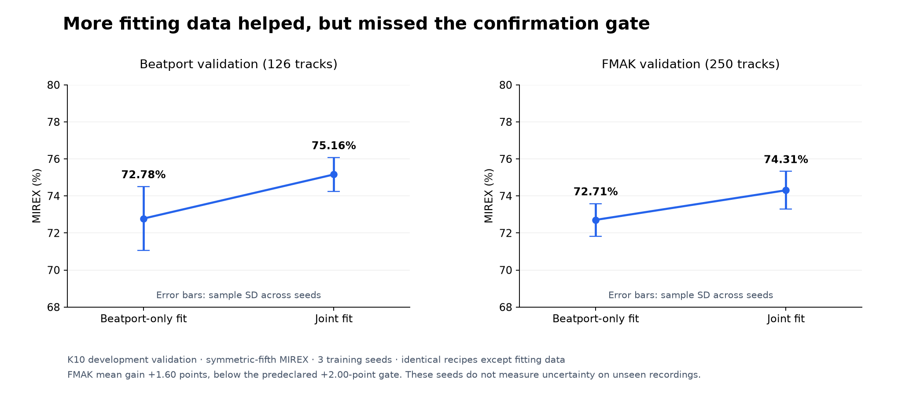

# K10 multi-domain comparison: positive means, confirmation gate missed

Six fits completed under the [predeclared protocol](PROTOCOL.md).
Adding the approved FMAK fitting rows increased both domain means, but the FMAK
gain was 1.60 points, below the required 2.00 points. Do not promote these weights
or select a lucky seed. The shipped Beatport K10 checkpoint remains unchanged.
No calibration, final, SWD or private-library predictions were made in this stage.

All accuracy figures here use **symmetric-fifth MIREX**, not an interchangeable
published-paper scoring convention. These are development-selected measurements,
not independent test estimates or evidence of state of the art.

## Problem

The release recipe fits Beatport EDM previews. We tested whether adding the
approved FMAK fitting subset improves broader-domain key accuracy while retaining
Beatport performance, without changing the architecture or training recipe.

## Method

Both arms share the K10 model, feature contract, initialization seeds, optimizer,
augmentation, stopping rule, 376 validation identities and combined per-track
checkpoint-selection metric. Only fitting data differs: clean Beatport 1,230
versus Beatport plus 976 FMAK rows. Validation is Beatport 126 / FMAK 250; FMAK
artist/album/audio group quarantine is inherited from the frozen previous audit.

## Results

| Seed | Beatport-only: BP | Joint: BP | BP change | Beatport-only: FMAK | Joint: FMAK | FMAK change |
|---|---:|---:|---:|---:|---:|---:|
| 13 | 73.57% | 76.11% | +2.54 | 71.96% | 75.48% | +3.52 |
| 37 | 70.79% | 75.08% | +4.29 | 73.68% | 73.80% | +0.12 |
| 73 | 73.97% | 74.29% | +0.32 | 72.48% | 73.64% | +1.16 |
| **Mean** | **72.78%** | **75.16%** | **+2.38** | **72.71%** | **74.31%** | **+1.60** |

*Figure 1. Joint fitting improves both point estimates. Error bars are sample
standard deviations over three training seeds, not confidence intervals for
unseen recordings. The FMAK mean improvement misses the fixed two-point gate.*

Changes are percentage points. Training-seed sample SDs were BP 1.73 / 0.92 points
and FMAK 0.88 / 1.02 points for control / joint. They do not measure uncertainty
over new recordings. Mean exact accuracy also rose: BP 65.34% to 67.46%, FMAK
63.87% to 66.80%.

The seed-13 pilot qualified, so both arms were confirmed at seeds 37 and 73.
Confirmation required mean FMAK gain >=2 points and mean BP loss <=2 points.
The BP condition passed; the FMAK gain did not. The summarizer returns
`qualifies_for_external_freeze: false` and `canonical_seed: null`.

## Integrity and inference findings

The original K10 manifest had 1,363 rows / 1,356 unique audio hashes, seven
duplicate groups and two fitting/validation crossings. The shared splitter now
preserves validation identities and removes training copies and remaining fitting
duplicates; it rejects conflicting labels. This is a checkpoint-selection issue,
not a demonstrated GiantSteps overlap. Historical test scores were not recomputed.

Old evaluation padded short tracks to their batch peers. This changed nine of
376 shipped-model validation predictions in the real batch-four diagnostic:
FMAK MIREX 71.52% padded versus 71.96% at actual length. Beatport remained 75.79%.
These shipped-weight diagnostics are not the fresh corrected control: its original
training included the duplicate crossings and used another selection rule.

The production `Predictor` also retained the old layout transpose, although K10's
features are already `(192 bins, time)`. The corrected path now matches a direct
K10 call. This bug was in inference, not the train/evaluation path used above.

The previous ONNX artifact had dynamic batch but fixed 320-frame time. Simply
making time symbolic exposed an exporter specialization of adaptive pooling.
Export now expresses its equivalent time-only mean explicitly, retaining all
24 frequency positions; CPU parity is checked against the original PyTorch model
at 8, 56, 319, 320 and 645 frames. The packaged ONNX was regenerated from the
same shipped `.pt` weights. The trained architecture and parameters did not change.

## Measured budget and provenance

Preparation: **81.72 seconds** for 2,582 tracks, with 1,356 matching-profile caches
reused and 1,226 FMAK caches extracted. Total six-fit wall time: **634.09 seconds**
(10.57 minutes). Individual fits took 58.54–134.68 seconds and stopped early.

| Seed | Control best epoch / seconds | Joint best epoch / seconds |
|---|---:|---:|
| 13 | 41 / 134.68 | 37 / 134.60 |
| 37 | 38 / 83.49 | 23 / 103.91 |
| 73 | 19 / 58.54 | 30 / 118.88 |

GPU 0 used its existing headroom with the bounded allocator; both vLLM instances
were preserved. No workload was stopped. Server runtime: Torch 2.15.0+cu132,
CUDA 13.2, NumPy 2.5.4, librosa 1.0.0, SciPy 1.18.1, numba 0.68.1, soxr 1.1.0.

Original fitting source commit: `673e280`. Later production inference/export fixes
do not retroactively change these run sources. Reproduction artifacts on
lysk-server are under `~/drone-experiments/k10-multidomain-20261111-v1/`:

- `source/`, `data/manifest.json`, `split-audit.json`, `environment.json`;
- `control-seed{13,37,73}/run.json` and `joint-seed{13,37,73}/run.json`, with
  source/feature hashes, fitting and validation IDs, histories and checkpoint SHA;
- `shipped-diagnostic/diagnostic.json`, `pilot-result.json`, paired comparisons,
  and `confirmation-summary.json` with all six run hashes and gate decision.

Run `python -m tools.summarize_k10_multidomain --root <server-root>` to replay the
decision; it refuses incomplete arms, mismatching sources, configurations, seeds
or validation identities. Training runs must use fresh output directories; a
terminated run is not silently resumed or treated as completed.

## Discussion and decision

The direction supports broader-domain labels, but the small pilot overstated
the confirmed mean gain. Keep the declared threshold rather than lowering it
after inspection. No extra seed sweep, ensemble, larger tier or fresh final score
is earned. The concrete release progress is corrected inference, variable-length
ONNX parity and data/evaluation integrity. Further training needs a new explicit
hypothesis and protocol; real CPU integration benchmarks can use the unchanged
K10 model with these correctness fixes.
