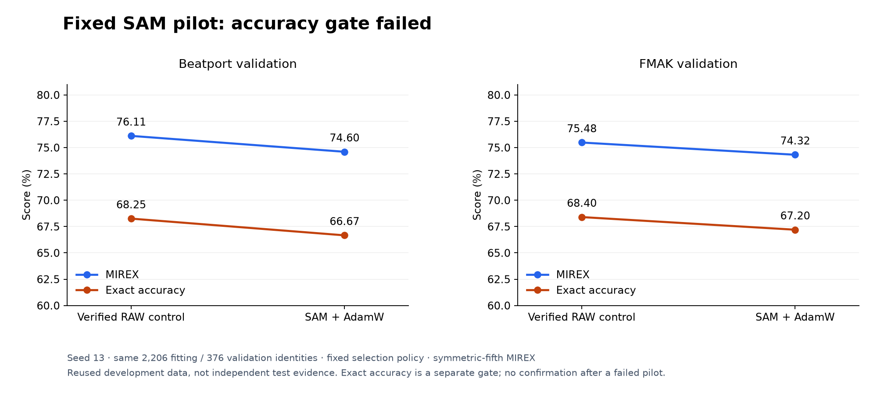
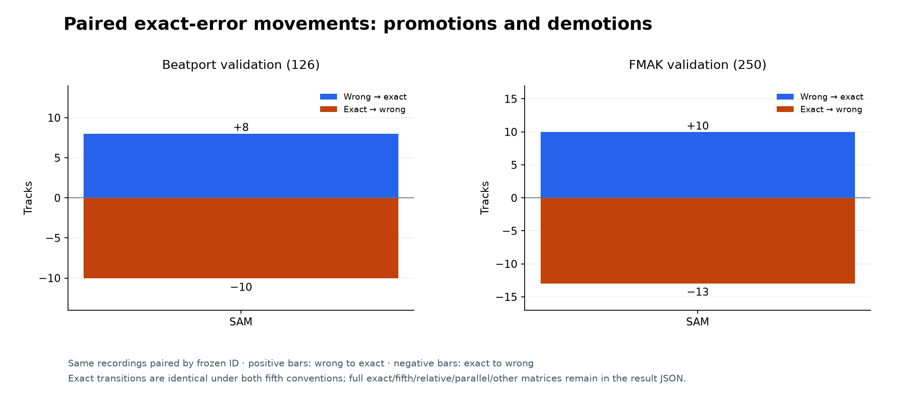
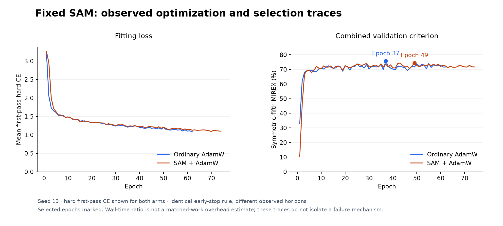

# Fixed SAM pilot: lower accuracy and no confirmation

## Problem and method

Would a fixed sharpness-aware update help K10 learn more useful key evidence than ordinary AdamW? This tests one transferred optimization recipe, rather than changing representation, capacity or inference. The canonical seed-13 pilot failed its accuracy gate. No confirmation seeds, radius/BN rescue, promotion or release-weight change followed.

The [pre-fit protocol](https://github.com/lvndry/drone/blob/research/k10-sam-v1/experiments/studies/k10-sam/PROTOCOL.md) fixes Euclidean SAM radius 0.05 over all trainable gradients, including biases and BN affine parameters, with the existing AdamW outer step. Each batch has two hard-CE forward/backward passes. Dropout RNG is coupled; both passes use batch statistics, but only first-pass BN buffers persist. Parameters are copied back exactly before one AdamW step, and RNG advances as after one ordinary forward. Augmentation is constructed once outside the hook. No EMA, BN recalibration, clipping, smoothing or optimizer sweep.

Both arms use the same 109,128-parameter K10, immutable CQT cache, 2,206 fitting tracks (1,230 Beatport + 976 FMAK) and 376 development-validation tracks (126 + 250). Crop 320, cached CQT-bin-reslice augmentation, batch 32, AdamW learning rate 1e-3 / weight decay 1e-4, cosine maximum 120 epochs, patience 25 and earliest strict-best combined symmetric-fifth score remain fixed. Each arm selects its own checkpoint under that same rule. Validation uses complete tracks.

Before SAM, the fresh hook-disabled control exactly reproduced archived source-673 history, predictions, selected/stopped epochs and every checkpoint tensor. The run/checkpoint files have different serialized hashes because provenance/serialization differs; the evidence claims exact state and behavior, not identical file bytes. The literal ordinary batch AST and source audit are preserved in [base-audit.json](data/base-audit.json).

The pilot required **at least +1.00 FMAK symmetric-MIREX point**, no Beatport symmetric-MIREX loss and no exact-accuracy loss in either domain. Only a passing complete pilot could earn fixed seeds 37/73. Their final means would also have needed the separate original +2.00 FMAK-point hurdle against BP-only controls, no BP MIREX loss and no regression against ordinary joint fitting. That three-seed stage was not reached.

## Results

Primary weighted score is the repository's symmetric-fifth MIREX. The existing ascending-fifth asymmetric convention is reported separately; exact accuracy remains a distinct gate.

| Arm | BP symmetric / asymmetric MIREX | BP exact | FMAK symmetric / asymmetric MIREX | FMAK exact |
|---|---:|---:|---:|---:|
| Reproduced ordinary joint K10 | 76.11 / 73.33% | 68.25% | 75.48 / 74.48% | 68.40% |
| Fixed SAM + AdamW | 74.60 / 72.22% | 66.67% | 74.32 / 73.52% | 67.20% |

*Figure 1. SAM loses weighted score and exact accuracy in both domains. The same development identities and fixed gate are used; these are not independent test estimates.*

Symmetric-MIREX changes are **−1.51 BP / −1.16 FMAK points**; asymmetric changes are −1.11 / −0.96 points. Exact changes are −1.59 / −1.20 points. The pilot gate fails; the original three-seed confirmation stage was not reached.

| Paired exact movement | Beatport, n=126 | FMAK, n=250 |
|---|---:|---:|
| Wrong → exact | 8 | 10 |
| Exact → wrong | 10 | 13 |
| Net exact-track change | −2 | −3 |

*Figure 2. More exact decisions are lost than gained. Full paired exact/fifth/relative/parallel/other matrices under both fifth conventions remain in the [candidate result](data/candidate-result.json); exact promotions/demotions agree across conventions.*

*Figure 3. The plotted loss is ordinary first-pass hard CE, not perturbed-pass loss. Selected/stop epochs are 37/62 for ordinary AdamW and 49/74 for SAM. The curves describe this recipe; they do not isolate why it failed.*

## Cost and limits

Recorded fit/finalization elapsed time is **138.86 seconds** for the control and **282.49 seconds** for SAM; fitting-only clocks are 138.62 / 282.25 seconds. The different observed epoch counts mean this ratio is not a matched-work estimate of SAM overhead. The predeclared inner caps were 1,200 / 2,400 seconds, with outer backstops 1,250 / 2,450 seconds. Both terminal receipts are zero; neither run was budget-inconclusive.

GPU peak allocated memory was 1,529,839,104 / 1,530,291,200 bytes; peak reserved memory was 1,916,796,928 bytes in both arms. These are Torch GPU allocator measurements, not host RSS. The recorded stack is Torch 2.15.0+cu132 and NumPy 2.5.4, GPU 0, four Torch/native CPU threads, TF32 disabled, deterministic/cuDNN settings preserved, allocator fraction 0.04 and a free-memory guard. The launcher retained the shared vLLM service. No end-to-end CPU inference performance was measured; SAM changes fitting updates, not the K10 inference graph.

The same 376 records selected checkpoints and supported earlier development. BP retains its label-stratified exact-audio-hash split with ID/SHA guards; FMAK retains audited artist/album development groups and audio quarantine. BP is not claimed artist-disjoint. These fixed policies do not establish independent generalization, new group auditing or a SOTA comparison. Calibration 159, GS/FMAK final, SWD and private tracks were not used here; earlier program-level exposure of final sets does not become pristine through this study. One paired seed gives no across-seed uncertainty estimate. Failure rejects this radius/AdamW/BN/RNG recipe, not all SAM variants or a proven causal explanation of K10 errors.

## Decision and reproduction

Stop the fixed optimizer route. No seeds 37/73, radius changes, BN alternatives, teacher qualification, native export or student fitting. Accuracy takes priority over fitting cost; current weights remain unchanged.

Executed source is tag [`research/k10-sam-v1`](https://github.com/lvndry/drone/tree/research/k10-sam-v1). [Execution provenance](data/execution-provenance.json) binds the authoritative terminal receipts, launcher, run, validation and result hashes. [Control result](data/control-result.json), [candidate result](data/candidate-result.json), [losslessly compressed control run](data/control-run.json.gz), [candidate run](data/candidate-run.json.gz) and history preserve the negative without checkpoints/audio in this PR. Full immutable artifacts remain under `/home/lysk-admin/drone-experiments/k10-sam-20261112-v1`.

Reproduce report arithmetic/provenance with `uv run python -m tools.check_optimizer_reports`; regenerate graphs with `uv run --extra plots python -m tools.plot_research`. These commands read checked-in results only and perform no fitting, model inference or new track scoring. [Figure inputs](../figure-inputs.json) binds measurements, renderer/checker and plotting lockfile; the executed training runtime remains the one recorded above.
