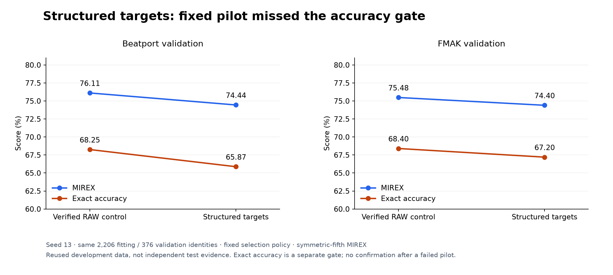

# Structured key targets: rejected

Training K10 with soft targets that give some probability to harmonically related
keys lowered accuracy. Symmetric MIREX fell 1.67 points on Beatport and 1.08 points on
FMAK, and exact accuracy fell 2.38 and 1.20 points. The pilot failed its pre-set
threshold, so no confirmation seeds were run. It used seed 13 and ran on 11 November
2026.

## Question

Can a musically structured training target improve a small classifier without
changing its architecture or inference cost? Near-miss keys (fifths, relative and
parallel keys) earn partial MIREX credit, but pushing probability toward them may cost
exact keys. This study measures that tradeoff instead of assuming weighted-score gains.

## Method

The [protocol](PROTOCOL.md) was fixed before training and changes only the loss: 0.8
of the target probability goes to the true key and 0.2 is spread over the fifth keys
in both directions and the relative and parallel keys, in proportion to the existing
MIREX relation weights. This is cross-entropy with structured soft targets, not direct
optimization of expected MIREX. There was no sweep over the smoothing amount or the
neighbour weights.

Both arms use the same 2,206 fitting and 376 validation recordings, the same CQT
caches, K10 at width 1, crops and augmentation, AdamW, cosine schedule and checkpoint
rule. Before the candidate was trained, the seed-13 hard-target control had to
reproduce the archived history, predictions and checkpoint weights exactly. No
final-test, calibration or private recordings were scored.

Pre-set success threshold: at least +1 FMAK symmetric MIREX point, no Beatport MIREX
decline and no exact-accuracy decline in either domain. Passing would earn seeds 37
and 73.

## Results

The control reproduced exactly. The candidate failed every condition.

| Arm | BP symmetric / asymmetric MIREX | BP exact | FMAK symmetric / asymmetric MIREX | FMAK exact |
|---|---:|---:|---:|---:|
| Hard-target control | 76.11 / 73.33% | 68.25% | 75.48 / 74.48% | 68.40% |
| Structured targets | 74.44 / 70.87% | 65.87% | 74.40 / 73.00% | 67.20% |

*Figure 1. Structured targets score lower than the hard-target control on weighted
and exact accuracy in both domains. Symmetric-fifth MIREX was the metric fixed for the
threshold; asymmetric MIREX is shown alongside.*

Symmetric MIREX changed by -1.67 points on Beatport and -1.08 on FMAK; exact accuracy
by -2.38 and -1.20. On FMAK, 13 predictions became exactly correct and 16 previously
correct predictions became wrong. On Beatport, 9 became correct and 12 became wrong.
Full error-category matrices under both MIREX conventions are in the
[candidate result](data/candidate-result.json).

The control selected epoch 37 and stopped at 62 after 259.48 seconds. The candidate
selected epoch 76 and stopped at 101 after 359.63 seconds. Different epoch counts and
machine load make these times unsuitable as a speed comparison.

## Decision

Do not run confirmation seeds or change the release weights. No new smoothing
variant or other seed followed.

## Limitations

- One seed, evaluated on validation data used repeatedly during development, so this
  is not an independent test.
- This rejects one soft-target recipe. It changes targets only, not the model's
  symmetry or how it sees pitch, so it does not show that every use of harmonic
  structure fails.
- Soft-target and hard-target losses have different minimum values, so their training
  loss curves cannot be compared directly.

## Reproduce

The training code is preserved at the git tag `research/k10-structured-targets-v1`.
Use that tag to replay training; the current combined training script has since gained
other study options and would not reproduce these runs. The
[control result](data/control-result.json) and [candidate result](data/candidate-result.json)
record checksums for the source, features, protocol, target table, checkpoints and
validation logits. Full runs, logits and checkpoints are kept outside the repository.
Regenerate Figure 1 with `uv run --extra plots python -m tools.plot_research`.
