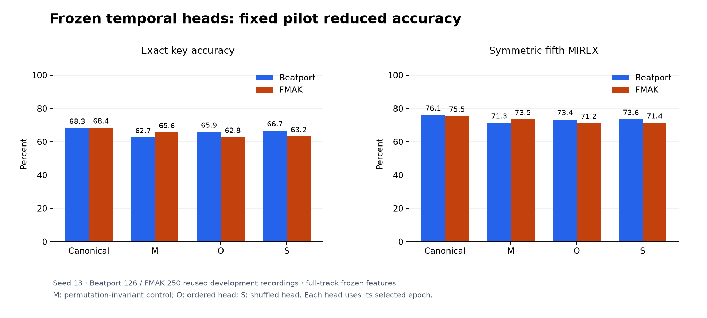
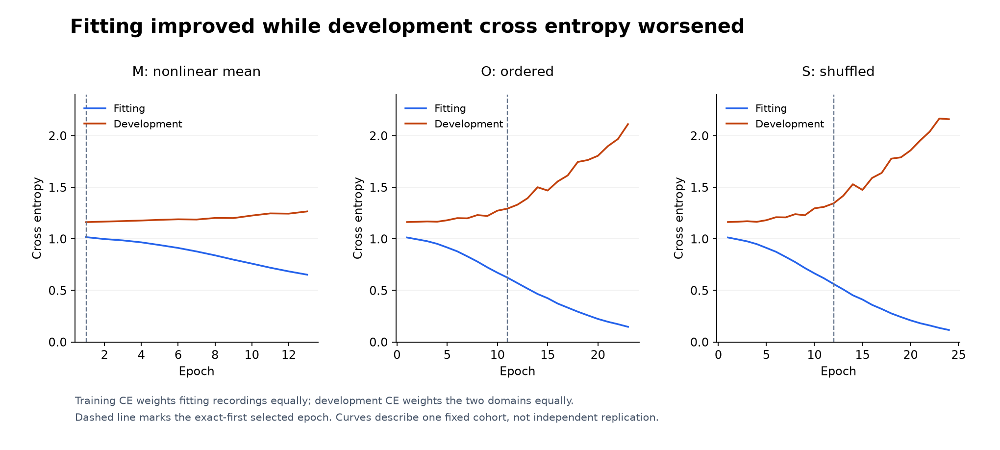
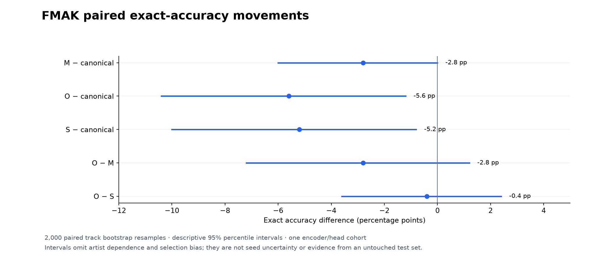

# Frozen temporal heads did not improve key recognition

## Question and result

Does learning how frozen K10 features evolve through a complete recording improve
exact key recognition, and does temporal order explain any improvement?
The fixed seed-13 study answered neither question positively. The ordered head
lost 5.60 percentage points of FMAK exact accuracy and 2.38 points on Beatport
against the canonical encoder/classifier. It also failed to beat the shuffled
head. Both prospective gates failed; there was no confirmation, CPU screen,
checkpoint promotion or tuning rescue.

This rejects the specified frozen-feature residual-head recipe. It does not
establish that temporal modeling, end-to-end temporal learning or different
representations cannot help.

## Comparison and method

The [protocol](PROTOCOL.md) was frozen before extraction and fitting. The encoder
was the canonical clean joint K10 seed-13 model. Fitting used 1,230 Beatport and
976 FMAK recordings; development used the existing 126 Beatport and 250 FMAK
recordings. The established audio and artist/album quarantine remained in force.
These development sets have been reused for earlier studies and are not pristine
external tests. No private recordings, calibration, exposed final sets or SWD
recordings entered this study.

All 2,582 complete recordings were represented by the encoder's 1,536-dimensional
hidden tokens, rather than 24 class logits. The cache retained every token in
FP32: no time sampling, track truncation or quantization. Original classifier
logits were retained as a frozen residual baseline. Three trainable heads used
hard cross entropy and the same fixed optimization recipe:

- **M:** nonlinear, permutation-invariant token processing and uniform pooling.
- **O:** ordered two-block depthwise temporal residual head.
- **S:** the identical temporal head with independently shuffled token order.

O and S shared their initial parameters. All heads had zero-initialized output
layers and initially reproduced the canonical logits. Masking prevented padded
tokens from entering convolutions, normalization or pooling. O/S used a
1,536→64 projection, kernel-five depthwise blocks with dilations one and four,
and a 64→24 residual readout. M contained 108,888 trainable parameters; O/S each
contained 109,400. The combined receptive field was 196 CQT frames, approximately
36 seconds plus the acoustic frontend's support.

The fixed head optimizer was AdamW, learning rate 0.0003, weight decay 0.001,
60-epoch cosine schedule, gradient clipping one and logical batch size 32.
Microbatches respected an 8,192-padded-token limit without discarding long tracks.
Selection maximized the mean of the two domains' exact accuracies, then minimized
the equally weighted domain cross entropy, then preferred the earlier epoch.
Patience was 12. This prospective exact-first policy does not change the selection
rules or gates of earlier failed studies.

## Selected accuracy and decisions

*Figure 1. One fixed encoder/head cohort on the reused development sets. Values
are percentages; no bars represent independent-seed uncertainty.*

| Model | Beatport exact | Beatport symmetric / asymmetric MIREX | FMAK exact | FMAK symmetric / asymmetric MIREX | Selected / stop epoch |
|---|---:|---:|---:|---:|---:|
| Canonical joint 13 | 68.254 | 76.111 / 73.333 | 68.400 | 75.480 / 74.480 | Archived control |
| M | 62.698 | 71.349 / 68.571 | 65.600 | 73.520 / 72.320 | 1 / 13 |
| O | 65.873 | 73.413 / 70.635 | 62.800 | 71.200 / 70.000 | 11 / 23 |
| S | 66.667 | 73.571 / 71.190 | 63.200 | 71.360 / 69.960 | 12 / 24 |

The repository metric awards fifth credit in both same-mode directions; the
existing asymmetric metric awards ascending-fifth credit. Both are reported
without replacing the predeclared symmetric-MIREX gate.

The candidate gate required O to gain at least two FMAK exact percentage points
(five recordings), with no Beatport exact loss and no symmetric-MIREX decline in
either domain. O instead lost 14 FMAK and three Beatport exact predictions.
The mechanism gate separately required O to beat **both** M and S by at least one
FMAK exact point (three recordings). O−M was −2.80 points and O−S was −0.40 points.
Both gates were false.

The separate original BP-control-mean hurdle also failed: O gained 0.635 Beatport
symmetric-MIREX points but lost 1.507 FMAK points against the frozen three-seed
BP-only mean, missing its required two-point FMAK gain. This is one head cohort
compared with a control mean, not a three-seed candidate estimate. No previously
failed hurdle was relaxed.

## Learning behavior

*Figure 2. Actual epoch histories. Fitting CE weights fitting recordings equally;
development CE weights domains equally. The dashed lines mark selected epochs.*

O fitting CE fell from 1.013 to 0.147 while balanced development CE rose from
1.163 to 2.113. S showed a similar trajectory: 1.013→0.116 fitting and
1.163→2.161 development. M changed less sharply, from 1.017→0.653 fitting and
1.162→1.266 development. The heads could fit the training labels, but their
increasing confidence did not transfer to the development recordings. Calling
this simply an optimization failure would miss that divergence.

These curves do not identify a unique cause. Data scarcity, domain shift,
representation limitations and head flexibility remain plausible. In particular,
the frozen encoder cannot adapt its representation to a temporal objective.
No learning-rate, regularization, feature or architectural variant was tried
after seeing these results.

## Paired movements and descriptive uncertainty

*Figure 3. Actual 2,000-resample paired track bootstrap intervals from the frozen
result. They omit artist dependence and checkpoint-selection bias. They are
neither seed uncertainty nor independent external evidence.*

| Contrast | Beatport exact change, pp [95% interval] | FMAK exact change, pp [95% interval] |
|---|---:|---:|
| M − canonical | −5.56 [−10.32, −1.59] | −2.80 [−6.00, 0.00] |
| O − canonical | −2.38 [−9.52, 3.99] | −5.60 [−10.40, −1.20] |
| S − canonical | −1.59 [−7.94, 4.76] | −5.20 [−10.00, −0.80] |
| O − M | 3.17 [−3.17, 9.52] | −2.80 [−7.20, 1.20] |
| O − S | −0.79 [−4.76, 2.38] | −0.40 [−3.60, 2.40] |

Against the canonical classifier, O corrected eight Beatport errors but spoiled
11 exact predictions. On FMAK it corrected nine and spoiled 23. Those 23 FMAK
exact demotions became eight fifth, four relative, four parallel and seven other
errors under the repository relation categories. The nine promotions came from
three fifth, one relative, one parallel and four other errors. Thus the weighted
metric did not hide a compensating exact-accuracy gain.

O versus S corrected seven FMAK errors but spoiled eight; on Beatport it corrected
two but spoiled three. These movements provide no support for the specified
order mechanism. Full relation-transition matrices, both metric conventions and
paired intervals are retained in [the measured result](data/result13.json).

## Integrity and resource evidence

Before fitting, all 2,582 cached reconstructions were **bit-identical** to the
canonical logits: zero maximum absolute error and zero argmax disagreements.
The hidden payload was 1,856,372,736 bytes, below the predeclared four-GiB ceiling.
Preflight accounted for manifest, headers, logits, evidence and the largest
atomic temporary file; extraction took 16.066 seconds.

Head phases including scoring took 37.138 seconds for M, 62.605 for O and 83.955
for S. Aggregate recorded time including extraction was 220.621 seconds, within
the fixed 60-minute aggregate limit and all phase limits. GPU peak allocation
was 257,705,472 bytes for extraction and at most 237,454,336 bytes during head
phases. These phase peaks include their surrounding evaluation work; they are
not isolated training-activation or deployment-memory benchmarks. The 4% GPU
allocator cap, eight-GiB free-memory guard and four-thread CPU policy applied.
No CPU deployment conclusion was earned because the accuracy gate failed.

## Reproduction and evidence

The exact executed source is published at
[`research/k10-temporal-v1`](https://github.com/lvndry/drone/tree/research/k10-temporal-v1),
commit `0cbb93ecd40e55be9ae239687287ff9b9268064e`. The six implementation,
protocol and test files included with this report preserve their executed bytes.
For full fit replay use that complete frozen tag: later main-branch dependency
and source changes do not satisfy the historical identity contract.

The executed source archive SHA-256 is
`c097cd58e95d605f6e7bd8122b066586ca908bcd8fb3b8ca218b68d1f2f059bc`.
The authoritative result SHA-256 is
`b31fe60c57a699bbaf95b409910312b10aa661c587a87494916b6bd22ac5882e`.
[Provenance](data/provenance.json) indexes every retained artifact's byte size and
hash, the six executed-file hashes, source tag and server root. Original
validation logits, identifiers and metrics are retained. Validation logits, histories and schedules
are losslessly gzip-compressed with both compressed and decoded hashes. No
checkpoint, audio or hidden cache is committed; checkpoint hashes remain in the
result. [Reconstruction](data/reconstruction.json), [preflight](data/preflight.json)
and cache/head identities retain the extraction and runtime evidence. Figure
inputs are indexed in [the shared registry](../figure-inputs.json), and
`uv run --extra plots python tools/plot_research.py` regenerates the figures.

The decision is to stop this fixed frozen-head route. The evidence favors
investigating transferable tonal representations and fitting-data efficiency
before adding another head or tuning this rejected recipe; that direction still
requires its own prospective protocol and clean evaluation.
