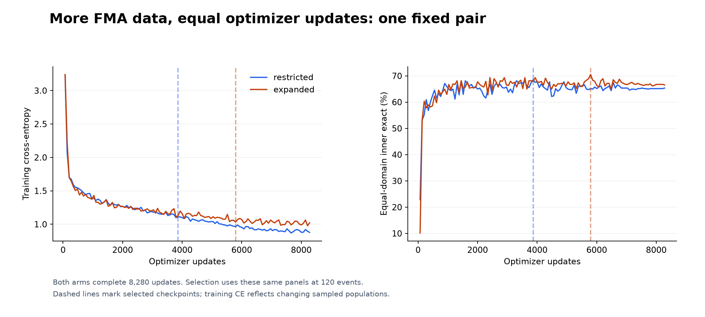
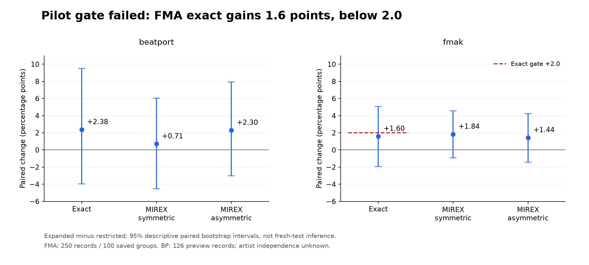
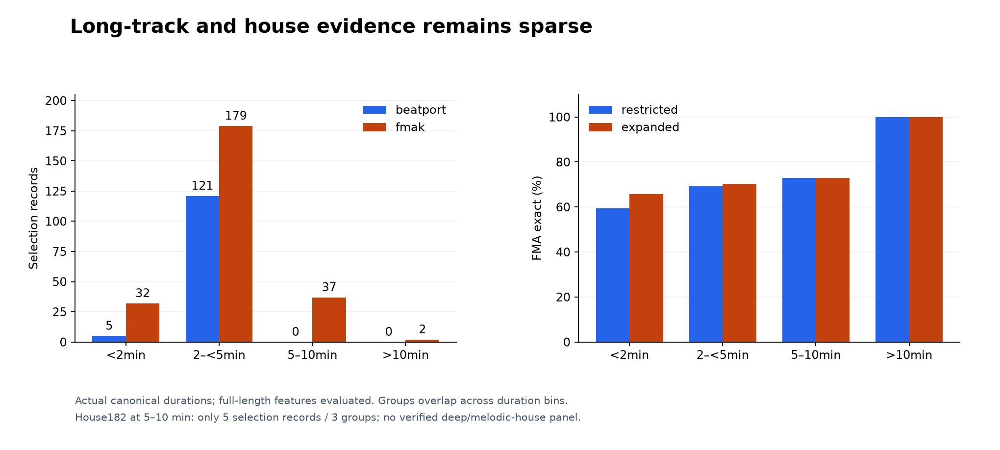

# More fitting data under matched updates: K10 v2 pilot

**The expanded-data pilot failed its frozen gate.** FMA exact accuracy increased
from **172/250 to 176/250 (+1.60 percentage points)**, below the required +2.00.
Beatport exact and both MIREX conventions improved. Both arms finished the full
8,280 updates; no confirmation, calibration, GiantSteps or private DJ evaluation
was performed. Release weights remain unchanged. This is one seed on adaptive
inner-selection panels, not an independent final test or a CPU performance result.

## Problem and comparison

Could recovering additional FMA fitting data improve this small classifier without
changing its deployed architecture? The [component-first proposal](../v2-data-contract/REPORT.md)
retired historical roles and fixed a new whole-component assignment using a
**label-independent metadata rule** and one deterministic seed. Its restricted
fitting pool retains the
old 976 FMA records; the expanded pool adds eligible records on the same new inner
panels. Old final recordings can enter the new fitting pool: the exposure ledger is
explicit, and the old benchmarks do not become pristine through repartitioning.

After the source-integrity amendment below, the comparison is **976 versus 4,033
container-unique FMA fitting records**, with the same **1,229 BP fitting records**.
Both use the same 126 BP and 250 FMA inner records. The 998-row/997-container-unit
confirmation panel and 159 calibration rows are excluded from pilot inputs.
FMA grouping uses audited artist/album components. BP originated from a
label-stratified, exact-audio-hash guarded split; it is **not artist-disjoint**.
Official metadata resolves artist identities for only 618/1,230 original BP fitting
records; the remaining 612 are unknown. Sharing BP exposure between arms supports
this narrower internal comparison, not an artist-independent generalization claim.

## Method fixed before outcomes

The [original protocol](PROTOCOL.md) and [execution amendment](EXECUTION.md) bind
source, targets, roles and the resource guard. Seed 13 starts both fresh 109,128
parameter K10 encoders from the same state. Hard cross-entropy, AdamW (learning
rate 0.001, decay 0.0001), physical CQT, 320-frame crops and cached CQT-bin-reslice
augmentation remain fixed. Evaluation uses all true-length features, without
first-120-second truncation. Exact label bookkeeping for reslicing is not an exact
waveform pitch transformation.

Each arm completes 120 virtual events of 69 updates × 32 draws: **8,280 updates**,
no independent early stop, and the same cosine schedule/evaluation cadence.
Nominal BP mass stays 1230/2206 after eligibility filtering. Fixed-size domain
batches and independently keyed domain order/augmentation streams give identical
BP samples and transformations **between v2 arms**; this is a new matched recipe,
not reproduction of the old 2,206-draw full-pass recipe (69×32 = 2,208 draws).
Selection maximizes equal-domain exact accuracy, then symmetric MIREX, then the
earliest event. The frozen pilot requires +2 FMA exact points and no BP exact or
symmetric/asymmetric MIREX decline; FMA weighted changes are reported, not gated.



*Both arms complete the same budget. Dashed lines mark selected updates 3,864
(restricted) and 5,796 (expanded). The curves use the panels that select checkpoints;
they are not independent learning-curve evaluations.*

## Preparation uncovered a real input-integrity failure

First16 completed normally (12 new/4 reused caches). Full preparation processed
all 5,641 proposed inputs, but **exited 1 with `complete=false`**, correctly stopping
readiness on canonical model-input duplicates. That failed receipt is preserved.
There were 25 canonical duplicate families. Their cache files were also bit-identical;
there were no extra cache-only families. The 23 consistent families stay fitting-only,
within the same saved FMA components, with no cross-domain/evaluation clustering union.

A separately reviewed eligibility overlay changed **three prepared inputs**, without
resplitting, replacement or choosing labels:

| Input | Frozen proposed role | Eligibility action |
|---|---|---|
| BP 2997186 | Fitting | Remove fitting alias from both arms; preserve selection BP 1926377 |
| FMA 051779 | Expanded fitting; historical quarantine | Quarantine conflicting canonical-target family |
| FMA 096100 | Expanded fitting; historical final | Quarantine the same family; neither FMA member was in restricted 976 |

The derived manifest contains **5,638 eligible prepared IDs**: BP1,229/FMA976 or
4,033 fitting, plus unchanged selection126+250. All verified numerical cache receipts
were reused; no re-extraction or automatic role repair occurred. The original
before-label assignment and failed manifest remain immutable. Within-role consistent
aliases are disclosed rather than silently interpreted as independent recordings.

The earlier cached PCM check covered FMA cross-role families and BP-fit→FMA-evaluation
matches; it did **not** cover BP fitting→BP selection or conflicting targets within a
fitting role. SAME-ID old mono11025 float32 hash witnesses already agree for the two
problematic pairs. Thus the earlier miss was a scope/target-check gap, not established
decoder-precision drift. Canonical22050 duration agrees with all 5,641 old fingerprint
receipts within one 22050 sample; neither agreement nor a finite CQT proves the publisher
intended decode was complete. Publisher duration discrepancies and decoder warnings
are preserved in the diagnostic, without an outcome-chosen rejection threshold.

## Paired results and uncertainty

| Inner panel / metric | Restricted | Expanded | Change, points | Descriptive paired 95% interval, points |
|---|---:|---:|---:|---:|
| BP exact, N126 | 68.25% | 70.63% | +2.38 | −3.97 to +9.52 |
| BP symmetric MIREX | 76.43% | 77.14% | +0.71 | −4.52 to +6.03 |
| BP asymmetric MIREX | 72.86% | 75.16% | +2.30 | −3.02 to +7.94 |
| FMA exact, N250 / 100 groups | 68.80% | 70.40% | +1.60 | −1.94 to +5.08 |
| FMA symmetric MIREX | 74.00% | 75.84% | +1.84 | −0.94 to +4.57 |
| FMA asymmetric MIREX | 73.60% | 75.04% | +1.44 | −1.44 to +4.23 |



*Intervals use 10,000 paired group bootstrap draws, fixed seed20261112, with
track-weighted scores: saved FMA components, BP record units only. They are
post-selection descriptive intervals on reused/adaptively consulted development
data, not fresh-test coverage, a seed-variance estimate or an alternative gate.*

Exact gains/losses are **11/8 BP** and **12/8 FMA**. Full per-ID predictions, labels,
error changes and both relation-transition matrices are retained in compressed
supplementary evidence. The net four FMA gains do not meet the required five.
The expanded arm sees each FMA identity only29–30 times, versus120–121 restricted;
all identities are visited, but expanded fitting receives fewer views per record.
This does not establish underfitting or show that longer training would help.
Both arms see the same147,733 BP draws; each sees117,227 FMA draws. This estimates
expanded-data value at this matched update budget, not the best achievable larger-data
accuracy after additional optimization. No extra seed, epoch or gate rescue was run.

## Primary-use gap: full-length house



| FMA actual duration | Records / saved groups | Restricted correct | Expanded correct | Genre-top coverage |
|---|---:|---:|---:|---|
| <2 minutes | 32 /18 | 19 | 21 | 15 missing; 1 Electronic |
| 2–<5 minutes | 179 /80 | 124 | 126 | 104 missing; 14 Electronic |
| 5–10 minutes | 37 /27 | 27 | 27 | 23 missing, 13 Electronic, 1 Rock |
| >10 minutes | 2 /2 | 2 | 2 | 1 missing, 1 Folk |

Counts use actual canonical sample lengths, not publisher duration. Groups may
span duration bins and must not be summed as disjoint units. FMA5–10minute exact
change is zero, with a descriptive interval **−12.50 to +13.51 points**. The N2
>10minute bootstrap collapses to zero change mechanically; it establishes no
certainty. BP has5 short and121 approximately120-second previews, **no5–10minute
tracks**; its panel does not test full DJ-track accuracy.

Only **five** actual5–10minute FMA inner tracks carry taxonomy **House182**, across
**three** components: restricted3/5 versus expanded5/5, two gains/no losses. The
selection-used subset is far too small for acceptance; its bootstrap spans0 to
+100 points. Broad Electronic is not verified house, and no deep-house/melodic-house
labels or adequate8–10minute house panel were established. Full FMA inner genre-top
is missing for143/250 records. The study cannot establish primary-use accuracy.

## Runtime, provenance and decision

The sequential pair ran on GPU0UUID `GPU-387d0c41-22e5-4c3b-efe8-1d8f1dd0494c`,
CPUs4,5,10,11, Torch4 threads, numeric-library threads1, TF32off and4% allocator.
Both protected vLLM parents and both EngineCore start identities survived. Python3.12.3,
Torch2.15.0+cu132 and NumPy2.5.4 are recorded. Controllers exited0; restricted/expanded
outer times378.93/374.40s and CPU390.01/386.40s stayed below fixed caps. Recorded
RSS≈2.18GB; expanded RSS combines sampled process-group peak with a reaped-child
lifetime upper bound inherited from the first child, not an independent peak.
This is training resource evidence, not measured product inference acceleration.

Executed numerical source is **58fe80662bdb3362349672820a0bcd4387155ca2**, with the
driver byte-identical to37f17a1; eligibility source **b67ad3e868a1aef99fc0f12f723d4c2bd3264f6c**;
launch guard **fa20244bc5f511df607048c3863b1626fce5bf0a**. Original execution identities
are retained despite publication cherry-picks. Both arms match initial state, BP
trace, source, plan, features, configuration, runtime and device. Server root,
PIDs, ordered targets, checkpoint hashes, permit/readback/terminal receipts and
compressed/decoded evidence hashes are retained under `data/`; no weights or audio
are published. [FMAKv2 source](https://zenodo.org/records/12759100) distinguishes expert
original FMAK labels from around200 v2 modifications unverified by original authors;
the pinned v2 target export is not adjudicated ground truth or a known noise ceiling.

**Decision: no confirmation earned, no promotion.** Preserve the negative and the
new input-integrity checks. Further long-house evidence or a different experiment
needs a prospective decision; this study supplies neither a new activation permit
nor an independent accuracy claim.

Reproduce report arithmetic (no model/audio), then regenerate all inline figures:

```bash
python -m tools.check_k10_v2_report
python -m tools.plot_research
python -m pytest tests/test_k10_v2_pilot.py tests/test_k10_v2_bulk.py tests/test_k10_v2_amendment.py tests/test_k10_v2_report.py
```
