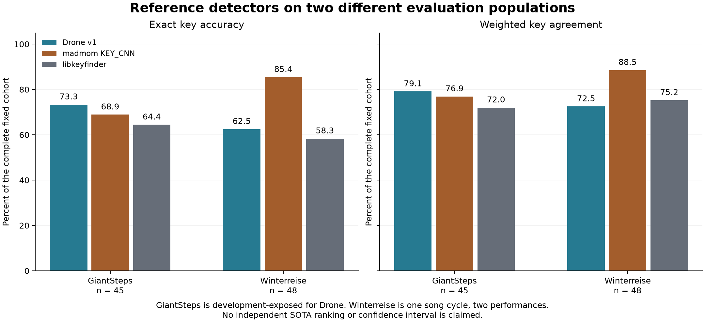
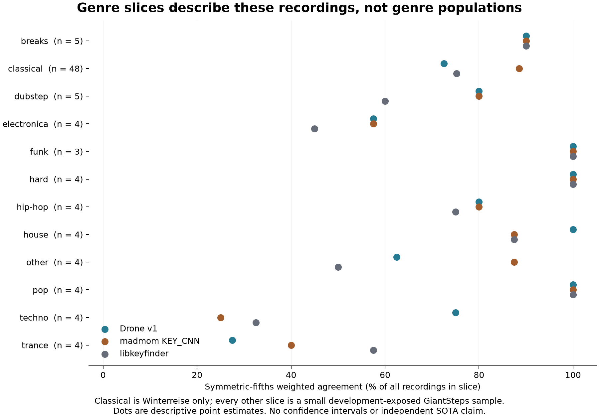
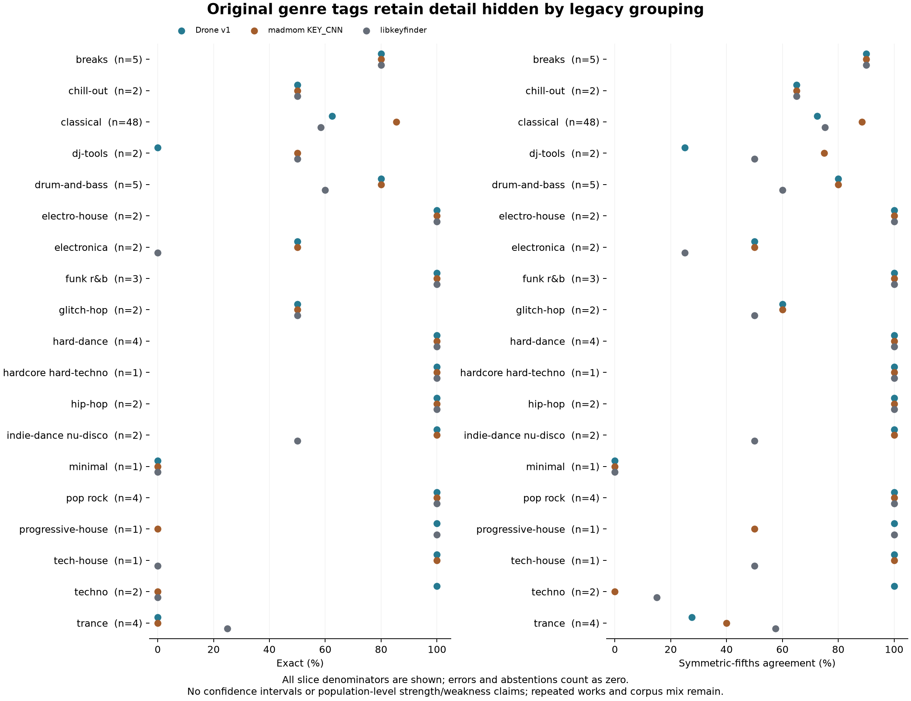
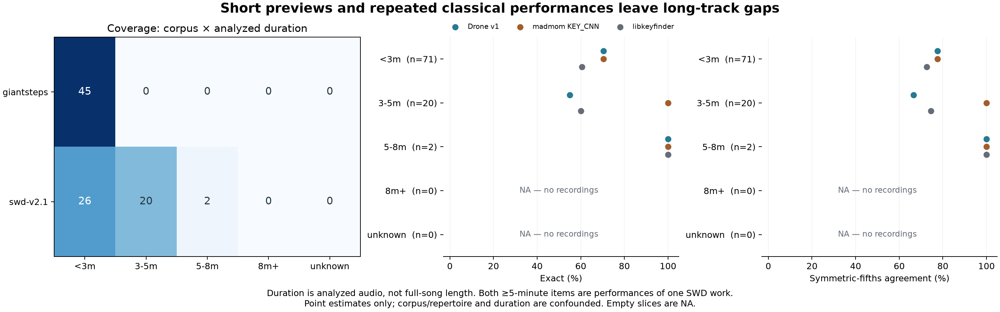
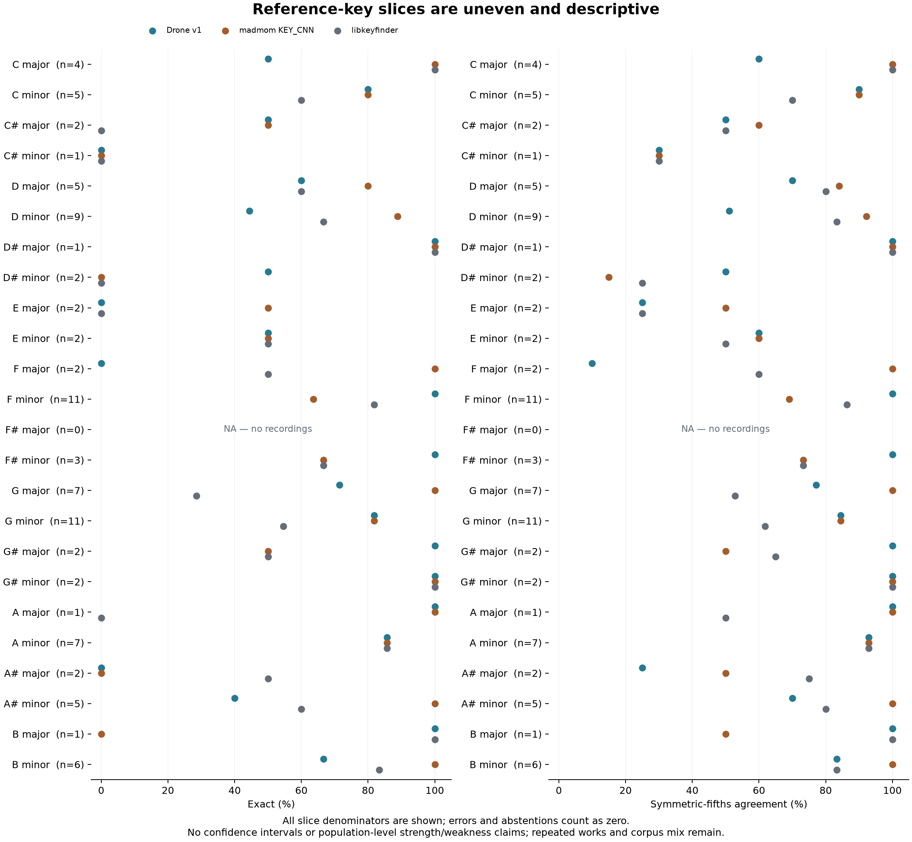

# Key detection references on Winterreise and GiantSteps

The initial comparison mixed a valid Drone/madmom run with an invalid
libkeyfinder wrapper. Its **37.6% exact / 47.6% weighted libkeyfinder result is
withdrawn as a baseline**. The original artifacts remain preserved in
[data/historical/](data/historical/); they are not silently replaced or repaired
by relabeling predictions. The fresh corrected libkeyfinder rerun records
**57/93 exact (61.3%) and 73.7% weighted agreement**, with no errors or abstentions.
This corrects the comparator; it is not a Drone model improvement.

The question is whether the released compact detector agrees with established
references on two specific populations. This is a descriptive reference comparison,
not a state-of-the-art ranking, deployment gate or architecture decision. MusicFM
was not run, so this is not a completed four-model comparison.

## Problem and comparison

Drone targets ordinary-CPU inference. Before drawing conclusions about its
coverage, compare it with madmom's pretrained KEY_CNN and libkeyfinder's native
DSP algorithm using the same decoded recording and the same reference convention.
Different corpora answer different questions; their combined average is not a
population estimate of general music accuracy.

The fixed panel contains **93 recordings**:

| Corpus | Recordings | Coverage | Exposure and interpretation |
|---|---:|---|---|
| Schubert Winterreise Dataset (SWD) v2.1 | 48 | One 24-song cycle, performances HU33 and SC06 | Narrow vocal/piano classical repertoire; paired performances are not 48 independent works |
| GiantSteps | 45 | Deterministic round-robin sample across 12 legacy benchmark groups | Development-exposed for Drone; descriptive, not independent evaluation |

The SWD archive's 48 available labeled recordings have a median duration of
**169.12 seconds**, ranging from **44.07 to 325.33 seconds**. Twenty-six are
under three minutes, twenty are three to five minutes, and two are five to eight
minutes. All 45 GiantSteps items are under three minutes. Across the complete
panel the duration counts are therefore 71 / 20 / 2 / 0 for under three,
three–five, five–eight and eight-plus minutes. This panel does not establish
accuracy on five–ten-minute DJ tracks.

The released `drone-v1` checkpoint declares **1,237 fitting IDs and 126 selection
IDs** from Beatport. These are separate exposures, not 1,363 fitting recordings.
GiantSteps has already been used for development reporting; a high score on this
sample should not be interpreted as an independent generalization result.

## Method and evidence

One canonical mono 44.1-kHz PCM16 WAV is supplied to each active detector, without
loudness normalization or trimming. Drone subsequently uses its native 22.05-kHz
frontend. Detector-native preprocessing remains part of the comparison. Decode
and model execution costs must be reported separately; inference latency does
not include the initial shared decode.

References use Drone's interleaved 24-class encoding. The existing
`drone.keys.score_mirex` and `score_breakdown` define exact agreement and weighted
agreement: exact 1.0, symmetric same-mode fifths 0.5, relative mode 0.3,
parallel mode 0.2, and other 0.0. This symmetric-fifths convention is stated
explicitly; results under different published scoring conventions need not match.
Ambiguous GiantSteps reference strings retain their first listed key under the
existing parser, not an outcome-dependent choice.

The repaired harness and metadata reproducer share `aggregate_rows`. Every
scored corpus, genre and duration slice keeps its complete input denominator;
errors and explicit abstentions contribute zero agreement. Valid prediction,
error and abstention counts are reported separately. A failed detector is not
allowed to improve its score by removing difficult recordings.

The original 93-row CSV, summary and manifest are archived byte-for-byte in
deterministic gzip files with decoded/compressed hashes. The active artifact
index binds the published CSV, summary and manifest; the metadata analysis
replays their joins and scores without audio or detector execution. The figure
receipt binds its analysis, plotting source, library version and rendered files.
These hashes establish evidence identity, not retroactive execution provenance
that the initial run did not record.

## Results and interpretation

The fresh corrected comparator is joined to the unchanged historical Drone and
madmom predictions. All 93 freshly decoded canonical WAVs matched both the
retained PCM bytes and complete WAV container bytes, permitting this reuse.
Only libkeyfinder was rerun; Drone and madmom predictions and timings were not
remeasured. All three detectors have 93 valid predictions, zero errors and zero
abstentions.

| Detector | Exact, complete 93-recording denominator | Weighted agreement | Execution provenance |
|---|---:|---:|---|
| Drone v1 | 63/93 (67.7%) | 75.7% | Unchanged original predictions |
| madmom KEY_CNN | 72/93 (77.4%) | 82.9% | Unchanged original predictions |
| libkeyfinder 2.2.8 | 57/93 (61.3%) | 73.7% | Fresh corrected wrapper, default settings |

The combined numbers mix 48 classical performances and 45 development-exposed
electronic tracks. Interpret the corpus breakdown first. On Winterreise,
libkeyfinder records 28/48 exact (58.3%) and 75.2% weighted agreement; on the
GiantSteps sample it records 29/45 exact (64.4%) and 72.0% weighted agreement.
Drone's corresponding weighted values are 72.5% and 79.1%; madmom's are 88.5%
and 76.9%. This is a corrected reference comparison on these recordings, not a
new accuracy gain for any model.



*Figure 1. Exact and symmetric-fifths weighted agreement on each fixed corpus.
Numbers above bars are percentages of all recordings in that corpus. Fresh
corrected libkeyfinder predictions are compared with unchanged Drone/madmom
predictions on byte-identical canonical WAVs. The invalid historical wrapper is
excluded. No confidence interval or independent SOTA ranking is implied.*

Madmom's recorded advantage on Winterreise does not establish superiority on
classical music generally. Conversely, the GiantSteps sample cannot establish
Drone's independent EDM performance. Legacy benchmark groups contain only three to five
GiantSteps recordings each. Report their counts alongside descriptive values;
they do not justify claims such as “strong on house” or “weak on trance” for
those genres as populations.



*Figure 2. Descriptive weighted agreement by the legacy benchmark grouping,
not a normalized genre taxonomy. Every
row shows its recording denominator. The nonclassical rows contain only three
to five development-exposed GiantSteps recordings, so visible gaps are not
population-level genre conclusions.*

Duration and corpus are confounded: every three–five-minute recording is SWD,
and the five–eight-minute bucket contains just two SWD recordings. This is not
evidence that duration caused any accuracy difference. Both SWD performances
also repeat the same underlying works, so recording-level uncertainty must not
be presented as independent-work uncertainty.

### Where Drone succeeds, misses, and lacks coverage

The following slices were added **after the existing benchmark results were
open**. They are retrospective descriptions, not a prospective gate or new
model accuracy measurements. All original genre labels, all 24 reference keys,
and the original duration bins are retained, including empty slices. The
[complete slice table](data/slice-analysis.csv) reports each detector's input,
valid, error, abstention and exact counts plus exact and weighted agreement;
[structured results](data/slice-analysis.json) retain intersections and provenance.
All observed slices have zero execution errors and zero abstentions in this run.

On these recordings, Drone agrees exactly on **33/45 GiantSteps items (73.3%)**
and **30/48 Winterreise performances (62.5%)**. The original-tag breakdown locates
specific misses: trance is 0/4 exact (27.5% weighted) and dj-tools is 0/2 exact
(25.0% weighted). Hard-dance and pop rock are each 4/4 exact; breaks and
drum-and-bass are each 4/5. These are review targets and observed successes in
small samples, not estimates of genre-wide strengths or weaknesses.



*Figure 3. Every original genre label is shown with its denominator and all three
comparators. GiantSteps labels are archived site tags; SWD's “classical” label
is corpus context rather than an independent per-recording genre annotation.*

The legacy benchmark grouping folds **drum-and-bass into dubstep** and
**glitch-hop into hip-hop**. It must not be treated as a normalized modern genre
taxonomy. Original labels and mapping methods remain in the
[metadata catalog](../v2-data-contract/data/reference-panel-catalog.csv).
These groups cannot establish performance on contemporary hip-hop, Afrobeats,
or house subgenres. A future curated, versioned taxonomy needs explicit source
tags and mapping rules; it must not silently replace this panel's membership.

| Metadata / coverage question | Known recordings | Unknown or absent | Interpretation |
|---|---:|---:|---|
| Original genre / corpus context | 93 | 0 | 18 GiantSteps tags plus SWD classical context; heterogeneous annotation methods |
| Analyzed audio duration | 93 | 0 | Canonical PCM frames divided by sample rate |
| Verified full-recording duration | 0 | 93 | Preview duration is not full-song duration |
| BPM | 0 | 93 | Not measured; no tempo slice or automatic estimation |
| Underlying work identity | 48 | 45 | SWD contains 24 works with two performances each; GiantSteps grouping unknown |
| Analyzed audio at least 8 minutes | 0 | Entire slice absent | Accuracy is NA, not zero |

GiantSteps consists of audio previews, generally around two minutes, according
to its [official dataset documentation](https://github.com/GiantSteps/giantsteps-key-dataset).
The [official SWD v2.1 description](https://zenodo.org/records/10839767) identifies
the 24-song cycle and separate performances. Source-audio duration and analyzed
PCM duration are separate catalog measurements; neither is silently promoted to
verified full-recording duration.



*Figure 4. Original duration bins are unchanged: <3 minutes, 3–5, 5–8, and 8+.
The unknown bin is explicit. Every recording at least three minutes long is
SWD. The two five–eight-minute recordings are HU33 and SC06 performances of the
same work, Schubert_D911-01; their perfect scores provide almost no long-track
repertoire coverage.*

Drone's exact/weighted values are 70.4%/77.6% for the 71 under-three-minute
recordings, 55.0%/66.5% for the 20 three–five-minute recordings, 100%/100% for
the two five–eight-minute performances, and NA for eight-plus minutes (n=0).
These differences mix corpus, repertoire and duration. They do not isolate a
length effect or establish full-length DJ-track performance.

| Corpus × reference mode | n | Drone exact | Drone weighted |
|---|---:|---:|---:|
| GiantSteps major | 13 | 9/13 (69.2%) | 73.1% |
| GiantSteps minor | 32 | 24/32 (75.0%) | 81.6% |
| SWD major | 16 | 7/16 (43.8%) | 56.3% |
| SWD minor | 32 | 23/32 (71.9%) | 80.6% |

Across the mixed panel, major references have 16/29 exact agreement (55.2%)
and minor references 47/64 (73.4%). The corpus crossing shows that the gap is
larger within this particular Winterreise repertoire. Mode, key, instrumentation
and work identity are not experimentally separated.



*Figure 5. All 24 reference-key classes are retained, including any empty classes
as NA. Exact and weighted agreement use the existing symmetric-fifths scorer.
Small cells and repeated works prevent treating these points as independent
population estimates.*

Factor and intersection reporting follows the contextual evaluation approach in
[Model Cards for Model Reporting](https://arxiv.org/abs/1810.03993). No confidence
intervals, significance tests or independent-work claims are attached to these
recording-level summaries. The practical next dataset needs are reliable BPM
metadata, genuinely long audio, broader original genre coverage, and documented
work/recording overlap and model-specific exposure. Current exposure annotations
identify Drone v1; exposure of the comparator models has not been assessed.

### Invalid historical libkeyfinder result

The original wrapper result was 35/93 exact and 47.6% weighted agreement. It is
retained as an implementation-failure record, excluded from valid-detector
plots, and must not support DSP-versus-neural conclusions. The replacement is
backed by the [sealed corrected execution](data/corrected-kf/receipt.json):
93 row/result and stdout witnesses, source/decode identities, the pre-output plan,
controller and worker-completion chain. The plan pins the corrected binary,
wrapper source and unchanged libkeyfinder shared library; their full identities
and exact commands remain in the evidence archive.
The metadata reproducer validates native typed JSON with the same enum/key
parser as the repaired harness and recomputes scores from the fresh classes,
rather than remapping the invalid old predictions.

The corrected execution completed in **240.64 seconds wall / 310.38 aggregate
CPU seconds**, with **285,577,216 bytes sampled peak tree RSS**. This includes
fresh decode and byte-equivalence verification. It is not directly comparable
with historical detector-only timings; neither these totals nor the new
per-call times establish a fair speed ranking. This defect does not invalidate the separate older
69.35% / 60.60% baseline produced through Euphoria's Rust path; its detector path
and evaluation population differ.

### MusicFM scope

The initial run recorded MusicFM+MLP as blocked because the published submission's
required fine-tuned checkpoint was unavailable. A fresh official Hugging Face
API metadata check on November 13, 2026, at 07:02:56 UTC identified the
repository snapshot last modified October 30
and no `.pt`, `.pth`, `.bin` or `.safetensors` files in that snapshot. The
[raw API metadata](data/musicfm-availability.json) and
[acquisition receipt](data/musicfm-availability-receipt.json) are hash-bound in
the active artifact index. Its reported literature numbers
are not measurements on this panel. The repository's separate MusicFM teacher
experiment is a different trained artifact and task head; it is not substituted
for that submission. Availability can change, so a future run must record the
actual source revision and acquired checkpoint identity rather than reuse a
hard-coded historical availability statement.

## Reproduction and remaining limits

Metadata and figure reproduction, without inference:

```bash
uv run python -m tools.report_key_references
uv run python -m tools.report_key_references --plot
uv run python -m tools.report_key_references --slices
uv run python -m tools.report_key_references --slices --write --plot
```

The additive `--slices` path verifies the catalog source hashes and rebuilds all
metadata fields from their source evidence before joining predictions. It binds
its own generator, catalog and original evidence hashes in separate derivative
files and a separate figure receipt; it does not reseal the original execution.
`--slices` without `--write` checks deterministic reproduction.

The first command verifies pinned active and historical evidence and recomputes
the stored metadata analysis. `--plot` regenerates the inline figure. A separately
recorded execution can publish new CSV/summary/manifest evidence and reseal their
index using `--publish-corrected --seal-index corrected --write --plot`. For
this repair, `--publish-corrected` rebuilds the mixed execution record from the
preserved historical rows and verified corrected archive without inference.
Resealing alone does not prove that a detector was corrected or rerun.

For a new detector run, follow `tools.benchmark_sota_4way --help` with the actual
SWD/GiantSteps paths, explicit checkpoint and corrected CLI paths, and a fresh
work directory. Preserve source/dependency/model/CLI and input identities, valid
counts and failures with the run. A missing optional detector is reported as
unavailable rather than silently replaced by another algorithm.

No weights, architecture, production model, dataset eligibility or release gate
changes as a result of this study. Broader genre coverage, long recordings,
independent exposure accounting and ordinary-CPU resource measurement remain
separate work.
