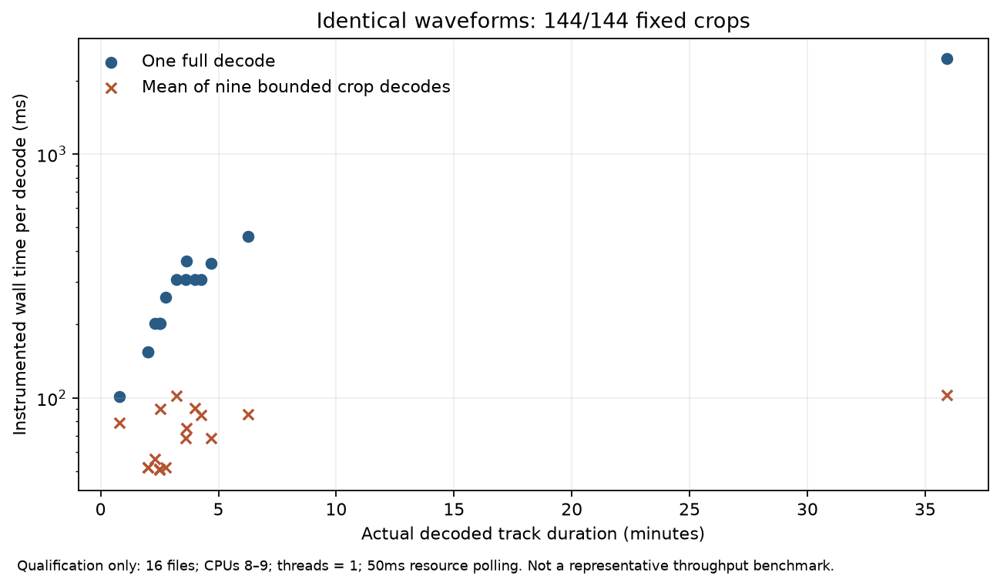
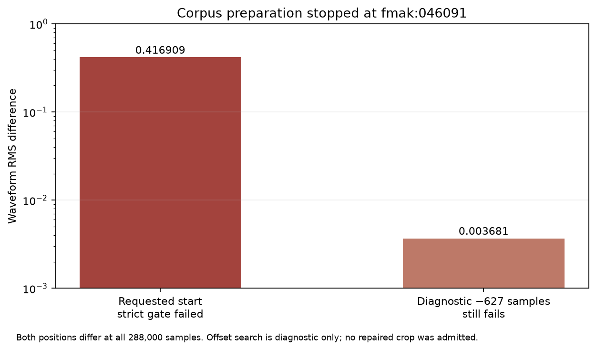

# MusicFM waveform crops: a small check passes, the full corpus fails

Seeking into compressed audio to cut random training crops is not reliable
enough for the MusicFM corpus. On 16 files, all 144 seek-based crops matched a
full decode bit for bit. Extending the same check to all 5,638 approved files
failed at file 2,289 (`fmak:046091`), where every sample of the crop differed
from the full decode. The seek path was rejected, and the next design decodes
each file once into a cache. Study date: November 12, 2026.

## Question

MusicFM training draws random 12-second crops from whole songs. How should those
waveforms be produced?

A small in-memory cache does not work. Replaying the exact planned sampler
(8,280 updates × 32 draws, 1,229 Beatport and 4,033 expanded FMA fitting
recordings, nominal Beatport share 1230/2206) against the proposed 4 GiB
least-recently-used cache gives only 1,118 hits in 264,960 requests (0.422%),
263,842 full-song misses and 4.15 TB of cache writes, against a projected
98.76 GB fitting working set. Adding a 16 KiB per-file header leaves the
conclusion unchanged. This is a serial metadata simulation using canonical
22,050 Hz sample counts, not measured throughput, and it ignores duplicated
prefetching across workers ([projection](data/lru-projection.json)).

Scaling historical preparation cost by decoded duration suggests roughly 74,908
CPU seconds to decode every draw, beyond an earlier 60,000-second whole-pilot
allowance. That proxy includes historical CQT work and is not a measured 24 kHz
decoding estimate.

The alternative tested here is to seek near the requested start and decode only
a short crop. The question is whether that crop is bit-identical to the same
span cut from a full decode.

## Method

### Decoder and comparison

FFmpeg 6.1.1 decodes each complete source to mono 24 kHz float32 little-endian
samples. The crop path seeks to an integer-second point two seconds before the
requested start, keeps 2–<3 seconds of preroll and one second of postroll, then
trims at the exact sample offset. Crops at the very beginning skip seeking. Both
paths use FFmpeg's default error-recovery behavior (no `-xerror`). Source
checksums were verified, and every stderr output was kept, including from
successful calls.

The pre-set success threshold is exact: equal length, finite values and
identical float32 bits (including signed zero) at the planned offset. There is
no lag correction, amplitude fitting or tolerance.

### Stage 1: 16 files

The [protocol](PROTOCOL.md), decoder and configuration were fixed before any
waveform was compared. Sixteen fitting files were fixed in advance; no labels,
models or scores influenced file or offset choice. Nine positions per file cover
the beginning, one-sample and phase-sensitive offsets, the midpoint, the last
legal starts and three seeded-uniform starts: 144 cases. Resource caps were 600
CPU seconds, 900 s wall, 2 GiB sampled memory and 512 MiB scratch.

### Stage 2: all approved files

The [preparation protocol](PREPARATION_PROTOCOL.md) reuses the stage 1 decoder
unchanged on all 5,638 approved IDs: 5,262 fitting and 376 selection. Each file
gets one full decode and one deterministic crop comparison at a position chosen
without labels. Key labels were used only to check that each file was the
expected input. Successful fitting decodes were discarded; selection waveforms
would have been kept only if the whole run completed. Caps were 6,000 CPU
seconds, 7,200 s wall, 2 GiB summed memory, 8 GiB storage and 256 MiB per
decoded file. The run stops at the first failed comparison.

## Results

### Stage 1: all 144 crops exact



All 144 crops matched. The plot shows wall time per decode against track
duration (log scale): full-decode time grows with song length, up to the
35.9-minute file, while the mean crop time stays near 50–100 ms. Timing includes
process launch and 50 ms polling, so it is not a speed benchmark.

| Stage 1 | Observed result |
|---|---:|
| Tracks / cases / exact matches | 16 / 144 / 144 |
| Differing samples / maximum absolute error | 0 / 0 |
| Exit code / resource cutoff | 0 / none |
| Total wall / sampled CPU | 18.220 s / 15.27 s |
| Sampled peak memory | 102,916,096 bytes (98.15 MiB) |
| Full decodes, summed wall / child CPU | 6.342 s / 6.285 s |
| Crops, summed wall / child CPU | 10.465 s / 7.626 s |
| Stderr files kept / nonempty | 160 / 0 |
| Bytes kept after cleanup | 647,091 |

The longest temporary full decode was about 207 MB, with one held at a time.

### Stage 2: failure at file 2,289



RMS difference between the crop and the full decode (log scale) at the
requested start (0.416909) and at the best-aligned diagnostic shift of 627
samples (0.003681). Shifting shrinks the error by about two orders of magnitude,
but it never reaches zero.

| Stage 2 | Observed result |
|---|---:|
| Planned / processed files | 5,638 / 2,289 |
| Passed before failure / first failed file | 2,288 / `fmak:046091` |
| Unprocessed files / selection waveforms kept | 3,349 / 0 |
| Failed crop maximum absolute / RMS error | 2.02278948 / 0.41690944 |
| Exit code / wall / child CPU | 1 / 714.983 s / 671.239 s |
| Sampled peak memory | 136,564,736 bytes (130.24 MiB) |
| Bytes kept | 49,084,818 |

Both FFmpeg commands exited normally and returned finite 12-second crops of the
right length, yet all 288,000 samples differed. The full decode logged
`Header missing` and an invalid-data packet error; the seek logged
`Header missing`. Seven earlier passing files also produced stderr output, so
warnings alone neither identify a bad crop nor prove a source is complete. Only
the exact waveform comparison caught this.

A follow-up diagnostic read only the saved buffers, with no new decoding. A
correlation search with integer refinement found the best alignment 627 samples
earlier (−26.125 ms, correlation 0.99992573). Even there, all 288,000 samples
differed, with maximum absolute error 0.03513932 and RMS 0.00368060, so no
shifted crop qualifies. Damaged frames, timestamp handling or resampler phase
could explain it; the exact cause is unproven. The diagnostic took 0.853 s wall,
0.686 s CPU and 186,613,760 bytes peak memory.

The 2,288 passing files covered 392,549.506 seconds of decoded audio. Full
decodes summed 520.179 s wall / 504.229 s child CPU, and crops 142.236 s wall /
110.537 s child CPU. These do not predict throughput under random sampling.

## Decision

The 16-file pass does not generalize; seek-based crops cannot be used for
training. The failure is kept as recorded: `fmak:046091` is not dropped, offsets
are not changed, the exact-bit threshold is not loosened, and the run is not
retried under the same protocol.

The next design decodes each fitting file once into a read-only float32 cache
held in RAM, keeps selection waveforms on ordinary disk, and cuts crops by exact
sample index, so the decoder and resampler are never restarted mid-file. That
design is described in the [RAM cache protocol](RAM_CACHE_PROTOCOL.md) and needs
its own capacity forecast and review; this study allocates no cache.

## Limitations

- The 16-file stage is a small qualification, and its timings include process
  launch and polling overhead.
- Stage 2 stopped at the first failure, so 3,349 files were never checked and
  the number of other affected files is unknown.
- Resource caps are sampled and can miss brief overshoots between samples.
- Waveform correctness is infrastructure evidence. It says nothing about key
  accuracy or teacher quality.
- The intended acceptance domain is 5–10 minute house, deep-house and
  melodic-house tracks, and current labels do not provide an independent panel
  for it.

## Reproduce

Regenerate both figures and verify the archived evidence without decoding audio:

```sh
python -m tools.musicfm_crop_io_report --study experiments/studies/musicfm-crop-io
python -m tools.musicfm_crop_failure_report --study experiments/studies/musicfm-crop-io
uv run pytest -q tests/test_musicfm_crop_io.py tests/test_musicfm_crop_io_report.py tests/test_musicfm_crop_failure_report.py
```

The stage 1 evidence is in the [raw packet](data/runtime-raw.json.gz),
[index](data/runtime-index.json) and [verified result](data/verified-result.json);
stage 2 is in the [raw packet](data/corpus-failure-raw.json.gz),
[original-byte index](data/corpus-failure-index.json.gz) and
[verified summary](data/corpus-failure-result.json). Neither contains audio or
model weights; the failed full decode and crop pair are kept outside the
repository. Matplotlib 3.11.2 generated the figures. Source revisions are in
[publication provenance](data/publication-provenance.json), and checksums for
all evidence files are in [SHA256SUMS](SHA256SUMS).
