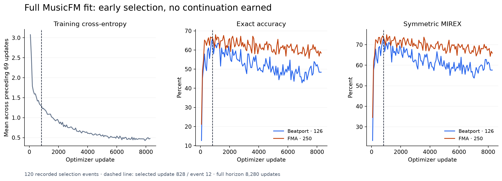
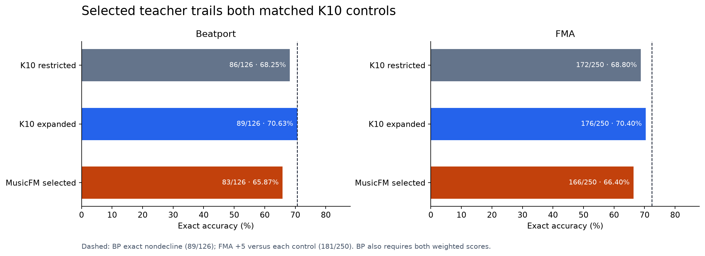
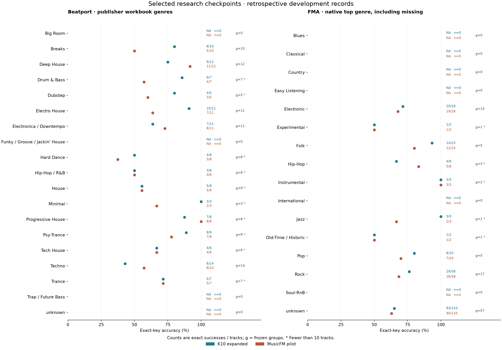
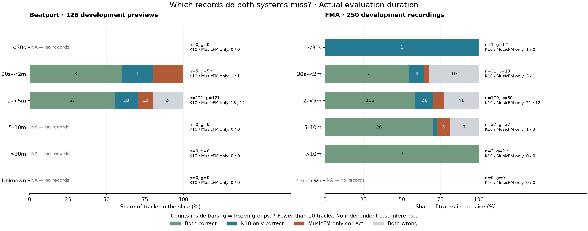
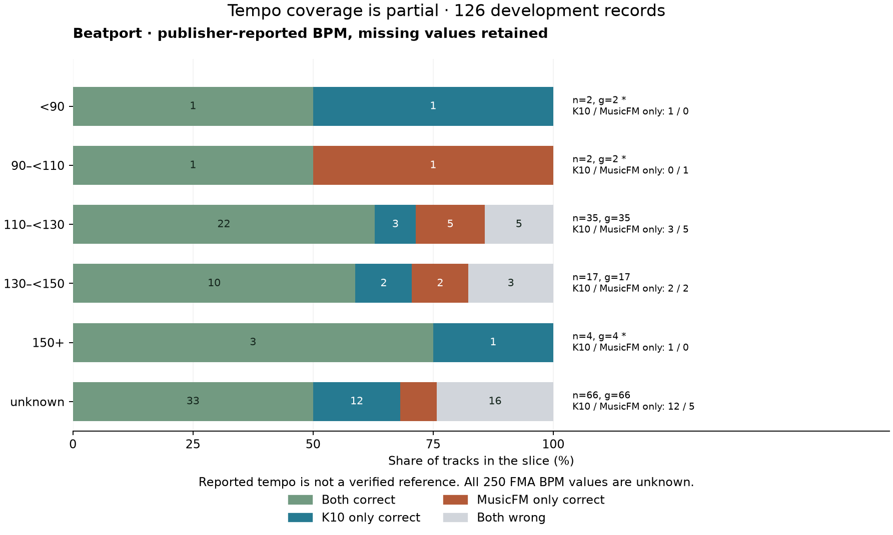
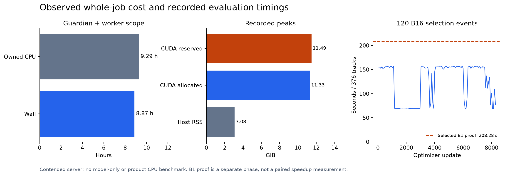
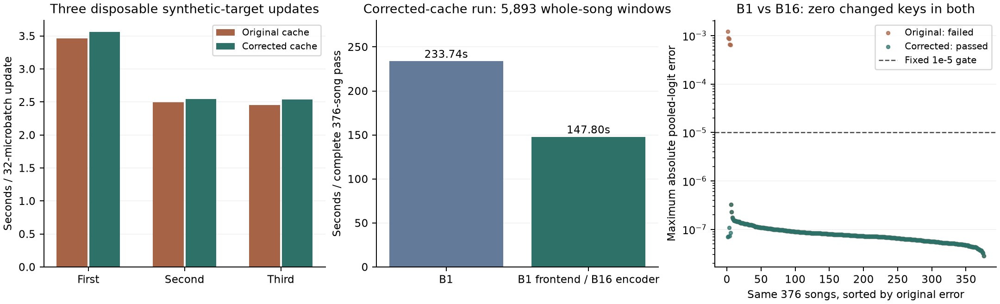

# MusicFM fine-tuning did not qualify a stronger key teacher

The fixed MusicFM-MSD pilot completed **8,280 updates and all 120 selection
events**. Its selected checkpoint, update **828 / event 12**, scored **83/126
Beatport** and **166/250 FMA** exact keys, below both matched K10 controls. It
failed the predeclared continuation gate. There was **no confirmation evaluation,
distillation or release change**. This is a negative result for this one frozen
teacher recipe, not a general rejection of pretrained music representations.

The fit ran on November 12, 2026, from 15:06:54 to 23:59:09 UTC. A separate
read-only terminal audit on November 13 verified metadata, the actual saved
checkpoint bytes, job retirement and protected service identities. The completed
fit results appear first below. The earlier disposable cost study and its failed
numerical gate remain intact in the dated historical appendix.

## Research question and frozen methods

Can full fine-tuning of MusicFM-MSD produce a teacher worth pursuing beyond the
compact K10 model? The [prospective protocol](PROTOCOL.md) fixes this as a system
comparison: architecture, context, augmentation, pretraining and optimizer differ
from K10. It does not isolate a representation effect. The product remains the
small CPU model; a 328,957,080-parameter teacher is a research/training candidate,
not a proposed ordinary-PC deployment.

The corrected training implementation fitted the approved **1,229 Beatport
+ 4,033 FMA recordings**. Selection used the same **126 Beatport + 250 FMA
recordings** as the two completed K10 controls. No calibration, confirmation,
GiantSteps or private DJ audio was evaluated. The run preserved the original
per-domain identity streams and nominal Beatport draw mass `1230/2206`, with a
frozen within-update interleave. It made 264,960 fitting draws: 32 microbatches
of size one per optimizer update, rather than a true batch of 32 for BatchNorm.

Uniform whole-recording 12-second waveform crops used the original 24-kHz mono
frontend and MSD statistics, without waveform pitch augmentation. The final
Conformer hidden layer was time-averaged into a linear 24-key head. All active
backbone parameters were trainable. Parameters, frontend, gradients and Adam
moments were FP32; training encoder/head autocast was BF16, evaluation FP32,
TF32 disabled and attention eager. AdamW used backbone/head rates `1e-5`/`1e-4`,
weight decay `0.01` and cosine decay over 120 events. Training RNGs were reset to
13 after strict loading and upstream construction's reset to 142. There was no
early stopping, resume, seed search, EMA or recipe change during the fit.

Every 69 updates, evaluation covered all 376 songs using disjoint 12-second
contexts plus actual tails, with FP64 sample-support-weighted logits. This is
whole-recording coverage with local contexts, not whole-song attention. The
frontend ran at B1; equal-shape FP32 encoder batches were at most 16, with
separate Beatport/FMA schedules. The selector maximized equal-domain exact
accuracy, then equal-domain symmetric MIREX, then retained the earliest tie.
The complete horizon ran even though its winning checkpoint was early.

## Completed results and fixed decision



**Figure 1.** Every point is a recorded event; the loss is the mean over the
preceding 69 updates. The dashed line marks the selected checkpoint, not a
stopping decision. Final-update exact scores were 61/126 Beatport and 146/250 FMA,
while interval-mean training cross-entropy fell from 3.077 at the first event to
0.477 at the last. The divergence is an observation, not proof of a particular
normalization, capacity or domain mechanism. [SVG](figures/teacher-learning.svg).

| Selected system | Best update | BP exact | BP symmetric MIREX | BP asymmetric MIREX | FMA exact | FMA symmetric MIREX | FMA asymmetric MIREX |
|---|---:|---:|---:|---:|---:|---:|---:|
| K10 restricted fitting pool | 3,864 | 86/126 · 68.25% | 76.43% | 72.86% | 172/250 · 68.80% | 74.00% | 73.60% |
| K10 expanded fitting pool | 5,796 | 89/126 · 70.63% | 77.14% | 75.16% | 176/250 · 70.40% | 75.84% | 75.04% |
| MusicFM expanded fitting pool | 828 | 83/126 · 65.87% | 73.25% | 71.27% | 166/250 · 66.40% | 73.36% | 71.36% |

These are the **matched joint-training controls** from the
[K10 v2 pilot](../k10-v2-pilot/REPORT.md), not the released K10 model's separate
GiantSteps results. The expanded K10 control also failed its own fixed improvement
gate and was not promoted. Table values are recorded metrics whose integer
numerators and denominators are checked by the reproducer; this report does not
reopen reference labels or rescore them.



**Figure 2.** The teacher needed at least five additional FMA exact cases versus
**each** control, hence at least **181/250 (72.40%)**, plus no Beatport decline in
exact, symmetric or asymmetric MIREX versus either control. It reached 166 FMA
cases and declined on all three Beatport measures. Both requirements failed
against both controls. The thresholds and comparison scope are unchanged.
[SVG](figures/teacher-controls.svg).

The saved decision is `continuation_earned: false`,
`confirmation_scored: false`, and `release_or_distillation_authorized: false`.
No selected-seed retry, reinterpretation of the gate or release claim follows.

## Retrospective diagnosis by genre, recording duration and BPM

The aggregate result does not tell us whether the failed pilot is weaker on every
kind of music. We joined its saved predictions and the expanded K10 control to the
new source-bound Beatport/FMA catalogs. This analysis uses the **same 126 Beatport
and 250 FMA development records** that selected both checkpoints across 120 events.
It adds no inference, training, independent test or new promotion gate. K10 here
is the expanded-data research control, not the released Drone-v1 checkpoint.

### Method and complete paired results

The [analysis artifact](../v2-data-contract/data/development-slices.json.gz)
binds source archives, the shared plan and selected references, model checkpoint
and evaluator identities, canonical scoring code, and metadata/binning helpers.
It checks ordered IDs, source-container hashes, the selected teacher's B1/B16
proof and actual per-recording sample counts. Scoring uses only the 376 authorized development
reference values; reserved confirmation references are not selected. The source catalogs remain target-free.
Symmetric-fifths MIREX follows the existing scorer; exact errors and abstentions
would remain in the denominator. All recorded predictions here are valid.

| Development cohort | Both exact | K10 only exact | MusicFM only exact | Both miss the exact reference | Frozen groups |
|---|---:|---:|---:|---:|---:|
| Beatport, 126 | 70 | 19 | 13 | 24 | 126 recording proxies |
| FMA, 250 | 150 | 26 | 16 | 58 | 100 existing components |

These disjoint outcomes sum to each full cohort. They explain the net MusicFM
losses of six Beatport and ten FMA exact cases without hiding the records where
it helps. “Both miss” does not mean zero harmonic partial credit. The groups do
not prove full recording independence, and some FMA components cross slices.
No confidence intervals or significance claims are assigned to this retrospective,
single-seed, adaptively reused development comparison.

### Genres: different strengths, thin support



*Every row shows exact successes / recordings for both systems and the number
of frozen groups. Asterisks mark fewer than ten recordings. Empty categories are
NA. Display order follows native labels, not the observed winner. The full artifact
also retains separate API genres/subgenres and overlapping FMA hierarchy tags.*

MusicFM is not uniformly worse. The Beatport workbook's **Deep House** subset is
11/12 exact versus K10's 9/12; **Techno** is 8/14 versus 6/14. In contrast,
**Electro House** is 7/11 versus 10/11 and **Breaks** is 5/10 versus 8/10. These
are descriptions of those records, not reliable genre rankings or a rule for
choosing a model after seeing its result.

FMA demonstrates why taxonomy provenance matters. Its top-level Hip-Hop field
covers only six records, while the hierarchy-inclusive Hip-Hop tag covers 16.
Neither interpretation should silently replace the other:

| FMA hierarchy-inclusive tag | Records / groups | K10 exact | MusicFM exact |
|---|---:|---:|---:|
| Electronic | 93 / 38 | 57/93 | 56/93 |
| Hip-Hop | 16 / 8 | 11/16 | 10/16 |
| House | 9 / 4 | 7/9 | 7/9 |
| Techno | 6 / 3 | 3/6 | 3/6 |
| Afrobeat | 0 / 0 | NA | NA |

These tags overlap and can include ancestors; the rows do not partition FMA.
The legacy Afrobeat tag is not contemporary Afrobeats coverage. The native top
field is missing for 143/250 records, and 16/250 have no all-genre tags. Missing
metadata is retained rather than silently removing those predictions.

### Duration: actual recording support, not the training crop



*Counts of K10-only and MusicFM-only successes are printed even when their bar
segments are tiny. Empty length bins remain visible. The Beatport 2–<5-minute
bin consists of approximately two-minute previews, not broad full-song coverage.*

K10 evaluated true-length 22,050-Hz-derived CQT features. MusicFM covered each
24-kHz recording with 12-second contexts plus real tails, pooling logits by sample
support. The saved model-specific durations fall into identical bins for every
joined recording; their hashes/frontends are not interchangeable. A 12-second
context does not make a five-minute evaluated recording a 12-second sample.

The FMA **five–ten-minute** bin has 37 recordings from 27 groups: K10 gets **27/37**
exact, MusicFM **29/37**. Both get 26 correct, MusicFM alone gets three, K10 alone
one, and both miss seven. The **two–five-minute** bin is larger: K10 **126/179**,
MusicFM **117/179**. The two recordings above ten minutes are both correct under
both systems, an insufficient sample for a long-track accuracy claim.

This is a mixed-genre length breakdown. It does not establish the result on
five–ten-minute house/techno specifically; only five FMA selection recordings
combine the House tag with five–ten-minute cache support. Genre, duration and
recording group are confounded here. Broad long-DJ-track evaluation remains a
measured data gap.

### BPM: missingness changes the apparent comparison



Only 60/126 Beatport development records have admitted publisher BPM. On those
60, K10 gets **44/60** exact and MusicFM **45/60**; on the 66 unknown-BPM records,
K10 gets **45/66** and MusicFM **38/66**. Dropping unknowns would therefore conceal
the overall decline. This is not evidence that missing BPM causes errors or that
tempo is the mechanism. The source metadata is not a verified tempo reference,
and all 250 FMA BPM values remain unknown.

### Consequence for the next experiment

The fixed MusicFM continuation gate remains failed. These results justify
checking specific coverage and error patterns, not distillation or a post-hoc
routing policy. The next representation candidate needs the same complete-domain
controls and a prospective decision rule. Additional labeled data should improve
support for full DJ recordings, contemporary genres and reliable metadata, rather
than simply increase the number of short previews.

Reproduce the analysis and verify or regenerate the inline figures:

```bash
uv run python -m tools.analyze_development_slices --check
uv run --extra plots python -m tools.plot_development_slices
uv run --extra plots python -m tools.plot_development_slices --write
```

The figure receipt binds the source analysis, plotting code and PNG/SVG hashes.
The analysis reads pinned catalogs incrementally, retaining only development
records, without opening audio or loading models.

## Checkpoint correctness and terminal evidence

The fit's **recorded selected-checkpoint proof** strictly reloaded `best.pt`,
evaluated B1 and B16 across all 376 songs / 5,893 contexts, and passed the unchanged
`1e-5` absolute pooled-logit tolerance. Maximum error was
**1.2904405593e-6**, with **zero changed keys**. The metadata reproducer checks
all saved 24-class vectors, their order and actual context lengths, and verifies
that B1 predictions equal the selected metrics' predictions.

The later **independent byte audit** hashed the real checkpoint files in place
without Torch loading, inference or downloading weights. Both hashes matched the
fit result, with stable file identities before and after hashing:

| Artifact | Size | Independent integrity check |
|---|---:|---|
| Selected checkpoint | 1.23 GiB | Matched the training record |
| Final checkpoint | 1.23 GiB | Matched the training record |

Exact byte counts and checksums are retained in the
[checkpoint audit records](data/terminal-index.json).

These are distinct claims: the original worker recorded a successful reload and
numerical comparison; the independent audit established which bytes remained on
disk. It did not perform a second independent model reload.

At `2026-11-13T05:15:40Z`, both original guardian/worker processes were absent,
neither failure artifact existed (including as a dangling symlink), and all four
protected vLLM processes retained their exact PID/start-time identities. The
terminal snapshot showed 22,971 MiB free on the teacher GPU and about 139.44 GiB
host memory available. This snapshot establishes observed retirement/recovery;
it is not continuous GPU-memory telemetry or an inference-service latency audit.

A separate source review identified a guardian bookkeeping flaw: the frozen
`run_musicfm_teacher.py` writes its completion marker before a subsequent
output/progress check in the loop. An exception there can write a failure receipt while retaining the
completion marker. Therefore **the marker alone is insufficient**. This audit
also checked failure-file absence, actual artifacts and caps; no evidence shows
that the completed run took that failure path. The old guardian remains unchanged
in this publication. Correcting that lifecycle ordering belongs in a separate
change, and prospective admission must reject conflicting failure receipts.

## Measured cost and its scope



**Figure 3.** Whole-job accounting includes the guardian and all owned live or
reaped descendants, including GPU queries. Memory bars show observed peaks; the
right panel uses the 120 actual B16 event timings. The selected B1 proof is a
separate phase, so its dashed reference is not a paired acceleration estimate.
No per-step GPU-utilization or memory trace was retained or reconstructed.
[SVG](figures/teacher-cost.svg).

| Resource | Observed | Fixed cap / scope |
|---|---:|---|
| Whole-job wall time | 31,934.96 s · **8 h 52 m 15 s** | 20 h |
| Aggregate owned CPU time | **33,450.7 s** · 9.29 CPU h | 100,000 s |
| Peak owned host RSS | **3.080 GiB** | 8 GiB |
| Torch peak allocated / reserved CUDA memory | 11.326 / 11.492 GiB | 12 GiB allocator ceiling |
| Audited output files | 2,650,589,359 bytes · 2.469 GiB | 8 GiB |

This was a contended GPU-server experiment. These are neither compact-model CPU
inference costs nor isolated training-kernel measurements. The earlier 10.92-hour
cost projection was planning evidence; the observed 8.87-hour whole job does not
establish a controlled speedup over that disposable probe.

The selected B1 proof's per-song times sum to **208.280 s**. The largest complete
B16 event in the 120-event history is **157.320 s** (update 5,934). The final B16
proof's separate elapsed time was not retained. If a future diagnostic requires
a fresh untouched B1 baseline plus candidate B1/B16, the recorded conservative
comparison basis is `2 × 208.280 + 157.320 = 573.880 s`, before any safety factor,
calibration work, loading, hashing, serialization or contingency. This arithmetic
is a prospective budget input, not a measurement or authorization of that work.

## Limits and next research decision

This is one seed and one recipe, selected repeatedly on the same adaptive
376-recording panel. It provides neither seed uncertainty nor an independent
estimate of full-length DJ performance. The
[existing coverage audit](../k10-v2-pilot/REPORT.md#primary-use-gap-full-length-house)
records the limited long-house panel and predominantly two-minute Beatport
previews. No new coverage, fresh-suite or state-of-the-art claim follows from
using a larger pretrained model. Label ambiguity, dataset provenance and
pretraining/comparator overlap remain relevant; the original role ledger remains
binding.

The result is sufficient to reject automatic distillation from this candidate.
It does not identify why the fit lost selection accuracy. Microbatch-one
BatchNorm train/eval behavior is a plausible prospective diagnostic target, not
a confirmed defect or causal explanation. A separately prepared fitting-only
BatchNorm-statistics diagnostic would need its own source, resource and terminal
admission, a sealed candidate before scoring, and the unchanged comparison gate.
**This report records no execution or result for that diagnostic.** Preparation
of such a test does not alter the completed negative outcome or require another
large fit.

## Reproduce the completed-result report

[Terminal evidence index](data/terminal-index.json) binds a compressed archive of
five byte-preserved original JSON receipts, the read-only audit script and a
lossless audit projection that removes duplicate base64 copies of those JSONs.
The archive contains metadata, predictions and proof vectors, not audio,
checkpoints or reference-label exports. It records the exact training source,
configuration and result identities separately from later report edits.

From the repository root:

```bash
python -m tools.musicfm_teacher_result_report
python -m tools.musicfm_teacher_result_report --plot
python -m pytest -q tests/test_musicfm_teacher_result_report.py tests/test_musicfm_teacher_cost_report.py
```

[The verifier and figure source](../../../tools/musicfm_teacher_result_report.py)
uses standard-library metadata checks; plotting additionally needs the existing
`plots` dependencies. It verifies raw-byte integrity, exact-first selection,
control hashes/membership, the fixed gate, numerical vectors, checkpoint audit,
retirement and recorded caps. Tamper tests cover those boundaries. No command
above runs inference, reads audio or exports labels. Hash consistency proves the
archive is internally bound to the retained receipts, not a cryptographically
independent attestation of the original runtime.

## November 13: BatchNorm diagnostic qualification, no accuracy result

**Question.** Could replacing the selected teacher's 18 BatchNorm input
populations improve this fixed checkpoint? The prospective
[BN protocol](BN_PROTOCOL.md) protects all learned parameters, counters and
unrelated buffers. It uses fitting audio only, deterministic crops, FP64 weighted
population moments and sequential upstream-to-downstream replacement. Candidate
state must be sealed before validation audio or reference keys are opened.

**Technical result.** A corrected, source-bound qualification started at 06:10 UTC
with the original isolated overlay. Two full traces and 36 stopped-prefix
comparisons had **zero maximum absolute difference**. Timing covered 288 stopped
prefixes across 16 fixed clips and all 18 sites. These checks support the
implementation's prefix equivalence on those inputs; they do not measure a
calibrated candidate's accuracy or establish population-estimator sufficiency.

| Budget item | Seconds | Interpretation |
|---|---:|---|
| Projected full calibration | 675.66 | 512 times the sum of per-site maximum observed clip costs |
| Required total safety margin | 2,638.41 | Doubled calibration and complete comparison costs, measured overhead, 120-second contingency |
| Remaining fixed window | 1,753.43 | Time available at admission |
| Actual qualification run | 47.63 | Complete guardian wall time; not full calibration time |

The required margin exceeded the remaining window. The worker returned
`BN_DIAGNOSTIC_BUDGET_INCONCLUSIVE_NO_SCORING`; no complete calibration,
validation comparison, retraining or promotion occurred. Peak owned RSS was
**3,550,330,880 bytes** and aggregate CPU was **51.04 seconds**. The owner recorded
exit zero, no cleanup error and compliant observed caps. Both vLLM instances
retained their original process identities after completion.

An earlier 05:45 attempt failed before calibration with missing `einops`: the
launcher used shared Python instead of the original isolated overlay. Its
preflight had missed the upstream dependency closure. The launcher guard now
requires the original interpreter path, and a bounded CPU-only check verified
all nine original module hashes before the corrected attempt. Neither startup
failure nor budget refusal is a negative BN-accuracy result.

The [terminal metadata bundle](data/bn-diagnostic/terminal-metadata.tar.gz)
preserves the exact diagnostic source, configuration and execution records. It
contains no audio or model weights. The original teacher and failed continuation
gate are unchanged. The existing report command verifies the bundle and
recomputes the calibration projection:

```sh
python -m tools.musicfm_teacher_result_report
```

**Allocation decision.** Defer another GPU window for this teacher. Sequential
population recalculation has a direct methodological precedent in Appendix A.3 of
[Rethinking “Batch” in BatchNorm](https://arxiv.org/pdf/2105.07576). That establishes
plausibility, not an expected MusicFM gain. A minimum useful-signal pass would
reach only 171/250 FMA with BP allowed to remain 83/126, still below the expanded
K10 control's 176/250 and 89/126. The joint intervention also cannot establish why
training plateaued. Retain the implementation and measured cost, but prioritize
cross-corpus exposure checks and broader evaluation of deployable candidates.
No larger resource window or follow-on training is scheduled.

**Owner amendment, 2026-11-13.** The project owner authorised one 3,600-second
window and raised the admission bound from 1,800 s. The bound was an arbitrary
admission guard rather than a safety property: the allocator cap, 8 GiB RSS,
10,800 CPU-seconds, output cap, protected-service identities and watchdog remain
binding. A first attempt under that window reached scoring but the worker was
killed when a 1.17 GiB allocation pushed it past the 12 GiB allocator slice
(11.54 GiB resident). The owner therefore raised the allocator guard to 16 GiB,
moved the run to a compute-idle device, and authorised a temporary stop of one
co-resident inference service for the run only; it is restored immediately
afterwards.
The gate, checkpoint, panel, estimator and interpretation are unchanged. The
diagnostic still reports `BN_DIAGNOSTIC_BUDGET_INCONCLUSIVE_NO_SCORING` if the
measured margin does not fit.

## November 13: BatchNorm diagnostic result — negative

The diagnostic completed on a compute-idle device at 10:12 UTC. The worker
exited zero with no cleanup error; wall was **707.6 s**, peak owned RSS
**6,219,206,656 bytes** and aggregate CPU **843.28 s**. All caps held, the
candidate state reloaded strictly, and the composed B1/B16 proof had **zero
argmax disagreements**. No training, confirmation scoring or promotion occurred.

| Panel | Untouched selected checkpoint | BN-refreshed candidate | Change |
|---|---:|---:|---:|
| Beatport exact, 126 | 83 (65.87 %) | 76 (60.32 %) | **−7 (−5.56 pp)** |
| FMA exact, 250 | 166 (66.40 %) | 169 (67.60 %) | **+3 (+1.20 pp)** |
| Beatport symmetric MIREX | 73.25 | 68.25 | −5.00 |
| FMA symmetric MIREX | 73.36 | 74.40 | +1.04 |

The frozen gate required at least **171/250** FMA exact (+5) with **no**
Beatport decline. The candidate failed both conditions (`useful_signal: false`,
`promotion_authorized: false`). Refreshing the 18 BatchNorm input populations
does not rescue this checkpoint: it costs seven Beatport exact answers and gains
only three FMA exact answers. This is a genuine negative result, not a budget
refusal or infrastructure failure.

**Interpretation.** This fixed sequential population refresh failed to rescue
this selected checkpoint under the declared gate. It does not rule out a causal
contribution from BatchNorm mismatch, or establish what a different calibration
population, estimator or checkpoint would do. We close this tested intervention;
we do not generalize the negative result to BatchNorm adaptation as a whole. The
result also bounds the earlier speculation: even the minimum-signal bar would
have left the candidate below the expanded K10 control's 176/250 FMA and 89/126
Beatport.

The [run record](data/bn-diagnostic/v4/run.json) separates actual resource use
from the one-hour wall limit, 8 GiB host-memory cap and 16 GiB CUDA allocator
allowance. The [terminal controller record](data/bn-diagnostic/v4/controller.json)
confirms successful completion. It does not contain a final output-size
measurement, so output-cap compliance is supported by the running guard alone.
The co-resident inference service was restored immediately after the run.

For reproducibility, the executed source included two overrides beyond its
recorded base revision. The [source lock](data/bn-diagnostic/v4/source-lock.json)
and [archived patch](data/bn-diagnostic/v4/source-overrides.patch) identify and
reconstruct the actual code used. The private configuration and approval are
identified in the public record; their contents cannot be independently recovered
from those identifiers.

Verify the archived evidence without loading models or audio:

```sh
python -m tools.check_musicfm_bn_v4
```

Add `--reconstruct-source` to also reconstruct and verify the executed code in a
temporary directory. That optional check requires the historical Git revision;
it leaves the checkout untouched.

## Historical preparation — November 12, 2026

The original cost-qualification findings follow. Their
statements that no task fit or accuracy result was established refer to those
**disposable pre-fit executions**, not the completed fit above. The failed gate,
controlled stop, cache repair and cost projection remain part of the evidence.

### MusicFM whole-song cost qualification exposed and repaired a precision cache bug

### Problem and decision

A short-window resource probe cannot establish the cost or correctness of a real
MusicFM key-training pipeline. The next step exercised actual cached fitting
waveforms, 32-microbatch optimizer updates and all 376 complete selection songs.
It found a precision-dependent state bug that the earlier 16-window probe missed.

The original B1/B16 composed check **failed**: maximum absolute pooled-logit error
**0.0012251087**, with five failing songs and zero changed keys. A proposed B1-only
run was stopped before model setup completed when independent source review found
that B1 itself could reuse BF16 rotary embeddings during FP32 evaluation. A new,
wrapper revision then passed the same fixed complete-song
gate: maximum error **3.230626e-7**, zero key changes, unchanged `1e-5` absolute
limit. The original failure and controlled stop remain preserved.

**This is a disposable cost/numerical study, not trained-key accuracy.** Each
complete run performed only three optimizer updates with synthetic targets. No
teacher weights were saved or reused. A real 8,280-update fit is distinct: it starts afresh from the original checkpoint,
binds its initial state to the probe, and includes complete-song evaluation and
the fixed continuation comparison. No real-fit accuracy result, stronger teacher,
distillation benefit or CPU deployment footprint is established here.



The same 376 songs appear in both numerical series, ordered by the original run's
error. The dashed line is the unchanged absolute gate. No logarithmic display floor
affects gate calculation. The middle panel covers all 5,893 actual song windows;
it is not a single-window forward benchmark. [SVG](cost-results.svg) and the
[verified plotting source](../../../tools/musicfm_teacher_cost_report.py) are
available; reproduction commands appear below.

### Method

Both complete runs use the original pinned MusicFM-MSD checkpoint, original
24-kHz mono mel frontend and MSD global statistics, original Conformer encoder
and pretraining projection, final hidden layer's time mean and a seed-13 linear
24-key head. Class IDs use the shared `2*tonic_index + minor` mapping.
The measured environment retains Torch 2.15.0+cu132 and NumPy 2.5.4; exact
dependency, source and checkpoint identities are retained in the
[cost-study records](data/cost-index.json).
There are 328,957,080 registered model/head parameters; checkpoint state elements
are a different quantity, documented in the [source/resource preflight](../musicfm-preflight/REPORT.md).

Parameters, frontend, gradients and Adam moments remain FP32. Training uses BF16
encoder/head autocast, TF32 off, eager attention, hard cross-entropy scaled by32,
finite loss per microbatch and finite accumulated gradients before optimizer
commit. AdamW uses backbone/head learning rates `1e-5`/`1e-4`, weight decay0.01,
betas0.9/0.999, epsilon1e-8, foreach/fused off. Python/NumPy/Torch training RNGs are
reset to13 after upstream construction's142 reset, strict checkpoint load and
head/device setup. Both runs started from the same verified model state.

Each cost run consumes exactly three groups of32 synthetic-target examples from
the predeclared original16 fitting IDs, using deterministic whole-track crop
sampling. It uses actual Adam allocation and updates, not shaped empty moments.
The normal provider returns exact FP32 crops from the hash-verified ordinary-disk
cache. It does not seek-decode each draw, use a full-song fitting LRU, silently
change waveform precision or activate the removed RAM cache.

The 376 evaluation songs contain126 Beatport and250 FMA IDs, with 5,893 windows.
No task scores are computed. Complete songs are tiled in actual12s contexts;
tails longer than1,024 samples use their own context, while smaller tails borrow
the final full context and contribute only their newly covered duration. The
FP64 mean weights each window by its exact support sample count. This covers the
song without providing whole-song attention or selecting harmonic windows.

The B1 reference and candidate both run the original frontend/normalization
individually at B1 in FP32. Candidate encoder batches combine only identical mel
shapes, with no padding or context change. Outputs are reordered before identical
FP64 aggregation. Both replay the actual separate Beatport/FMA evaluation calls,
including partial batches; this avoids qualifying a combined-panel schedule that
checkpoint selection would not use. The fixed gate is finite24-way outputs,
maximum absolute aggregated-logit error ≤`1e-5`, and zero changed argmax IDs.

The host is the shared RTX PRO6000 Blackwell server. Main worker affinity is
CPUs8–9. The executed CachedProvider uses one prefetch thread, inheriting that
affinity; numeric threads1. Four decoder threads and FFmpeg affinity10–13 belong
only to the explicit streaming fallback, not these disk-cache cost runs. ORT is
not used by this teacher probe. The per-process CUDA allocator cap is12GiB, with a global
8GiB free-memory reserve and all four protected vLLM parent/engine start identities
checked by the guardian. This is instrumented work on a shared serving host;
throughout-run foreign GPU utilization was not measured, so these are not isolated
throughput numbers.

### Results and timing boundaries

| Measurement | Original implementation | Precision-cache repair |
| --- | ---: | ---: |
| First actual32-microbatch update |3.46544s |3.56225s |
| Second / third update |2.49380 /2.45074s |2.54529 /2.53705s |
| Input wait before first update |0.06916s |0.06181s |
| Mean of the two later update times |2.47227s |2.54117s |
| B1 complete376-song evaluation |247.44495s |233.73865s |
| B1-frontend/B16-encoder complete evaluation |154.76148s |147.80360s |
| Both validation passes, aggregate worker/child CPU |401.82286s |381.25761s |
| Full cache integrity scan |161.28303s |160.16988s |
| Model setup / load |7.77894s |8.10650s |
| Complete controller wall / aggregate owned CPU |583.60354 /514.88s |562.63631 /495.34s |
| Maximum CUDA allocated / reserved |12,161,753,088 /12,308,185,088B |same |
| Maximum sampled controller-owned process-tree RSS |3,314,368,512B |3,315,097,600B |
| Absolute composed-logit maximum |**0.0012251087: failed** |**3.230626e-7: passed** |
| Failing tracks / changed keys |5 /0 |0 /0 |

Update timing starts only after all32 inputs resolve and CUDA synchronizes, then
includes H2D, actual forward/backward/Adam, finite-state instrumentation and final
synchronization. Separate training-pipeline time includes initial provider wait
and overlap:8.48340s original,8.71063s corrected. Subsequent resolve waits were
approximately30–38µs in these tiny runs; this is not a corpus-wide I/O forecast.

Evaluation timers include cache slicing, H2D, original frontend, encoder/head,
aggregation and worker watch calls. They exclude the earlier full cache scan and
model setup. B1 outputs reach CPU per window; candidate outputs reach CPU per
flushed group. Controller wall additionally includes startup, guards, GPU queries
and other setup. CUDA byte high-water marks differ from sampled whole-process
NVML allocation; no sampled NVML peak is invented from the CUDA fields. Host RSS
is the research process tree, not a prediction of final CPU classifier memory.

The corrected steady mean ×8,280 updates plus120 complete B16 validation events,
one setup and a final B1/B16 selected-checkpoint audit gives an arithmetic planning
estimate of **10.92h**. It is **not measured fit duration or an11h promise**: only
two later updates informed steady timing, cache/locality and serving contention
may vary, and progress/scoring/checkpoint writes and other long-run costs are not
fully represented. No training horizon, full-song coverage or validation cadence
may be shortened to fit that estimate. Actual full-fit resource use and duration remain separately measured outcomes. The expensive per-draw full-decode projection
belongs to the explicit streaming fallback, not this ordinary-disk cache path.

### The failed gate and precision-cache repair

The original five failures were exactly the first five Beatport songs:
`1059355`, `1077935`, `11077`, `1147737`, `1274431`. Three have no tail; the other
two have nearly complete11.97/11.98s tails. All short tails ≤one second passed.
This contradicts attributing the failure to very short tails. The worst component
was class6 on `beatport:1059355`, B1logit0.24281444 versus B16logit0.24403955.
The remaining371 songs had errors on the ordinary~`1e-7` scale; FMA maximum was
3.230626e-7. Zero changed keys did not satisfy or relax the frozen numeric gate.

The [archived Transformers source](../musicfm-preflight/evidence/transformers-conformer.py.txt.gz)
returns the rotary cache whenever
sequence length matches (snapshot lines143–144), but constructs that tensor in
the hidden-state dtype (lines154–155). The lookup does not check dtype/device.
The final BF16 training crop has300 encoder positions. The first five B1
validation songs also only produce300-position contexts; the sixth song's11.2s
tail changes length and forces FP32 cache reconstruction. Candidate B16 is run
after that reference pass. Thus B1 could reuse a BF16 cache at the beginning of
its nominal FP32 evaluation. This source-level state defect fits the sharp first-
five failure boundary; the old run did not retain rotary-tensor dtype traces.

A B1-only cost attempt was therefore stopped through its own verified guardian:
SIGTERM, worker exit−15,55.45517s controller wall. Its terminal receipt records
no completed update/validation and no upstream setup directory. It is an incomplete
controlled stop, not an additional failed accuracy or completed timing experiment.
Its raw receipts are retained with the two complete runs.

The prospective repair is confined to the teacher wrapper. It strictly verifies
the pinned rotary cache contract, clears its length/tensor attributes together
on train/eval transitions and module device/dtype application, and checks stale
dtype/device on same-mode forward precision changes. Repeated same-mode evaluation
keeps a valid cache. Shared dependencies, original frontend, model parameters,
head, windows and schedule are unchanged. This also protects the reverse
FP32-evaluation→BF16-training transition; choosing B1 alone was insufficient.

CPU synthetic regressions reproduce a length-only cache, cover BF16→FP32same-
length→BF16, exact fresh-reference FP32 results, unchanged state/parameters,
same-mode precision changes, module moves, repeated evaluation and rejection of
malformed cache contracts. The corrected complete run had the same initialization,
inputs, module receipts and settings; only `experiments/musicfm_teacher.py` changed
within the bound numerical source closure. Its new passing result supports this
repair without rewriting the old failure. No disposable weights carry into a fit.

### Evidence and reproduction

[Evidence index](data/cost-index.json) binds deterministic gzip containing13
original small UTF-8 JSON files, each preserved byte-for-byte with its own SHA256.
Both complete results include all376 ordered pairs of24-way logits, context
sample/window counts, separate-domain schedule, measured source closures, module
receipts and initialization digests. No waveform, feature array, model weights or
new task labels are bundled. Controlled-stop receipts remain distinct.

The index records the original and repaired implementations, their exact results
and shared initialization. These execution identities remain distinct from
later publication edits, even if a file path moves.

The verifier needs only the Python standard library. Plotting uses the repository's
existing Matplotlib plotting environment; it adds no inference/training dependency.

```sh
python -m tools.musicfm_teacher_cost_report
python -m pytest -q tests/test_musicfm_teacher_cost_report.py
python -m tools.musicfm_teacher_cost_report --plot
```

The verifier checks compressed/decoded/raw hashes, complete vector shapes and
finiteness, every paired gate, whole-song counts, schedule identity, scope and
initialization bindings, source/data invariants, and controlled-stop status.
Tests damage vectors, contexts, schedules and evidence bytes to exercise rejection.
The inline PNG/SVG derive from verified evidence, not transcribed figure labels.

### Limits and next decision

There are no real task-training results here. Full12s contexts tile the entire song
but do not provide long-range attention. Beatport120s previews and broad FMA
Electronic cannot establish the primary5–10minute house/deep-house/melodic-house
acceptance target; only five generic House selection songs across three groups
currently cover that range. No calibration, confirmation or private DJ selection
was used. Internal teacher continuation still requires the separately frozen gain
against both K10 controls and Beatport nondecline; resource feasibility earns no
accuracy exception. The K10 expanded-data pair's failed2-point gate stays failed.

The research teacher is a GPU system. These timings do not qualify its model or
frontend for ordinary PCs, prove a compact student's eventual accuracy, or promise
CPU memory/latency. The next accuracy evidence must come from a separately
completed, source-bound fresh fit and its complete-song evaluations; no such result
is included in this publication.
