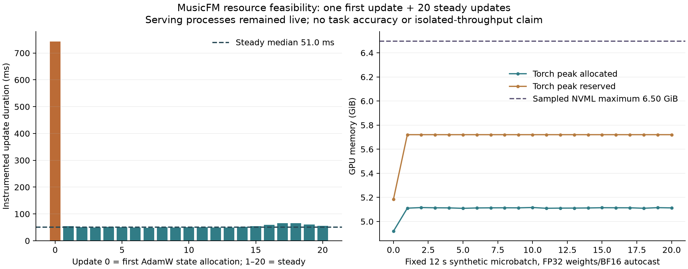

# MusicFM-MSD source preflight and shared-GPU feasibility

## Problem and decision

Before committing to MusicFM fine-tuning or distillation, determine whether its
actual source, checkpoint and optimizer fit alongside both existing vLLM services.
Version declarations alone were insufficient: the first TorchAudio wheel failed
its CUDA-build check. A separately approved official CPU build imported correctly,
and one strictly bounded synthetic GPU probe then completed.

The approved model and new resource head contain **328,957,080 parameters**.
The checkpoint contains **329,170,226 state elements across465 tensors**; state
includes buffers and is not a parameter count. **316,367,896 elements** received
gradients/Adam states. The loaded model, original mel frontend, final hidden
sequence and synthetic24-class head completed first AdamW state allocation and20
steady updates with all FP32 parameters and BF16 encoder/head autocast.

This establishes **resource feasibility for the fixed12s microbatch**, not key
accuracy, a trained teacher, whole-fit GPU hours, standalone throughput, CPU
performance or production readiness. A real-data pilot requires a separately
reviewed split, input/evaluation pipeline and finite compute/storage budget.

## Measured results



Figure: one repeated synthetic12s waveform, microbatch1, seeded head/target and21
updates. Update0 includes first optimizer-state allocation and first-use CUDA
work; model/checkpoint loading is outside the per-update timer. The measured
steady median includes finite-gradient/resource instrumentation. Both vLLM
processes remained live; root observed GPU0 actively serving before launch.
Utilization was not sampled throughout, so this is not an isolated GPU benchmark.
NVML values are sampled MiB; CUDA fields are bytes converted to GiB in the figure.

| Measurement | Observed result |
| --- | ---: |
| First instrumented update |0.743002s |
| Median of20 instrumented steady updates |0.050997s |
| Maximum CUDA allocated, across all21 updates |5,493,349,376B /5.116GiB |
| Maximum CUDA reserved, across all21 updates |6,142,558,208B /5.721GiB |
| Maximum sampled worker NVML usage |6654MiB /6.498GiB |
| Minimum sampled global GPU free memory |16312MiB /15.930GiB |
| Maximum sampled worker-tree host RSS |2,238,050,304B /2.084GiB |
| Resource supervisor wall /aggregate child CPU |10.568s /11.065s |
| Source-model registered buffer tensor bytes |951056B |
| Analytical FP32 weights+active gradients+two Adam moments |5,112,243,072B /4.761GiB |

The analytical last row uses`4P+12A` with counted stored parametersP and active
optimizer elementsA. It excludes scalar optimizer steps, buffers, activations,
workspaces, context and allocator effects. It is not measured peak GPU memory.
The nominal330M/all-active estimate was5.28GB; actual graph activity reduces it,
but still exceeds the old~4GB cap before workspace/context. No cap was increased
or recipe retried after an outcome.

## Method and fixed authorization

Root approved exact config SHA
`7520c83160f0079eec8f780005acf4c754f15ce213a8072d37ee90627c191a8a`,
source`84685cef837f2234e6acfd942e9cc8eb80d04f75`, tool SHA
`7b8523d363012c6d564dab435dbdb6022a23cdc32a06db1a792fee039675499d`,
and environment fingerprint
`40d07d3cfd8459bac65a585ef49cd546250b327045fcf953b755bd949555f274`
BEFORE the GPU attempt. The window was2026-11-12 09:35–09:50UTC. An explicit
separate approval receipt retained the original draft config unchanged, including
its draft`launch_authorized=false` metadata. All provided module hashes and both
protected process start identities were checked immediately before execution.

The sole probe launched09:37:35.744900UTC, supervisor PID4137056/worker4137186,
and exited0 within the approved window. Hard policies: fixed Linux CPUs8–9,
numeric/Torch threads1, GPU0 UUID
`GPU-387d0c41-22e5-4c3b-efe8-1d8f1dd0494c`, requested allocator cap12288MiB,
global-free reserve8192MiB,600 child CPU/600 wall seconds,8GiB sampled worker-tree
RSS and4GiB new output. Both vLLM PIDs1481756/3451013 retained start identities
35700162/111967770. Only this probe could be terminated by its supervisor.
No service action, second probe or parameter/shape/precision/cap change occurred.

The original MusicFM source/stat/config/weight identities are in the
[initial protocol](PROTOCOL.md); the [CPU-build amendment](CPU_CANDIDATE_AMENDMENT.md)
fixes the later build/affinity decision. Input was one uniform-noise
`[1,288000]` FP32 waveform at24kHz, reused21 times. Original mel2048/hop240/
128bands/MSD normalization produced1200 frames, then300×1024 hidden states.
Preprocessing stayed FP32; the stock eager Conformer/head used BF16 autocast,
with FP32 model/gradients/moments and TF32 off. Time pooling was along the
sequence axis, followed by a new1024→24 head and a synthetic target0.
The full official encoder path remained, including computations unused by the
resource-only head. No real audio, musical label, task score or saved new weights.

The checkpoint loaded on CPU with weights_only=True/mmap=True, the exact official
model. prefix and strict state matching before CUDA initialization. Thus the
probe verifies this CPU TorchAudio build supports the actual mel/frontend
operators through shared CUDA Torch at this shape; it is not a universal claim
about every TorchAudio CUDA operator or task-numerical equivalence to FP32.

## Dependency failure and corrected build

| Stage | Outcome | Child CPU /wall | Sampled peak RSS | Owned bytes at completion |
| --- | --- | ---: | ---: | ---: |
| PyPI TorchAudio2.11.0 |Import failed: CUDA13.0 versus shared Torch13.2; checkpoint gate stopped |4.932s /6.962s |601,124,864B |233,937,500B |
| Official TorchAudio2.11.0+cpu |Imports, constraints and safe CPU checkpoint layout passed |16.982s /30.669s |851,750,912B |1,523,119,630B |

The first failure is preserved, not normalized away. Stable TorchABI policy did
not imply CUDA-build compatibility. Root approved the separate CPU candidate;
no TorchAudio version check was monkeypatched. Its official341338byte cp312
manylinux_2_28 wheel has SHA
`2354248848d06a9ae1e7a12165f800f0dda7df60ecac9fca892322b722b922c0`.
All other resolved wheel records remained identical.19 exact direct/transitive
wheel identities and hashes are retained in the raw lock/selection receipt.
Torch and NumPy were excluded from resolution/download/install.

The task-owned overlay uses shared Torch2.15.0+cu132 and NumPy2.5.4 at their
original physical module paths/hashes. Complete base distribution receipts
before/after were identical. Exact candidate versions are TorchAudio2.11.0+cpu,
Transformers4.57.6 and einops0.8.1. Installation was offline, hash-required and
no-deps after all selected wheels were verified. No shared venv/system changes.
Only after imports passed was the pinned1,316,802,088byte MSD checkpoint fetched
and SHA-verified. CPU state inspection used no model construction or inference.
The large checkpoint, wheels, caches and overlay remain on the server, outside Git.

## Evidence, limitations and next step

The raw kernel-cache warning is retained verbatim: the requested
`cache/torch/kernels` directory could not be created and kernel caching was
disabled. This is a setup limitation, not an accuracy result. A future directory
creation fix needs a separate identity; the measured attempt is not repeated.

The [evidence index](data/runtime-index.json) binds90 original UTF-8 files through
per-file, compressed and decoded SHA256 values. The deterministic gzip bundle
preserves failed CLI attempts, v1 import failure, exact wheel/lock/module paths,
CPU layout, approval/config, all21 update records and sampled supervision.
It includes no checkpoint/wheel/audio bytes. Executed sources are preserved by
[source-audit2083524](https://github.com/lvndry/drone/commit/20835246e1066b313df3dc40e1e6aaf672c24cee),
[failed provisioning6cabc0e](https://github.com/lvndry/drone/commit/6cabc0e) and
[executed resource84685ce](https://github.com/lvndry/drone/commit/84685cef837f2234e6acfd942e9cc8eb80d04f75)
research tags; these measured identities are preserved independently of the
publication commit.

```sh
uv run python -m tools.musicfm_resource_report --plot
uv run pytest -q tests/test_musicfm_preflight.py tests/test_musicfm_provision.py
```

The checked reader verifies source/config/approval/effective-config bindings,
base preservation, import-before-download, fixed shape/step/precision and
resource limits before regenerating PNG/SVG. Source/per-step raw bytes remain
unchanged. Sampling cannot guarantee instantaneous global free memory between
observations. Active serving, repeated GPU-resident input, absent audio decode/
augmentation, first-use work and finite checks prevent a whole-fit cost promise.

Next: propose one finite v2-data MusicFM pilot with bounded24k waveform/crop I/O,
fixed song-level validation aggregation and real validation/checkpoint costs.
Use the newly frozen v2 inner IDs, not the oldv1 FMAK250, and exclude confirmation/
calibration. Stronger-teacher accuracy must be earned before any student budget.

The primary acceptance domain is5–10minute house/deep-house/melodic-house. This
synthetic probe provides no labelled evidence for it. A real pilot must cover
whole songs and separately report duration/domain/genre/group coverage; generic
FMA Electronic means and120s Beatport previews cannot establish that acceptance.
Long percussive intros/outros may dilute global evidence; record that risk and
window diagnostics without automatically reviving failed weighting searches.
Private DJ audio remains excluded from training and selection.
