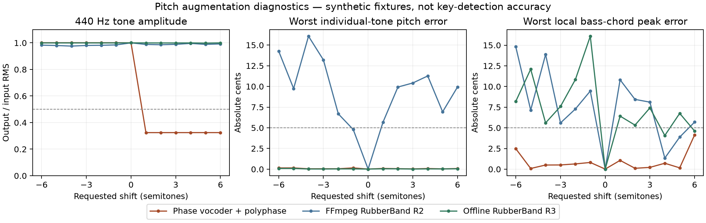
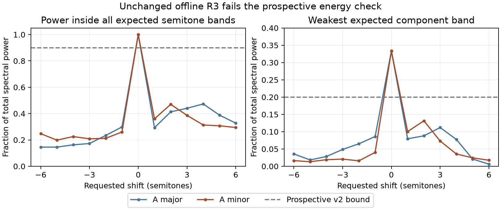
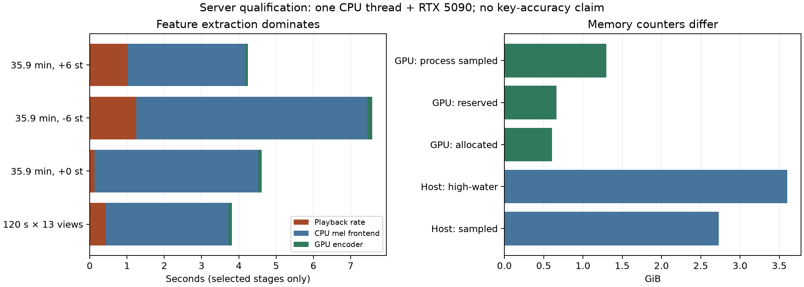

# Myna representation: qualification before the accuracy pilot

**The encoder, playback-rate augmentation and complete-track execution path are qualified for one controlled accuracy pilot. No key-detection accuracy result has been measured yet.**

The research question is whether a pretrained music representation can improve
key classification beyond the compact model. We use the released 21.4-million-
parameter Myna encoder, frozen while a separate key head is trained. This is a
research candidate; it does not replace Drone's released model or establish
ordinary-PC inference performance.

## Question and method

Before budgeting an embedding extraction or training experiment, verify that the
pinned encoder loads strictly, that batching preserves its output, and that a
bounded-memory frontend preserves complete-track mel frames. The initial worker
uses a ten-minute synthetic waveform and two fixed fitting-set PCM recordings.
No reference keys, development rankings, fresh evaluation tracks, or private DJ
audio enter this qualification.

The representation comes from the released [Myna model](https://huggingface.co/oriyonay/myna-vertical).
The key head follows the published [KeyMyna design](https://arxiv.org/html/2604.10021v1):
384 input features, two 4,096-unit hidden layers with ReLU, dropout 0.99 after
the first hidden layer, and 24 output logits. Its 18.5 million parameters make
the complete research system much larger than the compact product model.
We use our own fitting/selection protocol and head implementation. The
pretraining corpus has not been independently fingerprint-audited against every
recording in our evaluation inventory; source provenance is not overlap clearance.

The environment uses Python 3.12 and an exact uv lock. Torch and Torchaudio are
both 2.11.0 with CUDA 13.0 builds from PyTorch's explicit wheel index. The
[official installation matrix](https://pytorch.org/get-started/previous-versions/)
documents this pair. Version compatibility alone does not establish that our
model kernels work; the numerical qualification must demonstrate that.

The provisioning tool downloads only a reviewed compatible-wheel manifest,
checks every wheel's size and SHA-256, and installs from the verified local wheel
directory with network access disabled for installation. It records installed
distributions and hashes of installed files. The numerical worker checks those
identities again before importing the ML runtime.

## Input and numerical contract

- Input is verified finite mono float32 PCM at 24 kHz, already decoded by the
  existing FFmpeg preparation pipeline. Stereo downmix, when needed, is the
  arithmetic channel mean.
- Torchaudio resamples to 16 kHz with `sinc_interp_hann`, filter width 6 and
  rolloff 0.99. This does not claim equivalence to the upstream file loader or
  its TorchCodec decoder.
- The frontend is the pinned upstream nnAudio mel transform: 128 bands,
  2048-point FFT, 512-sample hop, centered reflection padding and power 2.
  No additional logarithm or normalization is inserted.
- All complete 196-frame windows are retained. A partial final window is
  discarded, matching the source contract. No window-count cap is applied.
- The frontend stays on CPU; the encoder runs in FP32 on the explicitly selected
  GPU. TF32 is disabled. Batch sizes 1, 8 and 16 use identical windows.
- Absolute tolerance is 1e-5 and relative tolerance is 1e-4. Failure is preserved
  as a failed run; tolerances are not automatically relaxed.

The block planner includes each frame's complete 1024-sample context and
preserves reflection at the actual recording boundaries. Metadata tests check
global frame centers, short-input rejection and final-block handling. Actual
full-versus-blocked tensor comparisons are required in addition to these tests.

## Resource protection

The worker is restricted to the RTX 5090 while both existing vLLM services
remain running. A separate guardian checks their process identities, samples
host RSS and global GPU free memory, and terminates only its owned worker group
on a violation. The initial caps are 600 wall seconds, 1200 CPU seconds,
4 GiB sampled host RSS, 2 GiB Torch allocator memory, a 6 GiB global GPU free
reserve and 64 MiB outputs. CPUs 8 and 9 and one numerical thread are used.
These are sampled safeguards, not hard operating-system memory isolation.

The receipt reports Torch allocated/reserved peaks separately from sampled
whole-process GPU memory. Their difference can include CUDA context and library
allocations outside Torch's allocator. Synthetic head optimizer steps measure
execution cost only; their weights and losses are not model-quality evidence.

## Evidence and remaining work

Private environment provisioning completed in 41.3 seconds, downloading 2.77 GB
and reusing 23.7 MB of verified wheels. Its sampled peak host RSS was 116 MB.
No model imports or CUDA execution occurred during provisioning. An earlier
resolver attempt exceeded its sampled metadata allowance and is retained as a
separate failure, rather than treated as a completed artifact.

Initial numerical qualification passed in 14.4 seconds including inventory
verification and imports. The strict encoder load succeeded. The ten-minute
synthetic full and blocked mel tensors were exactly equal; the fitting music
comparison differed by at most 0.000916 absolute and passed the declared
absolute-plus-relative criterion. All batch comparisons passed; the largest
error divided by its allowed tolerance was 0.069.

| Resource | Initial qualification measurement |
|---|---:|
| Sampled guardian plus worker host RSS | 1,594 MiB |
| Torch GPU allocated peak | 540 MiB |
| Torch GPU reserved peak | 568 MiB |
| Sampled whole-worker GPU memory | 1,216 MiB |
| Minimum sampled global GPU free memory | 8,885 MiB |

The 120-second fitting recording produced 19 complete windows. Forward calls
took 68.3 ms at batch 1, 11.7 ms at batch 8 and 7.87 ms at batch 16. **These are
not unbiased batching speedups:** batch 1 ran first and included cold-path
effects; its more numerous iterations also performed more guard queries inside
the measured interval. They are neither end-to-end extraction times nor laptop
inference estimates. Three synthetic head updates took 155 ms, too few to
establish a complete training budget. Both inference services retained their
process identities; the qualification process group was absent afterward.

The initial **length-preserving pitch implementation failed**
the synthetic amplitude check before any fitting-recording extraction. A
separate CPU diagnostic located the problem in the phase-vocoder stage: at
+3 semitones, 440 Hz retained only 32.4% of its input RMS amplitude. An
STFT/ISTFT round trip retained its amplitude, and the subsequent polyphase
resampler barely changed it. Negative shifts retained the individual tones'
amplitudes. This direction-dependent distortion would change the training
examples beyond the requested pitch transformation.

An independently declared alternative, FFmpeg's default RubberBand R2 engine
with its quality setting, preserved tone amplitudes and exact sample counts.
It failed the unchanged five-cent pitch check on every nonzero shift in these
synthetic bass fixtures. These results concern the tested R2 configuration;
they do not establish that all RubberBand engines or settings behave the same.
Neither failed candidate is used for model training, and no gain normalization
or tolerance relaxation has been applied.

The next candidate used the existing RubberBand library's offline R3 engine
through its pinned C API. This follows the publisher's
[offline quality guidance](https://breakfastquay.com/rubberband/integration.html),
with the required study pass, explicit process/drain handling, single-thread
operation, engine-version assertion and strict output lengths. Every individual
tone passed the five-cent check (worst error 0.089 cents), and amplitudes and
exact sample counts passed. Local peaks in the bass chord differed by up to
16.1 cents, so the original all-components five-cent gate still failed. That
original result remains a failure.

Dashed lines show the original diagnostic bounds. The chord panel measures
local FFT-peak estimates; it does not measure key-classification accuracy.
Individual-tone global peaks are also recorded in the raw diagnostics to avoid
mistaking a small expected-frequency side peak for the dominant output tone.
The [plotted measurements](data/pitch_diagnostics.csv) and
[rendering script](../../../tools/plot_myna_qualification.py) are included for reproduction.

An independent review challenged whether local peak interpolation was a valid
test of preserving the chord's notes. We therefore froze one **prospective,
exploratory v2 diagnostic** before running it. This amendment was motivated by
an observed failure; it does not retroactively qualify R3 or count as a fresh
independent confirmation. The implementation and settings remained unchanged.

The test used the existing equal-amplitude A-major chord and a new A-minor
chord, each at all 13 shifts. In the central ten seconds of each twelve-second
signal, a Hann-windowed power spectrum had to place at least 90% of total power
inside the union of ±50-cent bands around the three expected notes, and at
least 20% of total power in each individual band. These are engineering
tolerances, not a perceptual standard. Analytically generated correct chords
had to pass; an entire chord displaced by a further semitone and a chord with
its middle note deleted had to fail. The original pure-tone, amplitude,
finiteness, identity and exact-length checks remained in force.

**R3 failed v2 decisively.** All 26 sets of analytic controls behaved as
specified, but all 24 nonzero-shift R3 chord cases failed. Only 14.5–47.3% of
their total spectral power lay in the expected bands, below the 90% bound.
Both unshifted identity cases passed. This establishes failure on these
synthetic engineering fixtures, not measured key errors on songs or a general
claim about every RubberBand use. The R3 augmentation branch is stopped, with
no further threshold or DSP-setting search.

The [v2 measurements and controls](data/pitch_energy_v2.csv) are included.
The diagnostic took 11.1 seconds, used no CUDA context and loaded no model.
Both inference services retained their process identities; all owned diagnostic
processes had exited afterward. No augmented fitting cache or trained key head
has been admitted from these failed receipts.

The next intervention changes playback rate through
[polyphase resampling](https://docs.scipy.org/doc/scipy/reference/generated/scipy.signal.resample_poly.html).
It changes pitch **and tempo/duration**, like changing a turntable's playback
speed. That is a different training intervention from length-preserving pitch
shifting and is not claimed to reproduce the paper's augmentation. It applies
no gain normalization or time crop, and retains every complete feature window
of the resulting variable-length recording. Evaluation uses original audio.

This fixed implementation passed its separate 24-second synthetic
qualification: all 78 fixture/shift cases passed, the worst individual-tone
error was 0.153 cents, RMS ratios were 0.9987–1.0013, and each expected chord
component retained at least 33.3319% of total spectral power. All 26 correct,
wrong-semitone and missing-note control sets behaved as specified. The central
ten-second analysis region was centered in each output so every shift retained
valid support. Integer sample-rate rounding and exact output lengths were
recorded; there was no tail trimming or padding.

## Complete-recording and training-cost results

The follow-up real-recording qualification passed. It used two fixed fitting
records, selected before model execution, and no reference keys:

| Corpus and record | Original duration | Views | Genre/BPM information used |
|---|---:|---|---|
| Beatport `100066` | 120 seconds | All 13 shifts | Corpus is electronic music; no verified per-track genre/BPM in this qualification |
| FMAK `082660` | 35.9 minutes | Original and ±6 semitones | Not established in this qualification; no genre-specific conclusion |

All complete windows were retained. At the slowest rate the long recording
became 50.8 minutes and produced 485 complete windows; its original produced
343 windows. Full and blocked frontend tensors passed the numerical bound in
every view, and their resulting encoder embeddings were **bitwise equal in all
16 real-recording views**. This is a numerical execution result on these
inputs, not evidence that the predicted key is correct across genres or length.

| Workload | Output duration | Windows | Rate change | Blocked frontend | GPU encoder |
|---|---:|---:|---:|---:|---:|
| Two-minute record, all 13 views combined | 26.6 minutes | 251 | 0.430 s | 3.292 s | 0.090 s |
| Long record, original | 35.9 minutes | 343 | 0.125 s identity copy/check | 4.393 s | 0.095 s |
| Long record, −6 semitones | 50.8 minutes | 485 | 1.244 s | 6.206 s | 0.134 s |
| Long record, +6 semitones | 25.4 minutes | 242 | 1.023 s | 3.156 s | 0.067 s |

These are server measurements with a single numerical CPU thread and an RTX
5090 encoder, while both existing inference services remained running. The
encoder's actual batch and tail shapes were warmed before timing. PCM hashing,
loading, base resampling, initialization and cache serialization are separate
from the table. The frontend dominates this execution path; a faster neural
network alone would recover only a small fraction of its total cost.

The head benchmark used the **same functions as the prospective trainer**:
weighted cross-entropy, CPU gathers and transfers, finite-logit/loss/gradient
checks, Adam with explicit non-fused settings, watchdog calls and synchronous
loss extraction. After ten warm-up updates, 100 updates of batch 64 took
0.224 seconds, or 447 updates/second. It used synthetic features and labels;
no fitted checkpoint was retained. Evaluation used synthetic features grouped
into the actual 376 original-window-count groups: batch 64 took 0.183 seconds,
batch 1 took 3.135 seconds, and aggregate logits agreed within tolerance.

The complete qualification took 58.7 seconds. Worker peak host RSS was
**3.60 GiB**, while the separate guardian's sampled peak was **2.73 GiB**;
sampling missed a transient allocation. Torch's allocated/reserved peaks were
620/680 MiB, compared with 1,328 MiB sampled whole-worker GPU memory. These
differences are retained rather than presenting the smaller counter as total
memory. The run included full-matrix reference computations, so it does not
measure a streaming-only deployment's minimum memory. Services kept the same
process identities and the owned process group was absent afterward.

The figure uses the [runtime measurements](data/runtime-qualification.json) and
[resource receipt](data/runtime-resources.json). It excludes initialization,
loading, base resampling and serialization from the timing bars.

### A metadata edge case caught before extraction

The pinned TorchAudio base resampler converts its desired output length to a
float32 tensor before taking a ceiling. On long inputs this can round the
length down. A metadata-only audit found 20 affected recordings: nineteen lost
one sample and the longest lost two compared with ideal integer arithmetic.
Across the prospective views, 216 sample counts changed but **no mel-frame or
complete-window count changed**.

The cache metadata now describes the actual pinned library behavior. We did
not patch the library, pad audio or alter the successfully qualified waveform
path. The base-resampler length convention is separate from the playback-rate
augmentation's exact integer output-length rule. This is why source-code
arithmetic alone is insufficient to define a cache's audio geometry.

## Prospective experiment budget and limits

The full variable-rate cache contains 2,152,026 fitting vectors plus 10,892
original-only selection vectors: 3.32 GB of float32 payload before file/index
overhead. Every fitting track has all 13 views, and each view retains all its
complete windows. Per-view window counts enter the weighting so long records
do not silently dominate the objective.

Measured per-duration costs project to approximately **7.9 CPU-hours for the
frontend and 2.0 CPU-hours for rate changes**. Four preprocessing workers imply
an ideal 2.5 hours for those parts, with roughly twelve minutes of encoder work.
Parallel scaling, one-time hashing/loading/base resampling, cache writing and
admission have not been measured at corpus scale; these are forecasts, not
completion promises. The operational cap must include headroom for them.

Before observing any accuracy result, the prospective pilot chose **100 complete
passes**, about 3.36 million optimizer updates. The measured hot path predicts
2.1 hours of head computation, plus cache admission, evaluation, checkpoint
serialization and shared-server variation. This is substantially more exposure
than a training loop that draws only one window per track each epoch. See the
[pilot protocol](PROTOCOL.md) for the fixed objective and decision rule.

The first corpus extraction stopped safely after 275 recordings when another
training job reduced GPU headroom below the protected reserve. Its partial
cache is retained and cannot enter head training. A fresh, single extraction
attempt waits for sufficient sustained headroom; neither inference service nor
the unrelated training job is stopped. A fixed 100-pass head run may follow
only a completely validated cache. This operational interruption is not a
model-quality result.

No accuracy claim, release replacement or distillation decision follows from
this report. The next evidence must come from the fixed development experiment
with the same-data controls. Ordinary-PC inference remains a separate product
requirement; these server GPU figures do not qualify it.
