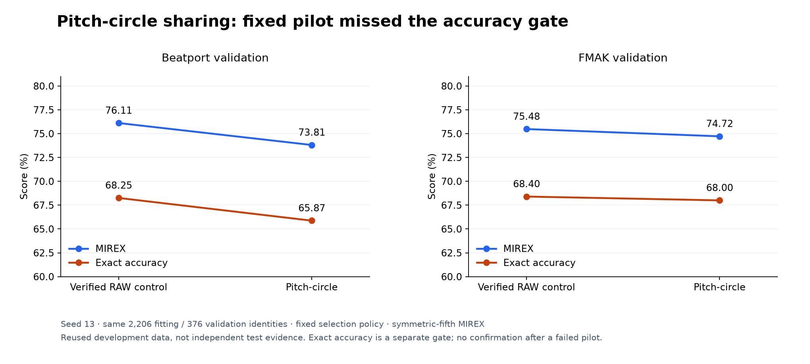

# Pitch-circle weight sharing: smaller model, lower accuracy

A K10 variant that shares convolutions around a pitch-class circle, with 73,506
parameters instead of 109,128, scored lower than ordinary K10. Symmetric MIREX fell
2.30 points on Beatport and 0.76 points on FMAK, and exact accuracy fell 2.38 and 0.40
points. It failed its pre-set threshold, so no confirmation seeds were run. The pilot
used seed 13 and ran in November 2026.

## Question

Can sharing musical patterns across transpositions improve accuracy with fewer
parameters? Earlier pilots that increased K10's capacity or softened its targets both
failed. This study tests a different architectural idea: keep octave information as
channels, but share convolutions around a circle of pitch classes.

## Method

The 192 CQT bands are folded into 8 octave channels and 24 half-semitone positions.
Six convolutions use circular padding along frequency and dilations 1, 1, 2, 2, 4, 4,
with the same BN, ELU and final dropout as the baseline. Pooling is over time only, and
a two-mode readout produces the usual 24 tonic and mode logits. The model has 73,506
parameters versus K10's 109,128.

The network is equivariant to rotations of the folded representation. A real
transposition of a finite-band CQT also moves energy between octave channels and past
the band edges, so exact equivariance to physical transposition is not established.

Both arms use the same 2,206 fitting and 376 validation recordings, padded CQT caches,
320-frame crops, pitch-shift augmentation of up to 4 semitones, hard cross-entropy,
batch size 32, AdamW, a 120-epoch cosine schedule and early-stopping patience 25. The
shared training loop changes only the model and checkpoint code. Models of different
shape consume different random draws at initialization and in dropout.

The seed-13 K10 control was reused only after its history, predictions and checkpoint
weights matched the archived joint run exactly. Pre-set success threshold: at least +1
FMAK symmetric MIREX point, no Beatport MIREX decline and no exact-accuracy decline in
either domain. Each run had a 20-minute time limit.

## Results

| Arm | BP symmetric / asymmetric MIREX | BP exact | FMAK symmetric / asymmetric MIREX | FMAK exact |
|---|---:|---:|---:|---:|
| Ordinary K10 (verified control) | 76.11 / 73.33% | 68.25% | 75.48 / 74.48% | 68.40% |
| Pitch-circle | 73.81 / 71.83% | 65.87% | 74.72 / 73.52% | 68.00% |

*Figure 1. The pitch-circle model scores below ordinary K10 in both domains, on both
weighted and exact accuracy. The validation tracks have been used repeatedly during
development.*

Symmetric MIREX changed by -2.30 points on Beatport and -0.76 on FMAK; exact accuracy
by -2.38 and -0.40. The selected epoch was 20 and training stopped at epoch 45. Training
and scoring took 163.21 seconds. Peak PyTorch memory during training was 409,924,608
bytes allocated and 515,899,392 bytes reserved.

## Decision

Do not run seeds 37 and 73 or change release weights. The smaller parameter count
should not be read as faster CPU inference; earlier operation-count estimates are not
measured performance. No smoothing, dilation, width or learning-rate search followed.

## Limitations

- One seed on validation data used repeatedly during development.
- The result rejects this architecture with this training recipe, not every use of
  musical symmetry. It does not identify whether octave-channel boundaries, capacity,
  optimizer settings or something else caused the loss.
- No calibration, final-test or private recordings were scored.

## Reproduce

The training code, [protocol](https://github.com/lvndry/drone/blob/research/pitch-circle-fit-v1/experiments/studies/pitch-circle/PROTOCOL.md),
architecture specification and checkpoint loader are preserved at the git tag
`research/pitch-circle-fit-v1`; replay from that tag rather than the current main
branch. The [candidate result](data/candidate-result.json) records checksums for the
source, protocol, features, control, checkpoint and logits, plus the memory settings,
both MIREX conventions and all paired error movements. Full runs, checkpoints and
logits are kept outside the repository. The
[source record](../../REPORT_PROVENANCE.md#pitch-circle) lists the exact source
identities. Regenerate Figure 1 with `uv run --extra plots python -m tools.plot_research`.
