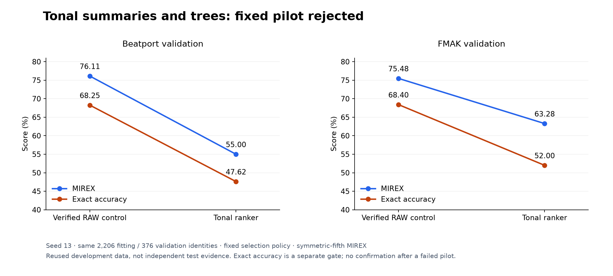

# Tonal summaries and trees: fast fitting, substantially lower accuracy

## Problem

Could fixed harmonic summaries and a small nonlinear decision model outperform a learned CNN on limited labels? This tests a broad classifier idea without external weights or teacher contamination. It is distinct from the earlier 48-parameter DSP-score fusion: the tree scorer directly learns from audio-derived evidence, without neural or native key logits.

## Method

Use the same 2,206 fitting / 376 validation identities and immutable FP16 CQT caches. For every track, construct all 24 key candidates as a single group with one positive. Thus there are 52,944 fitting rows but only 2,206 labelled tracks. Candidate groups never cross roles; existing artist/album/audio quarantine is retained.

The fixed 24-dimensional descriptor contains candidate-relative whole-track chroma, low-register tonic/third/fifth evidence, four quarter-wise scale contrasts, ending bass tonic, candidate mode, a half-bin phase proxy and relative-key contrasts. Features never consult the true key; candidate mode is a hypothesis. Frame normalization and summaries are deterministic; numeric tree borders fit on fitting rows only. The phase feature is not a tuning estimate or audio correction.

CatBoost 1.2.10 uses hard grouped `QuerySoftMax:beta=1`, 128 symmetric depth-4 trees, learning rate 0.05 and the other fixed settings in the [frozen protocol](https://github.com/lvndry/drone/blob/research/tonal-key-ranker-v1/experiments/studies/tonal-key-ranker/PROTOCOL.md). No teacher, validation eval-set, early stopping, descriptor search or tree-count selection. This changes representation and classifier together: it is a product comparison, not a causal tree-versus-CNN ablation.

The canonical seed-13 ordinary joint K10 control was independently reverified against archived actual history, predictions and checkpoint tensors, including the completed replay's result/logit hashes. The pilot needed at least one FMAK symmetric-MIREX point, no Beatport MIREX decline and no exact decline in either domain. No raw audio, final/calibration/SWD/private data or GPU was used.

## Results

| Arm | BP symmetric / asymmetric MIREX | BP exact | FMAK symmetric / asymmetric MIREX | FMAK exact |
|---|---:|---:|---:|---:|
| Verified ordinary joint K10 | 76.11 / 73.33% | 68.25% | 75.48 / 74.48% | 68.40% |
| Fixed tonal ranker | 55.00 / 53.81% | 47.62% | 63.28 / 60.88% | 52.00% |

*Figure 1. Both weighted score and exact accuracy decline substantially. The lower axis includes every observed score; the reused development set does not establish independent generalization.*

Symmetric MIREX changed by **−21.11 Beatport / −12.20 FMAK points**. Exact accuracy changed by −20.63 / −16.40 points. The complete paired error movements under both scoring conventions are retained in the raw result.

Streaming preparation of all 2,582 cached tracks, including control checks, took **7.86 seconds**, with 553.61 MiB peak process RSS. Fitting, model export/reload and validation scoring took **5.40 seconds**, with 641.50 MiB peak process RSS. These are operational measurements on the server with four CPU threads and affinity 6–9; they exclude audio decoding/CQT and do not measure per-track inference latency. The process imports research control-verification machinery, so its RSS is not a minimal deployment-runtime claim.

## Discussion and decision

Stop this fixed route: no confirmation seeds, feature revisions, tree/learning-rate sweep, native export, performance promotion or release-weight changes. Cheap fitting did not compensate for lost accuracy. Broader audited data and representation learning remain more credible routes to a substantial gain than rescuing this descriptor configuration on the same validation data.

The result rejects this descriptor plus 128-tree recipe. It does not establish that all tree models are unsuitable, identify whether feature pooling or decision capacity caused the loss, or provide a fair benchmark of every available tabular classifier. Coarse summaries lose progression and phrasing, while relative major/minor can share pitch distributions. Those are plausible limitations, not causes isolated by this experiment.

## Reproduction and evidence

Actual executed source is [`research/tonal-key-ranker-v1`](https://github.com/lvndry/drone/tree/research/tonal-key-ranker-v1), commit `7eae7736ebf6f5d4a8570b19092fe73861e0cc81`. The tag preserves the extractor, runner, optional pinned dependencies, strict research artifact loader, synthetic compatibility checks and pre-fit protocol. It introduces no production model/dependency dispatch on main.

[Candidate result](data/candidate-result.json) records source/protocol/feature/control/model/validation hashes, resolved parameters, both MIREX conventions and failed gate. [Runtime package versions](data/runtime-packages.json) distinguish the actual server stack from local compatibility tests. Full prepared descriptors, CBM model, validation logits and package-install record remain at `/home/lysk-admin/drone-experiments/tonal-key-ranker-20261112-v1`. Archived source tar SHA256 is `9047139b6ee7cf7990e0c9f57dff988981baba71ab22d34c4ee8d612856da8e9`.

Regenerate Figure 1 with `uv run --extra plots python -m tools.plot_research`. The figure-input index binds the raw result, generator and lockfile.
