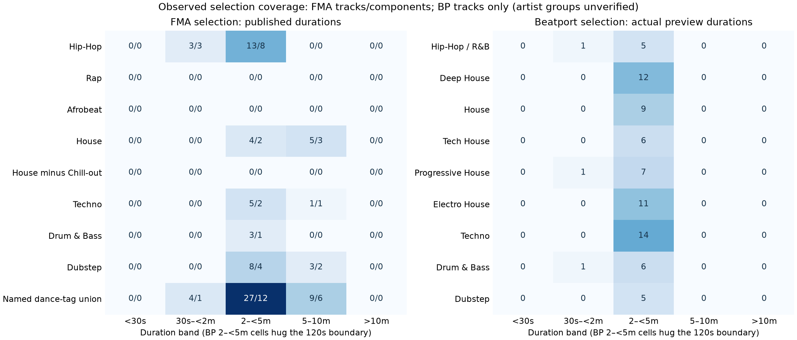
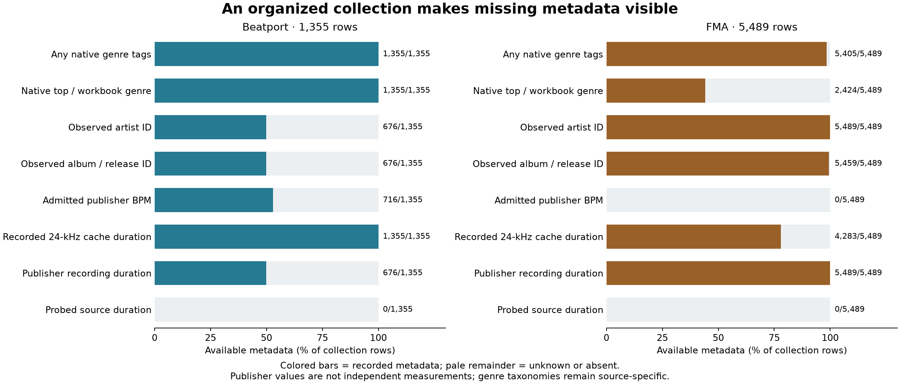
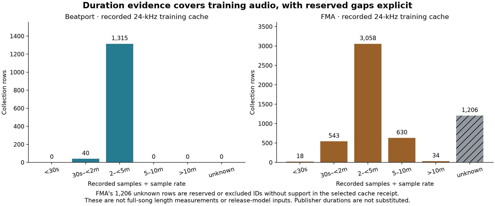
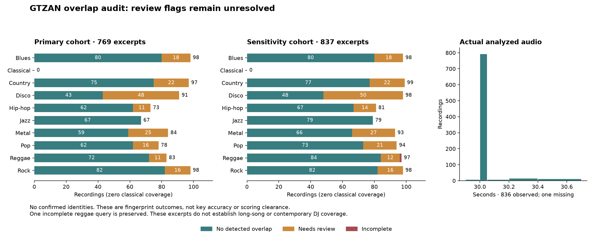

# Internal v2 data contract and coverage provenance

The assignment sections below retain their original proposal-time scope and counts.
The [current coverage/provenance chapter](#current-genre-duration-and-reference-provenance)
uses the later frozen eligibility amendment. The November 13 recording-integrity
results below supersede the metadata-only acquisition status in older sections.
They change no split, reference key or model outcome.

**Original proposal decision (historical): no new role assignment or training
activation; v1 data, weights and gates remained unchanged.** The original study
designed a component-first FMA campaign for a paired restricted-versus-expanded data experiment. It does not
establish accuracy, a pristine final test or fully artist-independent Beatport.

## Problem and fixed method

V1's 1,000 historical-final FMA rows touch components containing another 3,104
development rows. Reusing that coverage requires explicitly retiring historical
roles. An exact-size 4,080/250/159/1,000 certificate could put 1,000 evaluation rows
in only eight groups. This proposal instead preserves all old fitting components
and requires many complete groups in each evaluation panel.

The [predeclared protocol](PROTOCOL.md) fixes one seed **20261112**, one greedy
metadata rule, panel order and group constraints before assignment. It does not
search seeds or inspect model scores. All 1,157 saved components over 5,489 FMA
records are preserved, including bridges through omitted records. The old 976
fitting IDs force their 490 complete components into expanded fitting. Remaining
groups are chosen toward approximate row, publisher-duration and coarse-genre
targets, with 60/100/200 calibration/selection/confirmation components and per-group
size ceilings. No target labels enter the assignment schema or objective.

The first rule produced **4,082 / 250 / 159 / 998** raw rows in expanded fitting,
inner selection, calibration and development confirmation. These counts were
preserved; no second seed/rule was tried to improve class support. The assignment
ledger was pinned **before labels**; the [before-label record](data/before-label-witness.json) retains its identity.

## Source-integrity overlay and usable counts

A separate, later diagnostic reads only the prepared NPZ's metadata member and
inherited integer targets. It found one identical-container-SHA group with
conflicting key labels: **fmak:098877 and fmak:099017**, component `artist:17999`.
Both were old quarantined development and proposed expanded fitting. This is an
observed target conflict within fitting, **not** cross-role leakage.

Root approved a general [eligibility overlay](ELIGIBILITY_OVERLAY_PROTOCOL.md):
quarantine every record in any conflicting exact-SHA group across every inspected
FMA role and both arms. Both records are flagged; there is no first-label choice,
model adjudication, replacement, seed change or role reassignment. Independent
source adjudication is required before either can be recovered. Every old fitting
record remains retained and source-check eligible.

| Proposed cohort/panel | Assigned raw / unique SHA | Source-check eligible raw / unique SHA | Components after overlay | Largest component | Concentration equivalent* |
|---|---:|---:|---:|---:|---:|
| Restricted FMA fitting | 976 / 976 | 976 / 976 | 490 | 12 | 281.5 |
| Expanded FMA fitting | 4,082 / 4,036 | **4,080 / 4,035** | 797 | 272 | 71.3 |
| Inner selection | 250 / 250 | 250 / 250 | 100 | 5 | 83.3 |
| Calibration | 159 / 159 | 159 / 159 | 60 | 4 | 56.8 |
| Development confirmation | 998 / 997 | 998 / 997 | 200 | 12 | 154.4 |

*`N² / sum(component_size²)`, descriptive row-mass concentration; not validated
statistical effective N. Evaluation panels use far more groups than the size-only
certificate. Expanded fitting remains strongly concentrated: its largest artist/
album/audio component contains 272 rows. More recordings do not imply proportionally
more independent musical works. Unique evaluation counts matter for metric weighting;
matching-label exact duplicates require a single deterministic evaluation unit.

With the same 1,230 BP fitting records, prospective **unique** combined fitting is
**5,265 versus 2,206**, a 2.387× increase. The eligible raw combined count is 5,310.
The incidental eligible raw FMA count of 4,080 results from source-integrity exclusion,
not forcing the desired cardinality. No checkpoint or data loader uses this proposal.

## Balance, class support and precision limits

Publisher duration is populated for every FMA row. Eligible metadata durations are
223,585 s restricted fitting, 893,216 s expanded fitting, 53,972 s inner selection,
34,320 s calibration and 215,523 s confirmation. These are raw-row sums, including
same-SHA duplicates; they are not decoded duration, unique listening hours or measured
training work. Equal optimizer steps do not guarantee equal passes or audio coverage.

Coarse genre is missing for **3,065 / 5,489** source rows and explicitly treated as
MISSING. Missing counts are 439 restricted, 2,257 expanded, 143 inner, 92 calibration,
573 confirmation. Complete histograms are in the proposal/eligibility summaries.
Known classes include a single Easy Listening record and only eight Blues records
in the full corpus; a claim that every genre is balanced across panels is impossible.
The rule balances the available coarse metadata against the non-forced reservoir,
not a known deployment distribution or every underlying work/genre label.

Class support was **diagnostic after fixed assignment**, not stratification or model
selection. All 24 inherited key classes occur in every panel after the conflict
rule. Minimum unique per-class support is 9 restricted fitting, 47 expanded fitting,
**1 inner selection, 2 calibration, 14 confirmation**. No row was moved to improve
these counts. Those small cells limit classwise conclusions/calibration. Targets
are inherited prepared FMAK-v2 annotations, not evidence of human consensus or a
known label-noise ceiling. The historical before-overlay diagnostic remains recorded;
its arbitrary first-representative class counts for conflicting audio are not used
as eligible targets.

For planning only, a 20% paired-disagreement rate on 997 independent recordings
would already yield an approximate ±2.8-point 95% interval for a near-zero difference;
actual clustered uncertainty can be wider. A +2-point pilot is therefore a practical
screen, not assured significance or proof of no effect when unresolved. Future
analyses must pair predictions and resample actual groups; folds/seeds/crops do not
multiply independent recordings.

## Historical exposure is retained, not reset

The complete 5,489-row compressed exposure ledger retains each ID, full component,
old role, proposed role, restricted membership and historical exposure category.
The separate full-row eligibility overlay changes only source-integrity status.

| Old FMA role | → expanded fit | → inner selection | → calibration | → confirmation |
|---|---:|---:|---:|---:|
| Fit | 976 | 0 | 0 | 0 |
| Validation | 94 | 49 | 29 | 78 |
| Calibration | 64 | 29 | 17 | 49 |
| Historical final | **631** | 72 | 46 | 251 |
| Quarantined development | 2,317 | 100 | 67 | 620 |

These are immutable pre-overlay assignment counts; two of the 2,317 proposed
quarantined-development→fit records are subsequently ineligible. Prior program-level
final/development exposure is not erased by partitioning. Legacy development's
individual earlier fitting exposure is not cleared by this audit. Confirmation is
**internal exposed development confirmation**, not independent SOTA/release proof.
Both future data arms must be freshly trained and evaluated on the same panels;
canonical learned encoders/features fitted on an inner holdout cannot serve as fresh
inner-validation inputs. Only label-independent verified preprocessing may be reused.

## Observed guarantees versus unresolved identities

The checker finds **zero observed cross-role FMA primary-artist IDs, album IDs or
previously recorded exact-container SHAs**. Every saved component is assigned whole;
all 976 old fitting IDs remain in the expanded source-check-eligible cohort. This
guarantee covers the saved primary-credit graph, not every alias, remix, composition
or acoustic near-duplicate. No audio was read/hashed/decoded/fingerprinted here.

BP is a shared fitting-pool proposal, with **no new BP inner roles assigned**. Official
structured artist/release identity exists for only 618/1,230 fitting tracks; **612
remain unresolved**. Spreadsheet credits cover all but differ from filename credits
on 242 records. This is an explicit policy/disclosure decision for a paired internal
FMA data experiment, not proof of an observed BP cross-role violation or an automatic
indefinite veto. Sharing identical BP exposure across arms controls that exposure for
the data comparison; it does not justify artist-independent BP or independent-final
claims. The separate BP→GS overlap investigation must report its actual cached scope.

## Provenance, reproduction and remaining decision

Compressed sanitized input retains all FMA IDs, components, old roles, existing SHA
strings, artist/album IDs, coarse genres and publisher durations. It contains **no
key labels, features, audio or HTTP response cookies**. Source file paths/hashes and
public BP acquisition checksums and the original prepared metadata identity are retained.
Assignment uses the captured full graph, not rebuilt subset groups. Old calibration
is the 159 eligible indices left after the observed 976 fitting/250 validation IDs,
consistent with the saved v1 split policy; no old role is guessed from model scores.

Publication sanitization removed HTTP response headers from source provenance only.
The original before-label input/witness remains preserved privately in `/tmp`; a
separate SHA derivation proves **identical canonical track payload before/after**.
The historical witness was not silently rewritten. Class diagnostics bind the original
before-label input and ledger; the checker verifies the sanitized derivative and
unchanged assignment. Executed diagnostic source/stdio and metadata-member hashes
are recorded; only metadata was read on CPU4–5, with no persistent server job.

Later appendices to `PROTOCOL.md` (GTZAN metadata eligibility in PR #37 and
archive integrity in PR #39) changed the pinned hash and broke the published
reproduction command. The original witness remains byte-for-byte unchanged.
[Archived protocol snapshots](data/protocol-snapshots/) and the
[amendment chain](data/protocol-amendments.json) retain both transitions. The
checker verifies the original snapshot against the witness, each snapshot hash,
actual byte-prefix retention, connected transitions, and the current protocol.
Receipt declarations alone cannot authorize a rewrite. Other assignment
artifacts retain their existing checks.

This command reproduces the original 4,080-row / 4,035-unique fitting proposal.
The later amended 4,033-record eligible fitting pilot has its own
[execution and results](../k10-v2-pilot/REPORT.md). The proposal check does not
replace that execution record or alter the active fitting roles.

Reproduce locally without network, labels or models:

```sh
python -m tools.check_v2_contract
python -m pytest tests/test_v2_contract.py -q
```

Regression tests cover whole components/nesting/order invariance, bounded-group
failure, same-audio cross-component rejection, old-ID-preserving deduplication,
strict rejection of target fields in assignment inputs, and generic conflict
quarantine across restricted/expanded membership with no feature member read.
They also reproduce the committed study and reject invented ancestors or whole
protocol rewrites even when the amendment receipt is updated.

Ledger and overlay reproduction compares complete decompressed CSV bytes because
gzip headers and deflate encodings can vary across platforms. The archived
compressed ledger retains its original witness hash and diagnostic bindings; a
changed published container still fails. Regression tests distinguish generated
container differences from changed table content. The corrected reproducer was
also executed successfully on Linux with Python 3.12.3.
The checker reproduces proposal/ledgers, verifies the before-label/sanitization chain,
source hashes, all-role overlay coverage, observed ID/SHA separation and counts.

**At that proposal review point, decisions remained** on role retirement, narrow BP guarantees,
duplicate metric units, rare-class/genre coverage, clustered precision and prospective
paired training budgets. No automatic release promotion, training-role activation,
new seed/fold search or external panel scoring follows this metadata proposal.


## Current genre, duration and reference provenance

### Problem, method and result

A broad DJ-key classifier needs evidence across hip-hop, contemporary Afrobeats,
house/techno and other club styles, and across short and extended recordings.
Counts alone establish neither accuracy nor representative independent testing.
This metadata-only audit uses the current amended plan, frozen exposure
ledger, captured FMA master/taxonomy, and existing BP metadata. It reads
no audio or private files, makes no model predictions, selects no reference-key
fields, and changes no roles. Full source hashes are in
[coverage-inputs.json](data/coverage-inputs.json).

**BP genre coverage is stronger than an FMA-only inventory suggests:** all 1,229
current BP fitting and 126 selection IDs have a workbook genre, including explicit
Deep House/Tech House/Progressive House/Techno. Those inputs are roughly two-minute
previews, not evidence on their full commercial versions. FMA supplies longer
recordings, but specific current evaluation cells are sparse or unidentified.



Figure: FMA cells are **tracks/frozen components** from published durations; BP
cells are tracks from actual prepared-preview sample counts, with artist/album
independence unverified. All 9 FMA House-tagged selection tracks are also Chill-out.
**Afrobeat is not contemporary Afrobeats**; the latter cannot be identified by
these tags. Zero matching tags do not prove the music is absent. BP's populated
2–<5 min cells hug the 120 s boundary, not a spread of longer songs. Native taxonomies
are kept separate; overlapping FMA tags are not additive. [SVG](coverage-genre-duration.svg).

Duration bands are `<30 s`, `30 s–<2 min`, `2–<5 min`, `5–10 min`
(including 600 s), and `>10 min`. FMA's publisher
`track_duration` is not newly decoded support; metadata rounding and a clipped
rendition can change the applicable band. BP uses the existing canonical 24 kHz
sample-count metadata; no waveform was reopened. Neither source's genre tag is a
verified listening judgment.

### FMA coverage and missingness

The master table has 106,574 records; 5,489 are in the FMAK exposure ledger. Current
Expanded fitting has 4,033 records from 797 components; selection has 250 from
100; unique reserved confirmation has 997 from 200; excluded calibration has 159
from 60. Restricted fitting (976 records, 490 components) is nested inside expanded
fitting. The raw partition also includes 49 inactive/quarantined
former-fit IDs and 998 raw reserved records; those are not added back into fitting.

All 163 taxonomy tags are inventoried in the aggregate. Every master tag count
reproduced the taxonomy's published count. Below, each cell is tracks/components;
artist/album counts for every role/tag/duration are retained in the aggregate.

|Native FMA membership or explicit slice|Expanded fit|Inner selection|Reserved unique|Calibration excluded|
|---|---:|---:|---:|---:|
|Hip-Hop|269/50|16/8|41/13|16/6|
|Rap|57/5|0/0|0/0|2/1|
|Afrobeat|4/2|0/0|0/0|0/0|
|House|71/14|9/4|9/3|5/2|
|Chill-out|67/10|9/4|5/2|5/2|
|House minus Chill-out|4/4|0/0|4/1|0/0|
|Techno|17/11|6/3|11/3|2/1|
|Named dance-tag union|184/57|40/15|60/18|9/4|

`genres_all` includes ancestors, not only direct leaf tags. 86/94 House-taxonomy
FMAK tracks also carry Chill-out; House minus Chill-out is a declared set difference,
not a new genre. Its four reserved records occupy one component. Techno includes
Bigbeat; no claim of complete house/techno subgenre coverage follows. No Deep House,
Melodic House or contemporary Afrobeats tag exists in this FMA taxonomy. African
or Afrobeat cannot silently fill the Afrobeats gap. Garage (85) belongs under Rock,
so it is not counted as UK garage.

The named dance-tag union is exactly House, Techno, Disco, Dance, Drum & Bass,
Jungle, Dubstep, Breakbeat and Breakcore - Hard—not all music DJs play. It has 293
FMAK records/94 components overall. Its selection support is 40/15: four <2 min,
27 two–five-minute and 9 five–ten-minute tracks, and zero <30 s or >10 min. Current FMA
Hip-Hop selection has 16 tracks/8 components, but none ≥5 min; Rap-specific selection
and reserved support are both zero. Other named styles remain individually
available in the aggregate rather than inferred from generic Electronic.

FMAK has 3,065/5,489 missing top-level genre strings, but only 84 empty all-genre
lists. Selection has 143/250 missing top genre and 16 empty all-genre lists. A
coarse-genre-only analysis loses detail; empty tags must not become proof of
nonmembership. Known artist/album counts are 942/1,200 in expanded fitting,
118/118 in selection and 239/295 in reserved unique. Credits and aliases remain
imperfect proxies for musical independence.

### BP native genre and preview support

Workbook extraction selects only A:id/F:genres, resolving shared strings only for
those cells and rejecting formulas. G:M key/confidence/comment fields are not
selected. Store JSON members are filtered by the current 1,355 IDs; only
id/genres/sub_genres/duration are selected. Historical bare lowercase nan is safely
read as null outside quoted strings. No store `key` is used as a reference label.

|Native workbook genre, preserved verbatim|Current fit|Current selection|
|---|---:|---:|
|Big Room|2|0|
|Breaks|77|10|
|Deep House|63|12|
|Drum & Bass|73|7|
|Dubstep|80|5|
|Electro House|77|11|
|Electronica / Downtempo|159|11|
|Funky / Groove / Jackin' House|9|0|
|Hard Dance|81|8|
|Hip-Hop / R&B|79|6|
|House|66|9|
|Minimal|69|3|
|Progressive House|82|8|
|Psy-Trance|83|9|
|Tech House|74|6|
|Techno|70|14|
|Trance|84|7|
|Trap / Future Bass|1|0|

API JSON exists for 671/1,229 fit and 61/126 selection; 558/65 are missing. Missing
JSON does not mean unknown workbook genre. API subgenres appear for only 15 fit and
2 selection records. Workbook/API genre strings disagree on 41 fit + 2 selection records;
both native descriptions are retained, with no forced FMA conversion or silent
choice. `Hip-Hop / R&B` stays combined; `Minimal` is not automatically Techno.

Actual preview support is 43.3–120.007583 s fitting and 119.2–120.000750 s selection.
Strict bands put 35 fit + 5 selection below 120 s, 1,194 fit + 121 selection at/above 120 s; these
values closely straddle the boundary. **None reaches 5 min.** Store durations carry
explicit milliseconds and minutes text. Of 676 known values, 500 describe 5–10 min,
but 673/676 differ by >1 s from the supplied preview. Those durations cannot turn
preview evidence into full-track coverage.

The current uncertainty file assigns all 1,355 BP entries record-unknown-artist
singleton proxies. These are not 1,355 verified independent artists/albums. This
narrow extraction does not inspect artist/release fields; earlier identity metadata
exists, so the proxy does not imply the original source lacks artist information.
BP improves known genre coverage, not the independence guarantee.

### Exposure, larger-universe bridges and reference quality

The active frozen FMA fit/selection/reserved/calibration sets share zero ledger
components. A separate graph over all master artist/album credits yields two
components connecting fit↔selection and two fit↔reserved via outside-cohort
records. This wider-universe metadata diagnostic is **not proven acoustic
leakage**, an audio-identity test or grounds to repair the frozen split after
outcomes. It matters when choosing a future independent panel. Of 101,085 master
rows outside FMAK, 53,624 remain unlinked to FMAK under this conservative graph;
they are metadata candidates, not acquired audio or independently labelled data.
The aggregate contains counts only, not source rows or credit-path exports.

Reserved in the current split does not mean never exposed historically. The
998 raw reserved IDs include 251 program-exposed historical-final and 78 adaptive-
development entries; remaining exposure statuses are preserved in the ledger.
Component separation cannot erase previous program use. Pretrained-teacher
recording overlap also remains unknown rather than assumed absent.

The [original FMAK release](https://zenodo.org/records/10719860) describes expert
song-level references. [FMAKv2](https://zenodo.org/records/12759100), used by the
prepared research corpus, changes around 200 annotations; its release explicitly
says the original FMAK authors did not verify those modifications. **That does not
establish that the revisions are wrong.** Describe this as references derived from
expert-annotated FMAK, not 5,489 uniformly re-adjudicated expert labels. Internal
“v 2 split” and the FMAKv2 annotation version are separate identifiers. The
[author README](https://github.com/stellaywong/fma_keys) describes Spotify URI matches
for analyzer comparison—not Spotify-generated ground truth. No reference CSV was
re-extracted, compared, switched or corrected for this coverage audit.

The [BP release](https://zenodo.org/records/1101082) credits human annotations,
comments and confidence to Eduard Mas Marín, revised/expanded by Ángel Faraldo.
These references are distinct from store metadata keys. Its single-key encoding
can lose ambiguity; the audit does not certify all annotations equally certain.
The [maintained loader](https://github.com/mir-dataset-loaders/mirdata/blob/master/mirdata/datasets/beatport_key.py)
also documents the source and annotation terms. Metadata/annotation availability
is not blanket rights to redistribute underlying recordings or a proof that a
future public model has completed its provenance review. Pinned targets and all
completed/predeclared comparisons remain intact.

### Next independent-panel decision

Keep the live fixed model comparison on its original terms. A separate small
feasibility check could use four operational examples: contemporary Afrobeats,
hip-hop, a 5–10 min house/deep-house/melodic-house extended version, and a separate-
artist techno/club recording (prefer >10 min if a lawful exact version is available).
These are workflow examples, **not a statistical sample-size or accuracy claim**.
Select exact versions and access provenance before predictions; preserve rejected
candidates/reasons. Do not use private corrections or DJ libraries for fitting.

Two independent style-qualified annotators should be blind to models, vendor keys
and each other's answers, cover the whole recording, and retain disagreements,
multiple interpretations and no-stable-key cases. Measure access/annotation effort
before setting the later panel's size/precision budget. Workflow examples become
development-exposed and must not later masquerade as a sealed panel. A fresh panel
needs its own exact-version, exposure, ambiguity and scoring rules before outcomes.
No paid access, human annotation, contact or acquisition is started by this study.

### Reproduction and limits

Only the small [aggregate archive/index](data/coverage-index.json), input hash/path
receipts and scripts are committed—no source CSV/XLSX/ZIP, raw source rows, audio
or key-label export. Metadata readers use the standard library; the figure uses
the repository's existing Matplotlib plotting environment, with no new dependency.
Input paths may be relocated while retaining hashes; no downloader runs.

```sh
python -m tools.dj_coverage --inputs experiments/studies/v2-data-contract/data/coverage-inputs.json --output /tmp/coverage-fma-replay
python -m tools.dj_coverage_bp --inputs experiments/studies/v2-data-contract/data/coverage-inputs.json --output /tmp/coverage-bp-replay
python -m tools.dj_coverage_report --replay-fma /tmp/coverage-fma-replay/coverage.json --replay-bp /tmp/coverage-bp-replay/coverage-bp.json --plot
python -m pytest -q tests/test_dj_coverage.py
```

The verifier checks compressed/decoded/aggregate hashes, current cohort identity,
role and genre-band totals, native workbook completeness, preview/store separation
and metadata-only scope. Reader regressions exercise column/field allowlists,
quoted-nan preservation and formula rejection. These are metadata checks, not
musical-key accuracy, sample-support equivalence or corpus-wide licence clearance.

## Organized collection coverage: Beatport and FMA (November 13)

### Problem

To identify where Drone is strong or weak by genre, duration or BPM, we first
need to know what each dataset row represents and which metadata is actually
available. A missing tempo, a publisher's recording length and the duration of
a cached preview answer different questions. Mixing them would make later
accuracy slices misleading even if the scores themselves were calculated correctly.

The new collection catalogs organize **1,355 current-plan Beatport rows** and
**5,489 FMA rows** with stable IDs, source identities, native genre tags, observed
artist/album/release relationships, frozen memberships, grouping witnesses and
model-scoped exposure. They contain no key targets or predictions. This chapter
measures metadata coverage; it does not measure or improve model accuracy.

### Method

The report loads the committed [Beatport catalog](data/beatport1355-collection.json.gz)
and [FMA catalog](data/fmak5489-collection.json.gz), verifies their exact compressed
SHA256 identities, and applies the shared typed collection validator before
counting fields. Its [derived counters](data/collection-coverage-analysis.json)
and [figure receipt](data/collection-coverage-figures.json) bind these catalogs,
the report source, plotting version and output hashes. The original audit data,
execution receipts and earlier figures are retained unchanged.

Every availability count uses the complete source collection denominator. An
absent value stays unknown; a missing audio-support row is not filled from
publisher metadata. Duration bins reuse the existing coverage policy: below
30 seconds, 30 seconds to below 2 minutes, 2 to below 5 minutes, 5 through 10
minutes inclusive, above 10 minutes, and unknown. The plotted duration is
**recorded 24-kHz cache sample count divided by sample rate**, from saved metadata.
No source audio was read, decoded or newly probed for these plots.

### Results



*Colored bars show rows with recorded metadata; pale bars retain the unknown or
absent remainder. Counts are printed beside every row. Availability says nothing
about annotation correctness or model performance. Source taxonomies and the
meaning of their top-genre fields remain separate.*

| Metadata available | Beatport, n=1,355 | FMA, n=5,489 |
|---|---:|---:|
| Any native genre tags | 1,355 | 5,405 |
| Workbook / native top genre | 1,355 | 2,424 |
| Observed artist ID | 676 | 5,489 |
| Observed album or release ID | 676 | 5,459 |
| Admitted publisher BPM | 716 | 0 |
| Recorded 24-kHz cache duration | 1,355 | 4,283 |
| Publisher recording duration | 676 | 5,489 |
| Separately probed source-container duration | 0 | 0 |

The tempo gap is explicit: **639 Beatport rows and all 5,489 FMA rows have no
admitted BPM value**. The 716 Beatport values are archived publisher reports,
not newly estimated tempo; half/double-time ambiguity and source correctness
remain unresolved. Neither collection has a separately measured source-container
duration in this view, even where a cache duration or publisher duration exists.



*Counts describe the saved training-cache support, not full-song availability
or release-model input. Plot scales differ because the collections differ in
size. The unknown FMA bar is retained in the full denominator.*

| Recorded cache duration | Beatport rows | FMA rows |
|---|---:|---:|
| <30 seconds | 0 | 18 |
| 30 seconds–<2 minutes | 40 | 543 |
| 2–<5 minutes | 1,315 | 3,058 |
| 5–10 minutes, inclusive | 0 | 630 |
| >10 minutes | 0 | 34 |
| Unknown | 0 | 1,206 |

Beatport's large 2–<5-minute bar sits at the approximately 120-second preview
boundary; it is not evidence of broad three-to-five-minute coverage. FMA has
saved support for **4,033 expanded fitting rows and 250 inner-selection rows**.
The other **1,206 reserved or excluded IDs** have no audio support in the selected
cache receipt. Their publisher durations remain available as a different field;
we do not substitute those durations or infer missing cache availability.

### Limits and next use

Native tags have different semantics. Beatport retains workbook genres and API
genres/subgenres as separate taxonomies. FMA's `track_genres_all` includes its
hierarchy; direct versus ancestor labels are **unspecified**, so the presence of
a tag cannot be treated as an independently supplied direct label. Its native
top field is absent on 3,065 rows despite most rows having other tags. Neither
adapter manufactures a normalized modern genre taxonomy.

Rows are not independent songs. FMA's 5,489 rows contain 5,442 distinct recorded
source hashes and retain 1,157 frozen components. Beatport's 1,355 frozen groups
remain singleton uncertainty proxies, not verified artist-independent groups.
Observed artist/remixer/release relationships do not silently replace either
collection's frozen groups or change membership. Plan roles and exposure stay
scoped to their named plans and model witnesses; these catalogs do not create
an independent evaluation set.

This organization supports later reproducible joins to evaluations with explicit
unknown bins and exposure accounting. It also identifies concrete metadata work:
fill admitted tempo gaps, document direct genre semantics, distinguish available
audio length from publisher song length, and audit recording/work relationships.
The existing [93-recording descriptive score report](../key-sota-4way/REPORT.md)
is separate; these larger collection counts are not new accuracy results.

Reproduce the derived analysis and figures without audio or private source paths:

```bash
uv run python -m tools.report_collection_coverage
uv run python -m tools.report_collection_coverage --write --plot
```

The first command verifies the stored counters. The second regenerates only the
new derivative counters and figures from the pinned collection files. The local
plot run completed in 4.48 seconds wall and 4.15 seconds CPU, with an OS-reported
peak RSS of 238,665,728 bytes and 487,991 bytes of derivative outputs. RSS was
monitored via repeated reads of the OS high-water mark, rather than described
as an exact instantaneous process-tree sample. Limits were 90 seconds, 512 MiB
RSS and 16 MiB output. No audio, target or classifier execution was performed.

## Joining development outcomes to the collection metadata

The [retrospective K10/MusicFM diagnosis](../musicfm-key-pilot/REPORT.md#retrospective-diagnosis-by-genre-recording-duration-and-bpm)
now joins the same 376 development recordings to the BP/FMA catalogs. Its
[analysis relation](data/development-slices.json.gz) contains model-scoped
predictions and selected references; the source catalogs remain target-free.
Every join verifies ordered IDs, source identities, checkpoint/evaluator bindings
and sample support before calculating exact and symmetric-fifths scores.
The report embeds genre, duration and BPM figures and retains empty and unknown
cells. It does not redefine splits, score confirmation data or change a gate.

The [execution record](data/development-slice-execution.json) preserves the first
inconclusive attempt, the memory repair and successful bounded runs. Incremental
catalog reading retains only selected records while deriving the full native
metadata label universe. This avoids materializing every collection row at once;
it does not omit evaluation errors or select recordings by their predictions.

## GiantSteps collection: all 604 previews (November 13)

The earlier scored panel contains only 45 GiantSteps recordings. To organize the
complete source cohort, the [GS604 collection](data/giantsteps604-collection.json.gz)
joins the pinned publisher annotation archive to the existing overlap plan and
historical fingerprint decode receipt. The adapter verifies all source hashes,
exact ID membership and saved source/PCM identities, selecting native genre
metadata without extracting key targets or predictions. The
[source descriptor](data/giantsteps604-collection-sources.json) records the archive
revision and portable source paths; the [coverage receipt](data/giantsteps604-collection-coverage.json)
binds the generated catalog.

All **604 IDs** have native genre and recorded decode support. The 23 native
labels include **77 deep-house, 47 house, 88 progressive-house, 81 tech-house,
34 techno, 38 drum-and-bass, six glitch-hop and four hip-hop** recordings.
Glitch-hop and hip-hop remain distinct; these counts do not establish broad
contemporary hip-hop or Afrobeats coverage. No row has admitted BPM,
verified artist/work grouping or established full-song duration.

Saved decode support ranges **44.70–120.01 seconds**, at 11,025 Hz mono float32.
It describes the audio used by the historical fingerprint extraction, not the
24-kHz training cache or newly decoded model inputs. There are **602 distinct
saved PCM hashes across 604 source IDs**; duplicate identities are retained.
Publisher JAMS duration is preview metadata, so it does not fill the unknown
full-song duration field. All 604 recordings carry model-scoped release
evaluation exposure; direct training membership is not inferred.

This extension adds metadata coverage, not new accuracy observations. Reproduce
it without opening audio:

```bash
uv run python -m tools.export_giantsteps_collection --external-sources sources.json
```

`sources.json` maps `giantsteps_annotations` to the existing pinned metadata
archive; its location may change, its SHA256 may not. Omit `--write` to check the
committed artifacts. The corrected export used 0.34 seconds wall, 0.42 seconds
CPU and an OS-reported peak RSS of 89,800,704 bytes under a 120-second wall /
60-second CPU / 256 MiB RSS limit. A regression verifies that publisher preview
duration cannot become full-song support.

## GTZAN reference metadata: prospective short-clip coverage

**Decision: metadata frozen; no audio admitted and no detector scores.** This
addition prepares a released Drone-v1 versus rerun-libkeyfinder diagnostic.
It does not evaluate the new teacher or alter the internal v2 experiment.
The [primary DAFx annotation paper](https://www.dafx.de/paper-archive/2013/papers/03.dafx2013_submission_48.pdf)
describes manual annotation, with classical and ambiguous/modulating excerpts
excluded. It does not document an inter-annotator consensus/error rate. The
[annotation release](https://zenodo.org/records/5813199) and
[pinned repository](https://github.com/audiocontentanalysis/dataset-gtzan-key/tree/9ef1591f81ee2f7821c7ce41e774ea7ac7f94cbe)
now reproduce **837 single-key references, including 81 hip-hop excerpts**.

| Genre | Raw single-key references | Sturm filtered union | Named intersection / metadata eligible |
|---|---:|---:|---:|
| Blues | 98 | 100 | 98 |
| Classical | 0 | 99 | 0 |
| Country | 99 | 98 | 97 |
| Disco | 98 | 93 | 91 |
| Hip-hop | 81 | 92 | 73 |
| Jazz | 79 | 87 | 67 |
| Metal | 93 | 91 | 84 |
| Pop | 94 | 84 | 78 |
| Reggae | 97 | 86 | 83 |
| Rock | 98 | 100 | 98 |
| **Total** | **837** | **930** | **769** |

The [author's fault metadata](https://github.com/boblsturm/GTZAN/tree/fedc781026cf1a20034830f8071c98d93a422016)
has disjoint filtered filename lists of 443, 197 and 290 IDs; their union is an
eligibility restriction here, not a new training split. The frozen intersection
excludes 68 of the 837 raw references. Across all 1,000 IDs, 163 have annotation
−1 (including all 100 classical excerpts), and 70 fall outside the filtered
union; these reason counts overlap. `jazz.00054` is explicitly flagged by the
published loader as corrupted, but already has annotation −1, so the fixed
flag adds no exclusion to the 769. The complete compressed
[reference/exclusion ledger](data/gtzan-reference/reference-ledger.json.gz)
retains all 1,000 IDs, exact annotation-byte hashes, numeric mapping, expected
archive members, mirdata per-member MD5 witnesses and independent status fields.
No recording has been decoded or verified. The raw 837 and filtered 769 remain
separate denominators; neither can be changed after seeing detector outputs.

The compact [source packet and summary](data/gtzan-reference/summary.json)
contains pinned metadata only and records the exact annotation and fault archive identities.
The importer reconstructs both complete Git trees against pinned identities;
no floating branch or archive filename is treated as version proof. The mirdata
[index 1.0](https://zenodo.org/records/13993311/files/gtzan_genre_index_1.0.json?download=1)
is checked against both its publisher checksum and the acquired file identity in that summary.
Its checksums are **expected** audio identities, not evidence our audio matches.
Acquired source bodies total under 1 MiB; the compressed packet remains small.
The preserved MIT annotation notice supplies no blanket audio clearance;
public hosting and code licenses do not resolve recording rights.

A reachable [public audio mirror](https://huggingface.co/datasets/marsyas/gtzan/tree/d2146561ecc7df707d9e6b8318885fe6a39668a2/data)
exists, but its archive hash differs from the historical Torchaudio archive and
its audio license is unspecified. Neither a different recording nor equivalent
recordings can be inferred from that archive-hash difference. A separately
bounded audio/version/research-use review and cross-corpus audit must precede
any score opening. Published Drone-v1 is BP-only; its declared release fitting
and selection identities, including aliases, are the relevant primary exposure
reference. Joint FMA candidates are different models. Earlier BP→GS review
flags are unresolved, not confirmed overlap. No GTZAN loader/scoring artifact
was found in the inspected Drone code/report/history scope; this documentary
finding does not prove absence of every outside use. MusicFM/MSD pretraining
freshness is not asserted. The old 30-second genre excerpts, including 73
metadata-eligible hip-hop clips, do not establish contemporary Afrobeats or
5–10 minute house/deep-house/melodic-house accuracy.

Reproduce the metadata without network, audio libraries or detector execution:

```sh
python -m tools.import_gtzan_reference --check
python -m pytest -q tests/test_gtzan_reference.py
```

The [protocol amendment](PROTOCOL.md#gtzan-reference-metadata-amendment-2026-11-12)
fixes rules before scores. Regressions cover all 24 class mappings and unknowns,
malformed labels, source-byte/tree tampering including unselected members,
filtered-list overlap, exact counts, corruption status and zero admission.


## November 13: recording integrity, before classifier evaluation

**Problem.** The public mirror has a different archive hash from the historical
UVic download. Metadata alone could not establish whether its recordings matched
the pinned reference index. A fresh score on different audio would be misleading.

**Method.** Download the single pinned archive once, then stream its members
without extraction. Verify its exact byte length and SHA256, compare every WAV's
MD5 with the independently pinned mirdata index, and inspect WAV encoding and
payload structure. No classifier, keyfinder, feature extraction or score selection
ran. Audio remains on the research server and is not redistributed here.

**Result.** The 1,226,192,050-byte archive matches the publisher checksum.
All recordings in both frozen reference cohorts match their expected recording
identities and parse as mono 22,050-Hz, 16-bit PCM WAVs.

| Frozen cohort | Recordings | Matching MD5 | Parseable WAV |
|---|---:|---:|---:|
| Complete inventory | 1,000 | 999 | 999 |
| Raw single-key references | 837 | 837 | 837 |
| Named fault-filtered intersection | 769 | 769 | 769 |

The sole identity/format failure is `jazz.00054`, already excluded by the
previously frozen metadata rule. Its acquired checksum differs from the expected
index entry, and its bytes do not begin with a RIFF identifier. The
[integrity evidence](data/gtzan-audio-integrity/evidence.tar.gz) retains both checksums.
This finding does not create a new exclusion or establish that every byte in the
mirror is equivalent to the historical archive. The full-universe strict audit
remains failed. **No recording is admitted for classifier scoring yet.**

The first verifier stopped on bundled AppleDouble/Finder metadata. A parser
correction allows only bounded metadata companions at exact known paths. The
second strict audit stopped on the corrupt jazz recording's MD5 mismatch. A
separate diagnostic inventory then recorded all 1,000 outcomes without weakening
the strict audit. All three controllers, logs, source versions, configuration
receipts and per-recording outcomes are preserved in the
[metadata evidence bundle](data/gtzan-audio-integrity/evidence.tar.gz), whose identity is retained in the evidence index.
It contains no audio. Failed audits are not presented as successful runs.

The download took **13.04 seconds**. The diagnostic inventory took **6.96 seconds**,
used **6.93 aggregate CPU seconds**, and peaked at **47,501,312 bytes** of process-tree
RSS. It used CPU 10–11 at nice 19, with no GPU. The acquisition and two audit
controllers all stayed within their recorded resource bounds; the existing vLLM
process identities were protected. These are data-checking costs, not inference
benchmarks.

**Next gate at the integrity stage.** The later overlap audit below now provides
recording-match outcomes. Review disposition, model/keyfinder versions and scoring
rules still need a separate freeze before any paired evaluation. MusicFM pretraining independence, recording
rights and contemporary Afrobeats/long-song coverage remain unresolved. The 73
hip-hop excerpts in the 769 cohort are short, historical samples; they do not
represent all modern DJ music.

Reproduce the counts from metadata without downloading audio or running models:

```sh
python -m tools.check_gtzan_audio_report
python -m pytest -q tests/test_gtzan_audio.py tests/test_gtzan_reference.py
```

For the retained archive, `python -m tools.check_gtzan_audio ARCHIVE --output FILE`
performs the strict check and fails on the mismatched recording. Adding
`--inventory-only` records all mismatches explicitly; it never grants scoring
admission. Synthetic tests cover archive path/link boundaries, duplicates,
missing members, byte caps, recording mismatch, WAV truncation and the distinction
between inventory completion and a strict pass.

## GTZAN catalog: joining frozen roles to recorded integrity (November 13)

The frozen reference ledger and the later integrity inventory describe different
stages. Leaving them as separate report paragraphs makes it easy to mistake an
old `audio_verified: false` field for the latest source observation, or a matching
MD5 for classifier admission. The [1,000-row collection](data/gtzan1000-collection.json.gz)
now joins both snapshots by exact native ID and archive member without rewriting
the historical ledger or selecting its key targets.

The adapter verifies the pinned ledger, independent recording index, integrity
evidence archive and its diagnostic JSON member, and release checkpoint witness.
It requires exact population membership, matching expected MD5 identities and the
original failed-controller history. The existing catalog contract represents
reference inclusion, file-identity observation, WAV-header observation and scoring
admission as separate named membership scopes. Every field retains its source
pointer. The [coverage summary](data/gtzan1000-collection-coverage.json) binds the
catalog and generator; its genre counts retain zero-reference categories.

| Observation | Rows |
|---|---:|
| Complete source inventory | 1,000 |
| Included in frozen raw single-key references | 837 |
| Included in frozen named filtered references | 769 |
| Saved acquired-member MD5 matches the index | 999 |
| Saved WAV header is parseable | 999 |
| Recorded source-excerpt duration available | 999 |
| Model-analyzed audio support established | 0 |
| Admitted for classifier scoring | 0 |

The matching-identity and parseable-header counts happen to coincide; they are
independent observations, and a regression checks that identity matching does not
imply a parseable header. The bad `jazz.00054` bytes retain their actual SHA256,
MD5-mismatch observation and header failure. Its pre-existing exclusion from both
reference cohorts remains unchanged. The 769-row cohort contains 73 native
`hiphop` excerpts; its classical count is explicitly zero.

The known durations come from saved 22,050-Hz WAV-header frame counts, not a new
audio probe or model pass. Full-song duration, admitted BPM, verified artist/work
groups and model-analyzed PCM remain unknown. Released-model overlap is explicitly
not established by these bundled integrity observations. The completed overlap
audit is reported separately below; the catalog remains an unchanged observation
snapshot, and no row is promoted to scoring admission. Short historical excerpts do not fill the full DJ-track or
contemporary Afrobeats coverage gap.

Reproduce without source audio, network access or model loading:

```bash
uv run python -m tools.export_gtzan_collection
```

The [execution receipt](data/gtzan1000-collection-execution.json) preserves both
successful export attempts, source identities, exit codes and resource limits.
The final guarded generation completed in 0.76 seconds including process startup
and cleanup, used 0.69 CPU seconds and peaked at 44,515,328 bytes of child-process
RSS, within 120-second wall / 60-second CPU / 256 MiB RSS / 16 MiB output limits.
It wrote 127,531 bytes across catalog and coverage outputs. A preceding successful
export was regenerated after retaining explicit zero classical-reference counts;
the catalog bytes remained unchanged. No audio or classifier execution occurred.

## GTZAN overlap audit: complete coverage, review flags remain (November 13)

**The audit attempted all 837 frozen reference recordings.** The primary 769-recording
cohort completed entirely; the wider cohort retains one incomplete query from the
original attempt. No query produced an identity-level fingerprint match, but **167
primary recordings still have review-level matches**. No recording is admitted for
classifier scoring, and no key-accuracy result follows from this audit.

### Problem and method

Matching a downloaded WAV to its publisher checksum does not establish that its
recording was absent from model development. We compared the fixed GTZAN cohorts
against the existing **7,579-record reference index: 1,486 Beatport, 5,489 FMA and
604 GiantSteps recordings**. The [archived prospective amendment](GTZAN_OVERLAP_PROTOCOL.md)
and [query manifest](data/gtzan-overlap-manifest.json.gz) preserve membership before
matching. Reference availability defines those existing cohorts; reference-key
values and classifier outputs were not used to change their frozen membership,
thresholds or outcomes. The released Drone model's declared fitting and selection
IDs remain distinct from the later candidate-training split.

The unchanged matcher retains all qualifying landmark offsets, rather than only
a best match. Review support requires at least ten distinct anchors spanning five
seconds. Identity support additionally requires at least twenty anchors spanning
eight seconds and Chromaprint distance at most 0.15 at that landmark offset.
These are the pre-existing control-qualified rules, not thresholds tuned on GTZAN.
They detect some recording relationships; they do not prove work, artist or
pretraining independence when no match is found.

Before the continuation, the driver completed all **250 controls**: 180 cached
positive queries retrieved their expected reference; 64 synthetic negative queries
produced no identity flags and five review flags; six newly extracted 30-second
positive queries all retrieved their expected reference. These are operational
and retrieval checks, not a calibrated estimate of false-positive rates on music.

The original audit stopped after 377 attempts when `reggae.00086` reached the
fixed vote-memory budget. Its 376 completed queries and one incomplete query remain
unchanged. A separately qualified continuation processed only the **460 previously
unvisited recordings**, in frozen archive order, with the same numerical matcher,
reference index and decision rules. It did not retry the failed query. A preparation
checker initially used an incorrect path assumption for cached versus freshly
extracted controls; that failed preparation is preserved, and the corrected
metadata joins were verified before launch. No qualification or audio audit was
rerun to hide that failure.

### Results and coverage

| Frozen cohort | Attempted | Complete | No detected overlap | Needs review | Incomplete | Identity flags |
|---|---:|---:|---:|---:|---:|---:|
| Primary filtered cohort | 769 | 769 | 602 | 167 | 0 | 0 |
| Raw-reference sensitivity cohort | 837 | 836 | 656 | 180 | 1 | 0 |

The cohorts overlap; their rows must not be added together. “Complete” describes
query execution, not exposure clearance. The original machine field `unresolved`
counts incomplete queries only; it does **not** mean that review flags are resolved.



*Both cohorts keep their original membership, including zero classical coverage.
Bars show every recording and separate review flags from incomplete execution.
The duration histogram uses 836 retained fingerprint-extraction receipts; the
original incomplete query has no extraction receipt in the result. These are
recording-overlap outcomes, not classifier errors. [SVG](figures/gtzan-overlap.svg).*

Review flags are unevenly distributed. In the primary cohort, **48/91 disco**,
**25/84 metal** and **22/97 country** recordings require review; hip-hop has
**11/73**, while jazz has **0/67**. Silently dropping flagged recordings would
therefore change the genre mix. No genre is declared independent or more accurate
from these counts. The observed audio spans **29.93–30.65 seconds**, with median
**30.01 seconds**. Full-song duration, reliable BPM and verified artist/work groups
remain unavailable. This panel does not fill the five–ten-minute DJ-track or
contemporary Afrobeats coverage gap.

For the released checkpoint specifically, **80 primary queries** have review-level
alignments to its known fitting IDs or exact aliases, and **23** have them to
selection IDs or aliases. The wider cohort counts are 83 and 24. These categories
can overlap and are unresolved flags, not confirmed exposure. Other reference-index
matches matter for research candidates with different training histories; a future
scoring report must state which model's exposure it is discussing.

### Resources, verification and decision

The fresh driver qualification took **306.25 seconds**, with **309.56 CPU seconds**
and **872.51 MiB** sampled peak owned-process RSS. The continuation itself took
**445.20 seconds**, with **455.06 CPU seconds**, **839.06 MiB** sampled peak RSS
and **26.94 MiB** of recorded outputs. The continuation stayed inside its one-hour
wall, two-hour CPU, 2 GiB memory and 512 MiB output bounds. These costs exclude the
original prefix run and retained reference index; they are not classifier latency.
The original failure receipt separately records 294.12 CPU seconds and 1.10 GiB
sampled peak RSS. No serving process was stopped for either new run, and the
terminal check found both owned processes retired.

The [evidence index](data/gtzan-overlap/index.json) links the public records to
retained originals. The compact projection preserves **every query and all 55,474
review/identity-support alignments**. Publication independently checked all
**1,704,541 original alignments**, including those below screening support, against
the frozen classification rule. Those below-screening rows are counted rather
than bundled; their complete raw metadata remains retained outside Git. Public
verification replays every published supported decision, cohort, outcome and
coverage count. Exhaustive replay requires that retained raw metadata archive.
Original controllers and failure receipts are byte-preserved; configuration,
process identities and private paths stay in the retained operational records.
Their checksums establish identity, not public recovery of redacted contents.
The public fresh-control manifest omits operational source paths while retaining
the same six recording identities, crop settings and audio hashes. The current
preparation adapter resolves paths from the hash-verified reference descriptor;
it was not used for the reported run. The execution-source receipt continues to
identify the original twelve-file source closure and retained source archive,
including the original control manifest. This publication change does not
reattribute the historical run to the modified preparation code or rerun matching.

```bash
uv run python -m tools.prepare_gtzan_overlap --check
uv run python -m tools.report_gtzan_overlap
uv run --extra plots python -m tools.report_gtzan_overlap --plot
# Optional, with the retained metadata archive; no source audio is opened:
uv run python -m tools.report_gtzan_overlap --raw-audit /path/to/audit-metadata.tar
```

**Decision:** keep both cohorts and all outcomes intact. Review flags require a
separate blind disposition policy; absence of detected overlap is not automatic
admission. Freeze model versions, scoring conventions, missing-output treatment
and exposure-stratum reporting before a future paired classifier evaluation.
No threshold change, model selection, new training or release promotion was made
by this publication.

## KeyFinder enum conversion repaired and qualified (November 13)

The new standalone reference CLI correctly maps every libkeyfinder 2.2.8 key enum
and silence, verified both at compile time and by an actual-library runtime enum
self-test. No recording was decoded or classified. This is an interface
qualification, not a new accuracy result or an end-to-end audio qualification.

The [prospective protocol](data/keyfinder-reference/PROTOCOL.md) and [frozen input hashes](data/keyfinder-reference/frozen.json)
were copied into a new task-owned directory before compilation. The executed
[guardian source](data/keyfinder-reference/qualify.py.txt) is preserved byte-for-byte as a text artifact;
its original filename was `qualify.py`. The [receipt](data/keyfinder-reference/receipt.json) binds the C++ source,
protocol, guardian and original qualification test bytes. The [archived test](data/keyfinder-reference/test_keyfinder_reference.py.txt)
preserves those exact pre-formatting bytes. The current executable test at
`tests/test_keyfinder_reference.py` was subsequently Ruff-formatted and rerun; its
new hash is not retroactively attributed to the original receipt. C++ source and
qualified binary are unchanged, so no rebuild was needed. The existing wrapper, shared
libraries, environments, release weights and user-owned benchmark report were
not modified. No branch was pushed by this qualification.

### Executed result

- Server binary: `/home/lysk-admin/drone-experiments/keyfinder-reference-fix-20261113-v1/keyfinder_reference`.
- Binary, C++ source and runtime enum output identities are in the [qualification receipt](data/keyfinder-reference/receipt.json).
- Compile/self-test wall: 0.623288 seconds; child CPU: 0.313313 seconds.
- Sampled aggregate peak RSS: 94,969,856 bytes; this is sampled, not an exact peak.
- CPUs 10–11, nice 19; all four protected vLLM start identities passed throughout
  the short run and at completion. Host/disk reserve and output checks passed.
- Actual header hashes, compiler executable hash and exact build argv are in the
  receipt. [Loader inspection](data/keyfinder-reference/linked-libraries.txt) resolves libkeyfinder and
  FFTW to the pinned paths; no library substitution occurred.

The 25 [JSON lines](data/keyfinder-reference/self-test.jsonl) cover all 24 keys and silence. Local tests
compile a synthetic header ABI, independently check all output labels/classes,
reject malformed WAV before any stub classifier invocation, and require compilation
failure after deliberately swapping A-major/A-minor enum values. Both tests pass;
scoped Ruff and ty checks pass. These tests do not invoke actual audio inference.

### Consumer contract

Run the binary with one mono PCM16 RIFF/WAVE pathname. Parse exactly one JSON
object with schema `drone.keyfinder-reference.v1`, integer raw enum and status
`key` or `silence`. Key results carry C-first interleaved `drone_class` 0…23,
sharp tonic and major/minor. Silence has null tonic/mode/class. Nonzero exit is
an error and never a missing prediction silently dropped from denominators.
Do not pass stereo WAV: the later evaluator must explicitly freeze its common
mono decoding/resampling policy and the treatment of silence/errors.

The original wrapper source uses a range comparison against C_MINOR rather than
alternating-mode semantics, and shifts several major tonics too. Its existing
93-track KF accuracy is invalid as a correctly mapped KeyFinder comparison.
Preserve the original report as historical evidence; do not manufacture corrected
scores by remapping old outputs, because multiple raw enums collapse to the same
wrong output. Separate native-reference experiments and the other detectors are
not invalidated merely by this wrapper finding.

The library's default `keyOfAudio` algorithm is unchanged. The new wrapper accepts
only explicit, validated mono PCM16, preserves the signed sample amplitude
conversion and includes raw enum in output for future audits. Future GTZAN scoring
must separately freeze the audio path, artifact versions, cohort and evaluator.

## Prospective comparison with Mixed In Key

The next product comparison must answer whether Drone is more accurate than
Mixed In Key on the same independently annotated complete recordings. The
[comparison protocol](MIK_COMPARISON_PROTOCOL.md) fixes the preparation rules:
separate development and final panels, blinded reference annotation, identical
audio editions, a named comparator build, paired uncertainty and genre/length
coverage. It also separates full-track feature-extraction cost from model cost.

No comparison has run and no accuracy gain is claimed. A scoped local application
inventory did not find Mixed In Key, and the user confirmed they have no license.
The comparison depends on access; independent full-length audio, annotators and a
powered final-panel execution packet also remain unresolved. Model research can
continue while these dependencies are resolved.
Rekordbox's presence does not establish Mixed In Key access. The existing FMA
roles and the private DJ library's performance/manual-review restriction remain
unchanged. The [access inventory](data/mik-comparison-access.json) records exactly
what was inspected, without opening an application or scanning music.
