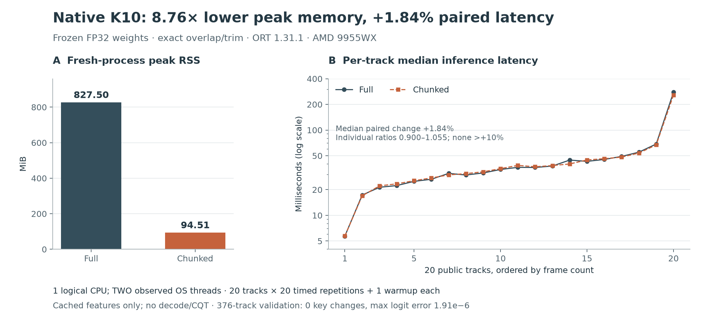

# Native K10 inference from cached features: bounded memory with prediction parity

On one logical CPU of an AMD Ryzen Threadripper PRO 9955WX, chunked native (Rust) inference cut fresh-process peak RSS from 827.50 MiB to 94.51 MiB (8.76x) while the median paired latency rose 1.84%, within the pre-set 10% limit. On all 376 public validation tracks every predicted key was unchanged: native full-model logits were identical to the Python ONNX Runtime references, and chunked logits differed by at most 1.90735e-6. These are parity and resource measurements with fixed weights and cached CQT features, measured on November 11, 2026; they are not a labeled accuracy score or an audio-to-key benchmark.

## Question

K10 is a 109,128-parameter CNN that predicts 24 musical keys from absolute-frequency CQT features. Small weights do not mean small working memory: running a long track at once creates temporal activation tensors proportional to its duration. Cropping the recording, or averaging predictions from unrelated crops, would change the learned function and discard evidence.

Hypothesis: exact overlap, alignment and trimming can keep every final temporal position while bounding the CNN's input workspace. The success thresholds, fixed before the run, were zero key disagreements, finite logits and allclose(atol=1e-5, rtol=1e-5) on 376 public validation tracks, followed by at least 2x lower peak RSS and at most 10% higher median paired latency on the existing 20-track public selection. Neither the thresholds nor the track membership were changed.

## Method

### Chunked computation

Three blocks of Conv3, Conv3 and Pool2 give a final temporal stride of 8 and a receptive field of 36. Output q depends on input indices `[8q-14, 8q+21]`. For an output core `[q0, q1)` of at most 64 positions, the prefix receives `[max(0, 8q0-16), min(T, 8q1+16))`. Keeping local outputs `[q0-a/8, q1-a/8)` covers every global position exactly once and preserves pooling phase, true endpoints and the T mod 8 tail. Prefix input is at most 544 frames.

The unchanged prefix emits `[1, 64, 24, Q]`. Retained features are summed in FP64, divided by floor(T/8), cast once to FP32 and passed once through the unchanged ONNX linear head. Linearity makes this equivalent in exact arithmetic; floating-point reordering still had to be measured. No quantization, truncation, early exit, feature renormalization or weight change was introduced.

Inputs are band-major little-endian FP32 files made by widening the existing padded FP16 CQT cache and taking bands `[8:200]`. The native reader checks completeness, membership counts, path containment, byte length, checksum and finiteness. It reads into one FP32 buffer, hashes the original bytes and converts byte order in place when needed, so no second full copy or audio frontend is held.

### Runtime

The standalone Rust research crate (Rust 1.92 or later) leaves the production application untouched. It was built with Rust 1.99.1 and `ort` 2.0.0-rc.15 (API 31), and loads the same ONNX Runtime 1.31.1 shared library as the Python reference; the C API version is checked exactly. Sessions use explicit CPU preference with the CPU arena enabled, sequential execution, one intra-op and one inter-op thread and spinning disabled.

Explicit device policy matters. An initial synthetic test on macOS found that registering the CPU provider alone left the Rust wrapper's efficiency policy active, which selected CoreML and gave rounded full-model logits with a 4.78e-4 discrepancy. The provider choice was fixed without relaxing the threshold. This behavior is described in the [upstream issue](https://github.com/pykeio/ort/issues/662).

Hardware: AMD Ryzen Threadripper PRO 9955WX 16-core, x86_64, Linux 6.14.0-37-generic. Measurements used CPU affinity 0 and all four OMP, MKL, OpenBLAS and NumExpr thread variables set to 1. Both modes reported two process threads on every track; affinity confined them to one logical CPU, and process CPU time includes both threads.

### Validation, then timing

First, one process evaluated all 376 public validation tracks against unchanged Python full-model logits, comparing native full with the reference, native chunked with the reference, and native chunked with native full. No ground-truth keys were read. Separately, 160 synthetic cases passed on Linux CPU 0: all eight time remainders, minimum length, seams and tails, random, constant and negative inputs, impulses and amplitudes from 1e-3 to 1e3. Unit tests cover index mapping, ties, integrity checks, non-finite inputs, symlink escape, byte order and provenance.

Only after validation passed, two separate fresh processes ran the same 20 selected public tracks, full first and then chunked. Each track had one warmup and 20 timed repetitions. The full process built only its full-model session and the chunked process only its prefix and head sessions; both reused sessions across tracks. Timed calls include input validation and tensor construction; file loading and hashing are reported separately. Whole-process RSS includes feature loading and allocator retention. Each stage was limited to 600 CPU seconds.

Reports record model, bundle, input, executable, source, lockfile and ONNX Runtime library hashes, plus CPU model and capabilities, kernel, a hashed machine identity, CPU affinity and thread environment. Any mismatch in code, runtime or hardware invalidates the pairing.

## Results

### Prediction parity

| Comparison | Tracks | Numerical failures | Key disagreements | Maximum absolute logit error |
| --- | ---: | ---: | ---: | ---: |
| Native full / Python full ORT | 376 | 0 | 0 | 0 |
| Native chunked / Python full ORT | 376 | 0 | 0 | 1.90735e-6 |
| Native chunked / native full | 376 | 0 | 0 | 1.90735e-6 |

Validation took 25.353 CPU seconds and 25.393 wall seconds. Its memory peak is not used for the resource comparison because that process loaded both modes.

### Memory and latency

Figure: fresh-process peak RSS for each mode and the 20 per-track latency medians (one warmup and 20 timed repetitions per track, one logical CPU, cached features only); look at the large RSS drop next to the nearly unchanged latencies. An [SVG version](figures/native-cached-results-58c290b.svg) and the [plot script](plot_results.py) are included.

| Measure | Full | Chunked |
| --- | ---: | ---: |
| Peak process RSS | 847,356 KiB (827.50 MiB) | 96,776 KiB (94.51 MiB) |
| Loaded process peak before features | 32,652 KiB | 32,088 KiB |
| Median of the 20 per-track latency medians | 35.463 ms | 36.199 ms |
| Total process CPU time | 20.347 s | 19.630 s |
| Total process wall time | 20.370 s | 19.657 s |
| Observed process threads | 2 | 2 |

Peak RSS fell 8.75585x (88.58%). The median of the 20 paired per-track latency ratios was 1.018393 (+1.84%), which differs from dividing the two medians in the table. Individual ratios ranged from 0.900263 to 1.054613; none exceeded +10%. Chunked peak RSS was also 5.66091x below the earlier 535 MiB isolated Python measurement, but the fresh native full process is the matched comparison.

Lower total CPU time and a slightly higher median paired latency can coexist: total CPU weights long tracks more, while the paired median weights each track equally. All raw repetitions are kept.

## Decision

The native cached-feature stage passes its pre-set parity and resource thresholds and is a suitable basis for native frontend work. Production integration is not enabled; reports keep `promotion: false`.

The next stage, carried out in the [native CQT study](../drone-native-cqt/REPORT.md), was to fix the installed Python frontend first: export a small public and synthetic golden set with reference mono 22,050 Hz PCM, CQT shape and core features, FP16 rounding, full-model logits, source hashes and dependency versions, covering tones, chords, impulses near both ends, silence and short inputs. The native frontend is evaluated on the same reference PCM before any decoder change, with decoded-PCM and raw-file fixtures kept separate so decoder drift can be told apart from CQT drift. Stored result caching comes after native frontend parity, and its cache key must include decoder and frontend versions, rounding, label order and the model and aggregation contract.

## Limitations

- One CPU, one runtime and a fixed run order. The results are descriptive, without randomized crossover or confidence intervals.
- RSS is a process high-water mark affected by ONNX Runtime arena retention, not a per-track memory curve.
- No general floating-point equivalence or accuracy on unseen near-ties is established. No weights were trained and no labels were scored.
- Cached CQT excludes decoding, resampling and feature extraction. The application's analyzer also keeps whole-track audio and computes tempo, energy, quality and beat grids. Bounding CNN activations does not bound that pipeline, so this is not native audio-to-key speed or an application-wide memory reduction.

## Reproduce

The [README](README.md) gives the input format and commands. The [reproducibility record](../report-provenance.json) identifies the measured source and binary and the checksums of the full validation report, which is kept off the repository with the raw inputs; later documentation edits do not replace those measurements. Committed evidence:

- [Full-mode report](evidence/native-full-58c290b.json)
- [Chunked-mode report](evidence/native-chunked-58c290b.json)
- [Validation summary](evidence/native-validation-summary-58c290b.json), with all comparison counts and the full report's checksum

Redraw the figure with `uv run --script research/drone-native-cached/plot_results.py`. No raw features or audio are committed.
