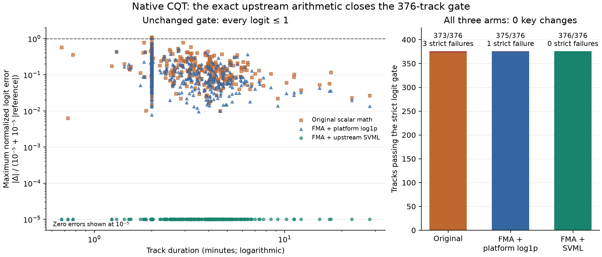
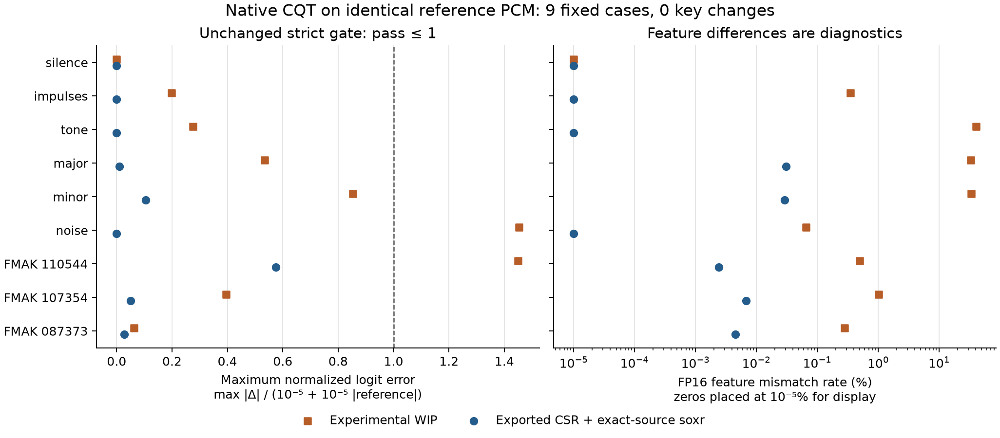

# Native CQT reproduces K10 inputs on 376 public tracks

A native (Rust) CQT frontend, given the same decoded PCM as the Python feature pipeline, reproduces all 82,562,688 FP16-roundtripped core feature values and all 9,024 logits bit for bit on the fixed 376-track public validation set, so every key prediction is unchanged. This needed two arithmetic changes that copy what NumPy actually executes: a fused-multiply-add (FMA) complex magnitude and the pinned upstream SVML logarithm. Without them the native frontend failed the strict logit threshold on 3 tracks (FMA magnitude alone: 1 track). The result qualifies one Linux x86 CPU configuration; it is not a performance or key-accuracy result.

The study ran on November 11 and 12, 2026.

## Question

The [native cached-feature study](../drone-native-cached/REPORT.md) showed that native inference reproduces the model, but its inputs already contain the CQT. Can native code reproduce the installed librosa frontend closely enough to preserve K10's logits and predicted key when both receive identical PCM? Weights are unchanged and no labels are scored.

## Method

The [original protocol](PROTOCOL.md), the [376-track expansion](EXPANSION.md) and the [two-arm arithmetic comparison](CANDIDATE2.md) were each fixed before their outcomes were seen.

### Cases

Nine fixed cases come first. Six deterministic PCM16 signals cover silence, first, middle and final impulses, a 440 Hz tone, major and minor chords and seeded noise; their lengths include the minimum of eight frames, exact-hop endpoints and irregular tails. Three public FMAK tracks have 217, 1,295 and 9,057 frames. The expansion then uses every validation track of the prepared data manifest: 376 tracks (126 Beatport, 250 FMAK), sorted by (domain, id), with source-audio hashes verified. Ground-truth keys are excluded from the study's data types and never used for selection or scoring.

### Reference

The original FFmpeg decode path produces reference FP32 PCM. Instrumented calls into the installed librosa 1.0.0 export the post-compensation complex64 CSR kernels, FFT sizes, hops, recursive resampling and normalization divisors; tests check that this observation does not change the output. The CQT uses 22,050 Hz, 208 bins, 24 bins per octave, hop 4,096, constant centered padding and log1p magnitude, followed by the original FP16 storage roundtrip and the core slice `[8:200]`. [librosa's implementation](https://librosa.org/doc/latest/_modules/librosa/core/constantq.html) describes the recursive transform; hashes of the installed functions and files identify the exact version executed.

### Native frontend

RustFFT 6.4.1 computes the centered, zero-padded forward FFT in FP64, casts the positive spectrum to complex64 and applies the captured CSR in FP32. Each track's actual normalization call is captured anew; no statistics from the silence case are reused. Whole-track frame counts, ceiling resampling lengths and full-model time pooling are kept. Kernel and resampler configurations were verified identical across the nine goldens and every expanded track.

Resampling uses the verified [python-soxr 1.1.0 source distribution](https://pypi.org/project/soxr/1.1.0/), built locally as a shared library (Release, OpenMP off, two jobs). The wrapper matches python-soxr's mono FLOAT32 split-channel HQ processing in 96,000-sample blocks, the final empty-input flush, the ceiling-length fix and librosa's scaling. The standalone library reports `libsoxr-0.1.3` while the Python wheel reports a later development revision of the same library, so source identity and build configuration are recorded rather than binary identity. All 63 recursive resampling outputs in the nine-case check match bit for bit. Python-SoXR and libsoxr are LGPL-2.1-or-later; the SVML source is BSD.

Both reference and native logits use the same unchanged full ONNX graph and checkpoint. ONNX Runtime (ORT) 1.31.1 runs with explicit CPU preference and arena, one intra-op and one inter-op thread, sequential execution and spinning off. Native inference calls no Python or Torch.

### Arithmetic arms

Three native arithmetic variants were compared on identical reference features:

1. Scalar `hypotf` magnitude plus platform `log1pf` (the original native frontend).
2. NumPy's source-defined finite magnitude `larger * sqrt(fma(smaller/larger, smaller/larger, 1))` plus platform `log1pf`.
3. The same magnitude plus the byte-identical upstream NumPy SVML `__svml_log1pf16` routine, loaded through a separate checked research library.

Arms 2 and 3 were defined after diagnosing the first failure (below) and fixed before their nine-case and 376-track outcomes. Both consumed each track's same reference output before it was deleted.

### Pass criterion

Finite values, matching shapes, every logit within `abs(delta) <= 1e-5 + 1e-5*abs(reference)`, and zero argmax disagreements. An arm qualifies only if it passes its own nine-case check and all 376 tracks. Feature maximum and RMS error and FP16 mismatch rates are diagnostics, not thresholds.

### Execution

Runs were sequential: a fresh Python reference process per track, then fresh native processes, so two ORT sessions were never resident at once. Processes were restricted to two logical CPUs with all four numeric thread environment variables set to 1. Only the current track's generated files were deleted after use; original audio, caches, goldens and the first failing track's files for each arm were kept.

## Results

Figure: per-track worst logit error relative to the allowed bound for the three arms over all 376 tracks; only the FMA plus SVML arm has every track at zero (shown at the annotated display floor). An [SVG version](cqt-376-ablation.svg) and the [plot script](plot_expansion.py) are included.

| Native arithmetic | Own nine-case check | Strict 376 check | Changed keys | FP16 core mismatches | Maximum logit error |
| --- | ---: | ---: | ---: | ---: | ---: |
| Scalar `hypotf` + platform `log1pf` | 9/9 | 373/376 | 0 | 4,163 | 2.14577e-5 |
| FMA magnitude + platform `log1pf` | 9/9 | 375/376 | 0 | 1,457 | 1.90735e-5 |
| FMA magnitude + pinned upstream SVML | 9/9 | **376/376** | **0** | **0** | **0** |

The original native frontend passed the nine-case screen but failed the strict check on Beatport 3662506, 5124850 and 5458695. FMA magnitude alone still fails Beatport 5124850, with largest normalized logit error 1.021261. An unchanged argmax alone does not qualify either failed arm. All 376 PCM hashes and reference logit vectors matched the earlier expansion exactly, confirming that the reference was stable between runs.

### Why the arithmetic change was necessary

The first failure, Beatport 3662506, was chosen in advance for diagnosis. It had six differing FP16 core positions. All nine complex CSR responses and all seven resampled PCM arrays were identical, and re-running the Python feature function reproduced the reference bytes. A scalar Rust probe reproduced the original six mismatches, maximum error and RMS exactly.

Over all 124,032 core positions of that track:

| Operation comparison | Differing positions |
| --- | ---: |
| Rust normalization vs original normalized complex values | 0 |
| Rust/platform `hypotf` vs NumPy magnitude | 43,431 |
| NumPy-source FMA-ratio magnitude vs NumPy magnitude | 0 |
| Platform `log1pf` on the same NumPy magnitudes vs NumPy `log1p` | 20,730 |
| Isolated upstream SVML on the same magnitudes vs NumPy `log1p` | 0 |

Five of the six FP16 mismatches come from magnitude rounding; the sixth has an equal magnitude but a different logarithm. At core bin 11, frame 14, NumPy's vectorized logarithm gives `0x3e136fff` and platform `log1pf` gives `0x3e137000`, exactly on an FP16 rounding midpoint. The diagnostic records values, bits, neighboring FP16 values and signed midpoint distances for all six positions. No epsilon, output bias, label or change to the FP16 step was introduced.

The difference between scalar and vector paths was measured, not assumed. Python `abs(np.complex64)` agrees with platform `hypotf` at the affected positions, while scalar `np.abs` and length-one array calls agree with the vectorized magnitude. Scalar and length-one `np.log1p` agree with the vectorized logarithm at all six positions. See the [arithmetic observation](evidence/first-failure-arithmetic.json) and its [source and runtime context](evidence/first-failure-arithmetic-input.json).

The installed NumPy 2.5.4 build uses GCC 14.2.1 and `X86_V4` dispatch for complex absolute value and `log1p`, with AVX512_SKX and FMA3 available. The executed Rust binary links `hypotf@GLIBC_2.35` and `log1pf@GLIBC_2.2.5` against glibc 2.39. NumPy's [complex magnitude source](https://raw.githubusercontent.com/numpy/numpy/v2.5.4/numpy/_core/src/umath/loops_unary_complex.dispatch.c.src) uses a ratio, fused multiply-add and square root in its SIMD path, and its [logarithm dispatch source](https://raw.githubusercontent.com/numpy/numpy/v2.5.4/numpy/_core/src/umath/loops_umath_fp.dispatch.c.src) and [build configuration](https://raw.githubusercontent.com/numpy/numpy/v2.5.4/numpy/_core/meson.build) select SVML for the Linux x86 SIMD build.

The [pinned SVML source](https://github.com/numpy/SVML/blob/bd9d46e0c627ab16f3d2641f7cdb1bc15d303ba4/linux/avx512/svml_z0_log1p_s_la.s) is copied without byte changes and verified against upstream; its BSD notices and source hashes are under [vendor](vendor/SOURCE.json). The isolated native probe has [zero bit differences](evidence/svml-arithmetic-result.json) on all 124,032 reference magnitudes and links no NumPy or Python. The wrapper processes 16 float32 lanes at a time, zero-pads only the final batch, and refuses to run unless the CPU is Linux x86-64 with AVX512F, DQ, BW, VL and FMA.

### Earlier nine-case screen

Figure: per-case logit and feature errors for the exported-kernel native frontend and for a separate experimental frontend by another contributor; the exported-kernel frontend passed all nine cases, the experimental one did not. Only that frontend's hashes and comparison outputs are kept; its source is not in this repository.

### Run costs

These are monitoring observations for the whole sequential run (reference production, native passes and checks), not frontend benchmarks or memory guarantees.

| Measure | Original 376-track run | Two-arm 376-track run |
| --- | ---: | ---: |
| Aggregate child CPU seconds | 539.26 | 603.71 |
| Wall seconds | 608.49 | 721.08 |
| Maximum owned process-tree RSS (sampled every 100 ms) | 628.42 MiB | 628.94 MiB |
| Experiment storage at completion | 826.44 MiB | 1,293.33 MiB |

The two-arm run's [recorded exit status](evidence/twoarm-exit.json) is 1 because one arm failed; the per-arm status qualifies FMA plus SVML and rejects FMA alone.

## Decision

Advance the FMA plus SVML frontend to a 20-track frontend and inference benchmark (reported in the [composed study](composed/REPORT.md)). Its core features and logits are exactly reproduced on this Linux CPU and runtime. FMA plus platform `log1p` is not qualified on this machine. Mac ARM uses a different NumPy dispatch and needs its own proof.

## Limitations

- The tested span is identical decoded PCM through FP16 core features and full ONNX logits. Native decoding, streaming CQT, combined chunked inference, concurrency, result caching and production integration are separate stages.
- Float32 arrays before FP16 rounding are not bit-identical in general, and this finite panel is not a guarantee for arbitrary inputs or hardware.
- No labeled accuracy and no frontend speed result is claimed.
- The numerical checks ran manually on the research machine; hosted CI covers only the source contract (unit tests, formatting and lints), without models, ORT or math-library downloads.

## Reproduce

Execution identities for each stage, including the earlier native work in the application repository, are in the [reproducibility record](../report-provenance.json); later documentation edits do not change which code was measured. Checksums for all evidence files are in [evidence/index.json](evidence/index.json). The [original 376-track summary](evidence/original-376-summary.json.gz) and [two-arm summary](evidence/twoarm-376-summary.json.gz) cover every case and are stored as deterministic gzip; the plot loader verifies both compressed and decoded checksums. An independent [summary verifier](https://github.com/lvndry/drone/blob/research/cqt-summary-35644f8/tools/summarize_cqt_expansion.py) checks every recorded logit, first-index argmax ties, artifact hashes and execution identities. Build evidence ([build-evidence-v2.json](evidence/build-evidence-v2.json)) covers source, configuration, compiler, library, licenses, FFT binary, CPU, kernel and executable hashes. Audio and bulk feature arrays are not committed.

Build, test and plotting commands are in the [README](README.md).
