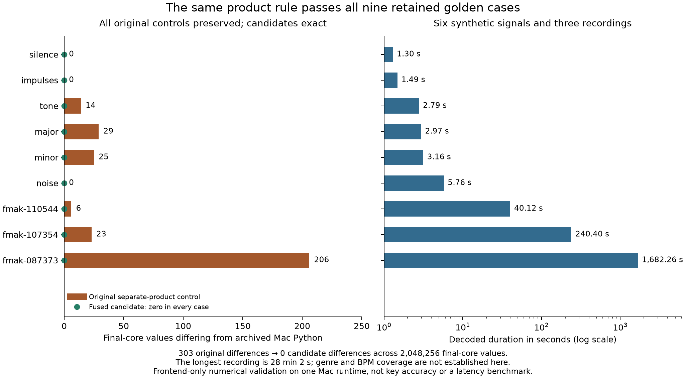
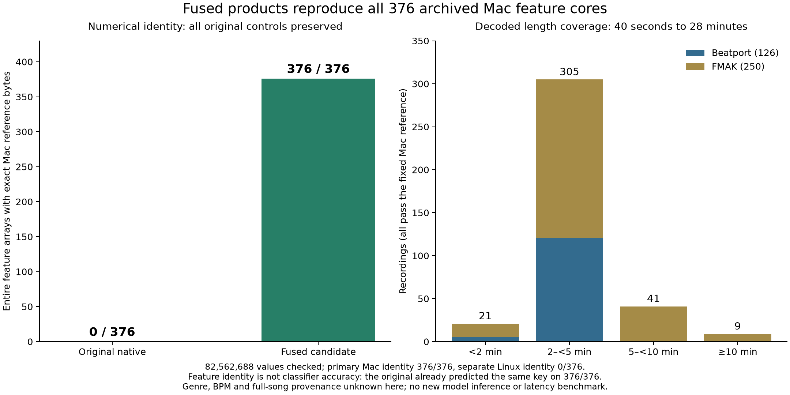
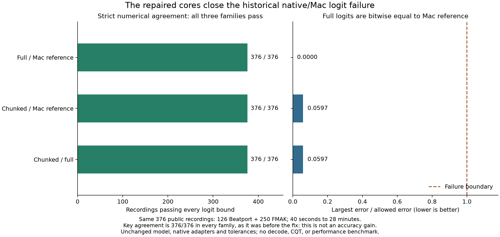
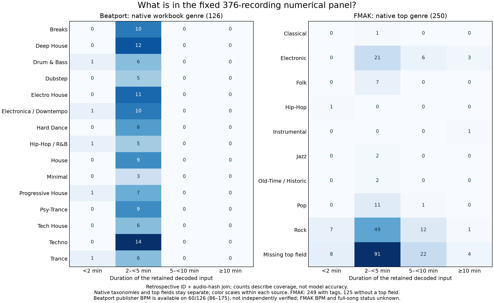

# Native CQT plus K10 inference on Linux and Apple CPUs

On Linux x86, a native (Rust) CQT frontend composed with the unchanged K10 model reproduces the Python reference on all 376 public validation tracks: every feature core matches, full-model logits are bitwise equal, chunked logits differ by at most 1.90735e-6, and no predicted key changes. On 20 tracks it lowers median paired latency by about 27% and median paired peak memory by 53% (full) or 65% (chunked) versus the Python pipeline. On an Apple M5 CPU the original native frontend failed the strict logit threshold on 1 of 376 tracks (with zero key changes); we traced this to how complex products are rounded in the sparse CQT step, and a fused-multiply-add product rule then reproduced all 376 Mac feature cores exactly and passed every strict model comparison. The Mac and Linux Python references still differ from each other on every track, so the two platforms agree on keys but not bit for bit.

The study ran on November 11 to 13, 2026. Agreement here is with archived model outputs, not with human key labels, so none of these numbers is a key-accuracy result.

## Question

The [native cached-feature study](../../drone-native-cached/REPORT.md) showed that native inference reproduces the model, but it starts from precomputed features and so says nothing about the memory or numerical fidelity of a complete native pipeline. The [native CQT study](../REPORT.md) showed that a native CQT reproduces Python features on Linux. This study asks:

1. Does a native pipeline that runs CQT, the FP16 feature roundtrip and then full or chunked ONNX inference reproduce the Python reference predictions on the fixed 376-track public panel?
2. How much latency and memory does it save on Linux?
3. Does the same native arithmetic transfer to an Apple M5 CPU, which has no x86 SVML math library? The M5 is a test machine, not a hardware requirement for Drone.

## Method

### Pipeline under test

A shared prepared plan preloads the verified sparse CQT kernels (CSR matrices), FFT constants and each track's normalization and resampling plan. Its compute path runs CQT, the original log1p and FP16 roundtrip, and then either the unchanged full ONNX model or the chunked path: the overlap-and-trim CNN prefix, FP64 averaging of hidden features, and the unchanged small ONNX head. No NumPy or Python runs during native inference.

- Linux: FMA-ratio complex magnitude plus the pinned upstream SVML log1p routine (the configuration qualified in the [native CQT study](../REPORT.md)).
- Mac: FMA-ratio magnitude plus the platform log1p, kernels and normalization constants captured from the Mac Python run, and a locally built libsoxr at the exact source revision used by python-soxr.

The released full ONNX model and the prefix/head bundle are unchanged. ONNX Runtime (ORT) 1.31.1 ran on CPU only, with one intra-op and one inter-op thread, sequential execution and spinning disabled.

### Data

The panel is every validation track of the prepared data manifest: 376 public recordings, 126 Beatport and 250 FMAK, with decoded durations from 40.12 seconds to 28 minutes 2 seconds. All PCM inputs were recreated from checksum-verified public audio through the original decode path (FFmpeg to 22,050 Hz signed 16-bit mono), and each had to match its archived PCM hash. Canonical CQT hashes and reference logits were reused, not regenerated. No key labels and no private audio were used.

Nine fixed "golden" cases come first: six synthetic signals (silence, impulses, a tone, major and minor chords, seeded noise) and three public FMAK recordings of 217, 1,295 and 9,057 CQT frames.

The timing subset is the existing fixed selection of 20 FMAK tracks spread across the duration range (no Beatport tracks).

### Pass criterion

Each comparison requires 24 finite logits per track, every logit within `abs(delta) <= 1e-5 + 1e-5*abs(reference)`, and an unchanged argmax (predicted key). These thresholds were fixed before any run and never changed. The relative term allows some absolute errors above 1e-5, so passing is not bitwise equality.

### Linux timing

Hardware: AMD Ryzen Threadripper PRO 9955WX. Qualification on the nine goldens and all 376 tracks ran and passed first, with the same source and configuration that was then timed.

Timing used 60 fresh processes: Python full, native full and native chunked for each of the 20 tracks, with mode order rotated by track. Each process loaded its PCM, ran one warmup and then 20 timed repetitions. The timer covers CQT, the FP16-roundtripped core and logits. Decoding, file reads, session and plan setup, hashing and correctness checks are outside the timer; correctness (core hash, finite logits, key) was still checked on every repetition. Python's normal CQT filter construction is inside its timed call, while native plan construction is setup, so this measures the usable prepared native API rather than identical low-level work. Peak RSS covers the whole process lifetime, including setup, PCM, frontend and inference.

All timing processes were restricted to one logical CPU, and all four numeric-library thread environment variables were 1. A separate check saw two OS threads restricted to that CPU; it did not sample every process.

Paired effects are computed per track first (the ratio of that track's medians), then summarized by their median. The p95 values use linear interpolation across the 20 track medians. The success threshold fixed before this stage was a visible paired improvement with full correctness. The earlier program target (at least 2x lower maximum RSS and at most 10% higher latency) was not a pre-registered threshold for this stage.

### Mac comparisons

The Mac runs used the same versions as Linux: librosa 1.0.0, NumPy 2.5.4, SciPy 1.18.1, python-soxr 1.1.0 and ORT 1.31.1. The verified 166-file soxr source tree was built locally (Release, shared, OpenMP off); its LGPL-2.1-or-later provenance is preserved. Numeric thread variables and VECLIB were set to 1; macOS has no Linux-style hard CPU affinity.

For each track the Mac computed:

- the Mac Python reference: Mac Python CQT on identical PCM, then the full model;
- native full and native chunked: the native Mac frontend on the same PCM, then each adapter;
- the canonical Linux core run through Mac ORT, to isolate runtime drift.

These were compared with each other and with the canonical Linux core and logits. Each track's PCM (as int16) and canonical core (as FP16) were transferred losslessly and reconstructed with independent hash checks, so no new quantization was introduced. Each track ran in a fresh process.

The 376 Mac tracks were processed in two runs, tracks 0 to 304 and tracks 305 to 375, because the first run reached its CPU-time limit. An earlier attempt that covered 11 tracks was stopped because its monitoring overhead made completion implausible; it is excluded. Track 305 had completed in the first run but was not recorded before the stop; the second run recomputed it, and all six comparison results and three core hashes matched the unrecorded copy exactly. Each track is counted once.

### Root-cause diagnostics

After the Mac failure, four follow-ups were each specified in a protocol before they ran:

1. A stage-by-stage trace of the failing track through both frontends ([trace protocol](BOUNDARY_TRACE_PROTOCOL.md)). The tracer needed its own offline build ([build protocol](BOUNDARY_BUILD_PROTOCOL.md)). The first build attempt was stopped after 2.69 seconds by a bug in our resource-monitoring script: it treated a temporary compiler file that disappeared during a disk-usage scan as an error. This was not a compiler or numerical problem. After the script was changed to ignore only that case, the second build succeeded.
2. An exact-arithmetic replay of the captured sparse products, emulating binary32 rounding with integer arithmetic for two candidate product rules, first on stage 0 and then on all remaining stages.
3. A compiled fused-product candidate, run on the failing track, then on the nine goldens, then on all 376 tracks ([single-track protocol](FUSED_PRODUCT_PROTOCOL.md), [nine-golden protocol](FUSED_GOLDENS_PROTOCOL.md), [376-track protocol](FUSED_376_PROTOCOL.md) and its [ordered membership](FUSED_376_MEMBERSHIP.json)). Each run first rebuilt and reproduced the original separate-product result as a control before testing the candidate.
4. Unchanged full and chunked inference on the 376 corrected feature cores ([model comparison protocol](RETAINED_MODEL_PROTOCOL.md)).

For the 376-track frontend run, the old full Mac reference arrays were no longer stored, only their hashes. Exact hash equality establishes exact bytes; a mismatch would have counted as a failure with unknown error magnitude. Results are reported by source and by decoded-duration bands fixed beforehand: under 2 minutes, 2 to under 5, 5 to under 10, and 10 minutes or longer.

## Results

### Linux: composed pipeline on 376 tracks and timing on 20

Qualification passed on the nine goldens and all 376 tracks. Every FP16-roundtripped core hash matched the canonical reference. Native full logits were bitwise equal to the reference; chunked logits had maximum absolute error 1.90735e-6. Both had zero key changes.

| Mode | Median track median | p95 track median | Median process peak RSS | Maximum process peak RSS |
| --- | ---: | ---: | ---: | ---: |
| Python full | 90.791 ms | 186.535 ms | 383.783 MiB | 1241.738 MiB |
| Native full | 64.985 ms | 157.664 ms | 181.264 MiB | 1076.336 MiB |
| Native chunked | 67.063 ms | 157.219 ms | 132.838 MiB | 477.500 MiB |

| Paired comparison (median of per-track ratios) | Latency | Peak RSS |
| --- | ---: | ---: |
| Native full vs Python full | -27.19% | -53.11% |
| Native chunked vs Python full | -26.92% | -64.94% |
| Native chunked vs native full | +0.897% | -25.85% |

The summary medians in the first table are not used to compute the paired effects. Maximum peak RSS fell 2.254x from native full to native chunked. The longest track still reached 477.5 MiB with chunking, because PCM and frontend arrays remain in memory; this is why the result differs from the cached-feature memory result, which excluded the frontend.


Figure: per-track latency medians and fresh-process peak RSS against CQT frame count for the three modes; look at how native chunked memory flattens for long inputs while native full keeps growing. It does not show model-only latency.

### Mac: nine-case check

All nine cases passed every comparison.

| Comparison | Cases passed | Maximum absolute logit error | Key changes |
| --- | ---: | ---: | ---: |
| Native Mac / Mac Python | 9/9 | 7.153e-6 | 0 |
| Mac Python / canonical Linux | 9/9 | 2.027e-5 | 0 |
| Native Mac / canonical Linux | 9/9 | 1.407e-5 | 0 |
| Canonical Linux core through Mac ORT / Linux ORT | 9/9 | 1.335e-5 | 0 |

Native and Mac Python cores differed at 303 of 2,048,256 values. Per-case feature maximum and RMS differences are in the raw comparisons.


Figure: logit error relative to the threshold for each of the nine cases and four comparisons, plus feature differences; every point sits below the threshold.

### Mac: original native frontend on 376 tracks

Coverage was complete. Strict qualification failed.

| Comparison | Strict passes | Failed logit elements | Argmax disagreements |
| --- | ---: | ---: | ---: |
| Native full / Mac Python | 375/376 | 1 | 0 |
| Native chunked / Mac Python | 375/376 | 1 | 0 |
| Mac Python / canonical Linux | 348/376 | 47 | 0 |
| Native full / canonical Linux | 350/376 | 39 | 0 |
| Native chunked / canonical Linux | 350/376 | 39 | 0 |
| Canonical Linux core: Mac ORT / Linux ORT | 376/376 | 0 | 0 |


Figure: per-track worst logit error divided by its allowed bound for the six comparisons; points above 1 are failures, and each native-versus-Mac panel has exactly one.

Thirty-three distinct tracks failed at least one comparison. The native-versus-Mac failure is `fmak:091711`, G-major logit: reference -0.2216097116, full-model error 1.5899539e-5 against an allowed 1.2216097e-5 (ratio 1.3015), so it is not a near-zero-reference artifact. The worst frontend ratio was 2.5943, and the largest Mac/Linux frontend absolute error was 3.8147e-5. Of 126 reference logits with absolute value at most 0.1, five failed Mac/Linux, six failed each native/Linux comparison and none failed native/Mac; all seven with absolute value at most 0.01 passed. These buckets were defined after the fact and do not change acceptance.

All six comparisons kept the same argmax on all 376 tracks. A stronger check on these saved pairs: for reference logits r, observed logits a, reference winner w and errors e_i = |a_i - r_i|, every competitor j has positive slack `r_w - r_j - e_w - e_j`. The minimum over all tracks and comparisons is 0.0010512024, and an independent recomputation matched every field. This uses observed errors only; it is not a bound for unseen inputs and does not relax the failed thresholds.


Figure: per-comparison extremes of observed error and winner margin across tracks; the two ends of a bar can come from different tracks.

All CSR bases, indices and row pointers for all nine CQT stages were byte-identical between Mac and Linux on every track. Exactly three normalization lengths differed by one float64 ULP.

### Root cause: rounding inside the complex product

The stage-by-stage trace of `fmak:091711` (399 frames) reproduced both archived final cores exactly. It checked 260 artifact references (171 unique arrays) and all 89 native records (41 full arrays and 48 probes); there were no non-finite values. The 27 CSR source arrays match the Python ones, and the normalization lengths match bitwise.

All nine stage inputs and all seven recursive resampling outputs are bitwise equal. Eight of nine FFT spectra are bitwise equal; stage 5 differs in one imaginary component (frequency bin 251, frame 60, absolute difference 7.45058e-9), and no row of that stage's CSR matrix uses bin 251, so it cannot reach any response. The first difference that matters is therefore in the sparse complex response, whose inputs are identical:

| Stage | Differing complex CSR responses / total | Maximum complex absolute difference |
| --- | ---: | ---: |
| 0 | 6,438 / 9,576 | 5.33120e-7 |
| 1 | 6,404 / 9,576 | 3.01578e-6 |
| 2 | 6,332 / 9,576 | 5.72205e-6 |
| 3 | 6,434 / 9,576 | 1.52588e-5 |
| 4 | 6,521 / 9,576 | 1.70598e-5 |
| 5 | 6,464 / 9,576 | 3.41197e-5 |
| 6 | 6,361 / 9,576 | 1.25827e-4 |
| 7 | 6,468 / 9,576 | 2.45302e-4 |
| 8 | 3,947 / 6,384 | 3.14568e-5 |

| Final step | Differing values / 76,608 | Maximum absolute difference |
| --- | ---: | ---: |
| Stacked complex response | 51,167 | 2.45302e-4 |
| Normalized complex response | 49,902 | 1.96605e-6 |
| Magnitude | 28,072 | 1.90735e-6 |
| log1p | 25,045 | 2.98023e-7 |
| FP16 final core | 9 | 9.765625e-4 |

Stacking introduces no new difference. The square-root normalization scales differ by one float64 ULP in 7 of 192 bins (maximum 1.42109e-14). Wherever the preceding value is bitwise equal, the next value is also equal at every later step on this track. All nine FP16 differences, at zero-based core (bin, frame) coordinates (11,4), (34,180), (36,151), (56,46), (72,328), (100,55), (102,115), (123,163) and (159,171), come from unequal stacked responses with bitwise-equal scales, so neither the FFT difference nor the scale differences explain them.


Figure: differing-value counts and maximum differences per CQT stage and at each final step; the differences start at the CSR response and shrink to nine values after FP16 rounding.

Inspection of the installed SciPy sparse kernel shows that it uses a fused multiply-add inside each complex product, while the native code rounds the component products separately; both add the finished product to the running sum separately. An exact replay of both rules on the captured operands covered 1,260,042 complex terms per rule and 82,992 response elements across all nine stages (including bins outside the final core). Stage 0 was checked first at two fixed coordinates (the first mismatch and the first equal nonzero response): all 22 isolated products and 22 partial sums agreed with the fused rule. At the equal-output coordinate the products differed but the sums later converged.

| Arithmetic rule | Differences from native responses | Differences from Python responses |
| --- | ---: | ---: |
| Separate component products, separate accumulation | 0 | 55,369 |
| Fused multiply-add within product, separate accumulation | 55,369 | 0 |

The response coordinates feeding all nine FP16 differences also matched.

### Fused-product native frontend

The candidate changes only the complex product: it rounds the cross terms separately, uses a fused multiply-add inside each product, then adds the finished product to the sum separately. FFT, resampling, accumulation order, magnitude, logarithm, FP16 step and reference are unchanged. An analytical cancellation unit test passed; it also distinguishes this rule from wrongly fusing the accumulation.

On `fmak:091711` (1,633,354 samples at 22,050 Hz, 74.08 seconds, 399 frames):

| Final core against Mac Python | Differing values / total | Maximum absolute difference |
| --- | ---: | ---: |
| Rebuilt original separate-product control | 9 / 76,608 | 0.0009765625 |
| Fused-product candidate | 0 / 76,608 | 0 |


Figure: replay mismatches for each product rule per stage, and the nine final-core differences of the control dropping to zero with the fused rule.

On the nine goldens, the candidate matched all 2,048,256 Mac Python core values (zero differing bits), and every control reproduced its original native core exactly:

| Case | Decoded duration | CQT frames | Original differing values | Candidate differing values |
| --- | ---: | ---: | ---: | ---: |
| Silence | 1.30 s | 8 | 0 | 0 |
| Impulses | 1.49 s | 9 | 0 | 0 |
| Tone | 2.79 s | 15 | 14 | 0 |
| Major chord | 2.97 s | 17 | 29 | 0 |
| Minor chord | 3.16 s | 18 | 25 | 0 |
| Noise | 5.76 s | 32 | 0 | 0 |
| FMAK 110544 | 40.12 s | 217 | 6 | 0 |
| FMAK 107354 | 240.40 s (4 min) | 1,295 | 23 | 0 |
| FMAK 087373 | 1,682.26 s (28 min 2 s) | 9,057 | 206 | 0 |



Figure: original versus candidate differing values for each golden, ordered by duration; every candidate value is zero, including the 28-minute recording.

On all 376 panel tracks, the candidate reproduced every Mac Python feature core exactly: 82,562,688 values, with all 376 original native controls reproduced. No case was dropped and no reference was regenerated. For comparison, the original native frontend had 0/376 byte-identical whole cores, yet its logits passed on 375/376 and its keys matched on 376/376.

| Source | Under 2 min | 2 to under 5 min | 5 to under 10 min | 10 min or longer | Exact Mac cores |
| --- | ---: | ---: | ---: | ---: | ---: |
| Beatport | 5 | 121 | 0 | 0 | 126 / 126 |
| FMAK | 16 | 184 | 41 | 9 | 250 / 250 |
| Total | 21 | 305 | 41 | 9 | 376 / 376 |



Figure: exact-match outcome for every track against decoded duration, split by source; all 376 match.

The canonical Linux cores match 0/376 of the Mac cores: the archived Linux and Mac Python references already differed on all 376 before this experiment. Matching the Mac reference therefore cannot also match the Linux reference.

### Model predictions from the corrected features

All 376 corrected cores pass all three strict comparisons. Full-model logits are bitwise equal to the archived Mac reference.

| Comparison | Strict passes | Failed logit elements | Key agreements | Maximum absolute error |
| --- | ---: | ---: | ---: | ---: |
| Native full / Mac reference | 376 / 376 | 0 | 376 / 376 | 0 (bitwise equal) |
| Native chunked / Mac reference | 376 / 376 | 0 | 376 / 376 | 0.000002861 |
| Native chunked / native full | 376 / 376 | 0 | 376 / 376 | 0.000002861 |

The largest error divided by its allowed bound was 0.05971 for both chunked comparisons. This removes the single original native-versus-Mac failure for both adapters; the predicted keys were already identical. Agreement with Linux was not rerun.



Figure: per-track error relative to the threshold for the three comparisons; all points are far below 1.

### Panel genre and tempo description

After the numerical runs, the panel was joined to the existing Beatport and FMAK catalogs by track ID and source-audio hash (all 376 matched). This is descriptive only: it did not affect membership or results, and no audio, models or labels were read.

| Source | Recordings | Top or workbook genre present | Any genre tag present | Publisher BPM present |
| --- | ---: | ---: | ---: | ---: |
| Beatport | 126 | 126 | 126 | 60, range 86 to 175 |
| FMAK | 250 | 125 | 249 | 0 |

Beatport workbook genres include Techno (14), Deep House (12), House (9), Progressive House (8), Tech House (6) and Hip-Hop / R&B (6). Archived API genre tags exist on 61 Beatport entries and subgenre tags on two. FMAK's top-genre field names Rock on 69 recordings, Electronic on 30 and Pop on 12, and is missing on 125; 249 of 250 still carry at least one FMA genre tag. FMA tags mix direct genres and their ancestors, so they are not exclusive counts.

All 41 recordings of 5 to 10 minutes are FMAK. Their top genre is Rock (12), Electronic (6), Pop (1) or missing (22). Counting overlapping tags instead gives Electronic 22, Rock 18 and Pop 10.

The 60 Beatport BPM values are unverified publisher metadata; no tempo was inferred for the rest. Whether each recording is a full song or a preview cannot be told from duration alone.



Figure: heatmaps of top genre against duration band, one per source with separate color scales; the missing category is shown explicitly.

## Decision: what this means for shipping a native CPU pipeline

- On the tested Linux x86 CPU, the native frontend plus full or chunked inference is a faithful replacement for the Python pipeline on this panel, and it is faster and smaller. Keep both adapters and prefer chunked inference for long inputs: it costs under 1% median latency versus native full and cuts the worst-case peak from 1076 MiB to 478 MiB.
- Memory is not yet bounded. The frontend still holds whole-track PCM and CQT arrays, so the longest track needs 478 MiB even with chunking. A streaming frontend is the next memory step.
- The default native arithmetic is still the separate-product rule; the fused-product rule exists only as an explicitly named research method. Making it the default requires requalifying Linux, where the original rule already matches.
- Exact cross-platform identity is not achievable against the current references, because the Linux and Mac Python references disagree on every track. Each native build matches its own platform's Python reference, and all platforms agree on predicted keys on this panel.
- Not yet measured: Mac latency and memory, other ordinary PCs, the application's own decoder and resampler on original files, and long-lived warm sessions.

No production default, model weights, training, dependency or minimum Rust version changed.

## Limitations

- All agreement is against archived model outputs on 376 public recordings. It is not key accuracy against labels and does not cover unseen inputs.
- The pipeline starts from FFmpeg-decoded 22,050 Hz PCM; decoding is outside both the timer and qualification. The application's own decoding, mixdown and resampling are not qualified, and Drone inputs must not inherit libkeyfinder tuning correction.
- Timing covers 20 FMAK tracks on one Linux CPU and is descriptive, without confidence intervals. Beatport tracks were not timed.
- Peak RSS is a process high-water mark. Diagnostic RSS values below were sampled and can miss short peaks.
- Four runtime properties of the historical Python reference remain unrecorded: the exact SciPy FFT backend, JIT runtime, system math library and RustFFT dispatch. Reproducing archived cores does not fill those gaps.
- The product-rounding explanation is proven for the traced track and confirmed empirically on 376 Mac tracks; other CPUs and SciPy builds are untested.
- Genre and tempo metadata are incomplete and full-song versus preview status is unknown. The panel describes coverage, not genre-specific accuracy. The private DJ library was not used.
- Calibrated confidence is not addressed. Existing libkeyfinder confidence thresholds cannot be applied to softmax top-1 minus top-2 margins without calibration.

## Data correction: native RSS units

The native pipeline reports stored a KiB value under a field named `peak_rss_bytes` (the helper returns KiB on both Linux and macOS). All native peak RSS values in this report are therefore the raw value times 1,024; for example, 105,408 KiB becomes 107,937,792 bytes. Python peaks, loaded RSS and sampled process-tree RSS were already in bytes and are not converted. The original files are kept unchanged, including the wrong field name. A later source version writes explicit bytes (report format v2); it was not used to produce these measurements, and the historical converter refuses other formats to prevent double conversion.

## Diagnostic run costs

These are costs of instrumented diagnostic runs (including file reads, hashing, monitoring and evidence writes), not inference benchmarks. RSS is sampled process-tree RSS unless noted.

| Run | Wall | CPU | Peak RSS |
| --- | ---: | ---: | ---: |
| Linux 376-track qualification | 269.87 s | 218.19 s | |
| Linux 20-track timing | 168.74 s | 162.55 s | |
| Mac nine cases, Python reference / native | 9.33 s / 2.95 s | 10.65 s / 2.84 s | 1,268,514,816 bytes |
| Mac 376, abandoned 11-track attempt (last checkpoint) | 299.43 s | 326.53 s | |
| Mac 376, tracks 0 to 304 | | 1,800.213 s at stop, 1,810.651 s with cleanup | |
| Mac 376, tracks 305 to 375 | 531.486 s | 554.711 s | 1,340,243,968 bytes |
| Linux PCM producer for tracks 305 to 375 | | 63.399 s | 419,065,856 bytes |
| Tracer build, first attempt (stopped) | 2.69 s | 2.381104 s | 255,049,728 bytes |
| Tracer build, second attempt | 147.37 s | 197.23 s | 482.39 MiB |
| Stage-by-stage trace | 6.3265 s | 6.4622 s | 322.84 MiB |
| Product replay, stage 0 | 5.44 s | 6.20 s | 84.33 MiB |
| Product replay, stages 1 to 8 | 43.29 s | 47.20 s | 105.78 MiB |
| Fused-product build / single-track run | 126.44 s / 0.552 s | 197.65 s / 0.461 s | 499.17 MiB / 58.89 MiB |
| Nine-golden build / run | 127.24 s / 4.087 s | 178.29 s / 4.486 s | 608.72 MiB / 495.64 MiB |
| 376-track frontend build | 66.60 s | 98.26 s | |
| 376-track frontend, Mac (transfer, two native passes, checks) | 495.22 s | 233.52 s | 515.56 MiB |
| 376-track frontend, Linux (decode, checks, transfer) | 491.11 s | 308.34 s | 418.38 MiB |
| 376-track model comparison | 54.35 s | 63.49 s | 565.55 MiB (process's own high-water: 469.59 MiB) |

The second tracer build produced a 1,799,584-byte binary and 224.15 MiB of output, including a 67.49 MiB private crate cache; the first attempt had written 76,464,031 bytes with a 70,764,137-byte cache. The trace wrote 34,165,163 bytes and the nine-golden run about 15.75 MiB. The Mac and Linux times for the 376-track frontend overlap and must not be added.

## Reproduce

Source, binary, library and hardware identities for every run are in the [Linux and Mac evidence index](evidence/index.json), the [Mac376 index](evidence/mac376-index.json), the provenance file next to each result and the [reproducibility record](../../report-provenance.json). Each index lists checksums for all of its evidence files. Historical sources are preserved at the [native compute snapshot](https://github.com/lvndry/euphoria/tree/research/cqt-composed-compute-20261112), [Linux run snapshot](https://github.com/lvndry/drone/tree/research/cqt-composed-linux-20261112) and [Mac run snapshot](https://github.com/lvndry/drone/tree/research/cqt-mac-nine-20261112); later edits in this repository are not the measured executables. No audio or raw feature arrays are published.

Evidence and scripts:

- Linux and Mac nine: [summary checker](summarize.py), [plot script](plot_results.py).
- Mac 376: [checker](summarize_mac376.py), [plot script](plot_mac376.py).
- Trace: [aggregate results](boundary-trace-results.json), [provenance](boundary-trace-provenance.json), [checker](summarize_boundary_trace.py), [plot script](plot_boundary_trace.py); build evidence for the [first](boundary-build-v1-evidence.tar.gz) and [second](boundary-build-v2-evidence.tar.gz) attempts and the [corrected monitoring script](qualify_boundary_build.py.txt).
- Product replay: [results](csr-product-rounding-results.json), [provenance](csr-product-rounding-provenance.json).
- Fused product: [single-track results](fused-product-results.json) and [provenance](fused-product-provenance.json); [nine-golden results](fused-goldens-results.json) and [provenance](fused-goldens-provenance.json); [376-track results](fused-376-results.json), [provenance](fused-376-provenance.json), [Mac run record](fused-376-controller.json), [Linux run record](fused-376-server-controller.json) and the [transport script as executed](fused-376-transport-executed.py.txt); the research entrypoint [`fused_product_case`](../src/bin/fused_product_case.rs); [checker](summarize_fused_product.py) and [plot script](plot_fused_product.py).
- Model comparison: [compressed results](retained-model376-results.json.gz), [run record](retained-model376-controller.json), [provenance](retained-model376-provenance.json), [entrypoint as executed](retained-model376-entrypoint-executed.rs.txt), [checker](summarize_retained_model.py).
- Panel metadata: [joined metadata](public376-metadata.json.gz).

The published transport script and model entrypoint later received static-typing and lint fixes; the executed versions are kept byte for byte, and the fixes were not rerun.

These commands read saved results only; no model, audio or ML runtime is needed:

```sh
python3 research/drone-native-cqt/composed/summarize.py
python3 research/drone-native-cqt/composed/summarize_mac376.py
python3 research/drone-native-cqt/composed/summarize_boundary_trace.py
python3 research/drone-native-cqt/composed/summarize_fused_product.py
python3 research/drone-native-cqt/composed/summarize_fused_product.py --goldens
python3 research/drone-native-cqt/composed/summarize_fused_product.py --public376
python3 research/drone-native-cqt/composed/summarize_retained_model.py
python3 -m unittest discover -s research/drone-native-cqt/composed -p 'test_*.py'
python -m tools.describe_native_panel
uv run --script research/drone-native-cqt/composed/plot_results.py
uv run --script research/drone-native-cqt/composed/plot_mac376.py
uv run --script research/drone-native-cqt/composed/plot_boundary_trace.py
uv run --script research/drone-native-cqt/composed/plot_fused_product.py
uv run --script research/drone-native-cqt/composed/plot_fused_product.py --goldens
uv run --script research/drone-native-cqt/composed/plot_fused_product.py --public376
uv run --script research/drone-native-cqt/composed/plot_fused_product.py --model376
```

`python -m tools.describe_native_panel --plot` redraws the metadata figure, and `--write` regenerates the metadata projection.

With the original private run directories, the checkers can also rehash the retained arrays (the trace replay needs NumPy; no transform or model runs):

```sh
python3 research/drone-native-cqt/composed/summarize_boundary_trace.py --trace-root "$TRACE_ROOT"
python3 research/drone-native-cqt/composed/summarize_fused_product.py --run-root "$FIXED_CASE_RUN"
python3 research/drone-native-cqt/composed/summarize_fused_product.py --goldens --run-root "$GOLDEN_RUN"
python3 research/drone-native-cqt/composed/summarize_fused_product.py --public376 --run-root "$PUBLIC_RUN"
```

To recombine the two Mac 376 runs from their saved artifacts, run this in the frozen source of the second Mac run (identified in the reproducibility record); it reads files only:

```sh
python -m tools.cqt_mac376_remainder combine \
  --proof "$MAC376_REMAINDER_ROOT/remainder-proof.json" \
  --config "$MAC376_REMAINDER_ROOT/qualification-configs/mac.json" \
  --report "$MAC376_REMAINDER_ROOT/qualification/report.json" \
  --output mac376-rechecked-disjoint.json
```
