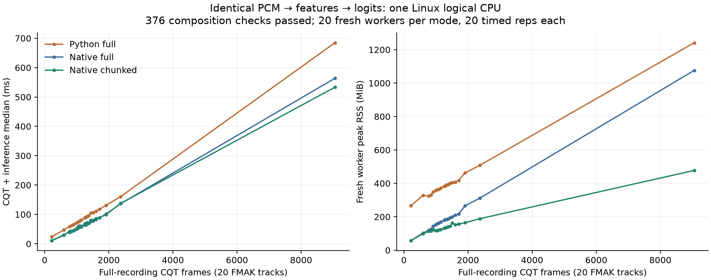
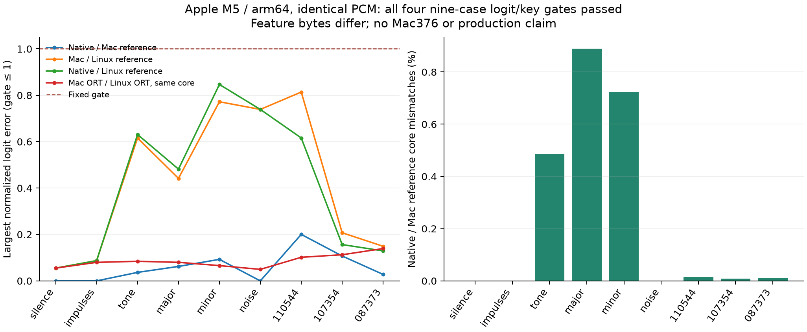
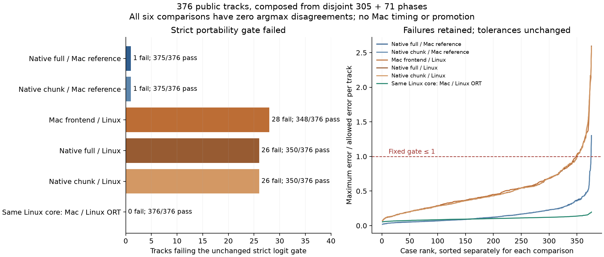
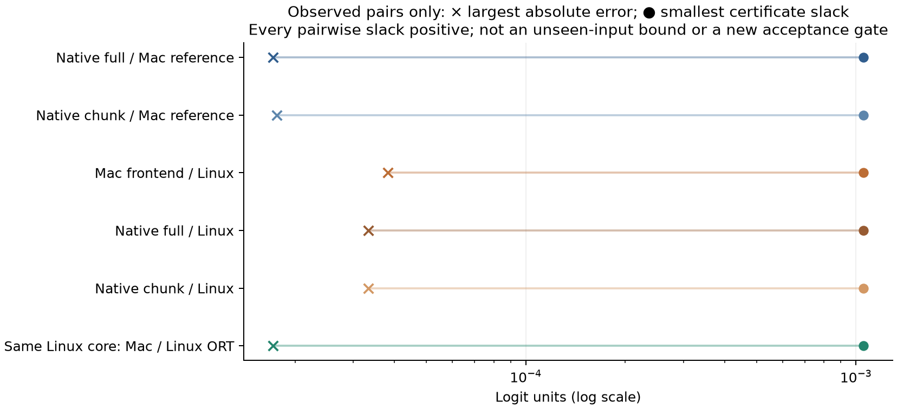
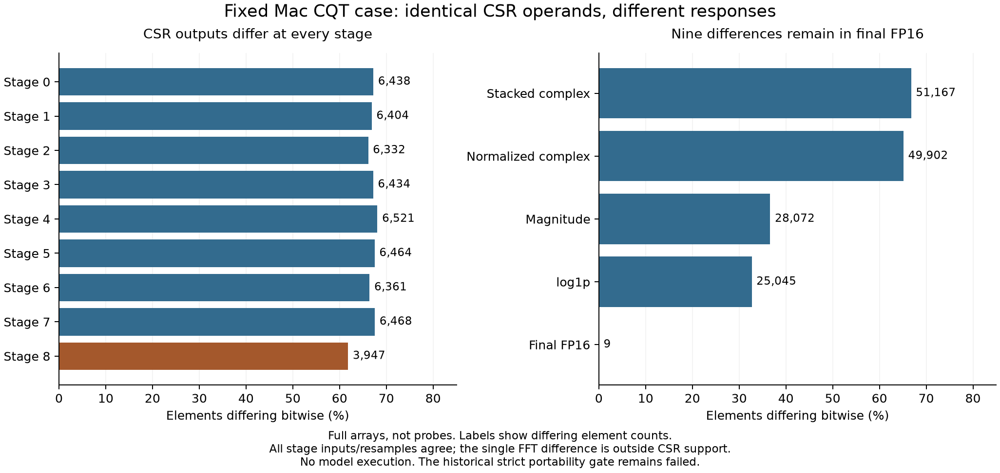
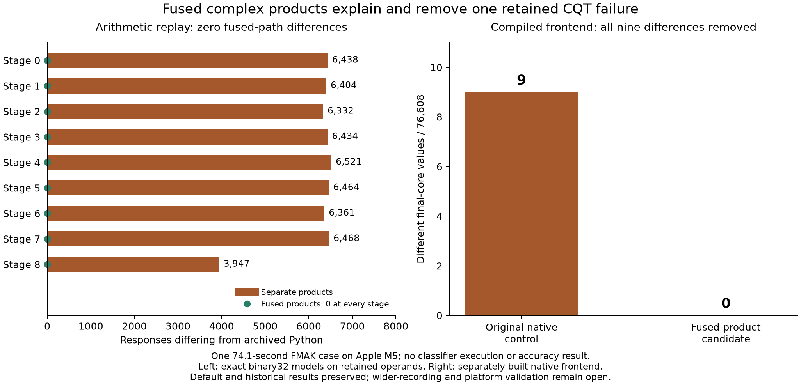

# Native CQT composition and cross-platform CPU portability

## Problem and result

A cached-feature benchmark does not establish that a native frontend preserves
the released classifier, nor measure its memory cost. This study composes the
captured CQT frontend with the unchanged full and chunked ONNX paths, and tests
whether the platform math transfers to an Apple M5 CPU without x86 SVML.
The M5 is a test host, not a hardware requirement for Drone or Euphoria.

The expanded Mac diagnostic now covers all **376 public tracks**, composed from
disjoint 305- and 71-case phases. Strict logit qualification failed: native full
and chunk each passed 375/376 against the actual Mac reference. All six comparison
families nevertheless had **zero argmax disagreements**. The original tolerances
remain unchanged; no Mac timing or promotion followed.
A later fixed-case frontend trace reproduced both archived feature arrays and
located the first observed difference at the sparse response, with identical input
and FFT operands. The [boundary diagnostic below](#fixed-case-boundary-trace-november-13-1246-utc)
reports that finding. A subsequent [fused-product candidate](#compiled-fused-product-candidate-removes-the-fixed-case-error-november-13)
now reproduces all 76,608 reference core values on this one recording. The
original control still reproduces its nine differences; the 376-track portability
verdict is unchanged until the new candidate undergoes wider qualification.

On Linux, the new compute-only API passed nine goldens and all **376 public
validation tracks**. Every FP16-roundtripped core hash matched the canonical
reference. Native full logits were bitwise equal to the reference; chunked logits
had maximum absolute error **1.90735e-6**. Both had **zero key changes**. No labels
were used. Qualification includes FMAK and Beatport; the fixed performance subset
contains **20 FMAK tracks and no Beatport tracks**.

On those 20 tracks, native full and chunked paths lowered median paired latency
by **27.19%** and **26.92%** versus Python full, and median paired worker peak RSS
by **53.11%** and **64.94%**. Chunking added **0.897%** median paired latency versus
native full while reducing median paired peak RSS by **25.85%**. The longest
case still reached **477.5 MiB** with chunking: PCM and frontend allocations
remain material. This is not the earlier cached-only memory result.



The figure relates fresh-process peaks and within-worker medians to exact CQT
frame counts, making long-input costs visible. It does not show model-only latency. All timing workers were restricted to Linux logical CPU2. A separate
late observer saw two OS threads restricted to that CPU; it did not sample every
worker. All four numeric thread environment variables were 1.

| Mode | Median track median | p95 track median | Median worker peak | Maximum worker peak |
| --- | ---: | ---: | ---: | ---: |
| Python full |90.791 ms |186.535 ms |383.783 MiB |1241.738 MiB |
| Native full |64.985 ms |157.664 ms |181.264 MiB |1076.336 MiB |
| Native chunked |67.063 ms |157.219 ms |132.838 MiB |477.500 MiB |

These summary medians are not used to calculate paired effects. Per-track ratios
are calculated first, then their median. p95 uses linear interpolation across 20
track medians. The frozen composed protocol required a visible paired improvement
with full correctness. The older program target of 2× maximum RSS reduction and
≤10% latency regression was not a numeric preregistered gate for this stage;
maximum native-full/native-chunked RSS happened to improve 2.254×.

## Method

The shared `PreparedPlan` preloads verified CSR/FFT constants and each track's
normalization/resampling plan. Its compute path performs CQT, original log1p and
FP16 roundtrip, then either unchanged full ONNX or the qualified overlap/trim
prefix, FP64 hidden mean and unchanged tiny ONNX head. Linux uses FMA-ratio
magnitude plus the pinned upstream SVML kernel. Mac uses FMA-ratio magnitude plus
platform log1p, with actual Mac-captured constants and exact-revision task-local
libsoxr. No NumPy/Python runtime is called by native inference.

All 376 PCM inputs were recreated from SHA-verified public audio through the
original decode/PCM preparation; PCM hashes had to match the archived canonical
references. Canonical CQT hashes and logit vectors were reused, not regenerated. Qualification ran on CPUs4–5/env1 and explicitly exercised the new
prepared API with full and chunked inference. It passed before timing. The
qualification and timing reports have identical source/config/artifact bindings,
including the supervisor and CPU-session source hashes. No numerical source
changed between them.

Timing used 60 fresh workers: Python full, native full and native chunked for each
of 20 fixed tracks, with mode order rotated by track. Each worker loaded the same
PCM before timing, warmed once, then performed 20 timed repetitions. Timers cover
CQT→FP16-roundtripped core→logits. Decode, input reads, session/plan setup, kernel
hashing, evidence JSON/probes and output integrity comparisons are outside the
timed region; returned-input/API checks remain inside the compute calls. Python's
normal CQT filter construction remains in its timed API; native plan construction
is setup. This measures the usable prepared native API, not just identical
low-level operator work. Every timed iteration retained core-hash, finite/logit
and key checks outside its timer. RSS covers the complete fresh worker lifetime,
including setup, PCM, frontend and inference, rather than only the timed region.

The Linux host was AMD Ryzen Threadripper PRO 9955WX. ORT 1.31.1 CPU only used
intra/inter 1, sequential execution and disabled spinning. Both paths used the
same unchanged model.
Source/binary/library/config/hardware bindings and every raw report are in the
[lossless evidence index](evidence/index.json). No ML runtime download is needed
for the evidence/unit tests.

Qualification consumed 218.19 aggregate child CPU seconds and 269.87 wall seconds;
timing consumed 162.55 child CPU and 168.74 wall seconds. Both completed before the
authorized 2026-11-12 08:30UTC deadline. The stage used the reviewed 1200/1500s
qualification and 1800/2100s timing CPU/wall limits, 2 GiB monitored tree RSS/storage
limits, and streamed/deleted each track spool. These are research-supervisor
observations and stops, not a universal allocation bound.

## RSS unit erratum and reproducibility

**The immutable native `pipeline` reports mislabeled KiB as `peak_rss_bytes`.**
In the measured implementation, `drone_native_cached::process_usage()` returns KiB on
both platforms (Linux ru_maxrss directly, Darwin ru_maxrss/1024). `pipeline` stored
that value unchanged under a byte field. All native peak RSS values in this
report/checker are recovered as **raw ×1,024**. Original bytes, SHA values and
server artifacts are preserved. Python peak values, loaded-RSS values and
supervisor sampled tree RSS already use bytes and are not multiplied.

[The checked summarizer](summarize.py) verifies compressed and decoded bundle
hashes, every raw-file hash, track/repetition counts, qualification identity and
peak ≥ loaded RSS. A separate lossless bundle retains all 376 original input
manifests: their hashes bind the recorded native reports, reference logits and
core identities. The checker independently checks all qualification and timed
logit vectors, both native backends, and every Mac contrast against the fixed
tolerance and key requirements. Its regression fixes the known 105,408 KiB → 107,937,792 byte example.
The post-measurement source fixes future reports by checked conversion once and
labels their format v2 with an explicit byte unit. Historical recovery refuses
other source identities/formats, preventing accidental double conversion. This
repair was not used to produce these measurements; no numerical benchmark was
rerun for it. Any future execution must bind the rebuilt executable.

Historical execution sources are preserved at the
[native compute tag](https://github.com/lvndry/euphoria/tree/research/cqt-composed-compute-20261112),
[Linux controller tag](https://github.com/lvndry/drone/tree/research/cqt-composed-linux-20261112)
and [Mac controller tag](https://github.com/lvndry/drone/tree/research/cqt-mac-nine-20261112).
Use those frozen identities for historical replay. The publication branch's
reporting repair is a later implementation, not the measured executable.

```sh
python3 research/drone-native-cqt/composed/summarize.py
python3 -m unittest discover -s research/drone-native-cqt/composed -p 'test_*.py'
uv run --script research/drone-native-cqt/composed/plot_results.py
```

The bundles preserve original UTF-8 file bytes losslessly, including native's
incorrect field name, with SHA256 for every file and for compressed/decoded
bundles. Figures derive from those verified bytes and the documented unit
recovery. PNG and SVG are adjacent to this report.

## Apple M5 nine-case diagnostic

Mac processing used the same six synthetic and three public canonical PCM arrays,
without new decoding or SVML. Exact preflight versions matched Linux:
librosa 1.0.0, NumPy 2.5.4, SciPy 1.18.1, python-soxr 1.1.0, ORT 1.31.1. The verified
166-file vendored soxr tree was built task-locally, Release/shared/OpenMPoff,
jobs ≤2, with no installation or production change. Source/compiler/CMake/library
hashes, dependency resolution and LGPL 2.1-or-later provenance are preserved.

All nine cases passed every named comparison using the unchanged finite/shape,
`abs(delta) ≤1e-5 +1e-5*abs(reference)` and zero-argmax-change gates:

| Comparison | Cases passed | Maximum absolute logit error | Key changes |
| --- | ---: | ---: | ---: |
| Native Mac / actual Mac Python |9/9 |7.153e-6 |0 |
| Actual Mac Python / canonical Linux |9/9 |2.027e-5 |0 |
| Native Mac / canonical Linux |9/9 |1.407e-5 |0 |
| Canonical Linux core through Mac ORT / Linux ORT |9/9 |1.335e-5 |0 |

The relative term allows some absolute errors above 1e-5. These are not bitwise
comparisons. Native/Mac reference cores differed at 303 of 2,048,256 values;
feature max/RMS and per-case mismatches remain in the raw comparisons.



The Mac reference and native workers consumed 10.65 and 2.84 child CPU seconds,
respectively, with 9.33 and 2.95 wall seconds. These are instrumented diagnostic
worker costs, not performance results. Sampled owned-tree peak RSS was
1,268,514,816 bytes. There was one numeric worker, thread variables and VECLIB set 1;
macOS offers no Linux-style hard affinity here. The retained executor completed
exit 0 before 08:00 UTC. An earlier detached launch was cleaned up before any stage
existed; its empty log and absent PID were investigated, and the retained session
is the authoritative execution record.

## Mac376 problem and prospective method

The nine-case diagnostic was too small to establish portability on real recordings.
The expansion reused the fixed 376 public inputs, unchanged released model,
actual Mac Python CQT, prepared native full/chunk APIs, and canonical Linux
cores/logits. It used no key labels, private audio, truncation, new tolerances or
performance measurements. This is a numerical portability study, not an accuracy
evaluation. Each comparison requires 24 finite logits,
`abs(delta) ≤ 1e-5 + 1e-5*abs(reference)`, and unchanged argmax.

Each track was transported alone: exact S16-derived PCM and the already
FP16-roundtripped canonical core were packed losslessly as int16 and FP16, then
reconstructed with independent SHA checks. This introduces no new quantization.
Each track used a fresh worker; the actual prepared and timed API source versions
were bound prospectively. The new reporting executable uses explicit byte RSS;
the earlier KiB erratum remains confined to its historical evidence.

Three prospective stages remain distinct:

| Stage | Terminal outcome | Reported coverage | Resource evidence |
| --- | --- | ---: | --- |
| Initial attempt (v2) | Controlled SIGINT: supervision overhead made completion implausible | 11/376; excluded from final composition | Last complete checkpoint: 326.53 CPU s, 299.43 wall s |
| Reduced supervision overhead (v3) | Fixed 1,800 CPU-second resource stop | 305/376, indices 0–304 | Trigger 1,800.213 CPU s; terminal 1,810.651 s including cleanup/reaping |
| Remaining tracks (v4) | Complete remainder; exit 1 because strict numerical gates failed | 71/71, indices 305–375 | 554.711/600 CPU s, 531.486 wall s; sampled peak 1,340,243,968 bytes |

V2 was not silently restarted. V3 changed only supervisor sampling: process trees
at approximately 0.1 seconds, disk scans at approximately 1 second, with fresh
boundary checks. It preserved numerical worker/transport/native code. V4 was a
new finite protocol for the exact reported complement, chosen independently of
pass/fail. It retained the v3 resource failure and counted no reported case twice.
V3 worker 305 completed but was not appended before the cap check; its original
orphan evidence remains separate. V4 explicitly recomputed that ID. All six gate
records and three core hashes matched its original orphan exactly. Only the v4
outcome enters the final 305 + 71 composition.

V4 reused the proven nine only after numerical source, executable, model/library,
input and stable runtime identities matched. Mac CPU limits were 1,800 seconds
for v3 and 600 for v4; each phase retained 2 GiB sampled tree RSS and 2 GiB combined
logical disk across all old/new Mac roots. Server limits remained 400 CPU seconds,
1 GiB sampled RSS and 512 MiB new-root disk, on CPUs 14–15/env1. V4 server
consumed 63.399 CPU seconds and peaked at 419,065,856 bytes. All owned processes
terminated and the four protected vLLM process start identities were unchanged.
These are diagnostic costs, **not inference timings**, and sampled RSS is not an
instantaneous allocation guarantee.

## Mac376 results

The exact-disjoint verifier checked the full ordered union, raw native vectors,
input/core witnesses and all six original gates. Complete diagnostic coverage
was achieved; **strict portability qualification failed**.

| Comparison | Strict passes | Failed logit elements | Argmax disagreements |
| --- | ---: | ---: | ---: |
| Native full / actual Mac reference | 375/376 | 1 | 0 |
| Native chunk / actual Mac reference | 375/376 | 1 | 0 |
| Actual Mac frontend / canonical Linux | 348/376 | 47 | 0 |
| Native full / canonical Linux | 350/376 | 39 | 0 |
| Native chunk / canonical Linux | 350/376 | 39 | 0 |
| Canonical Linux core: Mac ORT / Linux ORT | 376/376 | 0 | 0 |



Thirty-three distinct tracks failed at least one logit gate. The native-versus-Mac
failure is `fmak:091711`, G-major component: reference −0.2216097116, full error
1.5899539e-5 versus allowed 1.2216097e-5 (ratio 1.3015). This is not simply a
near-zero-reference issue. The worst frontend gate ratio was 2.5943; the largest
Mac/Linux frontend absolute error was 3.8147e-5. Of 126 reference elements with
absolute value ≤0.1, five failed Mac/Linux and six failed each native/Linux
comparison; none failed native/Mac. All seven elements with absolute reference
≤0.01 passed. These post-hoc buckets describe errors and do not alter acceptance.

All six families retained the same argmax on all 376 tracks. The
[root-observed certificate and independent receipt](evidence/mac376-index.json)
also check a stronger arithmetic statement about these saved pairs. For reference
logits r, observed logits a and reference winner w, define e_i = |a_i − r_i|.
Every competitor j has positive slack
`r_w − r_j − e_w − e_j`; the minimum across all cases/families is
**0.0010512024**. The independent receipt exactly recomputed all claimed fields.
This uses observed errors, not a bound on future errors, and establishes neither
unseen-input stability nor key-label accuracy. It does not relax the failed gates.



The figure compares each family’s extrema across tracks; its endpoints need not
come from the same track. It does not draw a per-track unseen-error bound.

All nine stages’ CSR bases, indices and indptr arrays were byte-identical between
Mac and Linux for every track. Exactly three normalization lengths differed by
one float64 ULP. These witnesses narrow the numerical differences; they do not
prove that changing normalization, kernels or a particular math routine would
fix any failure. No such intervention was measured.

## Mac376 evidence and reproduction

The [Mac376 index](evidence/mac376-index.json) binds a deterministic gzip bundle
with exact decoded/original-file SHA256 values. It retains all 376 raw native
reports and complete saved comparison vectors, stage terminal reports/configs,
source text, root certificates and the original independent receipt bytes.
Compact CSR/normalization witnesses retain every original Mac-manifest hash;
representative full manifests include the native/Mac failing case. Larger PCM,
CSR arrays and complete per-track plan artifacts remain unchanged in their
original owned roots; this publication does not copy an audio corpus.

The [reproducibility record](../../report-provenance.json) identifies the
source for each attempt, the native executable and the original combined
diagnostic. Compression and publication preserve the original evidence.

```sh
# Saved metadata/vector arithmetic only: no model, audio or ML runtime needed.
python3 research/drone-native-cqt/composed/summarize_mac376.py
python3 -m unittest discover -s research/drone-native-cqt/composed -p 'test_*.py'
uv run --script research/drone-native-cqt/composed/plot_mac376.py
```

For an artifact-level replay in the retained frozen v4 source and original roots:

```sh
python -m tools.cqt_mac376_remainder combine \
  --proof /tmp/euphoria-native-cqt-mac376-v4/remainder-proof.json \
  --config /tmp/euphoria-native-cqt-mac376-v4/qualification-configs/mac.json \
  --report /tmp/euphoria-native-cqt-mac376-v4/qualification/report.json \
  --output /tmp/mac376-rechecked-disjoint.json
```

This command reads saved artifacts and performs no audio or model work. The
publication verifier independently recomputes gates/certificates and checks the
retained original native report vectors.

## Decision and limits

The prepared Linux frontend→full/chunked API is qualified on the fixed 376 public
tracks, and its 20-case FMAK performance improvement is measured. Preserve both
paths and prefer chunked inference for long inputs. The complete frontend still
materializes PCM and CQT arrays, so production memory requires further work.

The Mac expansion now has complete **disjoint diagnostic coverage**, not a
successful single 376-case run. Strict logit gates failed despite zero observed
argmax disagreements. No Mac timing or promotion followed. Ordinary-PC deployment
remains the product goal; neither an M5 nor the research GPU is an inference
requirement. These data establish neither other-PC parity nor production readiness.

The composed proof starts from pinned FFmpeg-produced 22,050 Hz S16-derived PCM;
decode is outside the timing region. It does not qualify Euphoria
Symphonia/mixdown/resampling on original files, and Drone inputs must not silently
inherit libkeyfinder tuning correction. Public full-length house/deep/melodic-house
accuracy, calibrated Drone confidence, bounded warm sessions, and engine/model
cache identity require separate evidence. Existing libkeyfinder confidence
thresholds cannot be applied to softmax top1-minus-top2 margins without calibration. No final-result cache, Euphoria production key detector,
default dependency/MSRV, model weights or training changed.

## Boundary observer import closure and failed build qualification (November 13)

The boundary observer adds exact bindings for all local Python trace-support
imports and package initializers, the interpreter pathname, and the absence of
PYTHONPATH/PYTHONHOME. Thirteen tiny synthetic checks, Ruff format/lint and ty pass.
No transform or model runs in those tests. The shared editable test environment
contributes an extra `tools` namespace; actual trace admission correctly rejects
that environment. Tests isolate their import search without modifying shared pth
files. A complete actual Python trace runtime remains unqualified.

The separately [frozen build protocol](BOUNDARY_BUILD_PROTOCOL.md) authorized one
local offline build, with a private cache rather than shared Cargo mutations.
The 68-package lockfile has two local packages and 66 registry packages. All
required cached crates, archives and sparse-index entries were copied and
hashed; their private copy occupied 70,764,137 bytes within the total 512 MiB cap.
The macOS ownership probe verified exact process-start identities, live resident
memory and reaped-child CPU counters before compilation. The initial metadata
preparation launcher, `/usr/bin/python3`, lacked tomllib and exited before target
creation or any compiler process; the existing `/usr/local/bin/python3` 3.14.5
then performed preparation and was pinned in the actual build plan. No package
was installed and no environment was changed.

**The single build attempt failed operationally; build qualification was not
achieved.** The original build plan is retained in the linked evidence archive.
The build window began at 07:37:56 UTC. The supervisor tracked the worker and
compiler as an isolated process group.
After 2.692619 seconds, the guardian's owned-output scan attempted to stat a
transient Cargo `.rcgu.o` file that had just been removed. It treated that
FileNotFoundError as a failure and terminated only its verified owned process
group. This is not a compiler, numerical parity or CPU-portability finding.
No retry, cap extension, trace execution, PCM transfer, decoding or model call
followed. The loader inspection stage was not reached.

At failure, sampled aggregate RSS was 255,049,728 bytes, conservatively sampled
CPU usage was 2.381104 seconds, and owned outputs totaled 76,464,031 bytes. These
are sampled measurements, not an exact transient peak or complete final CPU
accounting. Post-failure verification found no remaining owned-group processes;
all bound source/toolchain files, copied shared-cache inputs and shared Cargo
metadata remained byte-identical, as did the old pipeline binary.

The [evidence archive](boundary-build-v1-evidence.tar.gz) contains the prospective
plan, complete input/copy hash inventory, source commit, exact build argv and
clean environment, launch identities, original logs/controller and post-failure
checks. It contains neither audio nor compiled artifacts. The original guardian
source is preserved separately from the repair; its identity is in the
[reproducibility record](../../report-provenance.json). Its original
receipt and evidence archive are unchanged. The [current guardian](qualify_boundary_build.py.txt)
now ignores only `ENOENT` when an already-enumerated output file disappears during
size sampling. Other errors, symlink checks and the original resource caps remain.
A regression covers both disappearance and non-ENOENT failures. The prospective
v2 build uses a fresh `/tmp/drone-cqt-boundary-build-v2` root with new source
bindings. When the repair was written, that new build had not yet been prepared
or executed. No build success,
frontend parity or performance improvement is claimed from the scanner repair.


## Repaired offline build qualified (November 13, 10:04–10:06 UTC)

**Problem.** The first build monitor failed when Cargo removed a temporary object
between directory enumeration and `stat`. This prevented us from qualifying the
boundary observer; it was not a numerical CQT failure.

**Method.** The repaired build supervisor ignores only `ENOENT`
for an already-enumerated output. Permission, I/O, non-directory and symlink errors
remain fatal. Six regressions cover these distinctions. Root prepared and reviewed
a new private cache and hash-bound build plan, then ran one offline, locked release
build of `boundary_trace`, with one Cargo job and nice 19. All original resource
limits were retained; the failed v1 run remains unchanged.

**Result.** The guardian recorded `COMPLETE`, with successful compilation and
post-build dependency inspection. It verified unchanged source/toolchain bytes,
shared Cargo cache inputs and metadata, private copied inputs, and the original
pipeline binary. The resulting diagnostic executable was **not executed**.

| Measurement | Observed | Declared limit |
|---|---:|---:|
| Wall time, including post-build inspection | 147.37 s | 360 s |
| Terminal guardian/reaped-child CPU | 197.23 CPU-s | 300 CPU-s |
| Sampled aggregate process-tree RSS peak | 482.39 MiB | 1,024 MiB |
| Owned output at terminal scan, including private cache | 224.15 MiB | 512 MiB |
| Private copied cache at admission | 67.49 MiB | <128 MiB |

RSS is sampled, not an exact OS peak. One Cargo job does not imply one active
thread throughout compiler/linker execution. The terminal cumulative CPU value
includes completed children; the earlier sampled live-process counter is not
substituted for that total.

The [successful-build evidence archive](boundary-build-v2-evidence.tar.gz)
preserves the plan, controller and worker receipts, logs, input hashes and exact
source snapshots. Their checksums are retained in the
[reproducibility record](../../report-provenance.json). The built binary is
1,799,584 bytes; it remains a local diagnostic artifact and is not bundled in
the repository.

**What this establishes.** The build and inspected loader identities are now
qualified. It does not establish frontend parity, a faster inference result or a
new model accuracy result. No audio was decoded, no model or ORT session was
initialized, and no tolerance changed. The next numerical trace still needs the
pinned PCM witness and an unambiguous Python import/runtime closure described in
[the trace protocol](BOUNDARY_TRACE_PROTOCOL.md). Euphoria remains untouched.


### Source identity after CI lint repair

The successful build receipt above qualifies the archived source snapshot
and binary, before the later CI repair that names the stage-response tuple type
in `src/plan.rs`. That repair addresses Clippy's type-complexity diagnostic; it
does not alter the FFT, accumulation, normalization, magnitude or log operations.
The original archive and built binary are preserved unchanged. The current source
has a different hash and is subject to CI validation; the old build receipt must
not be presented as a build of that newer source. Any numerical trace must bind
the actual executable to its archived source, or separately qualify a newly built
executable. This lint repair did not rebuild or execute either native binary.


## Fixed-case boundary trace (November 13, 12:46 UTC)

Both trace implementations reproduce their own archived final core exactly. On the fixed case
`fmak:091711` (399 frames), the first observed difference is **stage 0’s complex64 CSR response**.
Its complete input, pre-CSR FFT spectrum, CSR values, column indices and row pointers are bitwise
identical between implementations. This narrows the investigation to sparse complex arithmetic; it
does not yet identify the differing instruction or rounding rule.

The trace executed the qualified frontend-only observers on the exact recovered PCM witness. Its
Python import/runtime closure and archived pre-lint native source were bound before execution. A
first metadata preparation attempt rejected a mismatched namespace origin; a separately recorded
correction bound the actual source path and passed before either frontend ran. Both receipts remain
preserved. The frozen [trace protocol](BOUNDARY_TRACE_PROTOCOL.md) is unchanged.

At this trace-analysis stage, only retained arrays were read: no candidate change, model,
scoring or tolerance change followed. The later arithmetic replay and compiled candidate are
reported separately below. The original strict parity gate remains failed.

### Coverage and results

All 260 artifact references were checked against shape, dtype, byte length and SHA256, covering 171
unique blobs. All 89 native records were compared, including **41 full arrays** and 48 probes. The
27 CSR source blobs match the independently observed Python CSR blobs. The original manifest’s
normalization lengths match Python’s captured lengths bitwise. No nonfinite values occurred.



All nine complete stage inputs and all seven complete recursive resampling outputs are bitwise
equal. Eight complete FFT spectra are bitwise equal. Stage 5 has one differing imaginary component,
at frequency bin 251/frame 60, with absolute difference 7.45058e−9. **No row of that stage’s CSR
matrix uses frequency bin 251**, so this observed FFT discrepancy does not enter any retained
response.

| Stage | Different complex CSR responses / total | Maximum complex absolute difference |
| --- | ---: | ---: |
| 0 | 6,438 / 9,576 | 5.33120e−7 |
| 1 | 6,404 / 9,576 | 3.01578e−6 |
| 2 | 6,332 / 9,576 | 5.72205e−6 |
| 3 | 6,434 / 9,576 | 1.52588e−5 |
| 4 | 6,521 / 9,576 | 1.70598e−5 |
| 5 | 6,464 / 9,576 | 3.41197e−5 |
| 6 | 6,361 / 9,576 | 1.25827e−4 |
| 7 | 6,468 / 9,576 | 2.45302e−4 |
| 8 | 3,947 / 6,384 | 3.14568e−5 |

Stacking introduces no further change: each captured pre-normalization matrix is exactly the
corresponding reversed stage-row concatenation and core-bin slice. The captured square-root scales
differ by one float64 ULP in seven of 192 bins (maximum absolute difference 1.42109e−14). These are
differences in the executed square roots of identical lengths, distinct from the previously observed
cross-host length differences.

| Full terminal boundary | Different values / 76,608 | Maximum absolute difference |
| --- | ---: | ---: |
| Stacked complex response | 51,167 | 2.45302e−4 |
| Normalized complex response | 49,902 | 1.96605e−6 |
| Magnitude | 28,072 | 1.90735e−6 |
| log1p | 25,045 | 2.98023e−7 |
| FP16 / widened final core | 9 | 9.765625e−4 |

For every element where the preceding captured value is bitwise equal, the next terminal value is
also equal: zero new differences in normalized values, magnitude, log1p or FP16 conditional on equal
preceding values. This is an observation on this case, not proof those operations are universally
equivalent. Magnitude and log rounding can still affect already-unequal inputs; this conditional
check only excludes newly differing outputs where captured inputs agree.

All nine unequal FP16 locations already have unequal stacked CSR responses, and **all nine use
bitwise-equal normalization scales**. They occur at zero-based core `(bin, frame)` coordinates
`(11,4)`, `(34,180)`, `(36,151)`, `(56,46)`, `(72,328)`, `(100,55)`, `(102,115)`, `(123,163)`,
`(159,171)`. Their coordinates and response-stage mapping are retained in the public machine record; complete
boundary values remain in the original private arrays. The single unused FFT-bin difference and seven scale differences do not explain these nine
elements.

### One next numerical hypothesis

**Hypothesis to test:** the pinned SciPy sparse implementation and Rust’s ordered `num_complex`
multiply/add may evaluate complex64 products or accumulations with different contraction/rounding. The executed Rust source
performs `sum += basis[index] * spectrum[indices[index]]` in CSR order. Identical operands with
different output make this the highest-value next numerical question; FFT or resampler replacement
is not supported by these observations.

A separately bounded follow-up should replay only the captured CSR operands and compare the complex
product/accumulator sequence, beginning with stage 0, to determine whether product evaluation or
accumulation is responsible. It should preserve the current reference, thresholds and failure, and
load no audio transform or model. This analysis has **not** performed that replay and does not claim
that FMA, summation order or a particular library is proven responsible.

### Scope and provenance

The original trace controller reports 6.3265 seconds wall, 6.4622 CPU seconds, 338,526,208 bytes
sampled peak process-tree RSS (322.84 MiB), and 34,165,163 owned output bytes (32.58 MiB). These are
instrumented diagnostic costs, not inference performance or ordinary-PC qualification. Both workers
completed with no model/scoring invocation.

The runtime proof retains all four historical gaps: actual historical SciPy FFT backend, JIT
runtime, system math and RustFFT dispatch. Reproducing both archived cores admits this diagnostic
for the historical counterexample; it does not retroactively close those gaps or establish general
parity.

The [aggregate evidence](boundary-trace-results.json) retains all full-array/probe error summaries
and final difference coordinates without publishing audio or feature values. [Technical
provenance](boundary-trace-provenance.json) binds the original traces, runtime proof, preparation
failures, exact source files, executable and private receipts without exposing operational paths.
The original arrays and receipts remain immutable; this sanitized publication is not a lossless
replacement for them.

The [checker](summarize_boundary_trace.py) verifies the published metadata without NumPy or model
dependencies. With the original private trace root and NumPy available, its optional replay rechecks
all array hashes and comparisons, CSR input identities, stacking, conditional terminal differences,
final coordinates, scales and the unused FFT bin. No transform or model is imported. The [figure
script](plot_boundary_trace.py) reads only verified aggregate metadata.

```sh
python3 research/drone-native-cqt/composed/summarize_boundary_trace.py
python3 -m unittest discover -s research/drone-native-cqt/composed -p 'test_*.py'
uv run --script research/drone-native-cqt/composed/plot_boundary_trace.py
# Optional: replay retained arrays in the original private trace root (needs NumPy).
python3 research/drone-native-cqt/composed/summarize_boundary_trace.py --trace-root "$TRACE_ROOT"
```

## Sparse-product rounding explains the retained responses (November 13)

The follow-up isolated the difference **inside complex multiplication**, before
the completed product is added to the accumulator. The installed SciPy sparse
kernel uses a fused multiply-add within each complex product. The native source
rounds its component products separately. Both then add the completed complex
product to the running sum separately.

**Method.** Static inspection of the installed sparse kernel justified exactly
two arithmetic paths. An exact integer implementation of binary32 rounding
evaluated both on the captured operands, without a transform, decoder or model.
The first bounded run covered stage 0 and two fixed coordinates: the first
archived mismatch and the first equal nonzero response. All 22 isolated products
and all 22 prefix responses agreed with the fused model. At the mismatch
coordinate, the first product already differed. The equal-output control also
had differing products, but its accumulators later converged; intermediate
differences do not always survive to an output.

A second, prospectively fixed run covered **all eight remaining stages** using
the same two arithmetic implementations. Each model consumed its implementation's
own captured spectrum. Every CSR-used spectrum value was identical; the single
stage-5 FFT difference remained outside the matrix's column support. Each stage's
installed SciPy replay reproduced its archived response before interpretation.

Across all nine stages, the replay covered 1,260,042 complex terms per arithmetic
path and 82,992 response elements, including bins outside the final core:

| Arithmetic model | Differences from archived native responses | Differences from archived Python responses |
|---|---:|---:|
| Separate component products, separate accumulation | **0** | 55,369 |
| Fused operation within product, separate accumulation | 55,369 | **0** |

The response coordinates feeding all nine original FP16 differences also matched
their respective archived responses. This establishes the product-rounding
explanation for this case's sparse responses. This arithmetic-only replay did not establish a corrected whole frontend. The
subsequent compiled-candidate test below answers that question for this one case;
reference behavior on other CPUs and SciPy builds remains unqualified.

| Diagnostic | Wall time | Aggregate CPU | Sampled process-tree RSS |
|---|---:|---:|---:|
| Stage 0 and fixed term checks | 5.44 s | 6.20 CPU-s | 84.33 MiB |
| Fixed stages 1–8 extension | 43.29 s | 47.20 CPU-s | 105.78 MiB |

These are instrumented arithmetic-replay costs, not inference benchmarks. Both
controllers completed within their declared limits and found no surviving owned
processes. [Aggregate results](csr-product-rounding-results.json) and
[technical provenance](csr-product-rounding-provenance.json) retain coverage,
exact-match counts, term-check outcomes and original evidence identities without
publishing operational paths or raw operands.

## Compiled fused-product candidate removes the fixed-case error (November 13)

**Result.** A separately built native frontend reproduces the archived Python
core **bit for bit across all 76,608 values**, after the existing FP16 roundtrip.
Changing only the complex product evaluation removes all nine original
feature differences. The original separate-product control is reproduced
exactly by the same new executable before the candidate is admitted.



**Problem and method.** The retained counterexample is `fmak:091711`: 1,633,354
samples at 22,050 Hz, **74.08 seconds**, and 399 CQT frames. Its genre and BPM are
not established by this numerical packet; it is not evidence about a DJ genre or
long tracks. Both passes read the same retained PCM, captured CSR kernels and
normalization lengths. The candidate rounds the cross terms separately, uses a
fused multiply-add inside each complex product, then adds the completed product
to the accumulator separately. FFT, resampling, accumulation order, magnitude,
logarithm, FP16 boundary and reference all stay fixed. No model is loaded.

| Complete final core against archived Python | Different values / total | Maximum absolute difference |
|---|---:|---:|
| Rebuilt original separate-product control | 9 / 76,608 | 0.0009765625 |
| Explicit fused-product candidate | **0 / 76,608** | **0** |

This closes the causal loop for the retained failure: source inspection predicts
the product-rounding difference; exact arithmetic explains every captured stage;
a minimal native change then removes every final-core difference. The candidate
is exposed only through the explicitly named research method and
[`fused_product_case`](../src/bin/fused_product_case.rs). The ordinary compute,
trace and diagnostic paths retain their original arithmetic. The frozen
[build and fixed-case protocol](FUSED_PRODUCT_PROTOCOL.md) remains an unchanged
record of what was proposed before execution.

The offline build and the single analytical cancellation test passed. The test
also distinguishes fused products from incorrectly fusing the accumulator.
The supervised build used 126.44 seconds wall, 197.65 aggregate CPU seconds and
499.17 MiB sampled process-tree RSS. The two-pass frontend diagnostic used
**0.552 seconds wall, 0.461 aggregate CPU seconds and 58.89 MiB sampled process-tree
RSS**. These include diagnostic work and supervision; they are **not** warmed
per-track inference timings or an ordinary-PC memory guarantee. Both supervised
runs completed within their frozen limits with no surviving owned processes.

The [exact comparison record](fused-product-results.json) and [technical
provenance](fused-product-provenance.json) bind the executed source, private build
snapshot, executable, actual loaded Soxr libraries, input identities, logs and
resource receipts. They contain no operational paths or raw audio/features.
The four historical runtime gaps remain declared. The original negative result
is preserved, and **no classifier accuracy or full-corpus portability result is
claimed**. This is one numerical repair candidate, not a release promotion.

The [checker](summarize_fused_product.py) verifies the published comparison and
can independently read the retained core bytes without a transform or model.
The [figure source](plot_fused_product.py) reads checked aggregate results only.

```sh
python3 research/drone-native-cqt/composed/summarize_fused_product.py
python3 research/drone-native-cqt/composed/summarize_fused_product.py --run-root "$FIXED_CASE_RUN"
uv run --script research/drone-native-cqt/composed/plot_fused_product.py
```

### Next finite validation: the nine retained golden cases

The next proposed step is to freeze **all nine existing golden cases**, rather
than choosing a favorable subset: silence, impulses, tone, major chord, minor
chord, noise, and FMAK recordings `110544`, `107354`, `087373`. The three recordings
contain **40.12, 240.40 and 1,682.26 seconds** of decoded input (about 40 seconds,
4 minutes and 28 minutes); the six synthetic inputs span 1.30–5.76 seconds. These
are numerical fixtures, not a genre-balanced accuracy panel. No genre or BPM
coverage is inferred from their names.

Their existing Mac manifests, PCM, CSR banks, archived Python cores and original
native cores are retained locally. Before execution, bind all identities in a
new packet and admit a new frontend-only nine-case entrypoint. Keep the arithmetic
exactly as tested here; retain the original control and candidate core for every
case. Report every per-case exact hash, differing count and maximum difference,
using the archived **Mac** Python cores as the primary reference. Existing Linux
cores may be reported separately, never substituted to obtain a pass.

Proposed bounds are one sequential worker, numeric threads one, **120 seconds
wall, 90 aggregate CPU seconds, 1 GiB sampled process-tree RSS and 64 MiB owned
outputs/logs**. Existing input artifacts remain read-only; process only one case
at a time. A cap violation or mismatch is a retained failure, not permission to
retry, change arithmetic, drop the long fixture or relax thresholds. The exact
packet and source must be reviewed before execution; no such run is reported here.

Passing these nine cases would justify a separately frozen expansion over the
existing 376 public recordings and cross-platform validation. It would still
not establish improved key accuracy, broad genre coverage, a deployment memory
budget or parity on arbitrary PCs. Full classifier checks and paired performance
measurements follow only after frontend qualification.
